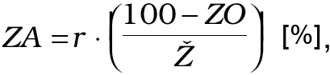

# Čl. I

Vyhláška Ministerstva spravodlivosti Slovenskej republiky č. 492/2004 Z. z. o stanovení všeobecnej hodnoty majetku v znení vyhlášky č. 626/2007 Z. z. a vyhlášky č. 605/2008 Z. z. sa mení a dopĺňa takto:

- 1. V prílohe č. 5 časti A sa vypúšťa deviaty bod.

- Doterajšie body 10 až 16 sa označujú ako body 9 až 15.

- 2. V prílohe č. 5 časti B prvý bod znie:

- „1.

- Základná amortizácia

- Vypočíta sa podľa vzťahu:

- 

- kde

- r – počet odpracovaných rokov [roky]

- ZO – zostatkové percento prevádzkyschopnosti EZ [%]

- Ž – prognózovaná technická životnosť EZ [roky]

- Základnou podmienkou na použitie tohto vzťahu je: r ≤ Ž

- V prípade, že zariadenie je v prevádzke dlhšiu dobu, ako je prognózovaná technická životnosť, t. j. r > Ž, základná amortizácia sa vypočíta podľa vzťahu:

- ZA = VTS – ZO [%],

- kde

- VTS – východiskový technický stav EZ [%]“.

- 3. Za prílohu č. 16 sa dopĺňa príloha č. 17, ktorá znie:

- „Príloha č. 17 k vyhláške č. 492/2004 Z. z.

- STANOVENIE VŠEOBECNEJ HODNOTY AKCIÍ SPOLOČNOSTÍ PODIEĽAJÚCICH SA NA ZLÚČENÍ ALEBO SPLYNUTÍ SPOLOČNOSTÍ A HODNOTY AKCIÍ NÁSTUPNÍCKEJ SPOLOČNOSTI NA ÚČELY ZISTENIA HODNOTY PEAŽNÉHO DOPLATKU ALEBO HODNOTY PRIMERANÉHO PROTIPLNENIA PODĽA ZÁKONA č. 513/1991 Zb. OBCHODNÝ ZÁKONNÍK V ZNENÍ NESKORŠÍCH PREDPISOV

- Všeobecná hodnota jednej akcie sa stanoví ako podiel všeobecnej hodnoty spoločnosti ako celku a počtu vydaných akcií so zohľadnením ich menovitej hodnoty.

- Na stanovenie peňažného doplatku1) pri zlúčení alebo splynutí spoločností sa stanoví všeobecná hodnota spoločnosti podieľajúcej sa na zlúčení alebo splynutí a tiež hodnota nástupníckej spoločnosti. Hodnota peňažného doplatku sa určí ako rozdiel všeobecnej hodnoty akcie spoločnosti podieľajúcej sa na zlúčení alebo splynutí a všeobecnej hodnoty akcie nástupníckej spoločnosti pri zachovaní výmenného pomeru akcií.

- Na stanovenie primeraného protiplnenia2) pri zlúčení alebo splynutí spoločností sa stanoví všeobecná hodnota spoločnosti podieľajúcej sa na zlúčení alebo splynutí.

- Všeobecná hodnota hodnotených spoločností sa stanoví použitím metód uvedených v § 3 tejto vyhlášky, pričom na stanovenie peňažného doplatku alebo primeraného protiplnenia pri zlúčení alebo splynutí spoločností nie je možné použiť likvidačnú metódu. Znalec zhodnotí na základe predložených podkladov vhodnosť a možnosť použitia metód podľa predchádzajúcej vety, pričom v časti posudok3) znaleckého posudku náležite zdôvodní výber metódy alebo metód, ktoré v znaleckom posudku použil, rovnako aj prípadnú nemožnosť alebo nevhodnosť použitia ostatných metód. Po aplikácii viacerých metód sa určenie jednej výslednej všeobecnej hodnoty v závere4) znaleckého posudku zdôvodní.

- Všeobecná hodnota spoločnosti podieľajúcej sa na zlúčení alebo splynutí a všeobecná hodnota nástupníckej spoločnosti, ktoré vstupujú do vzťahu pre výpočet hodnoty peňažného doplatku, musia byť stanovené rovnakou metódou.

- Znalec zohľadní špecifiká hodnotenej spoločnosti a samotného zlúčenia alebo splynutia spoločností pomocou všetkých relevantných podkladov, ktoré požaduje od spoločnosti, ktorej vznikla povinnosť ich poskytnúť.

- Pri stanovení všeobecnej hodnoty spoločnosti sa vychádza z podkladov, ktoré boli znalcovi poskytnuté na vypracovanie znaleckého posudku a ktoré sú platné k požadovanému dňu, pričom

- a) pri spoločnosti podieľajúcej sa na zlúčení spoločností je týmto dňom deň, ku ktorému valné zhromaždenie schválilo návrh zmluvy o zlúčení spoločností,

- b) pri spoločnosti podieľajúcej sa na splynutí spoločností je týmto dňom deň, ku ktorému bolo splynutie zapísané do obchodného registra alebo inej evidencie, a v prípade, keď v čase zadania znaleckého posudku ešte nedošlo k zápisu cezhraničného splynutia do obchodného registra alebo inej evidencie, deň, ku ktorému posledné z valných zhromaždení spoločností podieľajúcich sa na cezhraničnom splynutí schválilo návrh zmluvy o cezhraničnom splynutí spoločností,

- c) pri nástupníckej spoločnosti, ktorá je výsledkom zlúčenia alebo splynutia spoločností, je týmto dňom deň, ku ktorému bolo zlúčenie alebo splynutie zapísané do obchodného registra alebo inej evidencie, a v prípade, keď ešte nedošlo v čase zadania znaleckého posudku k zápisu cezhraničného zlúčenia alebo cezhraničného splynutia do obchodného registra alebo inej evidencie, deň, ku ktorému posledné z valných zhromaždení spoločností podieľajúcich sa na cezhraničnom zlúčení alebo cezhraničnom splynutí schválilo návrh zmluvy o cezhraničnom zlúčení alebo návrh zmluvy o cezhraničnom splynutí spoločností.“.
