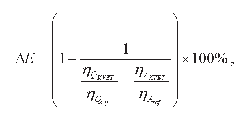
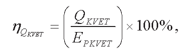
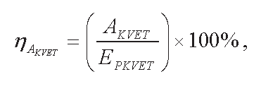

Príloha č. 1 k vyhláške č. 599/2009 Z. z. Hraničné a harmonizované referenčné hodnoty na výpočet množstva elektriny vyrobenej kombinovanou výrobou

Typ technológie kombinovanej výroby | Ukazovateľ kombinovanej výroby C [-]

Spaľovacia turbína s kombinovaným cyklom a s regeneráciou tepla | 0,95

Protitlaková parná turbína | 0,45

Kondenzačná parná turbína s odberom pary | 0,45

Spaľovacia turbína s regeneráciou tepla | 0,55

Spaľovací motor | 0,75

Mikroturbína | 0,50

Stirlingov motor | 0,35

Palivový článok | 1,43

Parný stroj | 0,30

Rankinov organický cyklus | 0,15

Príloha č. 2 k vyhláške č. 599/2009 Z. z.

Spôsob výpočtu úspor primárnej energie

(1) Úspora primárnej energie v zariadeniach na kombinovanú výrobu sa vypočíta podľa vzorca

pričom

ΔE – úspora primárnej energie vyjadrená v percentách,

ηQKVET – tepelná účinnosť kombinovanej výroby vyjadrená v percentách,

ηQref – referenčná hodnota účinnosti samostatnej výroby tepla vyjadrená v percentách,

ηAVET – elektrická účinnosť kombinovanej výroby vyjadrená v percentách,

ηAref – referenčná hodnota účinnosti samostatnej výroby elektriny vyjadrená v percentách.

(2) Tepelná účinnosť kombinovanej výroby sa vypočíta podľa vzorca

pričom

QKVET – množstvo využiteľného tepla vyjadrené v megawatthodinách za rok,

EPKVET – množstvo energie v palive použité na výrobu využiteľného tepla kombinovanou výrobou, výrobu elektriny kombinovanou výrobou a výrobu mechanickej energie kombinovanou výrobou vyjadrené v megawatthodinách za rok.

(3) Elektrická účinnosť kombinovanej výroby sa vypočíta podľa vzorca

pričom

AKVET – množstvo elektriny vyrobenej kombinovanou výrobou vyjadrené v megawatthodinách za rok; ak zariadenie na kombinovanú výrobu vyrába mechanickú energiu, zvýši sa ročné množstvo elektriny vyrobené kombinovanou výrobou o množstvo elektriny, ktoré je ekvivalentné množstvu vyrobenej mechanickej energie,

EPKVET – množstvo energie v palive použité na výrobu využiteľného tepla kombinovanou výrobou, výrobu elektriny kombinovanou výrobou a výrobu mechanickej energie kombinovanou výrobou vyjadrené v megawatthodinách za rok.

Príloha č. 3 k vyhláške č. 599/2009 Z. z.

Vzor mesačnej bilancie výroby a dodávky elektriny, výroby a dodávky tepla a využívania mechanickej energie vyrobenej kombinovanou výrobou

| | Jednotka | Množstvo | Poznámka

Palivo / energia v palive | zemný plyn | m3 | |

| | MWh | |

| hnedé uhlie | t | |

| | MWh | |

| čierne uhlie | t | |

| | MWh | |

| biomasa | t | |

| | MWh | |

| bioplyn | m3 | |

| | MWh | |

| Iné | | |

| | MWh | |

| Spolu | MWh | |

Celková výroba elektriny na svorkách generátorov | Označenie generátora | MWh | |

| | MWh | |

| | MWh | |

| | MWh | |

| Spolu | MWh | |

Technologická vlastná spotreba elektriny | | MWh | |

Elektrina vyrobená kombinovanou výrobou | | MWh | |

Elektrina vyrobená vysoko účinnou kombinovanou výrobou | | MWh | |

Mechanická energia vyrobená kombinovanou výrobou | | MWh | |

Mechanická energia vyrobená vysoko účinnou kombinovanou výrobou | | MWh | |

Teplo vyrobené na zariadeniach na kombinovanú výrobu | | MWh | |

Využiteľné teplo | | MWh | |

Teplo vyrobené na zariadeniach na oddelenú výrobu tepla | | MWh | |

Ukazovateľ kombinovanej výroby | | – | |

Celková účinnosť zariadenia | | % | |

Príloha č. 4 k vyhláške č. 599/2009 Z. z.

Zoznam preberaných právnych aktov Európskej únie

Smernica Európskeho parlamentu a Rady 2004/8/ES z 11. februára 2004 o podpore kogenerácie založenej na dopyte po využiteľnom teple na vnútornom trhu s energiou a ktorou sa mení a dopĺňa smernica 92/42/EHS (Mimoriadne vydanie Ú. v. EÚ kap. 12/zv. 3).
