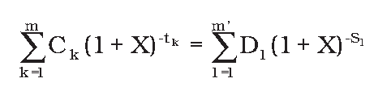
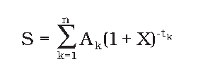

Príloha č. 2 k zákonu č. 129/2010 Z. z.

- I. Základná rovnica vyjadrujúca rovnosť poskytnutého spotrebiteľského úveru na jednej strane a splátok a poplatkov na strane druhej

  - Základnou rovnicou, ktorá vyjadruje ročnú percentuálnu mieru nákladov, kladie do rovnováhy na ročnom základe celkovú súčasnú hodnotu čerpaných prostriedkov na jednej strane a celkovú súčasnú hodnotu splátok a platieb poplatkov na strane druhej, je:

- 

  - Význam symbolov:

- – | X | je ročná percentuálna miera nákladov,

- – | m | je číslo posledného čerpania,

- – | k | je číslo čerpania, preto 1 ≤ k ≤ m,

- – | Ck | je výška čerpania k,

- – | tk | je interval vyjadrený v rokoch a zlomkoch roka medzi dátumom prvého čerpania a dátumom každého nasledujúceho čerpania, preto t1 = 0,

- – | m’ | je číslo poslednej splátky alebo platby poplatkov,

- – | l | je číslo splátky alebo platby poplatkov,

- – | Dl | je výška splátky alebo platby poplatkov,

- – | Sl | je interval vyjadrený v rokoch a zlomkoch roka medzi dátumom prvého čerpania a dátumom každej splátky alebo platby poplatkov.

  - Poznámky:

  - a) Čiastky zaplatené obidvoma zmluvnými stranami v rôznom čase nemusia byť rovnaké a nemusia byť zaplatené v rovnakých intervaloch.

  - b) Začiatočný dátum je dátum prvého čerpania.

  - c) Intervaly medzi dátumami použitými pri výpočtoch sú vyjadrené v rokoch alebo v zlomkoch roka. Rokom sa rozumie 365 dní (alebo 366 dní pri priestupných rokoch), 52 týždňov alebo 12 rovnakých mesiacov. Rovnakým mesiacom sa rozumie mesiac, ktorý má 30,41666 dní (t. j. 365/12), bez ohľadu na to, či je rok priestupný, alebo nie je. Ak je možné intervaly medzi dátumami použitými pri výpočtoch vyjadriť ako celé číslo v týždňoch, mesiacoch alebo rokoch, nie je prípustné vyjadrenie týchto intervalov v dňoch. Ak intervaly medzi dátumami použitými pri výpočtoch nemožno vyjadriť ako celý počet týždňov, mesiacov alebo rokov, intervaly sa vyjadria ako celý počet jedného z týchto období v kombinácii s počtom dní. Pri rozhodovaní o vyjadrení intervalov v rokoch, mesiacoch alebo týždňoch, je nevyhnutné zohľadniť frekvenciu čerpania finančných prostriedkov a splátok. Ak sa použije kombinácia rovnakých období a dní, počíta sa

    - 1. každý deň vrátane víkendov a sviatkov,

    - 2. rovnaké obdobie a potom sa dni počítajú spätne k dátumu počiatočného čerpania,

    - 3. dĺžka obdobia vyjadreného v dňoch; zistí sa odpočítaním prvého dňa a započítaním posledného dňa a vyjadrí sa v rokoch vydelením tohto obdobia počtom 365 dní alebo 366 dní úplného roka počítaného spätne od posledného dňa po rovnaký deň predchádzajúceho roka.

  - d) Výsledok výpočtu sa vyjadruje s presnosťou aspoň na jedno desatinné miesto. Ak sa hodnota číslice na nasledujúcom desatinnom mieste rovná alebo je väčšia ako 5, číslica na danom desatinnom mieste sa zvýši o jeden.

  - e) Táto rovnica sa dá prepísať pomocou jedného súčtu a pojmu tokov (Ak), ktorý bude kladný alebo záporný podľa toho, či vyjadruje výbery alebo vklady v obdobiach 1 až n, a vyjadrený v rokoch, t. j.:

  - 

  - S je súčasný stav tokov; ak je cieľom zachovať rovnováhu tokov, táto hodnota bude nulová.

- II. Dodatočné predpoklady na výpočet ročnej percentuálnej miery nákladov

  - a) Ak zmluva o spotrebiteľskom úvere umožňuje spotrebiteľovi čerpať peňažné prostriedky ľubovoľne, spotrebiteľský úver sa považuje za vyčerpaný okamžite a v plnej výške.

  - b) Ak zmluva o spotrebiteľskom úvere umožňuje spotrebiteľovi čerpať peňažné prostriedky ľubovoľne, ale upravuje medzi rôznymi spôsobmi čerpania peňažných prostriedkov obmedzenia, ak ide o výšku a čas, výška spotrebiteľského úveru sa považuje za vyčerpanú k najskoršiemu dňu dohodnutému v zmluve o spotrebiteľskom úvere a v súlade s týmito obmedzeniami čerpania.

  - c) Ak zmluva o spotrebiteľskom úvere umožňuje čerpanie peňažných prostriedkov rôznymi spôsobmi s rôznymi úrokovými sadzbami alebo poplatkami spotrebiteľského úveru, celková výška spotrebiteľského úveru sa považuje za vyčerpanú s najvyššou úrokovou sadzbou a najvyššími poplatkami spotrebiteľského úveru, ktoré sa vzťahujú na najpoužívanejší spôsob čerpania peňažných prostriedkov pri tomto type zmlúv o spotrebiteľskom úvere.

  - d) Ak ide o povolené prečerpanie, spotrebiteľský úver sa považuje za vyčerpaný v plnej výške a na celú dobu trvania zmluvy o spotrebiteľskom úvere; ak doba trvania povoleného prečerpania nie je známa, ročná percentuálna miera nákladov sa vypočíta na základe predpokladu, že trvanie spotrebiteľského úveru je tri mesiace.

  - e) Ak ide o zmluvu o spotrebiteľskom úvere bez pevne určenej doby trvania, pričom medzi tieto zmluvy o spotrebiteľskom úvere patrí aj zmluva o spotrebiteľskom úvere, ktorý sa musí splatiť úplne v rámci stanoveného obdobia alebo po ňom a až po jeho úplnom splatení je ďalšie čerpanie úveru prípustné a takéto zmluvy o spotrebiteľskom úvere nie sú povoleným prečerpaním, predpokladá sa, že

    - 1. spotrebiteľský úver sa poskytuje na obdobie jedného roka, počnúc dňom prvého čerpania, a že posledná splátka uskutočnená spotrebiteľom vyrovná zostatok istiny, úrokov a prípadných ďalších poplatkov,

    - 2. spotrebiteľ spláca istinu v rovnakých mesačných splátkach so začiatkom jedného mesiaca po dni prvého čerpania; ak sa istina musí úplne splatiť iba jedinou splátkou v rámci každého platobného obdobia, predpokladá sa, že následné čerpania a splácania celej istiny spotrebiteľom prebiehajú počas obdobia jedného roka; úroky a ďalšie poplatky sa použijú v súlade s uvedeným čerpaním a splácaním istiny a v súlade s tým, ako je uvedené v zmluve o spotrebiteľskom úvere.

  - f) Ak ide o zmluvu o spotrebiteľskom úvere inú ako povolené prečerpanie a inú ako zmluvu o spotrebiteľskom úvere bez pevne stanovenej doby trvania uvedenú v predpokladoch ustanovených v písmenách d) a e), použijú sa tieto predpoklady, ak:

    - 1. dátum alebo čiastka splátky istiny, ktorú má spotrebiteľ uskutočniť, sa nedá zistiť, predpokladá sa, že splátka sa uskutoční k najskoršiemu dňu uvedenému v zmluve o spotrebiteľskom úvere a vo výške najnižšej čiastky, ktorá je uvedená v zmluve o spotrebiteľskom úvere,

    - 2. dátum uzatvorenia zmluvy o spotrebiteľskom úvere nie je známy, predpokladá sa, že dňom prvého čerpania je deň, ktorý vyplýva z najkratšieho intervalu medzi týmto dátumom uzatvorenia zmluvy a dátumom prvej platby, ktorú má spotrebiteľ uskutočniť.

  - g) Ak sa dátum alebo výška splátky, ktorú má spotrebiteľ uskutočniť, nedá zistiť na základe zmluvy o spotrebiteľskom úvere alebo predpokladov ustanovených v písmene d), e) alebo písmene f), predpokladá sa, že splátka sa uskutočňuje v súlade s dátumami a podmienkami požadovanými veriteľom, a ak tieto údaje nie sú známe, tak

    - 1. úroky sa platia spoločne so splácaním istiny,

    - 2. poplatky alebo iné náklady vyjadrené jedinou sumou sa platia v deň uzavretia zmluvy o spotrebiteľskom úvere,

    - 3. poplatky alebo iné náklady vyjadrené ako niekoľko platieb sa platia v pravidelných intervaloch, počnúc dňom prvej splátky istiny, a ak výška takýchto platieb nie je známa, predpokladá sa, že ide o rovnaké čiastky,

    - 4. posledná splátka vyrovná zostatok istiny, úrokov a prípadných ďalších poplatkov.

  - h) Ak sa ešte nedohodla maximálna výška spotrebiteľského úveru, za maximálnu výšku spotrebiteľského úveru sa považuje 1 500 eur.

  - i) Ak sa na obmedzený čas alebo pre obmedzenú čiastku ponúkajú rôzne úrokové sadzby a poplatky spotrebiteľského úveru, za príslušnú úrokovú sadzbu a poplatky sa považuje najvyššia úroková sadzba a poplatky spotrebiteľského úveru počas celej doby trvania zmluvy o spotrebiteľskom úvere.

  - j) Ak ide o zmluvu o spotrebiteľskom úvere, pri ktorej sa dohodla fixná úroková sadzba spotrebiteľského úveru na počiatočné obdobie, na konci ktorého sa určí nová úroková sadzba spotrebiteľského úveru a tá sa bude následne pravidelne upravovať v súlade s dohodnutým ukazovateľom, vychádza výpočet ročnej percentuálnej miery nákladov z predpokladu, že na konci obdobia s fixnou úrokovou sadzbou spotrebiteľského úveru je úroková sadzba spotrebiteľského úveru rovnaká ako v čase výpočtu ročnej percentuálnej miery nákladov na základe hodnoty dohodnutého ukazovateľa v tomto čase.
