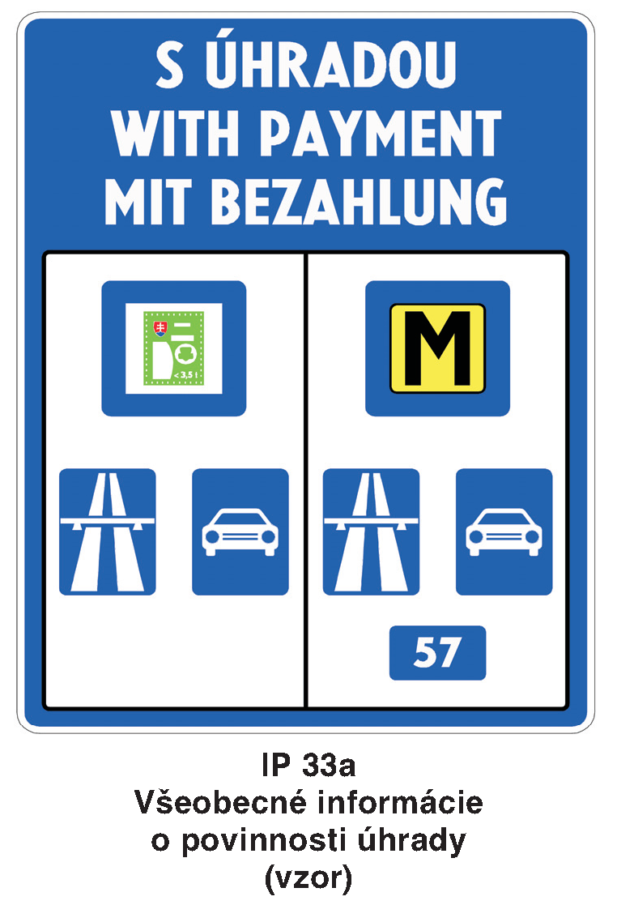
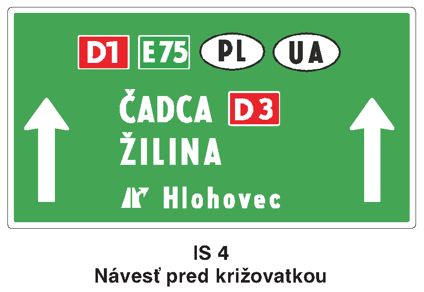
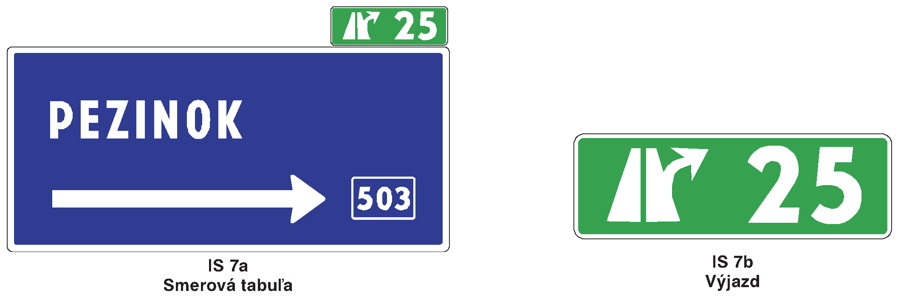
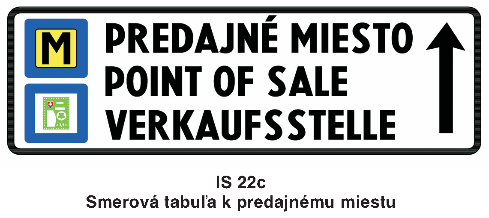
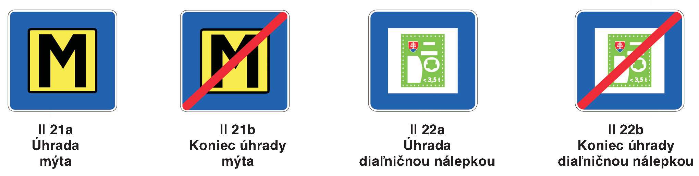
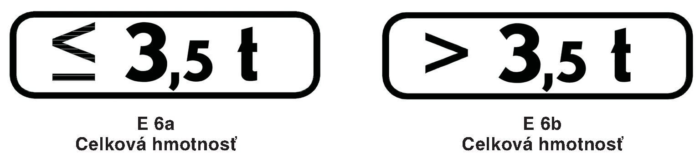

# Čl. I

Vyhláška Ministerstva vnútra Slovenskej republiky č. 9/2009 Z. z., ktorou sa vykonáva zákon o cestnej premávke a o zmene a doplnení niektorých zákonov sa mení a dopĺňa takto:

- 1. V prílohe č. 1 I. diele I. časti bode 5 sa za vyobrazenie dopravnej značky č. IP 33 vkladá vyobrazenie novej dopravnej značky č. IP 33a:

- 

- 2. V prílohe č. 1 I. diele I. časti bode 5 sa vyobrazenie dopravnej značky č. IS 4 nahrádza týmto vyobrazením:

- 

- 3. V prílohe č. 1 I. diele I. časti bode 5 sa vyobrazenie dopravných značiek č. IS 7a a IS 7b nahrádza týmito vyobrazeniami:

- 

- 4. V prílohe č. 1 I. diele I. časti bode 5 sa za vyobrazenie dopravnej značky č. IS 22b vkladá vyobrazenie novej dopravnej značky č. IS 22c:

- 

- 5. V prílohe č. 1 I. diele I. časti bode 5 sa za vyobrazenie dopravnej značky č. II 20c vkladajú vyobrazenia nových dopravných značiek č. II 21a až č. II 22b:

- 

- 6. V prílohe č. 1 I. diele I. časti bode 6 sa za vyobrazenie dodatkovej tabuľky č. E 6 vkladá vyobrazenie nových dodatkových tabuliek č. E 6a a č. E 6b:

- 

- 7. V prílohe č. 1 II. diele čl. 5 ods. 30 a 32 sa slová „ktoré nie sú spoplatnené, sa označujú dodatkovou tabuľkou s textom „BEZ ÚHRADY“ v troch jazykoch.9)“ nahrádzajú slovami „ktorých užívanie nepodlieha úhrade mýtom alebo diaľničnou nálepkou, sa označujú značkami č. II 21b alebo č. II 22b, ktoré sa umiestňujú pod túto značku.“.

- 8. V prílohe č. 1 II. diele čl. 5 sa za odsek 43 vkladá nový odsek 44, ktorý znie:

- „(44)

- K značke č. IP 33a:

- Značka Všeobecné informácie o povinnosti úhrady (č. IP 33a) informuje o úsekoch diaľnic, rýchlostných ciest a ciest I. triedy, ktorých užívanie podlieha úhrade, a o spôsobe ich úhrady.9) Na príslušnej dodatkovej tabuľke možno uviesť ďalšie spresňujúce údaje. Značka č. IP 33a sa používa najmä v kombinácii s dodatkovými tabuľkami č. E 6a a č. E 6b a s dodatkovou tabuľkou č. E 10 s príslušným symbolom druhu vozidla.“.

- Poznámka pod čiarou k odkazu 9 znie:

- „9)

- Zákon č. 135/1961 Zb. o pozemných komunikáciách (cestný zákon) v znení neskorších predpisov a zákon č. 25/2007 Z. z. o elektronickom výbere mýta za užívanie vymedzených úsekov pozemných komunikácií a o zmene a doplnení niektorých zákonov v znení neskorších predpisov.“.

- Doterajší odsek 44 sa označuje ako odsek 45.

- 9. V prílohe č. 1 II. diele čl. 6 odseky 8 a 9 znejú:

- „(8)

- K značke č. IS 7a:

- Značka Smerová tabuľa (č. IS 7a) informuje o cieli (cieľoch) v smere odbočenia a o čísle križujúcej cesty. Pri odbočení na diaľnicu alebo rýchlostnú cestu je podkladová doska zelenej farby. Ak ide o odbočenie na inú pozemnú komunikáciu, farba podkladovej dosky je modrá. Ak je na značke Smerová tabuľa (č. IS 7a) uvedený iba miestny alebo iný cieľ, farba podkladovej dosky je biela a nápisy a šípky (symboly) sú čierne.

- (9)

- K značke č. IS 7b:

- Značka Výjazd (č. IS 7b) informuje o čísle výjazdu, ktoré zodpovedá staničeniu odbočenia z diaľnice alebo rýchlostnej cesty na inú cestu. Základná plocha dopravnej značky je vždy zelenej farby. Umiestňuje sa nad dopravnou značkou IS 2, IS 3, IS 5a, IS 5b, IS 6, IS 7a.“.

- 10. V prílohe č. 1 II. diele čl. 6 sa za odsek 25 vkladá nový odsek 26, ktorý znie:

- „(26)

- K značke č. IS 22c:

- Značka Smerová tabuľa k predajnému miestu (č. IS 22c) informuje o predajnom mieste, kde je možné uskutočniť nákup diaľničnej nálepky alebo palubnej jednotky pre elektronické mýto; značka sa môže použiť aj ako značka predbežná s informovaním o smere, prípadne o vzdialenosti k miestu predaja.“.

- Doterajšie odseky 26 až 45 sa označujú ako odseky 27 až 46.

- 11. V prílohe č. 1 II. diele sa čl. 7 dopĺňa odsekmi 29 až 32, ktoré znejú:

- „(29)

- K značke č. II 21a:

- Značka Úhrada mýta (č. II 21a) informuje o začiatku úseku diaľnice, rýchlostnej cesty alebo cesty I. triedy, ktorej užívanie podlieha úhrade mýta.9a) Značka č. II 21a sa používa najmä v kombinácii so značkou č. IS 29, pričom v tomto prípade sa umiestňuje pod túto značku; značka č. II 21a sa nepoužíva samostatne. Ďalšie spresňujúce údaje možno uviesť pod značkou č. II 21a na príslušnej dodatkovej tabuľke, napríklad na tabuľke č. E 6a a č. E 6b alebo na tabuľke č. E 10 za použitia príslušného symbolu druhu vozidla.

- (30)

- K značke II 21b:

- Značka Koniec úhrady mýta (č. II 21b) informuje o konci úseku cesty I. triedy, ktorej užívanie podlieha úhrade mýta;9a) informuje o začiatku úseku diaľnice alebo rýchlostnej cesty, ktorej užívanie nepodlieha úhrade mýta.9a) Značka č. II 21b sa používa najmä v kombinácii so značkami č. IP 22a, č. IP 22b, č. IP 23a, č. IP 23b a č. IS 29.

- (31)

- K značke č. II 22a:

- Značka Úhrada diaľničnou nálepkou (č. II 22a) informuje, že užívanie vymedzených úsekov diaľnic a rýchlostných ciest podlieha úhrade diaľničnou nálepkou.9b) Značka č. II 22a sa nepoužíva samostatne. Ďalšie spresňujúce údaje možno uviesť pod značkou č. II 22a na príslušnej dodatkovej tabuľke, napríklad na tabuľke č. E 6a a č. E 6b alebo na tabuľke č. E 10 za použitia príslušného symbolu druhu vozidla.

- (32)

- K značke č. II 22b:

- Značka Koniec úhrady diaľničnou nálepkou (č. II 22b) informuje o začiatku úseku diaľnice alebo rýchlostnej cesty, ktorej užívanie nepodlieha úhrade diaľničnou nálepkou.9b) Značka č. II 22b sa používa najmä v kombinácii so značkami č. IP 22a, č. IP 22b, č. IP 23a a č. IP 23b.“.

- Poznámky pod čiarou k odkazom 9a a 9b znejú:

- „9a)

- Vyhláška Ministerstva dopravy, pôšt a telekomunikácií Slovenskej republiky č. 529/2009 Z. z., ktorou sa vymedzujú úseky diaľnic, rýchlostných ciest a ciest I. triedy s elektronickým výberom mýta v znení neskorších predpisov.

- 9b)

- Vyhláška Ministerstva dopravy, pôšt a telekomunikácií Slovenskej republiky č. 547/2009 Z. z., ktorou sa ustanovuje spôsob označenia úsekov diaľnic a rýchlostných ciest, ktorých užívanie podlieha úhrade, vzor nálepky a spôsob jej umiestnenia na motorovom vozidle.“.

- 12. V prílohe č. 1 II. diele čl. 8 sa za odsek 7 vkladajú nové odseky 8 a 9, ktoré znejú:

- „(8)

- K dodatkovej tabuľke č. E 6a:

- Dodatková tabuľka Celková hmotnosť (č. E 6a) sa používa najmä v kombinácii so značkami č. II 21a, č. II 21b, č. II 22a, č. II 22b a č. IP 33a, ktorých platnosť je potrebné obmedziť len na vozidlá, ktorých najväčšia prípustná celková hmotnosť nepresahuje údaj uvedený na dodatkovej tabuľke za matematickým symbolom alebo sa mu rovná. Pri jazdnej súprave zloženej z jedného alebo z viacerých vozidiel a z jedného alebo z viacerých prípojných vozidiel rozhoduje súčet najväčších prípustných celkových hmotností vozidiel.

- (9)

- K dodatkovej tabuľke č. E 6b:

- Dodatková tabuľka Celková hmotnosť (č. E 6b) sa používa najmä v kombinácii so značkami č. II 21a, č. II 21b, č. II 22a, č. II 22b a č. IP 33a, ktorých platnosť je potrebné obmedziť len na vozidlá, ktorých najväčšia prípustná celková hmotnosť presahuje údaj uvedený na dodatkovej tabuľke za matematickým symbolom. Pri jazdnej súprave zloženej z jedného alebo z viacerých vozidiel a z jedného alebo z viacerých prípojných vozidiel rozhoduje súčet najväčších prípustných celkových hmotností vozidiel.“.

- Doterajšie odseky 8 až 23 sa označujú ako odseky 10 až 25.

- 13. V prílohe č. 1 II. diele čl. 22 sa za odsek 30 vkladá nový odsek 31, ktorý znie:

- „(31)

- K značke č. IP 33a:

- Ak je to potrebné, možno rozsah informácií rozšíriť vhodným spôsobom. Značka č. IP 33a sa spravidla osadzuje pred značkou č. IP 33 bezprostredne na vstupe na územie Slovenskej republiky.“.

- Doterajší odsek 31 sa označuje ako odsek 32.

- 14. V prílohe č. 1 II. diele čl. 23 odsek 2 znie:

- „(2)

- K značkám č. IS 22a, č. IS 22b a č. IS 22c:

- Na značkách č. IS 22a, č. IS 22b a č. IS 22c nesmú byť vyznačené reklamné nápisy a symboly. Pod značkou č. IS 22b možno na dodatkovej tabuľke č. E 12 uviesť maximálne štyri názvy obchodov z predmetného obchodného centra.“.

- 15. V prílohe č. 1 II. diele sa čl. 24 dopĺňa odsekmi 18 a 19, ktoré znejú:

- „(18)

- K značke č. II 21a:

- Značka č. II 21a sa nepoužíva v kombinácii so značkami č. IP 22a, č. IP 22b, č. IP 23a a č. IP 23b.

- (19)

- K značke č. II 22a:

- Značka č. II 22a sa nepoužíva v kombinácii so značkami č. IP 22a, č. IP 22b, č. IP 23a a č. IP 23b.“.
