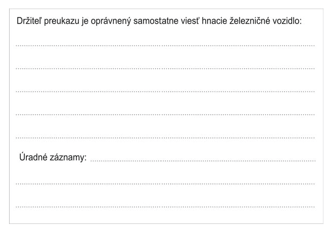

Príloha č. 3a k vyhláške č. 245/2010 Z. z.

- VZOR PREUKAZU

  - na vedenie hnacieho železničného vozidla podľa § 24 ods. 2 písm. b) až e) zákona o doprave na dráhach vydaného podľa § 25 ods. 3 zákona o dráhach

  - Rozmer: 105 mm 72 mm

  - Farba: kód RGB – 143, 84, 68

  - Proti falšovaniu sa preukaz doplní o ochranné prvky, ako hologram alebo čip.

  - Predná strana

- 

  - Zadná strana

- 
