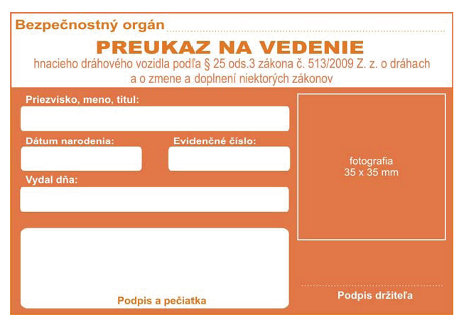
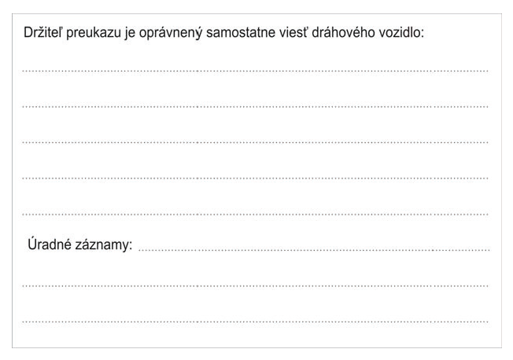

Príloha č. 3b k vyhláške č. 245/2010 Z. z.

- VZOR PREUKAZU

  - na vedenie dráhového vozidla špeciálnej dráhy, električkovej dráhy alebo trolejbusovej dráhy

  - Rozmer 105 mm 72 mm

  - Farba CMYK – 0, 60, 80, 0

  - Farba RGB – 231, 120, 68

  - Proti falšovaniu sa môže preukaz doplniť o ochranné prvky, ako hologram alebo čip.

  - Predná strana

- 

  - Zadná strana

- 
