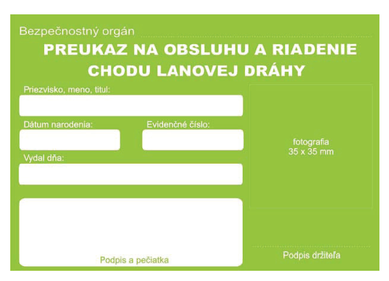
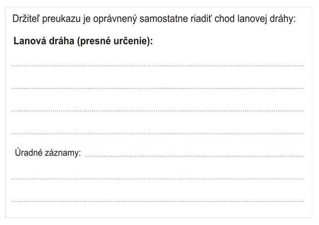

Príloha č. 3c k vyhláške č. 245/2010 Z. z.

- VZOR PREUKAZU

  - na obsluhu a riadenie chodu lanovej dráhy

  - Rozmer 105 mm 72 mm

  - Farba CMYK – 40, 0, 100, 0

  - Farba RGB – 132, 194, 37

  - Proti falšovaniu sa môže preukaz doplniť o ochranné prvky, ako hologram alebo čip.

  - Predná strana

- 

  - Zadná strana

- 
