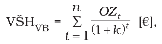
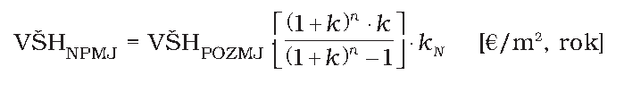

# Čl. I

Vyhláška Ministerstva spravodlivosti Slovenskej republiky č. 492/2004 Z. z. o stanovení všeobecnej hodnoty majetku v znení vyhlášky č. 626/2007 Z. z., vyhlášky č. 605/2008 Z. z. a vyhlášky č. 47/2009 Z. z. sa mení takto:

- 1. V prílohe č. 3 časti E bod E.3 znie:

- „E.3 Metóda polohovej diferenciácie

- E.3.1 Pozemky

- Pozemky sa pri použití metódy polohovej diferenciácie na účely tejto vyhlášky delia na skupiny:

- E.3.1.1 Pozemky na zastavanom území obcí, nepoľnohospodárske a nelesné pozemky mimo zastavaného územia obcí,2) pozemky v zriadených záhradkových osadách3) a pozemky mimo zastavaného územia obcí určené na stavbu4)

- Všeobecná hodnota sa vypočíta podľa základného vzťahu

- VŠHPOZ = M . VŠHMJ [€],

- kde

- M – výmera pozemku v m2,

- VŠHMJ– jednotková všeobecná hodnota pozemku v €/m2.

- Jednotková všeobecná hodnota pozemku sa môže stanoviť aj pre skupinu pozemkov.

- Jednotková všeobecná hodnota pozemkov sa stanoví podľa vzťahu

- VŠHMJ = VHMJ . kPD [€/m2],

- kde

- VHMJ – jednotková východisková hodnota pozemku, ktorá sa stanoví podľa tabuľky:

- Klasifikácia obce – názov alebo údaj podľa počtu obyvateľov | | VHMJ eura/m2

- a) | Bratislava | 66,39

- b) | Krajské mestá: Nitra, Prešov, Trenčín, Trnava, Žilina, Košice, Banská Bystrica a mestá: Piešťany, Vysoké Tatry, Trenčianske Teplice | 26,56

- c) | Mestá: Poprad, Zvolen, Liptovský Mikuláš, Martin | 16,60

- d) | Ostatné okresné mestá so sídlom okresných alebo obvodných úradov | 9,96

- e) | Ostatné obce nad 15 000 obyvateľov | 6,64

- f) | Ostatné obce od 5 000 do 15 000 obyvateľov | 4,98

- g) | Ostatné obce do 5 000 obyvateľov | 3,32

- Obce a lokality v okolí miest so zvýšeným záujmom o kúpu nehnuteľností na bývanie alebo rekreáciu môžu mať jednotkovú východiskovú hodnotu do 80 % z východiskovej hodnoty obce (mesta), z ktorej vyplýva zvýšený záujem. V prípade záujmu o iné druhy nehnuteľností (napríklad priemyselné, poľnohospodárske využitie) okrem pozemkov v zriadených záhradkových, chatových osadách a hospodárskych dvoroch poľnohospodárskych podnikov môžu mať jednotkovú východiskovú hodnotu do 60 % z východiskovej hodnoty obce (mesta), z ktorej vyplýva zvýšený záujem. V prípade záujmu o pozemky v zriadených záhradkových osadách, chatových osadách a hospodárskych dvoroch poľnohospodárskych podnikov môžu mať jednotkovú východiskovú cenu do 50 % z východiskovej hodnoty obce (mesta), z ktorej vyplýva zvýšený záujem. V takých prípadoch sa koeficient polohovej diferenciácie vzťahuje na obec, z ktorej vyplýva zvýšený záujem.

- kPD je koeficient polohovej diferenciácie, vypočíta sa podľa vzťahu

- kPD = kS . kV . kD . kP . kI . kZ . kR [-],

- kde

- kS - koeficient všeobecnej situácie (0,50-2,00) sa stanoví takto:

- Všeobecná situácia | | kS

- 1. | záhradkové osady, chatové osady a hospodárske dvory poľnohospodárskych podnikov | 0,50 – 0,70

- 2. | poľnohospodárske oblasti značne vzdialené od obcí, | 0,70 – 0,80

- 3. | stavebné územie obcí do 5 000 obyvateľov, okrajové priemyslové a poľnohospodárske časti obcí a miest do 10 000 obyvateľov | 0,80 – 0,90

- 4. | obytné časti obcí a miest od 5 000 do 10 000 obyvateľov a časti rekreačných oblastí, centrá obcí do 5 000 obyvateľov, obytné časti na predmestiach a priemyslové a poľnohospodárske oblasti miest do 50 000 obyvateľov | 0,90 – 1,10

- 5. | centrá miest od 10 000 do 50 000 obyvateľov, obytné časti miest nad 50 000 obyvateľov a ich rýchlo dostupné predmestia, prednostné oblasti vilových alebo rodinných domov v centre i mimo centra mesta, oblasti rekreačných domčekov v dôležitých centrách turistického ruchu, priemyslové a poľnohospodárske oblasti miest nad 50 000 obyvateľov | 1,00 – 1,30

- 6. | veľmi dobré obchodné a obytné časti v mestách od 50 000 do 100 000 obyvateľov, obytné časti miest nad 100 000 obyvateľov, luxusné obytné oblasti s dobrým osvetlením a výhľadom, exkluzívne oblasti rodinných domov v dosahu miest nad 100 000 obyvateľov | 1,20 – 1,60

- 7. | veľmi dobré obchodné oblasti v mestách od 50 000 do 100 000 obyvateľov a kúpeľných mestách, vedľajšie ulice v centre miest nad 100 000 obyvateľov, nákupné centrá vo veľkých obytných častiach mimo centra miest nad 100 000 obyvateľov s dobrými dopravnými možnosťami | 1,50 – 1,80

- 8. | prednostné obchodné ulice a miesta v užšom centre miest nad 100 000 obyvateľov, najlepšie miesta pre obchod v mestách od 50 000 do 100 000 obyvateľov | 1,70 – 1,90

- 9. | najlepšie miesta pre obchod v mestách nad 100 000 obyvateľov | 1,80 – 2,00

- kV - koeficient intenzity využitia (0,90 - 2,0) sa stanoví takto:

- Intenzita využitia | | kV

- 1. | veľmi malé využitie, 2-podlažné súkromné rekreačné domčeky, 2 – 3-podlažné stavby rodinných domov s podštandardným vybavením, nepodpivničené, nízke nebytové stavby nevyužívané alebo s malým využitím, poľnohospodárske stavby bez využitia, bez zástavby v širšom okolí | 0,90

- 2. | rodinné domy s nižším štandardom vybavenia, bytové domy s podštandardným vybavením, 3 – 4-podlažné nebytové stavby pre priemysel s malým technickým vybavením, využívané poľnohospodárske stavby | 0,95

- 3. | rodinné domy so štandardným vybavením, bežné bytové domy, bytové domy s nebytovými priestormi, nebytové stavby pre priemysel s bežným technickým vybavením | 1,00

- 4. | nadštandardné rodinné domy; nadštandardné bytové domy, viacpodlažné nebytové stavby pre priemysel so štandardným technickým zariadením | 1,05 – 1,10

- 5. | exkluzívne bytové stavby, obchodné domy a administratívne budovy so štandardným vybavením, 5 – 7-podlažné, vysoké využitie pozemku | 1,10 – 1,15

- 6. | obchodné domy a administratívne budovy s nadštandardným vybavením, viacpodlažné obchody (5 – 7 podlaží a 1 – 2-podzemné podlažia), veľmi vysoké využitie pozemku | 1,15 – 1,30

- 7. | využitie ako v položke 6, ale exkluzívne miesta v centrách miest | 1,30 – 2,0

- kD - koeficient dopravných vzťahov (0,80 - 1,20) sa stanoví takto:

- Dopravné spojenie s obcou | | kD

- 1. | pozemky v odľahlých lokalitách bez možnosti využitia hromadnej dopravy, cesty bez dokončovacích prác (nespevnené a pod.), cesta do obce alebo mesta v trvaní viac ako 30 min | 0,80

- 2. | pozemky na okraji miest a obce so železničnou zastávkou alebo autobusovou prímestskou dopravou, doprava do mesta ešte vyhovujúca | 0,85

- 3. | pozemky na predmestiach miest, odkiaľ sa možno pešo dostať k prostriedku hromadnej dopravy alebo vlastným autom do centra do 15 min | 0,90

- 4. | pozemky v tesnej blízkosti prostriedku hromadnej dopravy s dobrou úpravou ciest, cesta vlastným autom do centra (10 min), územie mesta | 1,00

- 5. | pozemky na obchodných uliciach miest do 100 000 obyvateľov, v nákupných centrách väčších predmestí, intenzívny peší ruch, centrum hromadnej dopravy (autobus, trolejbus, električka) | 1,05

- 6. | pozemky na obchodných uliciach v centre miest nad 100 000 obyvateľov so širokými ulicami a parkoviskami, mestská hromadná doprava s hustou premávkou | 1,05 – 1,20

- kP - koeficient obchodnej alebo priemyselnej polohy (0,90 - 2,00) sa stanoví takto:

- Obchodná poloha alebo priemyselná poloha | | kP

- 1. | obchodná poloha | 1,50 – 2,00

- 2. | obchodná poloha a byty | 1,20 – 1,50

- 3. | obytná alebo rekreačná poloha | 1,00 – 1,20

- 4. | priemyselná poloha | 0,90 – 1,00

- 5. | poľnohospodárska poloha | 0,90

- kI – koeficient technickej infraštruktúry pozemku (0,80 – 1,50) sa stanoví takto:

- Vybavenie pozemku | | kI

- 1. | bez technickej infraštruktúry (vlastné zdroje) | 0,80 – 1,00

- 2. | stredná vybavenosť (napríklad: miestne rozvody vody, elektriny) | 1,00 – 1,20

- 3. | dobrá vybavenosť (napríklad: miestne rozvody vody, elektriny, zemného plynu) | 1,20 – 1,30

- 4. | veľmi dobrá vybavenosť (väčšia ako v bode 3) | 1,30 – 1,50

- Technická infraštruktúra pozemku sa posudzuje z pohľadu možného priameho napojenia cez vlastné, prípadne obecné pozemky (napr. komunikácie). Hodnota koeficientu v odporúčanom intervale je závislá od náročnosti (finančnej, technickej a pod.) súvisiacej s napojením.

- kZ – koeficient povyšujúcich faktorov (1,01 – 3,00) sa stanoví takto:

- Povyšujúce faktory | | kZ

- – | pozemky určené územným plánom na vyššie využitie, než na aké slúžia v súčasnosti (napríklad nezastavané stavebné pozemky, zmena funkcie zóny sídla a pod.), | 1,01 – 3,00

- – | pozemky na chránených územiach, |

- – | obchodné pozemky v miestach so silným turistickým ruchom, ak to nebolo zohľadnené v koeficiente kS, |

- – | pozemky s výrazne zvýšeným záujmom o kúpu, ak to nebolo zohľadnené v zvýšenej východiskovej hodnote, |

- – | iné faktory (napríklad: tvar pozemku, výmera pozemku, druh možnej zástavby, sadové úpravy pozemku a pod.). |

- Povyšujúce faktory možno použiť iba v prípadoch, ak už neboli zohľadnené vo východiskovej hodnote alebo v predchádzajúcich koeficientoch.

- V prípade, že sa povyšujúci faktor nevyskytuje, koeficient povyšujúcich faktorov je 1.

- kR – koeficient redukujúcich faktorov (0,20 – 0,99) sa stanoví takto:

- Redukujúce faktory | | kR

- – | ak sa v najbližšom čase predpokladá nižší stupeň využitia ako doteraz, | 0,20 – 0,99

- – | spád emisií a vplyv zápachu z priemyselnej výroby, uskladnenia surovín, odpadov, z výroby potravín, z poľnohospodárskej výroby a pod., |

- – | rušivý hluk z cestnej, leteckej alebo železničnej dopravy v obytných oblastiach, |

- – | ekologické zaťaženie pozemku, |

- – | ak sa v blízkosti obytnej, administratívnej alebo rekreačnej zóny nachádzajú rušivo pôsobiace priemyselné zariadenia, |

- – | pri mimoriadnom zatienení obytných miest (les, skaly, severné úbočie a pod.), |

- – | svahovitosť terénu, hladina podzemnej vody, únosnosť základovej pôdy, |

- – | ochranné pásma zo zákona, stavebná uzávera, |

- – | stavba pod povrchom pozemku, |

- – | závady viaznuce na pozemku (napríklad: právo priechodu alebo prejazdu, ochranné pásmo a pod.), |

- – | iné faktory (napríklad: tvar pozemku, výmera pozemku, druh možnej zástavby a pod.). |

- Redukujúce faktory možno použiť iba v prípadoch, ak už neboli zohľadnené vo východiskovej hodnote alebo v predchádzajúcich koeficientoch.

- V prípade, že sa redukujúci faktor nevyskytuje, koeficient redukujúcich faktorov je 1.

- E.3.1.2 Poľnohospodárske pozemky5) mimo zastavaného územia obcí druhu orná pôda alebo trvalý trávny porast

- Všeobecná hodnota sa vypočíta podľa základného vzťahu

- VŠHPOZ = M . VŠHMJ [€],

- kde

- M – výmera pozemku v m2,

- VŠHMJ – jednotková všeobecná hodnota pozemku v €/m2.

- Jednotková všeobecná hodnota pozemku sa môže stanoviť aj pre skupinu pozemkov.

- Jednotková všeobecná hodnota pozemku sa stanoví podľa vzťahu

- VŠHMJ = VHMJ . kPD [€/m2],

- kde

- VHMJ– jednotková východisková hodnota pozemku, ktorá sa stanoví podľa osobitného zákona6) v závislosti od katastrálneho územia a okresu. V prípade, že v osobitnom zákone je uvedená nulová východisková hodnota, jednotková východisková hodnota ornej pôdy sa stanoví v závislosti od kódu bonitovanej pôdno-ekologickej jednotky7) poskytnutého príslušnou správou katastra alebo príslušným obvodným pozemkovým úradom. Jednotková východisková hodnota pozemkov druhu trvalý trávny porast, ktoré majú podľa osobitného zákona uvedenú nulovú východiskovú hodnotu, sa rovná 75 % jednotkovej východiskovej hodnoty pozemku druhu orná pôda určenej podľa predchádzajúcej vety [€/m2],

- kPD – koeficient polohovej diferenciácie, ktorý zohľadňuje produkčnú schopnosť poľnohospodárskej pôdy, špecifiká polohy, trh s poľnohospodárskou pôdou v danom mieste a čase, technické úpravy na poľnohospodárskej pôde, environmentálne funkcie a iné špecifické faktory [–].

- E.3.1.3 Poľnohospodárske pozemky5) mimo zastavaného územia obcí druhu chmeľnica, vinica, ovocný sad a záhrady mimo zriadených záhradkových osád

- Všeobecná hodnota sa vypočíta podľa základného vzťahu

- VŠHPOZ = M . VŠHMJ [€],

- kde

- M – výmera pozemku v m2, prípadne v ha,

- VŠHMJ – jednotková všeobecná hodnota pozemku v €/m2, prípadne v €/ha.

- Jednotková všeobecná hodnota pozemku sa môže stanoviť aj pre skupinu pozemkov.

- Jednotková všeobecná hodnota pozemku sa stanoví porovnávacou metódou alebo metódou polohovej diferenciácie podľa základného vzťahu

- VŠHMJ = VHMJ . kPD [€/m2], [€/ha],

- kde

- VHMJ – jednotková východisková hodnota pozemku sa rovná jednotkovej východiskovej hodnote pozemku druhu orná pôda podľa osobitného zákona.6) V prípade, že v osobitnom predpise je uvedená nulová východisková hodnota, jednotková východisková hodnota ornej pôdy sa stanoví v závislosti od kódu bonitovanej pôdno-ekologickej jednotky7) poskytnutého príslušnou správou katastra alebo príslušným obvodným pozemkovým úradom,

- kPD – koeficient polohovej diferenciácie, ktorý zohľadňuje produkčnú schopnosť poľnohospodárskej pôdy, špecifiká polohy, trh s poľnohospodárskou pôdou v danom mieste a čase, technické úpravy na poľnohospodárskej pôde, environmentálne funkcie a iné špecifické faktory [–].

- E.3.1.4 Lesné pozemky8) mimo zastavaného územia obcí

- Všeobecná hodnota lesného pozemku sa vypočíta podľa vzťahov

- VŠHLPOZ = M . VŠHLMJ [€],

- VŠHLMJ = VHLMJ . kPD [€/ha], [€/m2],

- VHLMJ= Hpz+ fp [€/ha], [€/m2],

- Hpz= Hpzjk. zstcjk [€/ha], [€/m2],

- fp = Zcujk . zstcjk (Hv1 + Hv2) [€/ha], [€/m2],

- kde

- VŠHLPOZ – všeobecná hodnota lesného pozemku,

- M – výmera lesného pozemku v ha s presnosťou na štyri desatinné miesta (m2),

- VŠHLMJ – jednotková všeobecná hodnota lesného pozemku sa stanoví podľa špecifických metód stanovenia hodnoty lesov,

- VHLMJ – jednotková východisková hodnota lesného pozemku v €/ha (€/m2) sa stanoví ako súčet základnej hodnoty lesného pozemku pre cieľové drevinové zastúpenie podľa prílohy č.14 tab. č. I a hodnoty faktora polohy v závislosti od približovacej a odvoznej vzdialenosti podľa prílohy č.14 tab. č.II,

- Hpz – základná hodnota lesného pozemku v €/ha sa určí ako súčet základnej hodnoty jednotlivých drevín upravenej cieľovým zastúpením,

- fp – hodnota faktora polohy v €/ha,

- Hpzjk – základná hodnota lesného pozemku v €/ha cieľových drevín – k, j-tej bonity, príloha č. 14, tab. č.I,

- zstcjk – cieľové zastúpenie drevín – k, j-tej bonity na lesnom pozemku v percentách určené v lesnom hospodárskom pláne (LHP),

- Hv1, Hv2 – jednotková hodnota sadzby faktora polohy lesného pozemku za približovanie (v1) a odvoz (v2) dreva v €/m3, príloha č. 14, tab. č.II,

- Zcujk – celková zásoba produkcie dreva na pni, cieľových drevín – k, j-tej bonity v rubnej dobe na hektár, príloha č. 14, tab. č.III,

- kPD – koeficient polohovej diferenciácie zohľadňujúci špecifiká využiteľnosti, dosahovania výnosu, predajnosti a pod., ktorý sa stanoví osobitne pre lesné pozemky a osobitne pre lesné porasty podľa vzťahu

- kPD = kS.kV.kL [-]

- kde

- kS – koeficient všeobecnej situácie dopytu po úžitkoch funkcií lesa sa stanoví takto:

- Ukazovateľ hustoty obyvateľstva okresu na km2 | Hodnota koeficienta ks |

- | lesný pozemok | lesný porast

- nad 1 000 | 1,5 | 1,3

- 500 – 1 000 | 1,4 | 1,2

- 250 – 500 | 1,3 | 1,1

- 100 – 250 | 1,0 | 1,0

- 50 – 100 | 0,9 | 0,9

- do 50 | 0,7 – 0,9 | 0,8 – 0,9

- Údaje hustoty obyvateľstva okresu sa získajú na obvodnom úrade, do ktorého územného obvodu príslušný okres patrí.

- kV – koeficient využiteľnosti lesného majetku sa stanoví takto:

- Skupiny lesov podľa možnosti komerčného využitia produkčnej funkcie | Hodnota koeficienta kv |

- | lesný pozemok | lesný porast

- Lesy hospodárske s absolútnou výškovou bonitou od stredu bonitného rozpätia hore vo veku začiatku obnovy a staršie | 1,3 | 1,20

- Lesy hospodárske s absolútnou výškovou bonitou od stredu bonitného rozpätia hore, ktoré nedosiahli vek začiatku obnovy | 1,3 | 1,15

- Lesy hospodárske s absolútnou výškovou bonitou od stredu bonitného rozpätia dole vo veku začiatku obnovy a staršie | 1,2 | 1,10

- Lesy hospodárske s absolútnou výškovou bonitou od stredu bonitného rozpätia dole, ktoré nedosiahli vek začiatku obnovy | 1,2 | 1,00

- Lesy osobitného určenia s absolútnou výškovou bonitou od stredu bonitného rozpätia hore | 1,3 | 1,05

- Lesy osobitného určenia s absolútnou výškovou bonitou od stredu bonitného rozpätia dole | 1,2 | 0,95 – 1,0

- Lesy ochranné a chránených území s 2., 3. a 4. stupňom ochrany prírody | 1,0 | 0,90 – 0,95

- Lesy chránených území s 5. stupňom ochrany prírody | 0,8 – 0,9 | 0,85 – 0,90

- Lesy v marginálnych a horších prírodných a výrobných podmienkach | 0,7 – 0,8 | 0,80 – 0,85

- Vplyv inej využiteľnosti lesného pozemku (napr. poľovné právo, bažantnice a pod.) sa zohľadní pre dotknuté plochy osobitne.

- kL – koeficient lesnatosti časti krajiny (regiónu – okresu) sa stanoví takto:

- Lesnatosť časti krajiny v % | Hodnota koeficienta kL |

- | lesný pozemok | lesný porast

- do 5 % | 1,3 | 1,2

- 5 – 10 % | 1,1 – 1,2 | 1,1

- 10 – 20 % | 1,0 | 1,0

- 20 – 30 % | 0,9 | 0,95

- 30 – 40 % | 0,8 | 0,9

- 40 – 60 % | 0,6 – 0,7 | 0,85

- nad 60 % | 0,4 – 0,6 | 0,8

- Lesnatosť sa zistí na lesnom úrade v sídle okresu.

- Minimálna základná hodnota 1 ha lesného pozemku je 132,78 eura.

- Pri nesúlade údajov o druhu pozemku v katastri nehnuteľností so skutočným stavom sa všeobecná hodnota pozemku stanovuje podľa skutočného stavu.

- E.3.2 Trvalé porasty

- E.3.2.1 Všeobecná hodnota trvalých porastov na poľnohospodárskej pôde mimo zastavaného územia obcí

- Všeobecná hodnota porastu sa vypočíta podľa vzťahu

- VŠHP = VHP . kPD [€],

- kde

- VHP – jednotková východisková hodnota porastu sa stanoví podľa prílohy č. 15 pre ovocné stromy podľa tabuľky č. I, pre viničné porasty podľa tabuľky č. II, pre chmeľové porasty vrátane zariadenia chmeľníc podľa tabuľky č. III a pre okrasné dreviny podľa tabuľky č. X,

- kPD - koeficient polohovej diferenciácie, ktorý zohľadňuje špecifiká kvality, stupňa poškodenia, dosahovania výnosu, predajnosti a pod. [-].

- E.3.2.2 Všeobecná hodnota trvalých porastov na lesnom pôdnom fonde

- Všeobecná hodnota lesného porastu v zastavanom území aj mimo zastavaného územia obcí sa vypočíta podľa vzťahov

- VŠHLP = M . VŠHLPMJ [€]

- VŠHLPMJ =VHLPa . kPD [€/ha], [€/m2]

- VHLPa = Hporzijk . (1-kP) + fP [€/ha], [€/m2]

- Hporzijk = [(Hutjk – cjk) . faijk + cjk] kd – zstijk . z [€/ha], [€/m2]

- fP = Zsijk . (Hv1+Hv2) [€/ha], [€/m2]

- kde:

- VŠHLPJM – jednotková všeobecná hodnota lesného porastu v €/ha sa stanoví ako súčin jednotkovej východiskovej hodnoty lesného porastu VHLpa a koeficienta polohovej diferenciácie (kPD),

- VHLPa – jednotková východisková hodnota lesného porastu v €/ha sa stanoví ako súčet základnej hodnoty drevín skutočného zastúpenia (k), veku (i), bonity (j) a zakmenenia (z) upravenej o poškodenie lesného porastu (kp v %) a hodnoty faktora polohy (fp) v €/ha,

- Hporzijk – základná hodnota lesného porastu v €/ha sa stanoví ako súčet hodnoty jednotkovej sadzby lesného porastu danej dreviny vo veku 3 rokov (cjk), príloha č. 15, tab. VI, a súčinu vekového hodnotového faktora dreviny (faijk), príloha č. 15, tab. IV.1 – IV.6, a hodnoty ťažbového výnosu v rubnej dobe (Huťjk), príloha č. 15, tab. V, zníženého o hodnotu jednotkovej sadzby lesného porastu danej dreviny vo veku 3 rokov (cjk), príloha č. 15, tab. VI, upravený na skutočné zastúpenie dreviny a zakmenenie lesného porastu v €/ha,

- Huťjk – hodnota ťažbového výnosu v rubnej dobe, danej bonity (j) a dreviny (k), príloha č. 15, tab. V,

- cjk – celkové pestovné náklady založenia lesného porastu vo veku 3 rokov danej bonity (j) a dreviny (k), príloha č. 15, tab. VI,

- faijk – vekový hodnotový faktor i-tého vekového stupňa, j-tej bonity, k-tej dreviny, príloha č. 15, tab. IV. 1 – IV. 6,

- z – zakmenenie (od 0,1 – 1,0),

- kP – koeficient poškodenia porastu (podiel zníženia celkovej hodnoty porastu odvodený zo zníženia hodnoty zásoby dreva vo vekovom stupni), príloha č. 15, tab. IX,

- fP – hodnota faktora polohy v €/ha sa určí ako súčin jednotkových hodnôt faktora polohy v €/m3, príloha č. 15, tab. VIII, a skutočnej zásoby porastu v m3 (Zsijk),

- M – výmera lesného porastu JPRL (na štyri desatinné miesta),

- kd – koeficient prepočtu základnej hodnoty porastu určujúcich drevín na hodnotu priradených drevín, príloha č. 15, tab. VII,

- zstijk – skutočné zastúpenie drevín – k, v poraste i-tého vekového stupňa, j-tej bonity,

- Zsijk – skutočná zásoba dreva na pni v i-tom vekovom stupni, j-tej bonity, zastúpených drevín – k,

- Hv1, Hv2 – jednotková sadzba faktora polohy lesného porastu za približovanie (v1) a odvoz (v2) dreva v €/m3, príloha č. 15, tab. VIII,

- kPD – koeficient polohovej diferenciácie zohľadňujúci špecifiká využiteľnosti, dosahovania výnosu, predajnosti a pod.

- Porasty staršie, ako sú rubné doby v prílohe č. 15 v tab. IV. 1 – IV. 6, sa ohodnotia podľa údajov najvyššej rubnej doby danej dreviny ich interpoláciou s primeraným zohľadnením poklesu kvality drevných zásob.

- V prípade poškodenia porastu antropogénnou činnosťou, predovšetkým imisiami sa jednotková východisková hodnota lesného porastu zníži o hodnotu identifikovaného poškodenia podľa prílohy č. 15, tab. IX. Hodnota poškodenia v stupňoch sa preberie z výsledkov pravidelného monitoringu zdravotného stavu lesa alebo sa zistí priamo v poraste (pre listnaté dreviny iba v období plnej vegetácie) na základe priemernej defoliácie drevín v poraste alebo iných relevantných postupov.

- Skutočná celková zásoba porastu v m3, ktorá sa preberie z lesného hospodárskeho plánu alebo sa zistí meraním. Jednotkové hodnoty polohy sa zistia v prílohe č. 15, tab. VIII na základe priemernej približovacej a odvoznej vzdialenosti konkrétneho porastu.“.

  - Poznámky pod čiarou k odkazom 2, 3, 4, 5, 6, 7 a 8 znejú:

  - „2) Vyhláška Úradu geodézie, kartografie a katastra Slovenskej republiky č. 461/2009 Z. z., ktorou sa vykonáva zákon Národnej rady Slovenskej republiky č. 162/1995 Z. z. o katastri nehnuteľností a o zápise vlastníckych a iných práv k nehnuteľnostiam (katastrálny zákon) v znení neskorších predpisov.

  - 3) Zákon č. 64/1997 Z. z. o užívaní pozemkov v zriadených záhradkových osadách a vyporiadaní vlastníctva k nim v znení neskorších predpisov.

  - 4) § 43h zákona č. 50/1976 Zb. o územnom plánovaní a stavebnom poriadku (stavebný zákon) v znení zákona č. 237/2000 Z. z.

  - 5) Zákon č. 220/2004 Z. z. o ochrane a využívaní poľnohospodárskej pôdy a o zmene zákona č. 245/2003 Z. z. o integrovanej prevencii a kontrole znečisťovania životného prostredia a o zmene a doplnení niektorých zákonov v znení neskorších predpisov.

  - 6) Príloha č. 1 zákona č. 582/2004 Z. z. o miestnych daniach a o miestnom poplatku za komunálne odpady a drobné stavebné odpady v znení zákona č. 465/2008 Z. z.

  - 7) Vyhláška Ministerstva pôdohospodárstva Slovenskej republiky č. 38/2005 Z. z. o určení hodnoty pozemkov a porastov na nich na účely pozemkových úprav.

  - 8) Zákon č. 326/2005 Z. z. o lesoch v znení neskorších predpisov.“.

- 2. V prílohe č. 3 časť F znie:

  - „F. VŠEOBECNÁ HODNOTA ZÁVAD

  - F.1 Vecné bremeno

  - Vecné bremená sa delia na vecné bremená s povinnosťou

  - a) konať (napr. poskytnúť doživotné bývanie),

  - b) zdržať sa (napr. nestavať plot nad určenú výšku),

  - c) strpieť (napr. právo priechodu, prejazdu, právo stavby, užívacie právo).

  - Samostatne sa všeobecná hodnota jednotlivých vecných bremien viaznucich na nehnuteľnostiach stanoví spravidla na účely exekučného konania alebo vtedy, ak je potrebné stanoviť všeobecnú hodnotu na požiadanie štátneho orgánu v rámci jeho právomocí alebo ak ide o právny úkon alebo konanie podľa osobitného predpisu. V takých prípadoch sa všeobecná hodnota nehnuteľností a stavieb stanoví bez zohľadnenia existencie vecného bremena.

  - V ostatných prípadoch sa existencia vecného bremena zohľadní pri výpočte všeobecnej hodnoty nehnuteľností a stavieb.

  - F.2 Výpočet všeobecnej hodnoty vecného bremena (VŠHVB)

  - Výpočet všeobecnej hodnoty vecného bremena sa vykoná takto:

  - a) Práva spojené s nehnuteľnosťou sa odhadnú tak, že sa zistí výhoda, ktorú tieto práva prinášajú oprávnenému (vlastníkovi) v období jedného roka, a hodnota tejto výhody sa násobí pri právach časovo neobmedzených dvadsiatimi, pri právach časovo obmedzených počtom rokov, počas ktorých má právo ešte trvať, najviac však dvadsiatimi.

  - b) Závady viaznuce na nehnuteľnosti sa odhadnú podľa hospodárskej ujmy, ktorá vyplýva zo závady pre zaťaženého (vlastníka). Výpočet sa vykoná kapitalizáciou hospodárskej ujmy (rozdielu budúcich znížených odčerpateľných zdrojov oproti bežným odčerpateľným zdrojom) počas časovo obmedzeného obdobia. Pri stanovení odčerpateľných zdrojov sa postupuje obdobne ako pri stanovení výnosovej hodnoty podľa bodu D.2. Pri závadách neobmedzeného trvania sa vezme za základ výpočtu obdobie dvadsiatich rokov, pri závadách presne obmedzeného trvania toto obdobie.

  - Všeobecná hodnota vecného bremena sa vypočíta podľa základného vzťahu

  - 

  - kde

  - OZt – trvalo odčerpateľný zdroj [eur/rok], ktorý sa vypočíta ako rozdiel budúcich znížených odčerpateľných zdrojov oproti bežným odčerpateľným zdrojom (napr. hodnota zvýšenia alebo zníženia ročnej nájomnej sadzby vyplývajúca z vecného bremena a pod.),

  - n – časové obdobie trvania vecného bremena pri neobmedzenom trvaní platí: n = 20 rokov [rok],

  - k – úroková miera, ktorá sa do výpočtu dosadzuje v desatinnom tvare [%/100].

  - Poznámka pod čiarou k odkazu 9 znie:

  - „9) Napríklad § 87a zákona č. 511/1992 Zb., § 139 zákona Národnej rady Slovenskej republiky č. 233/1995 Z. z.“.

- 3. V prílohe č. 3 časť G znie:

- „G. VÝPOČET VŠEOBECNEJ HODNOTY NÁJMU ZA POZEMOK

- Všeobecnú hodnotu ročného nájmu za pozemok možno stanoviť porovnávaním alebo výpočtom podľa vzťahu

- 

- kde:

- VŠHPOZMJ – všeobecná hodnota pozemku na mernú jednotku [€/m2],

- k – úroková miera, ktorá sa do výpočtu dosadzuje v desatinnom tvare [%/100],

- kN– koeficient zohľadňujúci daňové zaťaženie daňou z príjmu, ktorý sa rovná (100+N)/100, kde N vyjadruje náklady spojené s dosiahnutím hrubého výnosu (daň z príjmu v percentách),

- n – obdobie predpokladanej návratnosti investície, spravidla v intervale 15 až 40 rokov, v závislosti od ekonomických, polohových a fyzických faktorov.

- Pri stanovení všeobecnej hodnoty nájmu za pozemok porovnávaním sa dodržujú rovnaké zásady ako pri stanovení všeobecnej hodnoty pozemku podľa časti E bodu E.1.“.
