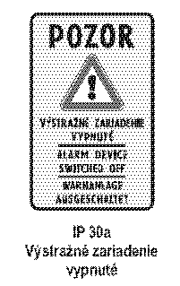
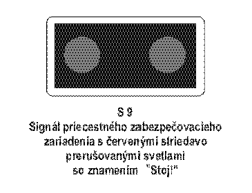
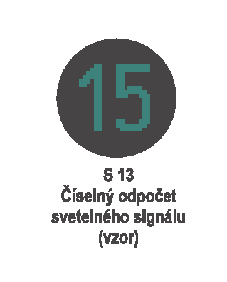
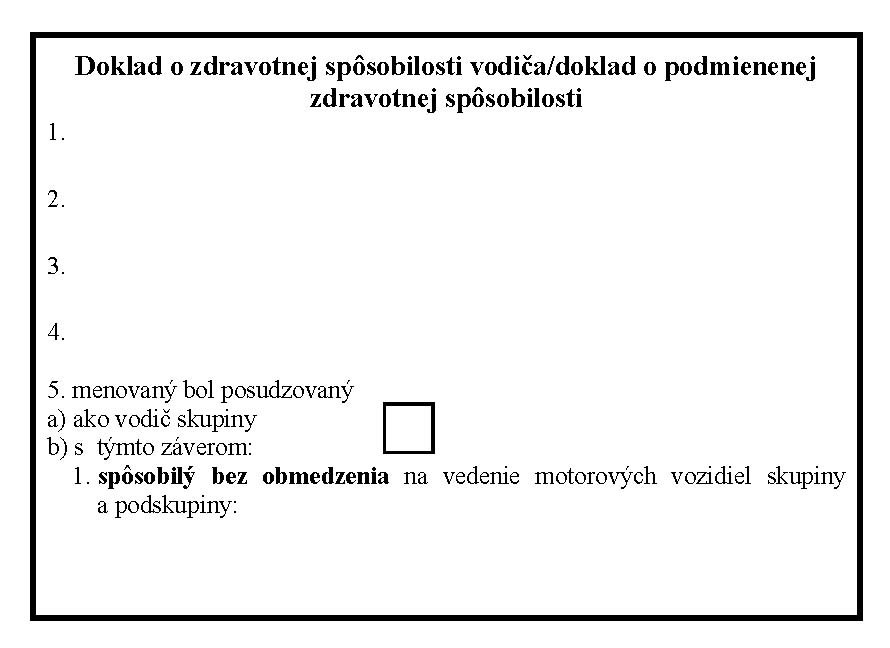
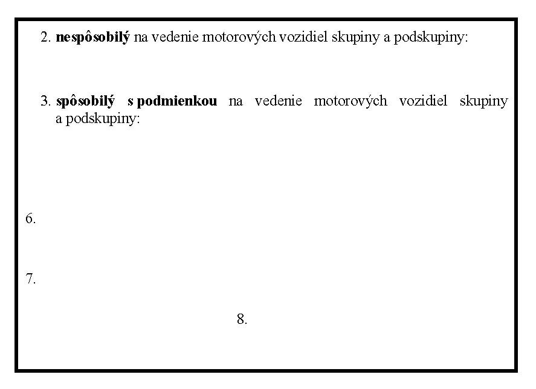
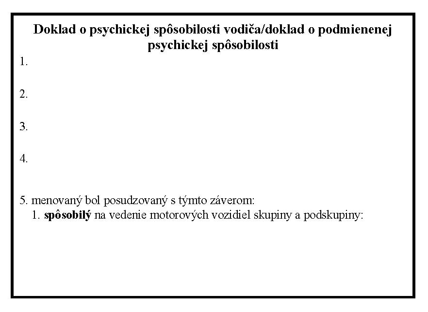
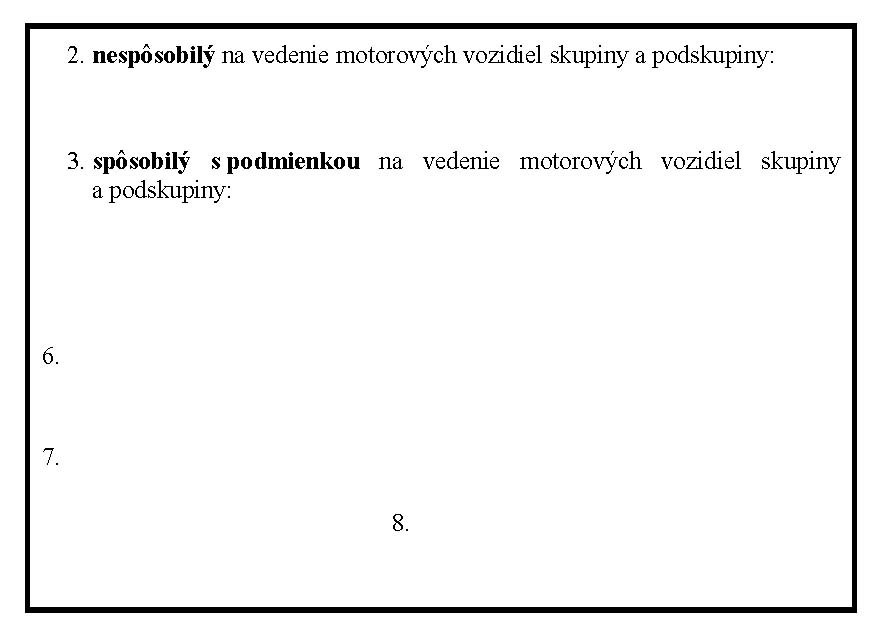

# Čl. I

Vyhláška Ministerstva vnútra Slovenskej republiky č. 9/2009 Z. z., ktorou sa vykonáva zákon o cestnej premávke a o zmene a doplnení niektorých zákonov v znení vyhlášky č. 130/2010 Z. z. sa mení a dopĺňa takto:

- 1. V úvodnej vete sa slová „§ 87 ods. 6“ nahrádzajú slovami „§ 87 ods. 7“.

- 2. V § 5 ods. 11 sa vypúšťajú slová „alebo na stojane,“ a za slovo „konštrukcii,“ sa vkladajú slová „ktorá je striedavo červeno-bielo pruhovane označená a“.

- 3. V § 7 ods. 3 sa vkladá nové písmeno a), ktoré znie:

- „a)

- svetelné signalizačné zariadenia so svetelnými signálmi (č. S 1a až S 14g),“.

- Doterajšie písmená a) až h) sa označujú ako písmená b) až i).

- 4. V § 7 ods. 3 písm. d) sa vypúšťa bod 9.

- Doterajší bod 10 sa označuje ako bod 9.

- 5. V § 7 ods. 3 sa vypúšťa písmeno i).

- 6. V § 8 ods. 2 písm. d) sa za slová „č. A 12,“ vkladajú slová „č. A19,“.

- 7. V § 8 ods. 2 písm. e) sa za slová „č. C 25“ vkladajú slová „až C 30“.

- 8. V § 8 odsek 6 znie:

- „(6)

- Významový symbol a symbol zvislej dopravnej značky možno vložiť do prednej strany inej zvislej dopravnej značky alebo aplikovať na povrch cesty; pri zvislých dopravných značkách č. IP 24a a č. IP 24b nemožno použiť viac ako dva symboly alebo dva významové symboly inej zvislej dopravnej značky s príslušnými dodatkovými tabuľkami.“.

- 9. V § 8 ods. 9 sa slová „Stĺpik, na ktorom sú umiestnené zvislé prenosné dopravné značky, musí byť zreteľne označený“ nahrádzajú slovami „Stĺpik alebo iná nosná konštrukcia, na ktorých sú umiestnené zvislé prenosné dopravné značky, musia byť zreteľne označené“.

- 10. V § 8 ods. 13 písmeno c) znie:

- „c)

- na žltozelený fluorescenčný podklad; pri zvislých dopravných značkách č. P 1 a č. P 2 sa nesmie zmeniť tvar príslušnej zvislej dopravnej značky, predná strana ostatných zvislých dopravných značiek sa môže symetricky umiestniť na žltozelený fluorescenčný podklad tvaru pravouholníka.“.

- 11. V § 8 sa za odsek 13 vkladá nový odsek 14, ktorý znie:

- „(14)

- Farebné vyhotovenie zvislých dopravných značiek, ktoré sú na žltozelenom fluorescenčnom podklade, nesmie byť odlišné od vyobrazenia v prílohe č. 1.“.

- Doterajšie odseky 14 až 20 sa označujú ako odseky 15 až 21.

- 12. V § 8 odsek 16 znie:

- „(16)

- Ak je to technicky možné, zvislé dopravné značky č. B 29a, č. B 30a a č. B 31a musia byť umiestnené opakovane i pri ľavom okraji cesty v smere jazdy; to neplatí, ak je zvislá dopravná značka č. B 31a umiestnená nad vyznačeným jazdným pruhom na ceste.“.

- 13. V § 9 ods. 3 písmeno c) znie:

- „c)

- signál s plným zeleným svetlom „Voľno“ znamená pre vodiča možnosť pokračovať v jazde, a ak dodrží ustanovenia o odbočovaní a také odbočovanie nie je zakázané dopravnou značkou, možnosť odbočiť vpravo alebo vľavo a ak dodrží ustanovenia o otáčaní a otočenie dovoľuje dopravná značka, možnosť otočiť sa; vodič je pritom povinný dať prednosť chodcom prechádzajúcim vo voľnom smere po priechode pre chodcov a cyklistom prechádzajúcim vo voľnom smere po priechode pre cyklistov, pritom ich nesmie ohroziť ani obmedziť; ak svieti signál pre opustenie križovatky (č. S 4) umiestnený v protiľahlom rohu križovatky, neplatí pre odbočovanie vľavo alebo vpravo § 19 ods. 4 zákona,“.

- 14. V § 9 ods. 3 písmeno e) znie:

- „e)

- smerový signál so zeleným svetlom (zelená šípka alebo zelené šípky rôznych smerov) znamená pre vodiča možnosť pokračovať v jazde len v smere, ktorým uvedená šípka alebo šípky ukazujú a ak smerový signál so zeleným svetlom (zelená šípka alebo zelené šípky rôznych smerov) nezobrazuje otáčanie na križovatke a také otáčanie dovoľuje dopravná značka, možnosť otočiť sa, ak dodrží ustanovenia o otáčaní; ak zelená šípka smeruje vľavo alebo vpravo, neplatí pre odbočovanie § 19 ods. 4 zákona,“.

- 15. V § 9 ods. 4 sa slovo „písmen“ nahrádza slovami „odseku 3 písm.“.

- 16. V § 10 odsek 1 znie:

- „(1)

- Číselný odpočet svetelného signálu (č. S 13) možno použiť len spolu so svetelným signálom č. S 1a, č. S 1c, č. S 2a, č. S 2c, č. S 3a, č. S 3c, č. S4, č. S 5a až S 5d, č. S 7a, č. S 7c a č. S 10, pričom rozsvietený číselný znak označuje aktuálny čas v sekundách, pri ktorom dôjde ku zmene svetelného signálu. Farba číslice svetelného signálu odpočtu musí byť vo farbe toho svetelného signálu, ktorý je odpočítavaný.“.

- 17. V § 13 ods. 2 sa vypúšťajú slová „v rovnošate“.

- 18. V § 13 ods. 4 sa za slovo „vojakom“ vkladajú slová „a vojakom mimoriadnej služby v rovnošate“.

- 19. § 15 vrátane nadpisu znie:

- 㤠15

- Organizácia vykonávania skúšok z odbornej spôsobilosti

- (1)

- Žiadateľa o vykonanie skúšky z odbornej spôsobilosti (ďalej len „žiadateľ o vykonanie skúšky“) prihlasuje autoškola podaním vyplnenej prihlášky na skúšku z odbornej spôsobilosti (ďalej len „prihláška“). Spolu s prihláškou sa vždy predkladá úplne a správne vyplnená žiadosť o udelenie vodičského oprávnenia každého žiadateľa o vykonanie skúšky uvedeného v zozname prihlásených žiadateľov o vykonanie skúšky.

- (2)

- Prihlášku podľa odseku 1 predkladá osobne prevádzkovateľ autoškoly alebo ním poverený zástupca autoškoly v dvoch výtlačkoch.

- (3)

- Žiadosť o udelenie vodičského oprávnenia obsahuje

- a)

- meno, priezvisko, rodné priezvisko a prípadne titul žiadateľa o vykonanie skúšky,

- b)

- dátum a miesto narodenia, rodné číslo žiadateľa o vykonanie skúšky,

- c)

- adresu pobytu žiadateľa o vykonanie skúšky alebo miesta, kde sa zdržiava,

- d)

- informáciu o požadovaných a udelených vodičských oprávneniach a o vydanom vodičskom preukaze,

- e)

- potvrdenie o výsledku lekárskej prehliadky,

- f)

- vyhlásenie žiadateľa o vykonanie skúšky o pravdivosti a úplnosti ním uvádzaných údajov a o splnení podmienok na udelenie vodičského oprávnenia,

- g)

- vlastnoručný podpis a podpis zákonného zástupcu žiadateľa o vykonanie skúšky, ktorý v deň podania žiadosti o udelenie vodičského oprávnenia nedosiahol vek 18 rokov,

- (4)

- K žiadosti podľa odseku 3 sa prikladá doklad o

- a)

- zdravotnej spôsobilosti, ak uplynula platnosť potvrdenia o výsledku lekárskej prehliadky v žiadosti o udelenie vodičského oprávnenia alebo ak je toto potvrdenie nesprávne vyplnené,

- b)

- psychickej spôsobilosti, ak tak ustanovuje zákon,

- c)

- podrobení sa príprave na vedenie motorového vozidla v autoškole, ak zákon neustanovuje inak.

- (5)

- Doklady podľa odseku 4 sa prikladajú k žiadosti, len ak ide o skúšku z odbornej spôsobilosti na udelenie vodičského oprávnenia.

- (6)

- Príslušný orgán Policajného zboru pred určením termínu a miesta vykonania skúšky z odbornej spôsobilosti preverí úplnosť a správnosť vyplnenia žiadosti o udelenie vodičského oprávnenia vrátane úplnosti a správnosti vypísania dokladov a tlačív, ktorými žiadateľ o vykonanie skúšky preukazuje splnenie ustanovených podmienok.

- (7)

- Príslušný orgán Policajného zboru určí termín a miesto vykonania skúšky, len ak je žiadosť o udelenie vodičského oprávnenia vrátane priložených dokladov a tlačív vyplnená úplne a správne. Inak žiadosť o udelenie vodičského oprávnenia spolu s priloženými dokladmi a tlačivami bezodkladne vráti, čo prevádzkovateľ autoškoly alebo ním poverený zástupca potvrdí v prihláške svojím podpisom a odtlačkom pečiatky autoškoly.

- (8)

- Príslušný orgán Policajného zboru termín a miesto vykonania skúšky z odbornej spôsobilosti uvedie v prihláške. Prevádzkovateľ autoškoly alebo ním poverený zástupca autoškoly potvrdí v prihláške svojím podpisom a odtlačkom pečiatky autoškoly, že bol s určeným termínom a miestom vykonania skúšky z odbornej spôsobilosti oboznámený.

- (9)

- Autoškola s určeným termínom a miestom vykonania skúšky z odbornej spôsobilosti bezodkladne oboznámi tých žiadateľov o vykonanie skúšky, ktorí predložili správne a úplne vyplnenú žiadosť o udelenie vodičského oprávnenia, ustanovené doklady a tlačivá.

- (10)

- Žiadateľ o vykonanie skúšky môže vykonať skúšku najskôr v deň dovŕšenia veku predpísaného na vedenie motorového vozidla príslušnej skupiny alebo podskupiny.“.

- 20. V § 16 ods. 2 sa slová „§ 15 ods. 2 písm. b) až d)“ nahrádzajú slovami „§ 15 ods. 4“.

- 21. V § 16 ods. 3 sa na konci pripájajú tieto slová: „a preukáže, že má na území Slovenskej republiky zvyčajné bydlisko alebo preukáže, že študuje na území Slovenskej republiky aspoň šesť mesiacov.“.

- 22. V § 16 odsek 7 znie:

- „(7)

- Vzor prihlášky je uvedený v prílohe č. 2. Vzor žiadosti o udelenie vodičského oprávnenia podľa § 15 ods. 1 a vzor záznamu o skúške z odbornej spôsobilosti sú uvedené v prílohe č. 2a. Vzor protokolu o skúškach je uvedený v prílohe č. 3.“.

- 23. V § 17 ods. 1 sa na konci pripájajú tieto slová: „ak táto vyhláška neustanovuje inak.“.

- 24. V § 17 ods. 2 sa za slovo „dňa“ vkladá slovo „určeného“.

- 25. V § 17 ods. 4 sa na konci pripája táto veta: „Predĺžená lehota začína plynúť dňom uplynutia lehoty podľa odseku 2.“.

- 26. § 17 sa dopĺňa odsekom 5, ktorý znie:

- „(5)

- Ak žiadateľ o udelenie vodičského oprávnenia, ktorý sa nezúčastnil skúšky z odbornej spôsobilosti v určenom termíne, najneskôr v deň vykonania nasledujúcej skúšky z odbornej spôsobilosti nepreukáže závažné dôvody, pre ktoré sa nezúčastnil tejto predchádzajúcej skúšky, je hodnotený klasifikačným stupňom neprospel.“.

- 27. V § 20 ods. 2 písm. b) prvom bode sa čiarka na konci nahrádza bodkočiarkou a pripájajú sa tieto slová: „za podperu sa považuje aj stojan alebo iné zariadenie, ktoré slúži na stabilizovanie motocykla počas zastavenia, státia alebo parkovania,“.

- 28. V § 20 ods. 3 písm. f) sa čiarka na konci nahrádza bodkočiarkou a pripájajú sa tieto slová: „toto sa nevzťahuje na skúšku z vedenia motorových vozidiel skupiny AM,“.

- 29. V § 20 sa za odsek 8 vkladajú nové odseky 9 a 10, ktoré znejú:

- „(9)

- Vyhodnotenie skúšky z vedenia motorových vozidiel podľa odseku 1 písm. b) a oboznámenie žiadateľa s výsledkom skúšky nie je zahrnuté v časových limitoch podľa odseku 8.

- (10)

- Pri približovaní sa k prípojnému vozidlu pri pripájaní prípojného vozidla podľa odseku 6 písm. a) bod 12 môže žiadateľovi asistovať inštruktor, pričom úkony súvisiace s pripojením prípojného vozidla k motorovému vozidlu vykoná žiadateľ.“.

- Doterajší odsek 9 sa označuje ako odsek 11.

- 30. V § 21 odsek 2 znie:

- „(2)

- Žiadateľ o vykonanie skúšky, ktorý nevykonáva skúšku z náuky o vozidlách a ich údržbe podľa § 79 ods. 2 písm. b) zákona, musí v rámci vykonávania skúšky podľa § 20 ods. 1 písm. a) preukázať základné vedomosti a rozpoznať najčastejšie poruchy, ktoré majú vplyv na bezpečnosť cestnej premávky a ochranu životného prostredia tak, že správne zodpovie na jednu otázku, ktorá sa týka riadenia vozidla, brzdového systému, pneumatík, osvetlenia vozidla, smerových svetiel, spätných zrkadiel, stieračov, bezpečnostných pásov, predného výhľadového skla alebo výfuku.“.

- 31. V § 21 ods. 4 sa za slovo „premávke“ vkladajú slová „vrátane preukázania základných vedomostí podľa odseku 2“.

- 32. V § 21 sa za odsek 4 vkladajú nové odseky 5 a 6, ktoré znejú:

- „(5)

- Skúška z vedenia motorových vozidiel sa vždy začína časťou skúšky podľa § 20 ods. 1 písm. a). Ak je žiadateľ hodnotený klasifikačným stupňom neprospel, v skúške nepokračuje a celá skúška z vedenia motorových vozidiel sa hodnotí klasifikačným stupňom neprospel.

- (6)

- Ak bol žiadateľ o vykonanie skúšky v druhej časti skúšky z vedenia motorových vozidiel podľa § 20 ods. 1 písm. b) hodnotený klasifikačným stupňom neprospel, celá skúška z vedenia motorových vozidiel sa hodnotí klasifikačným stupňom neprospel. Predmetom opakovanej skúšky z vedenia motorových vozidiel je v takom prípade len časť skúšky podľa § 20 ods. 1 písm. b).“.

- Doterajší odsek 5 sa označuje ako odsek 7.

- 33. V nadpise § 29 sa slová „§ 87 ods. 6“ nahrádzajú slovami „§ 87 ods. 7“.

- 34. V § 29 ods. 1 písm. a) sa slová „skupiny AM, A, B a T“ nahrádzajú slovami „skupiny AM, A, B, B + E a T“ a slová „podskupiny A1, B1 a B1 + E“ nahrádzajú slovami „podskupiny „A1 a B1“.

- 35. V § 29 odseky 3 až 6 znejú:

- „(3)

- Ak je posudzovaná osoba držiteľom vodičského oprávnenia skupiny alebo podskupiny uvedenej v odseku 1 písm. b) alebo je vodičom podľa § 87 ods. 3 písm. b) zákona a žiada o udelenie vodičského oprávnenia skupiny A, B + E, T alebo podskupiny A1, posudzuje sa ako vodič skupiny 2, pričom posudzujúci lekár sa v záveroch lekárskej prehliadky vyjadruje aj ku skupinám a podskupinám vodičského oprávnenia, ktorých už posudzovaná osoba je držiteľom.

- (4)

- Predmetom lekárskej prehliadky je

- a)

- posúdenie zdravotného stavu posudzovanej osoby so zameraním na choroby a poruchy, ktoré zdravotnú spôsobilosť na vedenie motorových vozidiel vylučujú alebo podmieňujú; choroby a poruchy, ktoré zdravotnú spôsobilosť na vedenie motorových vozidiel vylučujú alebo podmieňujú a spôsob ich posudzovania, sú uvedené v prílohe č. 5,

- b)

- komplexné fyzikálne vyšetrenie vrátane orientačného vyšetrenia sluchu, zrakovej ostrosti, zorného poľa, rovnováhy a orientačného neurologického vyšetrenia; do úvahy sa berú aj výsledky z preventívnej prehliadky podľa osobitného predpisu.5)

- (5)

- Posudzujúci lekár na základe čestného vyhlásenia, zdravotnej dokumentácie, iného podnetu alebo na základe ním vykonaného vyšetrenia v prípade, že u posudzovanej osoby existuje podozrenie na chorobu alebo poruchu, ktorá by mohla podmieňovať alebo vylúčiť zdravotnú spôsobilosť, požiada o odborné vyšetrenie.5) Odborným vyšetrením sa zisťuje splnenie minimálnych požiadaviek tak, ako je ustanovené v prílohe č. 5.

- (6)

- Výsledok lekárskej prehliadky posudzujúci lekár zaznamená do zdravotnej dokumentácie posudzovanej osoby a do dokladu o zdravotnej spôsobilosti; výsledok lekárskej prehliadky žiadateľa o udelenie vodičského oprávnenia zaznamená do zdravotnej dokumentácie posudzovanej osoby a do žiadosti o udelenie vodičského oprávnenia podľa predtlače.“.

- Poznámka pod čiarou k odkazu 5 znie:

- „5)

- § 2 zákona č. 577/2004 Z. z. o rozsahu zdravotnej starostlivosti uhrádzanej na základe verejného zdravotného poistenia a o úhradách za služby súvisiace s poskytovaním zdravotnej starostlivosti v znení neskorších predpisov.“.

- 36. § 29 sa dopĺňa odsekom 11, ktorý znie:

- „(11)

- Ak je zdravotná spôsobilosť posudzovanej osoby podmienená podľa § 86 ods. 2 písm. c) zákona, posudzujúci lekár určí termín nasledujúcej lekárskej prehliadky a do zdravotnej dokumentácie a do žiadosti o udelenie vodičského oprávnenia alebo do dokladu o zdravotnej spôsobilosti zaznamená príslušný národný kód.“.

- 37. V § 30 odsek 1 znie:

- „(1)

- Minimálne požiadavky na psychickú spôsobilosť a podmienky pre podmienenie psychickej spôsobilosti podľa § 88 ods. 4 zákona sú ustanovené v prílohe č. 10; posudzujúci psychológ pri posudzovaní psychickej spôsobilosti používa štandardizované psychologické testy a prihliadne aj na predchádzajúce záznamy v zdravotnej dokumentácii.“.

- 38. V § 30 odseky 5 až 7 znejú:

- „(5)

- Ak sa psychologickým vyšetrením nezistia dôvody, pre ktoré by posudzovaná osoba nebola spôsobilá viesť motorové vozidlo, posudzujúci psychológ v záveroch psychologického vyšetrenia uvedie, že posudzovaná osoba je psychicky spôsobilá viesť motorové vozidlo.

- (6)

- Ak sa psychologickým vyšetrením zistia dôvody, pre ktoré posudzovaná osoba nie je spôsobilá viesť motorové vozidlo, posudzujúci psychológ v záveroch psychologického vyšetrenia uvedie, že posudzovaná osoba nie je psychicky spôsobilá viesť motorové vozidlo.

- (7)

- Ak sa psychologickým vyšetrením zistia dôvody, pre ktoré treba psychickú spôsobilosť posudzovanej osoby podmieniť podľa § 88 ods. 4 zákona, posudzujúci psychológ navrhne obmedzenie vodičského oprávnenia prostredníctvom príslušného národného kódu podľa prílohy č. 9, ktorý zaznamená do dokladu o psychickej spôsobilosti.“.

- 39. § 30 sa dopĺňa odsekom 8, ktorý znie:

- "(8) Interval medzi jednotlivými psychologickými vyšetreniami podľa § 88 ods. 4 zákona nesmie byť kratší ako 12 mesiacov.“.

- 40. § 31 vrátane nadpisu znie:

- 㤠31

- Doklad o zdravotnej spôsobilosti a doklad o psychickej spôsobilosti (k § 89 ods. 2 zákona)

- (1)

- Doklad o zdravotnej spôsobilosti sa vydáva pre

- a)

- žiadateľa o udelenie vodičského oprávnenia, ak uplynula platnosť potvrdenia o výsledku lekárskej prehliadky v žiadosti o udelenie vodičského oprávnenia alebo ak je toto potvrdenie nesprávne vyplnené,

- b)

- vodiča, ktorý sa podrobuje preskúmaniu zdravotnej spôsobilosti,

- c)

- vodiča, ktorý sa podrobuje pravidelným lekárskym prehliadkam podľa § 87 ods. 3 a 4 zákona,

- d)

- osobu, na ktorú sa vzťahuje § 87 ods. 5 zákona.

- (2)

- Doklad o zdravotnej spôsobilosti obsahuje

- a)

- meno, priezvisko a adresu (sídlo) posudzujúceho lekára (aj vo forme odtlačku pečiatky, ak obsahuje požadované údaje),

- b)

- meno, priezvisko, dátum narodenia alebo rodné číslo posudzovanej osoby,

- c)

- rozsah udeleného vodičského oprávnenia,

- d)

- skupiny a podskupiny vodičských oprávnení, o ktorých udelenie posudzovaná osoba žiada, ak ide o doklad pre žiadateľa o udelenie vodičského oprávnenia,

- e)

- zaradenie do skupiny podľa § 29 ods. 1,

- f)

- závery lekárskej prehliadky,

- g)

- miesto a dátum vyhotovenia,

- h)

- dátum uplynutia platnosti,

- i)

- odtlačok pečiatky a podpis posudzujúceho lekára.

- (3)

- Platnosť dokladu o zdravotnej spôsobilosti osoby podľa odseku 1 písm. a) a b) a platnosť potvrdenia o výsledku lekárskej prehliadky podľa § 15 ods. 3 písm. e) je jeden rok od dátumu vyhotovenia; ak je zdravotná spôsobilosť posudzovanej osoby podmienená podľa § 86 ods. 2 písm. c) zákona, dobu platnosti určuje posudzujúci lekár, najviac však na jeden rok.

- (4)

- Platnosť dokladu o zdravotnej spôsobilosti osoby podľa odseku 1 písm. c) sa určuje a vyznačuje podľa § 87 ods. 4 alebo § 89 ods. 1 zákona; ak je zdravotná spôsobilosť posudzovanej osoby podmienená podľa § 86 ods. 2 písm. c) zákona, dobu platnosti dokladu určuje posudzujúci lekár, najviac však na päť rokov, a ak je posudzovaná osoba staršia ako 65 rokov, najviac na dva roky.

- (5)

- Vzor, obsah a spôsob vypĺňania a vyhotovenia dokladu o zdravotnej spôsobilosti osoby podľa odseku 1 písm. a) a b) je uvedený v prílohe č. 7.

- (6)

- Vzor, obsah a spôsob vypĺňania a vyhotovenia dokladu o zdravotnej spôsobilosti osoby podľa odseku 1 písm. c) a d) je uvedený v prílohe č. 8.

- (7)

- Doklad o psychickej spôsobilosti sa vydáva pre

- a)

- žiadateľa o udelenie vodičského oprávnenia,

- b)

- vodiča, ktorý sa podrobuje preskúmaniu psychickej spôsobilosti,

- c)

- vodiča, ktorý sa podrobuje pravidelným psychologickým vyšetreniam podľa § 88 ods. 6 zákona,

- d)

- osobu, na ktorú sa vzťahuje § 88 ods. 4 zákona.

- (8)

- Doklad o psychickej spôsobilosti obsahuje

- a)

- meno, priezvisko a adresu (sídlo) posudzujúceho psychológa (aj vo forme odtlačku pečiatky, ak obsahuje požadované údaje),

- b)

- meno, priezvisko, dátum narodenia alebo rodné číslo posudzovanej osoby,

- c)

- rozsah udeleného vodičského oprávnenia,

- d)

- skupiny a podskupiny vodičských oprávnení, o ktorých udelenie posudzovaná osoba žiada, ak ide o doklad pre žiadateľa o udelenie vodičského oprávnenia,

- e)

- závery psychologického vyšetrenia,

- f)

- miesto a dátum vyhotovenia,

- g)

- dátum uplynutia platnosti,

- h)

- odtlačok pečiatky a podpis posudzujúceho psychológa,

- (9)

- Platnosť dokladu o psychickej spôsobilosti osoby podľa odseku 7 písm. a) a b) je jeden rok od dátumu vyhotovenia; ak je psychická spôsobilosť posudzovanej osoby podmienená podľa § 88 ods. 4 zákona, dobu platnosti dokladu určuje posudzujúci psychológ, najviac však na jeden rok.

- (10)

- Platnosť dokladu o psychickej spôsobilosti osoby podľa odseku 7 písm. c) sa určuje a vyznačuje podľa § 88 ods. 6 zákona; ak je psychická spôsobilosť posudzovanej osoby podmienená podľa § 88 ods. 4 zákona, dobu platnosti dokladu určuje posudzujúci psychológ, najmenej však na jeden rok a najviac na päť rokov, a ak je posudzovaná osoba staršia ako 65 rokov, najviac na dva roky.

- (11)

- Vzor, obsah a spôsob vypĺňania a vyhotovenia dokladu o psychickej spôsobilosti osoby podľa odseku 7 písm. a) a b) je uvedený v prílohe č. 12.

- (12)

- Vzor, obsah a spôsob vypĺňania a vyhotovenia dokladu o psychickej spôsobilosti osoby podľa odseku 7 písm. c) a d) je uvedený v prílohe č. 13.“.

- 41. Za § 41 sa vkladá § 41a, ktorý vrátane nadpisu znie:

- 㤠41a

- Prechodné ustanovenia k úpravám účinným od 15. septembra 2010

- (1)

- Dopravné značky umiestnené podľa doterajších predpisov sa musia zosúladiť s podmienkami podľa tejto vyhlášky do 31. decembra 2016.

- (2)

- Na konanie o udelení vodičského oprávnenia sa použijú doterajšie predpisy, ak výcvik žiadateľa o udelenie vodičského oprávnenia bol začatý alebo žiadosť o udelenie vodičského oprávnenia bola podaná pred nadobudnutím účinnosti tejto vyhlášky.

- (3)

- Doklady o zdravotnej spôsobilosti a doklady o psychickej spôsobilosti vydané podľa doterajších predpisov sa považujú za doklady vydané podľa tejto vyhlášky.“.

- 42. § 42 znie:

- 㤠42

- Touto vyhláškou sa preberajú právne záväzné akty Európskej únie uvedené v prílohe č. 21.“.

- 43. V prílohe č. 1 I. diele I. časti bode 5 sa za vyobrazenie dopravnej značky č. IP 30 vkladá vyobrazenie novej dopravnej značky č. IP 30a:

- 

- 44. V prílohe č. 1 I. diele III. časti bode 1 sa za vyobrazenie svetelného signálu č. S 8 vkladá vyobrazenie nového svetelného signálu č. S 9:

- 

- 45. V prílohe č. 1 I. diele III. časti bode 1 sa vyobrazenie osobitného svetelného signálu č. S 13 nahrádza týmto vyobrazením:

- 

- 46. V prílohe č. 1 II. diele čl. 3 odsek 21 znie:

- „(21) K značke č. B 21:

- Značka Zákaz vjazdu vozidiel prepravujúcich nebezpečné veci (č. B 21) zakazuje vjazd vozidlám prepravujúcim výbušniny, ľahko horľavé alebo inak nebezpečné veci. V prípade vyznačenia zákazu prejazdu vozidiel prepravujúcich určené nebezpečné veci cez tunel je táto značka doplnená dodatkovou tabuľkou č. E 14. V takomto prípade sa zákaz vjazdu vozidiel prepravujúcich nebezpečné veci vzťahuje len na vozidlá, ktoré sú obmedzené príslušnou dodatkovou tabuľkou.“.

- 47. V prílohe č. 1 II. diele čl. 4 odsek 17 znie:

- „(17)

- K značke č. C 19:

- Značka Prikázaný smer prepravy vyznačených vozidiel a vecí (č. C 19) prikazuje vodičom vozidiel prepravujúcim výbušniny, ľahko horľavé alebo inak nebezpečné veci alebo len vodičom vyznačených druhov vozidiel jazdu len smerom, ktorý ukazuje šípka alebo šípky vyznačené na značke. Ak tento prikázaný smer jazdy je založený na použití značky č. B 21 spolu s dodatkovou tabuľkou č. E 14, značka č. C 19 je doplnená dodatkovou tabuľkou č. E 14. V takomto prípade sa prikázaný smer prepravy vyznačených vozidiel a vecí vzťahuje len na vozidlá obmedzené príslušnou dodatkovou tabuľkou. Na značke možno na určenie iného druhu vozidla použiť významový symbol značky zo značiek č. B 4 až B 9 a č. B 17 až B 26 a na prikázanie smeru jazdy symbol značky zo značiek č. C 1 až C 5.“.

- 48. V prílohe č. 1 II. diele čl. 5 sa za odsek 40 vkladá nový odsek 41, ktorý znie:

- „(41)

- K značke č. IP 30a:

- Značka Výstražné zariadenie vypnuté (č. IP 30a) upozorňuje na stav vypnutia ovládania závor a na stav vypnutia prejazdového výstražného zabezpečovacieho zariadenia na príslušnou značkou označenom železničnom priecestí, ktoré by účastník cestnej premávky inak neočakával; v takomto prípade platí ustanovenie § 27 ods. 1 zákona.“.

- Doterajšie odseky 41 až 45 sa označujú ako odseky 42 až 46.

- 49. V prílohe č. 1 II. diele čl. 6 odseky 1 až 10 znejú:

- „(1)

- K značke č. IS 1a:

- Značka Návesť pred križovatkou (č. IS 1a) informuje na diaľnici a rýchlostnej ceste o názve najbližšej križovatky diaľnic, diaľnice a rýchlostnej cesty alebo rýchlostných ciest s uvedením čísel križujúcich ciest a vzdialenosti k začiatku odbočovacieho pruhu. Farba podkladovej dosky je zelená.

- (2)

- K značke č. IS 1b:

- Značka Návesť pred križovatkou (č. IS 1b) informuje na diaľnici a rýchlostnej ceste o názve križovatky s cestou nižšieho dopravného významu a o vzdialenosti k najbližšiemu výjazdu (odbočeniu) a o čísle výjazdu (odbočenia) z priameho smeru diaľnice alebo rýchlostnej cesty, ktoré zodpovedá staničeniu križovatky. Farba podkladovej dosky je zelená.

- (3)

- K značke č. IS 2:

- Značka Návesť pred križovatkou (č. IS 2) informuje na ceste o vzdialenosti k najbližšej križovatke, o smeroch k vyznačeným cieľom dosiahnuteľným v priamom smere alebo v smere výjazdu (odbočenia) z priameho smeru cesty a o číslach pokračujúcej a križujúcej cesty, prípadne krajiny, vyjadrenej medzinárodným označením štátu. Základná plocha dopravnej značky na diaľnici alebo na rýchlostnej ceste je vždy zelenej farby.

- (4)

- K značke č. IS 3:

- Značka Návesť pred križovatkou (č. IS 3) informuje na ceste o vzdialenosti k najbližšej križovatke, o smeroch k vyznačeným cieľom dosiahnuteľným v priamom smere alebo v smere výjazdu (odbočenia) z priameho smeru cesty, o číslach pokračujúcej a križujúcej cesty, prípadne krajiny, vyjadrenej medzinárodným označením štátu a o počte a usporiadaní jazdných pruhov. Základná plocha dopravnej značky na diaľnici alebo na rýchlostnej ceste je vždy zelenej farby.

- (5)

- K značke č. IS 4:

- Značka Návesť pred križovatkou (č. IS 4) informuje na ceste o cieľoch dosiahnuteľných v priamom smere, o číslach pokračujúcej cesty, prípadne krajiny, vyjadrenej medzinárodným označením štátu a o počte a usporiadaní jazdných pruhov v priamom smere. Základná plocha dopravnej značky na diaľnici alebo na rýchlostnej ceste je vždy zelenej farby.

- (6)

- K značkám č. IS 5a a č. IS 5b:

- Značky Návesť pred križovatkou (č. IS 5a a č. IS 5b) informujú na ceste v mieste začiatku odbočovacieho pruhu o určujúcich dopravných cieľoch v smere výjazdu (odbočenia) z priameho smeru cesty, o čísle križujúcej cesty, o počte jazdných pruhov v smere odbočenia a o spôsobe radenia pred križovatkou. Základná plocha dopravnej značky na diaľnici alebo na rýchlostnej ceste je vždy zelenej farby.

- (7)

- K značke č. IS 6:

- Značka Návesť pred križovatkou (č. IS 6) poskytuje na diaľnici a rýchlostnej ceste rozšírené informácie o cieľoch v smere odbočenia. Základná plocha dopravnej značky je vždy zelenej farby.

- (8)

- K značke č. IS 7a:

- Značka Smerová tabuľa (č. IS 7a) informuje o určujúcom dopravnom cieli a prípadne iných cieľoch v smere odbočenia a o čísle križujúcej cesty.

- (9)

- K značke č. IS 7b:

- Značka Výjazd (č. IS 7b) informuje na diaľnici a rýchlostnej ceste o čísle výjazdu (odbočenia), ktoré zodpovedá staničeniu križovatky. Základná plocha dopravnej značky je vždy zelenej farby. Umiestňuje sa nad dopravnou značkou č. IS 2, č. IS 3, č. IS 5a, č. IS 5b, č. IS 6, č. IS 7a.

- (10)

- K značke č. IS 8:

- Značka Diaľková návesť (č. IS 8) informuje na ceste o diaľkových cieľoch s uvedením vzdialenosti v kilometroch. Základná plocha dopravnej značky na diaľnici a rýchlostnej ceste je vždy zelenej farby.“.

- 50. V prílohe č. 1 II. diele čl. 8 odsek 24 znie:

- „(24) K dodatkovej tabuľke č. E 14:

- Dodatkovú tabuľku Kategória tunela (č. E 14)11) možno použiť v kombinácii so značkami č. B 21 a č. C 19 vzhľadom na zákaz, resp. prikázaný smer cestnej prepravy nebezpečných vecí, ktorých preprava je obmedzená príslušnou kategóriou tunela. Významový symbol tabuľky možno vložiť do prednej strany príslušnej značky zo skupiny IS. Na tabuľke sa namiesto údaja (*) uvedie aktuálny údaj z jedného z písmen B, C, D alebo E, znamenajúceho príslušnú kategóriu, do ktorej bol tunel zaradený.11)“.

- 51. V prílohe č. 1 II. diele čl. 9 ods. 1 posledná veta znie: „Značku je zakázané prechádzať alebo nákladom presahovať, ak to nie je potrebné na obchádzanie alebo odbočovanie na miesto mimo cesty alebo na poľnú cestu, lesnú cestu, cestičku pre cyklistov alebo na vchádzanie na cestu, pričom nesmú byť ohrození ostatní účastníci cestnej premávky.“.

- 52. V prílohe č. 1 II. diele čl. 13 ods. 1 sa slová „č. V 11b“ nahrádzajú slovami „č. V 11a“.

- 53. V prílohe č. 1 II. diele článok 14 vrátane nadpisu znie:

- „Čl. 14

- Šikmé rovnobežné čiary

- K značke č. V 13:

- Značka Šikmé rovnobežné čiary (č. V 13) vyznačuje priestor, do ktorého je zakázané vchádzať alebo doň nákladom presahovať, ak to nie je potrebné na obchádzanie, odbočovanie na miesto mimo cesty alebo na poľnú cestu, lesnú cestu, cestičku pre cyklistov alebo na vchádzanie na cestu, pričom nesmú byť ohrození ostatní účastníci cestnej premávky.“.

- 54. V prílohe č. 1 II. diele čl. 16 ods. 21 prvá veta znie: „Elektronické panely na premenné prevádzkové informácie (č. Z 12) poskytujú účastníkom cestnej premávky okamžitú informáciu, ktorá je výstupom monitorovacieho procesu, o najbližšom úseku cesty, prípadne časti územia, napríklad o teplote vozovky a vzduchu, počte voľných parkovacích miest, dopravnej nehode a podobne.“.

- 55. V prílohe č. 1 II. diele čl. 22 sa za odsek 29 vkladá nový odsek 30, ktorý znie:

- „(30) K značke č. IP 30a:

- Značka č. IP 30a sa umiestňuje tesne pred príslušnou značkou označené železničné priecestie tak, aby bezprostredne na železničnom priecestí upozorňovala na stav vypnutia ovládania závor a na stav vypnutia prejazdového výstražného zabezpečovacieho zariadenia, pričom značku možno použiť len pri stave fyzického vypnutia ovládania závor a prejazdového výstražného zabezpečovacieho zariadenia. Ak si to vyžaduje bezpečnosť a plynulosť cestnej premávky, najmä pri stave vypnutia ovládania závor, značku možno použiť aj ako značku predbežnú spolu s dodatkovou tabuľkou č. E 2 s uvedením skutočnej vzdialenosti, ktorá sa umiestňuje spravidla najmenej 50 m pred označeným železničným priecestím. Značku č. IP 30a možno použiť len v nevyhnutne potrebnom čase, v rozsahu potrebnom na vykonanie opatrení smerujúcich k opätovnému zapnutiu ovládania závor a prejazdového výstražného zabezpečovacieho zariadenia.“.

- Doterajšie odseky 30 až 32 sa označujú ako odseky 31 až 33.

- 56. V prílohe č. 1 II. diele čl. 23 sa vkladajú nové odseky 1 až 9, ktoré znejú:

- „(1)

- K značke č. IS 1a:

- Značka č. IS 1a sa umiestňuje nad vozovkou. Názov križovatky sa zvolí tak, aby spravidla vyjadroval názov významnej obce alebo jej časti, ktorá je najvýznamnejším dopravným cieľom v regióne, dosiahnuteľným z danej križovatky; názov musí byť v súlade s vytýčenou dopravnou politikou.

- (2)

- K značke č. IS 1b:

- Značka č. IS 1b sa umiestňuje vedľa vozovky; v odôvodnených prípadoch možno značku umiestniť nad vozovkou. Názov križovatky sa zvolí tak, aby zodpovedal určujúcemu dopravnému cieľu, ktorý je z danej križovatky dosiahnuteľný a je nosným informačným elementom nasledujúcich návestí pre odbočujúci smer; názov musí byť v súlade s vytýčenou dopravnou politikou. Pri opakovaných názvoch sa uvedie aj časť obce vyjadrujúca príslušnú svetovú stranu (napr. Sever, Juh a pod.).

- (3)

- K značke č. IS 2:

- Značka č. IS 2 sa umiestňuje vedľa vozovky; v odôvodnených prípadoch možno značku umiestniť nad vozovkou. Ak je cieľ dostupný po ceste I., II. alebo III. triedy, uvedie sa na základnej zelenej ploche subplocha modrej farby s uvedením názvu určujúceho dopravného cieľa ležiaceho na križujúcej ceste. Pod určujúci dopravný cieľ sa môže umiestniť aj ďalší doplnkový cieľ. V priamom smere sa ako prvý uvádza najvzdialenejší cieľ, posledný sa uvedie názov a označenie nasledujúcej križovatky. Vedľa cieľa sa môže uviesť aj číslo cesty, po ktorej je cieľ dosiahnuteľný, aj keď táto cesta nie je pokračujúcou cestou, a to najskôr pred križovatkou, ktorá bezprostredne predchádza križovatke, z ktorej je cieľ dostupný. Ak je diaľnica alebo rýchlostná cesta vedená v intraviláne obce, uvedie sa na základnej zelenej ploche subplocha bielej farby s označením názvu miestneho cieľa alebo označením iného cieľa. Na bielej subploche sú texty a symboly čierne. Ak sa dopravná značka použije na iných cestách, neuvádza sa označenie križovatky a farba podkladovej dosky je modrá. Ciele sa uvádzajú v poradí od najvzdialenejšieho po najbližší. Ciele dosiahnuteľné po diaľnici alebo rýchlostnej ceste sa uvedú na zelenej subploche. Ak sú ciele dostupné po obchádzkovej alebo odklonovej trase, možno ich vyznačiť na žltej ploche alebo subploche. Nápisy a šípky (symboly) sú čierne. Ak sa použije na miestnych a účelových komunikáciách iba na návestenie miestnych a iných cieľov, je farba podkladovej dosky biela, nápisy a šípky (symboly) sú čierne.

- (4)

- K značke č. IS 3:

- Značka č. IS 3 sa umiestňuje nad vozovkou. Ak je cieľ dostupný po ceste I., II. alebo III. triedy, uvedie sa na základnej zelenej ploche subplocha modrej farby s uvedením názvu určujúceho dopravného cieľa ležiaceho na križujúcej ceste. Pod určujúci dopravný cieľ sa môže umiestniť aj ďalší doplnkový cieľ. V priamom smere sa ako prvý uvádza najvzdialenejší cieľ, posledný sa uvedie názov a označenie nasledujúcej križovatky. Vedľa cieľa sa môže uviesť aj číslo cesty, po ktorej je cieľ dosiahnuteľný, aj keď táto cesta nie je pokračujúcou cestou, a to najskôr pred križovatkou, ktorá bezprostredne predchádza križovatke, z ktorej je cieľ dostupný. Ak je diaľnica alebo rýchlostná cesta vedená v intraviláne obce, uvedie sa na základnej zelenej ploche subplocha bielej farby s označením názvu miestneho cieľa alebo označením iného cieľa. Na bielej subploche sú texty a symboly čierne. Ak sa dopravná značka použije na iných cestách, neuvádza sa označenie križovatky a farba podkladovej dosky je modrá. Ciele sa uvádzajú v poradí od najvzdialenejšieho po najbližší. Ciele dosiahnuteľné po diaľnici alebo rýchlostnej ceste sa uvedú na zelenej subploche. Ak sú ciele dostupné po obchádzkovej alebo odklonovej trase, možno ich vyznačiť na žltej ploche alebo subploche. Nápisy a šípky (symboly) sú čierne. Ak sa použije na miestnych a účelových komunikáciách iba na návestenie miestnych a iných cieľov, je farba podkladovej dosky biela, nápisy a šípky (symboly) sú čierne.

- (5)

- K značke č. IS 4:

- Značka č. IS 4 sa umiestňuje nad vozovkou. Ako prvý sa uvádza najvzdialenejší cieľ, posledný sa uvedie názov a označenie nasledujúcej križovatky. Značka sa použije v mieste začiatku odbočovacieho pruhu križovatky, pričom šípky súčasne znázorňujú spôsob radenia pred križovatkou. Ak sa použije na ceste I., II. alebo III. triedy, podkladová doska je modrej farby a označenie križovatky sa neuvádza. Vedľa cieľa sa môže uviesť aj číslo cesty, po ktorej je cieľ dosiahnuteľný, aj keď táto cesta nie je pokračujúcou cestou, a to najskôr pred križovatkou, ktorá bezprostredne predchádza križovatke, z ktorej je cieľ dostupný. Ak sa použije na miestnych komunikáciách iba na návestenie miestnych a iných cieľov, je farba podkladovej dosky biela, nápisy a šípky (symboly) sú čierne.

- (6)

- K značkám č. IS 5a a č. IS 5b:

- Značky č. IS 5a a č. IS 5b sa umiestňujú vedľa vozovky; v odôvodnených prípadoch možno značky umiestniť nad vozovkou, napríklad spolu so značkou č. IS 4, ak ich použitie nasleduje po umiestnenej značke č. IS 3. Ak je cieľ dostupný po ceste I., II. alebo III. triedy, uvedie sa na základnej zelenej ploche subplocha modrej farby s uvedením názvu určujúceho dopravného cieľa ležiaceho na križujúcej ceste. Pod určujúci dopravný cieľ sa môže umiestniť aj ďalší doplnkový cieľ. Ak je diaľnica alebo rýchlostná cesta vedená v intraviláne obce, uvedie sa na základnej zelenej ploche subplocha bielej farby s označením názvu miestneho cieľa alebo označením iného cieľa. Na bielej subploche sú nápisy a symboly čierne. Ak sa značky použijú na ceste I., II. alebo III. triedy, podkladová doska je modrej farby a označenie križovatky sa neuvádza. Ciele dosiahnuteľné po diaľnici alebo rýchlostnej ceste sa uvedú na zelenej subploche. Ak sú ciele dostupné po obchádzkovej alebo odklonovej trase, možno ich vyznačiť na žltej ploche alebo subploche. Nápisy a šípky (symboly) sú čierne. Ak sa použije na miestnych komunikáciách iba na návestenie miestnych a iných cieľov, je farba podkladovej dosky biela, nápisy a šípky (symboly) sú čierne. Ak sa jeden odbočovací pruh použije na odbočenie pre dva rôzne smery, so značkou č. IS 5a možno použiť aj značku č. IS 7a. Ak sú na odbočení dva výjazdy tesne za sebou, potom sa na značku č. IS 5b vyznačí skutočný tvar šípky s odbočeniami pre dva rôzne smery.

- (7)

- K značke č. IS 6:

- Značka č. IS 6 sa umiestňuje vedľa vozovky. V hornej časti značky je uvedený názov križovatky a vzdialenosť k začiatku odbočovacieho pruhu križovatky. Pod názvom križovatky sa na subplochách uvádzajú aj ďalšie dostupné ciele. Ak sú ciele dostupné po ceste I., II. alebo III. triedy, farba subplochy je modrá. Ak je na značke uvedený miestny alebo iný cieľ, farba subplochy je biela a nápisy a symboly sú čierne. Ak je na značke uvedený kultúrny alebo turistický cieľ, farba subplochy je hnedá.

- (8)

- K značke č. IS 7a:

- Značka č. IS 7a sa umiestňuje vedľa vozovky a v odôvodnených prípadoch možno značku umiestniť nad vozovkou, pričom sa umiestňuje pri ľavom okraji vozovky do odbočovacieho klina v smere jazdy. Pri odbočení na diaľnicu alebo rýchlostnú cestu je podkladová doska zelenej farby. Ak sú ciele dostupné po obchádzkovej alebo odklonovej trase, možno ich vyznačiť na žltej ploche alebo subploche. Nápisy a šípky (symboly) sú čierne. Ak je odbočenie na inú cestu, farba podkladovej dosky je modrá. Ak je na značke uvedený iba miestny alebo iný cieľ, farba podkladovej dosky je biela a nápisy a šípky (symboly) sú čierne. Ak sa jeden odbočovací pruh použije na odbočenie pre dva rôzne smery, so značkou č. IS 7a možno použiť aj značku č. IS 5a.

- (9)

- K značke č. IS 8:

- Značka č. IS 8 sa umiestňuje vedľa vozovky. Ako prvý sa uvádza najvzdialenejší určujúci dopravný cieľ, posledný sa uvedie názov a označenie nasledujúcej križovatky. Pod čiarou sa môže vedľa doplnkového cieľa uviesť aj číslo cesty, po ktorej je doplnkový cieľ dosiahnuteľný, aj keď táto cesta nie je pokračujúcou cestou, a to najskôr pred križovatkou, ktorá bezprostredne predchádza križovatke, z ktorej je cieľ dostupný. Ak sa značka č. IS 8 použije na ceste I., II. alebo III. triedy, podkladová doska je modrá a neuvádza sa názov a označenie nasledujúcej križovatky.“.

- Doterajšie odseky 1 až 5 sa označujú ako odseky 10 až 14.

- 57. Príloha č. 2 znie:

- „Príloha č. 2 k vyhláške č. 9/2009 Z. z.

- [Príloha 02](assets/0f282fa0442053f38173b021a6ff8a37e6ee810c1e9b0c531fcc8959f620e7ea.pdf)“.

- 58. Za prílohu č. 2 sa vkladá príloha č. 2a, ktorá znie:

- „Príloha č. 2a k vyhláške č. 9/2009 Z. z.

- [Príloha 02a](assets/95ff05b4139f87f365fe84dcdcc1f9ae75a38130667d3014478ebc31141b1ff1.pdf)

- “.

- 59. Príloha č. 3 znie:

- „Príloha č. 3 k vyhláške č. 9/2009 Z. z.

- Poradové číslo / Dátum zaevidovania žiadosti o udelenie VO | Meno a priezvisko žiadateľa o vodičské oprávnenie | Rozsah požadovaného vodičského oprávnenia | Názov a sídlo autoškoly, v ktorej absolvoval kurz vodičov | Dátum prvej skúšky | Výsledok skúšky | | | Podpis a pečiatka skúšobného komisára

- | | | | Dátum opakovanej skúšky | Predpisy o cestnej premávke | Vedenie motorových vozidiel | Náuka o vozidlách a ich údržbe |

- | Rodné číslo | | | Dátum opakovanej skúšky | | | | Číslo preukazu skúšobného komisára

- “.

- 60. V prílohe č. 5 I. časť znie:

- „I.

- Minimálne požiadavky na zrak

- (1)

- Posudzovaná osoba, ktorá patrí do skupiny 1,

- a)

- musí mať binokulárnu zrakovú ostrosť s hodnotou aspoň 0,5 pri súčasnom používaní obidvoch očí, a to aj v prípade použitia korekčných šošoviek (vnútroočné šošovky sa nepovažujú za korekčné šošovky) a

- b)

- zároveň musí mať horizontálne zorné pole binokulárne najmenej 120 stupňov s dostatočným rozsahom najmenej 50 stupňov doľava a doprava a 20 stupňov smerom nahor a nadol, pričom v rozsahu centrálneho zorného poľa 20 stupňov nesmú byť prítomné žiadne výpadky zorného poľa.

- (2)

- Ak sa u osoby podľa odseku 1 zistí alebo potvrdí očná choroba s progresívnou povahou, zdravotná spôsobilosť osoby sa podmieni povinnosťou pravidelne sa podrobovať lekárskej prehliadke a odbornému očnému vyšetreniu zameraným na túto chorobu.

- (3)

- Posudzovaná osoba patriaca do skupiny 1, ktorá má úplnú funkčnú stratu zraku na jednom oku alebo používa iba jedno oko (aj v prípade diplopie), musí mať zrakovú ostrosť najmenej 0,5, a to aj v prípadne použitia korekčných šošoviek, pričom stav monokulárneho videnia musí trvať najmenej šesť mesiacov a zorné pole tohto oka musí spĺňať požiadavku podľa odseku 1 písm. b). Posudzujúci lekár v takom prípade vždy požiada o odborné očné vyšetrenie.

- (4)

- Posudzovaná osoba, ktorá patrí do skupiny 2,

- a)

- musí mať zrakovú ostrosť s hodnotou aspoň 0,8 na lepšom oku a aspoň 0,1 na horšom oku, a to aj v prípade použitia korekčných šošoviek,

- b)

- zároveň musí mať binokulárne horizontálne zorné pole najmenej 160 stupňov s dostatočným rozsahom najmenej 70 stupňov doľava a doprava a 30 stupňov smerom nahor a nadol, pričom v rozsahu centrálneho zorného poľa 30 stupňov nesmú byť prítomné žiadne výpadky zorného poľa.

- (5)

- Ak sa na dosiahnutie hodnôt 0,8 a 0,1 podľa odseku 4 písm. a) používajú korekčné šošovky, minimálna ostrosť (0,8 a 0,1) sa musí dosiahnuť buď pomocou okuliarov so silou nepresahujúcou plus osem dioptrií, alebo pomocou kontaktných šošoviek, pričom korekcia sa musí dobre znášať.

- (6)

- Zdravotná spôsobilosť osoby patriacej do skupiny 2 je vylúčená, ak má diplopiu alebo poruchu citlivosti na kontrast.

- (7)

- Osoba patriaca do skupiny 2, u ktorej z rôznych príčin vzniklo výrazné zníženie videnia na jednom oku, môže byť zdravotne spôsobilá na vedenie motorových vozidiel v tejto skupine až po uplynutí najmenej šiestich mesiacov pri splnení podmienok podľa odseku 4, iba ak odborné vyšetrenie potvrdí zdravotnú spôsobilosť na vedenie motorových vozidiel.“.

- 61. V prílohe č. 5 V. časť znie:

- „V.

- Diabetes mellitus a zdravotná spôsobilosť

- (1)

- Na účely minimálnych požiadaviek na úroveň telesnej schopnosti a duševnej schopnosti na vedenie motorových vozidiel u osôb s diabetes mellitus sa ťažkou hypoglykémiou rozumie stav, keď je potrebná pomoc inej osoby a opakovanou hypoglykémiou sa rozumie druhá ťažká hypoglykémia v priebehu predchádzajúcich dvanástich mesiacov, aj taká, ktorá nesúvisí s vedením motorového vozidla. Ťažkú hypoglykémiu ohlási osoba s diabetes mellitus špecialistovi, ktorý posúdi zdravotný stav osoby na udelenie vodičského oprávnenia.

- (2)

- Zdravotná spôsobilosť osoby, ktorá má diabetes mellitus, sa vždy posudzuje odborným vyšetrením.

- (3)

- Osoba, ktorá patrí do skupiny 1 a má diabetes mellitus, môže byť považovaná za zdravotne spôsobilú, iba ak

- a)

- sa pravidelne podrobuje lekárskej prehliadke zameranej na diabetes mellitus,

- b)

- preukáže čestným vyhlásením, že chápe riziko spojené s ťažkou hypoglykémiou; tento stav dokáže primerane ovládať, čo preukazuje pravidelným denným monitorovaním glukózy.

- (4)

- Interval medzi jednotlivými lekárskymi prehliadkami sa určuje primerane každému prípadu, pričom nesmie presiahnuť dobu piatich rokov.

- (5)

- Zdravotná spôsobilosť osoby patriacej do skupiny 1, ktorá má diabetes mellitus, je vylúčená, ak sa vyskytuje opakovaná hypoglykémia alebo ak taká osoba má diagnostikovaný syndróm neuvedomenia si hypoglykémie.

- (6)

- Pri posudzovaní zdravotnej spôsobilosti u osoby patriacej do skupiny 2, ktorá má diabetes mellitus, sa musia vždy brať do úvahy všetky skutočnosti a riziká týkajúce sa vedenia motorového vozidla takou osobou vzhľadom na špecifikum vyplývajúce z charakteristiky skupiny 2, napríklad dlhá trasa jazdy, preprava cestujúcich, možnosť prepravy nebezpečných vecí alebo možnosť prepravy nadrozmerného nákladu.

- (7)

- Osoba, ktorá patrí do skupiny 2 a má diabetes mellitus vyžadujúci liečbu inzulínom alebo inými liekmi, môže byť považovaná za zdravotne spôsobilú iba na základe stanoviska z odborného vyšetrenia a iba ak

- a)

- sa u takej osoby v predchádzajúcich dvanástich mesiacoch nevyskytla opakovaná hypoglykémia,

- b)

- u takej osoby nebol diagnostikovaný syndróm neuvedomenia si hypoglykémie,

- c)

- taká osoba preukáže čestným vyhlásením, že tento stav dokáže primerane ovládať, a to pravidelným monitorovaním glukózy v krvi najmenej dvakrát denne a v čase, keď vedie motorové vozidlo,

- d)

- taká osoba preukáže čestným vyhlásením, že si uvedomuje riziko vyplývajúce z hypoglykémie,

- e)

- u takej osoby neexistujú iné obmedzujúce komplikácie v súvislosti s diabetes mellitus,

- f)

- sa taká osoba pravidelne podrobuje lekárskej prehliadke zameranej na diabetes mellitus a závery lekárskej prehliadky zdravotnú spôsobilosť nevylučujú.

- (8)

- Interval medzi jednotlivými lekárskymi prehliadkami sa stanovuje primerane každému prípadu, pričom nesmie presiahnuť dobu dvoch rokov.“.

- 62. V prílohe č. 5 VI. časť znie:

- „VI.

- Zdravotná spôsobilosť a choroby, chyby alebo stavy nervovej sústavy

- (1)

- Choroby, chyby alebo stavy nervovej sústavy vylučujúce zdravotnú spôsobilosť na vedenie motorového vozidla sú také choroby, chyby alebo stavy nervovej sústavy, ktoré spôsobujú zdravotné komplikácie alebo odchýlky, ktoré pri vedení motorového vozidla predstavujú nebezpečenstvo pre cestnú premávku

- a)

- u osoby patriacej do skupiny 1

- 1.

- záchvatové neurologické ochorenia spôsobujúce poruchy vedomia,

- 2.

- hyperkinézy a spasticity ťažkého stupňa,

- 3.

- stavy po chirurgických zákrokoch, úrazoch alebo ochoreniach nervového systému s trvalými neutíšiteľnými bolesťami alebo poruchami pohybu, hlbokej citlivosti alebo ťažkými trofickými zmenami,

- 4.

- choroby alebo stavy po zranení periférnych nervov s trvalými poruchami pohybu, citlivosti alebo trofickými zmenami v takom rozsahu, že zabraňujú bezpečnému vedeniu motorového vozidla,

- 5.

- záchvatové stavy s poruchou vedomia alebo hybnosti, ako je narkolepsia a kataplexia,

- b)

- u osoby patriacej do skupiny 2

- 1.

- choroby, chyby alebo stavy podľa písmena a),

- 2.

- epilepsia, epileptické syndrómy počas desiatich rokov bez záchvatového obdobia po vysadení antiepileptickej liečby,

- 3.

- a iné ochorenia a poruchy nervového systému ovplyvňujúce spôsobilosť osoby viesť motorové vozidlo.

- (2)

- Na účely tejto vyhlášky sa epilepsia vymedzuje ako dva alebo viac epileptických záchvatov, ku ktorým došlo v období kratšom ako päť rokov. Vyvolaný epileptický záchvat je na účely tejto vyhlášky vymedzený ako záchvat, ktorý má rozoznateľný príčinný faktor, ktorému je možné sa vyhnúť.

- (3)

- Choroby, chyby alebo stavy nervovej sústavy, ktoré ovplyvňujú bezpečnosť premávky na pozemných komunikáciách, pri ktorých možno osobu patriacu do skupiny 1 uznať za zdravotne spôsobilú len na základe záverov odborného vyšetrenia a pod podmienkou, že sa pravidelne podrobuje lekárskej prehliadke zameranej na choroby, chyby alebo stavy nervovej sústavy a závery lekárskej prehliadky zdravotnú spôsobilosť nevylučujú, sú najmä neurologické poruchy spojené s chorobami alebo chirurgickými zákrokmi, ktoré ovplyvňujú centrálny alebo periférny nervový systém a spôsobujú psychické, zmyslové alebo motorické poruchy a majú vplyv na rovnováhu a koordináciu, ako sú

- a)

- stavy po úrazoch a chorobách centrálnej nervovej sústavy s trvalými neutíšiteľnými bolesťami alebo s poruchami pohybu, kognície (duševné pochody, vnímanie, pamäť, poznanie), hlbokej citlivosti alebo s ťažkými trofickými zmenami,

- b)

- stavy po zranení alebo chorobe periférnych nervov s trvalými poruchami pohybu, citlivosti alebo s trofickými zmenami, ak obmedzujú schopnosť viesť motorové vozidlo,

- c)

- vyvolaný epileptický záchvat; posudzovaná osoba, ktorá dostala vyvolaný epileptický záchvat spôsobený rozoznateľným vyvolávajúcim faktorom, ktorý sa pravdepodobne nebude opakovať pri vedení vozidla, môže byť v jednotlivých prípadoch posúdená ako zdravotne spôsobilá, a to len na základe neurologického stanoviska (posudok by mal byť v prípade potreby v súlade s posudkom k inej poruche alebo chorobe uvedenej v tejto prílohe alebo k inému faktoru komorbidity),

- d)

- prvý alebo jediný nevyvolaný záchvat; posudzovanú osobu, ktorá mala prvý nevyvolaný epileptický záchvat, možno považovať za zdravotne spôsobilú, keď počas dvanástich mesiacov nemala záchvaty a absolvovala zodpovedajúce lekárske posúdenie zahŕňajúce aj EEG vyšetrenie so stimulačnými metódami; skutočnosť, že počas uvedeného obdobia posudzovaná osoba nemala epileptický záchvat, preukáže posudzovaná osoba čestným vyhlásením,

- e)

- epilepsia; posudzovanú osobu možno považovať za zdravotne spôsobilú, keď uplynie obdobie jedného roka bez ďalších záchvatov; skutočnosť, že počas uvedeného obdobia posudzovaná osoba nemala epileptický záchvat, preukáže posudzovaná osoba čestným vyhlásením,

- f)

- pooperačné stavy chirurgickej liečby epilepsie; postupuje sa podľa písmena e),

- g)

- záchvaty výlučne počas spánku; posudzovanú osobu, ktorá mala len záchvaty počas spánku, možno považovať za zdravotne spôsobilú, pokiaľ sa tento ustálený stav pozoruje počas obdobia, ktoré nesmie byť kratšie ako obdobie bez záchvatov požadované pri epilepsii; ak sa u posudzovanej osoby vyskytujú záchvaty v bdelom stave, vyžaduje sa, aby v období jedného roka pred vykonaním odborného vyšetrenia nedošlo k ďalšej príhode,

- h)

- záchvaty bez vplyvu na vedomie alebo schopnosť konať; posudzovanú osobu, ktorá mala len záchvaty, pri ktorých sa výlučne preukázalo, že nemajú vplyv na vedomie a ani nespôsobujú nejakú funkčnú poruchu, možno považovať za zdravotne spôsobilú pod podmienkou, že tento ustálený stav pretrváva počas obdobia, ktoré nesmie byť kratšie ako obdobie bez záchvatu požadované pri epilepsii; skutočnosť, že počas uvedeného obdobia posudzovaná osoba nemala žiaden iný typ epileptického záchvatu, preukáže posudzovaná osoba čestným vyhlásením; ak posudzovanú osobu postihne akýkoľvek iný druh záchvatu, vyžaduje sa, aby v období jedného roka pred vykonaním odborného vyšetrenia nedošlo k ďalšej príhode,

- i)

- záchvaty v dôsledku zmeny liečby na pokyn lekára; posudzovaná osoba sa môže považovať za nespôsobilú viesť motorové vozidlo od začiatku obdobia ukončovania liečby a následne na obdobie šiestich mesiacov po jej skončení; ak sa vyskytnú záchvaty počas obdobia zmeny alebo po prerušení podávania liekov na pokyn lekára, posudzovaná osoba nesmie viesť vozidlo tri mesiace po obnovení liečby, ktorá bola predtým účinná,

- j)

- iná strata vedomia; strata vedomia by sa mala posudzovať podľa rizika jej opakovania počas vedenia vozidla.

- (4)

- Choroby, chyby alebo stavy nervovej sústavy, ktoré ovplyvňujú bezpečnosť premávky na pozemných komunikáciách, pri ktorých osobu patriacu do skupiny 2 možno uznať za zdravotne spôsobilú len na základe záverov odborného vyšetrenia a pod podmienkou, že sa táto osoba pravidelne podrobuje lekárskej prehliadke zameranej na choroby, chyby alebo stavy nervovej sústavy, pričom závery lekárskej prehliadky jej zdravotnú spôsobilosť nevylučujú, takými chorobami sú:

- a)

- choroby, chyby alebo stavy podľa odseku 3,

- b)

- vyvolaný epileptický záchvat; osoba, u ktorej bol zistený epileptický záchvat podmienený zjavne rozoznateľným príčinným faktorom, ktorý sa pravdepodobne nebude opakovať, môže byť považovaná za zdravotne spôsobilú, iba ak sa podrobí vyšetreniu EEG a neurologickému vyšetreniu s negatívnym záverom; to neplatí, ak bol u nej zistený ojedinelý záchvat alebo strata vedomia,

- c)

- prvý alebo jediný nevyvolaný záchvat; posudzovanú osobu, ktorá mala prvý nevyvolaný epileptický záchvat, možno považovať za zdravotne spôsobilú, ak bez pomoci protiepileptických liekov nemala nasledujúcich päť rokov epileptický záchvat a ak sa vykonalo vhodné neurologické posúdenie vrátane EEG vyšetrenia; skutočnosť, že počas uvedeného obdobia posudzovaná osoba nemala epileptický záchvat, preukáže posudzovaná osoba čestným vyhlásením,

- d)

- epilepsia; je nevyhnutné, aby sa stav, keď sa desať rokov nevyskytli ďalšie záchvaty, dosiahol bez pomoci protiepileptických liekov; skutočnosť, že počas uvedeného obdobia posudzovaná osoba nemala epileptický záchvat, preukáže posudzovaná osoba čestným vyhlásením,

- e)

- iná strata vedomia; strata vedomia by sa mala posudzovať podľa rizika jej opakovania počas vedenia vozidla; riziko opakovania by nemalo byť vyššie ako 2 % ročne,

- f)

- ťažšie poruchy spánku ovplyvňujúce najmä schopnosť koncentrácie a rýchlosť reakcie a iné ochorenia a poruchy nervového systému ovplyvňujúce spôsobilosť osoby viesť motorové vozidlo.

- (5)

- Pri posudzovaní zdravotnej spôsobilosti vo vzťahu k chorobám, chybám alebo stavom nervovej sústavy u osoby patriacej do skupiny 2 sa musia vždy brať do úvahy všetky skutočnosti a riziká týkajúce sa vedenia motorového vozidla takou osobou vzhľadom na špecifikum vyplývajúce z charakteristiky skupiny 2, ako je napríklad dlhá trasa jazdy, preprava cestujúcich, možnosť prepravy nebezpečných vecí, možnosť prepravy nadrozmerného nákladu a podobne.

- (6)

- Posudzovaná osoba nemôže užívať protiepileptické lieky v požadovanom období, v priebehu ktorého sa nevyskytnú u nej epileptické záchvaty. V prípade akútnej príhody je súčasťou posúdenia zdravotného stavu vyšetrenie EEG a neurologické vyšetrenie.

- (7)

- Osobu patriacu do skupiny 2 nemožno uznať za zdravotne spôsobilú, ak bolo lekárskym vyšetrením preukázané riziko vzniku záchvatu viac ako 2 percentá za 12 mesiacov.“.

- 63. Prílohy č. 7 a 8 znejú:

- „Príloha č. 7 k vyhláške č. 9/2009 Z. z.

- Doklad o zdravotnej spôsobilosti žiadateľa o udelenie vodičského oprávnenia/vodiča, ktorý sa podrobuje preskúmaniu zdravotnej spôsobilosti

- [Vzor 07](assets/e50f50d3d24fef822ac96b326f489daf793ddd15a63558838832b0ce91cae428.pdf)

- II.

- Forma, obsah a spôsob vypĺňania dokladu o zdravotnej spôsobilosti žiadateľa o udelenie vodičského oprávnenia/vodiča, ktorý sa podrobuje preskúmaniu zdravotnej spôsobilosti

- (1)

- Doklad o zdravotnej spôsobilosti žiadateľa o udelenie vodičského oprávnenia/vodiča, ktorý sa podrobuje preskúmaniu zdravotnej spôsobilosti sa vyplňuje podľa predtlače (pričom položky 1, 5, 6, 7 a 8 vyplňuje posudzujúci lekár; položky 2, 3 a 4 vyplňuje posudzovaná osoba)

- 1.

- meno, adresa (sídlo) posudzujúceho lekára (aj vo forme pečiatky, ak táto obsahuje požadované údaje),

- 2.

- meno a priezvisko posudzovanej osoby,

- 3.

- dátum narodenia posudzovanej osoby,

- 4.

- a)

- označia sa skupiny a podskupiny vodičských oprávnení takým spôsobom, že zakrúžkovaním sa označia skupiny a podskupiny vodičského oprávnenia, ktorých je posudzovaná osoba držiteľom, a preškrtnutím v tvare X sa označia skupiny a podskupiny vodičského oprávnenia, ktorých posudzovaná osoba nie je držiteľom,

- b)

- označia sa skupiny a podskupiny vodičských oprávnení takým spôsobom, že zakrúžkovaním sa označia skupiny a podskupiny vodičského oprávnenia, o ktorých udelenie posudzovaná osoba žiada, a preškrtnutím v tvare X sa označia skupiny a podskupiny vodičského oprávnenia, o udelenie ktorých posudzovaná osoba nežiada,

- 5.

- a)

- prečiarkne sa skupina, do ktorej posudzovaná osoba nepatrí podľa § 29 ods. 1 vyhlášky MV SR č. 9/2009 Z. z., ktorou sa vykonáva zákon o cestnej premávke a o zmene a doplnení niektorých zákonov v znení neskorších predpisov (ďalej len „vyhláška“),

- b)

- 1. – 2. posudzujúci lekár uvedie tie skupiny a podskupiny vodičského oprávnenia, ktorých je posudzovaná osoba držiteľom a o ktorých udelenie žiada, na ktoré sa vzťahuje záver uvedený v tomto bode,

- 3.

- posudzujúci lekár uvedie tie skupiny a podskupiny vodičského oprávnenia, ktorých je posudzovaná osoba držiteľom a o ktorých udelenie žiada, na ktoré sa vzťahuje záver uvedený v tomto bode takým spôsobom, že uvedie príslušný kód (prípadne kódy) podľa prílohy č. 9 k vyhláške, slovo „pre“ a označenie skupiny a podskupiny vodičského oprávnenia (napr. „5.01 pre C“, „5.01, 6.01 pre C, C + E“); v prípade zaznamenania jedného kódu pre viacero skupín a podskupín, viacerých kódov pre jednu skupinu a podskupinu vodičského oprávnenia alebo pre viacero skupín a podskupín sa kódy, skupiny a podskupiny vodičského oprávnenia oddelia čiarkami,

- 6.

- miesto a dátum vyhotovenia dokladu o zdravotnej spôsobilosti,

- 7.

- dátum uplynutia platnosti dokladu podľa § 31 ods. 3 vyhlášky,

- 8.

- odtlačok pečiatky a podpis posudzujúceho lekára.

- (2)

- Ak v položke 5 písm. b) niektorý z bodov 1 až 3 nie je pre posudzovanú osobu relevantný, posudzujúci lekár tento bod prečiarkne a prečiarknutie potvrdí svojím podpisom.

- (3)

- Posudzujúci lekár v názve dokladu o zdravotnej spôsobilosti prečiarkne možnosť, ktorá pre posudzovanú osobu nie je relevantná.

- Príloha č. 8 k vyhláške č. 9/2009 Z. z.

- Doklad o zdravotnej spôsobilosti vodiča/doklad o podmienenej zdravotnej spôsobilosti

- I.

- Vzor

- 1.

- strana

- 

- 2.

- strana

- 

- II.

- Forma, obsah a spôsob vypĺňania dokladu o zdravotnej spôsobilosti vodiča/dokladu o podmienenej zdravotnej spôsobilosti

- (1)

- Doklad o zdravotnej spôsobilosti vodiča/doklad o podmienenej zdravotnej spôsobilosti má rozmer 86 mm x 55 mm a vyplňuje sa podľa predtlače

- 1.

- meno, priezvisko, adresa (sídlo) posudzujúceho lekára (aj vo forme pečiatky, ak táto obsahuje požadované údaje),

- 2.

- meno a priezvisko posudzovanej osoby,

- 3.

- dátum narodenia alebo rodné číslo posudzovanej osoby,

- 4.

- uvedú sa skupiny a podskupiny vodičských oprávnení, ktorých je posudzovaná osoba držiteľom,

- 5.

- a)

- skupina, do ktorej posudzovaná osoba patrí podľa § 29 vyhlášky Ministerstva vnútra Slovenskej republiky č. 9/2009 Z. z., ktorou sa vykonáva zákon o cestnej premávke a o zmene a doplnení niektorých zákonov v znení neskorších predpisov (ďalej len „vyhláška“),

- b)

- 1. –2. posudzujúci lekár uvedie tie skupiny a podskupiny vodičského oprávnenia, ktorých je posudzovaná osoba držiteľom, na ktoré sa vzťahuje záver uvedený v tomto bode,

- 3. posudzujúci lekár uvedie tie skupiny a podskupiny vodičského oprávnenia, ktorých je posudzovaná osoba držiteľom, na ktoré sa vzťahuje záver uvedený v tomto bode takým spôsobom, že uvedie príslušný kód (prípadne kódy) podľa prílohy č. 9 k vyhláške, slovo „pre“ a označenie skupiny a podskupiny vodičského oprávnenia (napr. „5.01 pre C“, „5.01, 6.01 pre C, C + E“); ak je zaznamenaný jeden kód pre viacero skupín a podskupín, viaceré kódy pre jednu skupinu a podskupinu vodičského oprávnenia alebo pre viacero skupín a podskupín, kódy, skupiny a podskupiny vodičského oprávnenia sa oddelia čiarkami,

- 6.

- miesto a dátum vyhotovenia dokladu o zdravotnej spôsobilosti,

- 7.

- dátum uplynutia platnosti dokladu podľa § 31 ods. 4 vyhlášky,

- 8.

- odtlačok pečiatky a podpis posudzujúceho lekára.

- (2)

- Ak v bode 5 písm. b) niektorý z bodov 1 až 3 nie je pre posudzovanú osobu relevantný, posudzujúci lekár tento bod prečiarkne a prečiarknutie potvrdí svojím podpisom.“.

- 64. V prílohe č. 9 I. časti sa slová „1. VODIČ“ nahrádzajú slovami „A. VODIČ“.

- 65. Príloha č. 9 II. časť znie:

- „II.

- NÁRODNÉ KÓDY

- A.

- VODIČ (zdravotné dôvody)

- 500.

- Pravidelná lekárska prehliadka podľa § 86 ods. 2 písm. c) zákona

- B.

- VODIČ (psychická spôsobilosť)

- 600.

- Pravidelné psychologické vyšetrenie podľa § 88 ods. 4 zákona

- 600.01

- Obmedzenie viesť vozidlo len počas dňa (za kódom sa uvádza čas v tvare 00.00-00.00)

- 600.02

- Obmedzenie jazdy v okruhu ..... km od miesta bydliska držiteľa preukazu alebo len vnútri mesta/regiónu ..... (za kódom sa uvedie číslovka alebo názov mesta/regiónu)

- 600.03

- Jazda bez spolucestujúcich

- 600.04

- Obmedzenie rýchlosti jazdy maximálne ..... km.h-1 (za kódom sa uvedie číslovka)

- 600.05

- Jazda povolená výhradne len vtedy, ak je spolucestujúci držiteľom vodičského preukazu

- 600.06

- Bez prípojného vozidla

- 600.07

- Nepovolená jazda po diaľnici a rýchlostnej ceste

- 600.08

- Nepovolená jazda po ceste I. triedy

- 600.09

- Nepovolená preprava nebezpečných vecí

- 600.10

- Nepovolené vedenie motorových vozidiel s právom prednostnej jazdy

- -0 Kódy 600. až 600.10 sú platné, len ak ide o vodiča podľa § 88 ods. 4 alebo 6 zákona (kód „-0“ sa pripája k jednotlivým kódom 600. až 600.10)“.

- 66. Prílohy č. 10 až 13 znejú:

- „Príloha č. 10 k vyhláške č. 9/2009 Z. z.

- KRITÉRIÁ NA POSUDZOVANIE PSYCHICKEJ SPÔSOBILOSTI

- I.

- Minimálna úroveň psychických schopností na vedenie motorového vozidla sa posudzuje štandardizovanými psychologickými testmi, ktoré sú zamerané na:

- 1.

- Všeobecné rozumové schopnosti minimálne na úrovni podpriemeru populácie.

- 2.

- Gramotnosť (alfabetizmus).

- 3.

- Výkonové dispozície minimálne na úrovni podpriemeru populácie (minimálne 33 percentil) v každom z nasledujúcich kritérií:

- a)

- pozornosť v záťaži,

- b)

- psychomotorické tempo,

- c)

- senzomotorická reaktivita a koordinácia (rýchlosť a presnosť senzomotorických reakcií na série vizuálnych a akustických podnetov),

- d)

- reakcie na vizuálne podnety na dynamickom pozadí (minimálne v rozsahu 160 stupňov), testované pomocou prístroja na meranie periférneho vnímania u vodičov vozidiel s právom prednostnej jazdy a vodičov vozidiel prepravujúcich nebezpečné veci (ADR),

- e)

- pamäť, vizuálna percepcia a percepčná rýchlosť.

- II.

- Kontraindikácie v štruktúre osobnosti

- 1.

- Nekritický sebaobraz, neprimerané sebahodnotenie.

- 2.

- Emocionálna labilita.

- 3.

- Nízka úroveň racionálnej regulácie správania a ovládania, resp. tolerancie negatívnych afektov.

- 4.

- Prevažne maladaptívne stratégie zvládania životných situácií, záťaže a vyhodnotenia dopravných situácií

- a)

- nezodpovedné, ľahkomyseľné, bezohľadné, impulzívne a agresívne správanie, resp. štýl jazdy za volantom,

- b)

- nízka schopnosť odhadnutia a posúdenia miery rizika a nebezpečenstva, vysoká miera tendencie riskovať,

- c)

- sociálne neprijateľné správanie voči ostatným účastníkom cestnej premávky, súperivá, nekooperatívna orientácia, intolerancia, neohľaduplnosť.

- III.

- Anamnestická prítomnosť znakov, príznakov a čŕt, ktoré sú v rozpore so správaním prispôsobeným doprave

- a)

- dopravné nehody a dopravné priestupky,

- b)

- zadržaný vodičský preukaz,

- c)

- celkový a ročný počet najazdených kilometrov,

- d)

- vyšší počet úrazov,

- e)

- opakovaná trestná činnosť,

- f)

- výchovné, výučbové, pracovné a partnerské problémy,

- g)

- alkoholizmus a závislosť od psychotropných látok,

- h)

- zdravotné chyby, poruchy a choroby,

- i)

- neurotické alebo psychotické ochorenia.

- IV.

- Podmienenie psychickej spôsobilosti

- Posudzujúci psychológ môže podmieniť psychickú spôsobilosť, ak ide o posudzovanú osobu s

- a)

- kognitívnymi deficitmi, ktoré sú nižšie ako 33-percentil štandardizovanej psychodiagnostickej metódy,

- b)

- neistou prognózou z hľadiska rizikových faktorov v profile osobnosti,

- c)

- neistou prognózou z hľadiska rizík neurotického a/alebo psychotického ochorenia,

- d)

- neistou prognózou z hľadiska potenciálnych rizík v oblasti sebaregulácie, zvládania rizika, motivácie a vôle v kontexte psychologického profilu posudzovanej osoby,

- e)

- rizikovými anamnestickými znakmi v kontexte psychologického profilu posudzovanej osoby aj s ohľadom na výkonové predpoklady a charakteristiky v štruktúre a dynamike osobnosti.

- Príloha č. 11 k vyhláške č. 9/2009 Z. z.

- Čestné vyhlásenie posudzovanej osoby vo vzťahu k jej psychickej spôsobilosti na vedenie motorových vozidiel

- [Vzor 11](assets/31fa2f0e8ac6b757e0c4519be774fc7327fb6fe0d524428e97e5c595d2ac797d.pdf)

- Príloha č. 12 k vyhláške č. 9/2009 Z. z.

- Doklad o psychickej spôsobilosti žiadateľa o udelenie vodičského oprávnenia/vodiča, ktorý sa podrobuje preskúmaniu psychickej spôsobilosti

- [Vzor 12](assets/d03d1906e957943eb6968ee0a1174ba6822b616847bb06382234bdd811442f24.pdf)

- II.

- Forma, obsah a spôsob vypĺňania dokladu o psychickej spôsobilosti žiadateľa o udelenie vodičského oprávnenia/vodiča, ktorý sa podrobuje preskúmaniu psychickej spôsobilosti

- (1)

- Doklad o psychickej spôsobilosti žiadateľa o udelenie vodičského oprávnenia/vodiča, ktorý sa podrobuje preskúmaniu psychickej spôsobilosti, sa vyplňuje podľa predtlače (pričom položky 1, 5, 6, 7 a 8 vyplňuje posudzujúci psychológ; položky 2, 3 a 4 vyplňuje posudzovaná osoba)

- 1.

- meno, adresa (sídlo) posudzujúceho psychológa (aj vo forme pečiatky, ak táto obsahuje požadované údaje),

- 2.

- meno a priezvisko posudzovanej osoby,

- 3.

- dátum narodenia posudzovanej osoby,

- 4.

- a)

- označia sa skupiny a podskupiny vodičských oprávnení takým spôsobom, že zakrúžkovaním sa označia skupiny a podskupiny vodičského oprávnenia, ktorých je posudzovaná osoba držiteľom, a preškrtnutím v tvare X sa označia skupiny a podskupiny vodičského oprávnenia, ktorých posudzovaná osoba nie je držiteľom,

- b)

- označia sa skupiny a podskupiny vodičských oprávnení takým spôsobom, že zakrúžkovaním sa označia skupiny a podskupiny vodičského oprávnenia, o ktorých udelenie posudzovaná osoba žiada, a preškrtnutím v tvare X sa označia skupiny a podskupiny vodičského oprávnenia, o udelenie ktorých posudzovaná osoba nežiada,

- 5.

- 1.

- – 2. posudzujúci psychológ uvedie tie skupiny a podskupiny vodičského oprávnenia, ktorých je posudzovaná osoba držiteľom a o ktorých udelenie žiada, na ktoré sa vzťahuje záver uvedený v tomto bode,

- 3.

- posudzujúci psychológ uvedie tie skupiny a podskupiny vodičského oprávnenia, ktorých je posudzovaná osoba držiteľom a o ktorých udelenie žiada, na ktoré sa vzťahuje záver uvedený v tomto bode takým spôsobom, že uvedie príslušný kód (prípadne kódy) podľa prílohy č. 9 k vyhláške Ministerstva vnútra Slovenskej republiky č. 9/2009 Z. z., ktorou sa vykonáva zákon o cestnej premávke a o zmene a doplnení niektorých zákonov v znení neskorších predpisov, slovo „pre“ a označenie skupiny a podskupiny vodičského oprávnenia (napr. „600. pre C“, „600.01, 600.02-0 pre B“); v prípade zaznamenania jedného kódu pre viacero skupín a podskupín, viacerých kódov pre jednu skupinu a podskupinu vodičského oprávnenia alebo pre viacero skupín a podskupín sa kódy, skupiny a podskupiny vodičského oprávnenia oddelia čiarkami,

- 6.

- miesto a dátum vyhotovenia dokladu o psychickej spôsobilosti,

- 7.

- dátum uplynutia platnosti dokladu podľa § 31 ods. 9 vyhlášky,

- 8.

- odtlačok pečiatky a podpis posudzujúceho psychológa.

- (2)

- Ak v položke 5 niektorý z bodov 1 až 3 nie je pre posudzovanú osobu relevantný, posudzujúci psychológ tento bod prečiarkne a prečiarknutie potvrdí svojím podpisom.

- (3)

- Posudzujúci psychológ v názve dokladu o psychickej spôsobilosti prečiarkne možnosť, ktorá pre posudzovanú osobu nie je relevantná.

- Príloha č. 13 k vyhláške č. 9/2009 Z. z.

- Doklad o psychickej spôsobilosti vodiča/doklad o podmienenej psychickej spôsobilosti

- I.

- Vzor

- 1.

- strana

- 

- 2.

- strana

- 

- II.

- Forma, obsah a spôsob vypĺňania dokladu o psychickej spôsobilosti vodiča/dokladu o podmienenej psychickej spôsobilosti

- (1)

- Doklad o psychickej spôsobilosti vodiča/doklad o podmienenej psychickej spôsobilosti má rozmer 86 mm x 55 mm a vyplňuje sa podľa predtlače

- 1.

- meno, priezvisko, adresa (sídlo) posudzujúceho psychológa (aj vo forme pečiatky, ak táto obsahuje požadované údaje),

- 2.

- meno a priezvisko posudzovanej osoby,

- 3.

- dátum narodenia alebo rodné číslo posudzovanej osoby,

- 4.

- uvedú sa skupiny a podskupiny vodičských oprávnení, ktorých je posudzovaná osoba držiteľom,

- 5.

- 1.

- – 2. posudzujúci psychológ uvedie tie skupiny a podskupiny vodičského oprávnenia, ktorých je posudzovaná osoba držiteľom, na ktoré sa vzťahuje záver uvedený v tomto bode,

- 3.

- posudzujúci psychológ uvedie tie skupiny a podskupiny vodičského oprávnenia, ktorých je posudzovaná osoba držiteľom, na ktoré sa vzťahuje záver uvedený v tomto bode takým spôsobom, že uvedie príslušný kód (prípadne kódy) podľa prílohy č. 9 k vyhláške Ministerstva vnútra Slovenskej republiky č. 9/2009 Z. z., ktorou sa vykonáva zákon o cestnej premávke a o zmene a doplnení niektorých zákonov v znení neskorších predpisov, slovo „pre“ a označenie skupiny a podskupiny vodičského oprávnenia (napr. „600. pre C“, „600.01, 600.02-0 pre B“); ak je zaznamenaný jeden kód pre viacero skupín a podskupín, viaceré kódy pre jednu skupinu a podskupinu vodičského oprávnenia alebo pre viacero skupín a podskupín, kódy, skupiny a podskupiny vodičského oprávnenia sa oddelia čiarkami,

- 6.

- miesto a dátum vyhotovenia dokladu o psychickej spôsobilosti,

- 7.

- dátum uplynutia platnosti dokladu podľa § 31 ods. 10 vyhlášky,

- 8.

- odtlačok pečiatky a podpis posudzujúceho psychológa.

- (2)

- Ak v bode 5 niektorý z bodov 1 až 3 nie je pre posudzovanú osobu relevantný, posudzujúci psychológ tento bod prečiarkne a prečiarknutie potvrdí svojím podpisom.“.

- 67. Príloha č. 21 znie:

- Príloha č. 21 k vyhláške č. 9/2009 Z. z.

- ZOZNAM PREBERANÝCH PRÁVNYCH AKTOV EURÓPSKEJ ÚNIE

  - 1. Smernica Rady 91/439/EHS z 29. júla 1991 o vodičských preukazoch (Mimoriadne vydanie Ú. v. EÚ, kap. 7/zv.1; Ú. v. ES L 237, 24. 8. 1991) v znení smernice Rady 94/72/ES z 19. decembra 1994 (Mimoriadne vydanie Ú. v. EÚ, kap.7/zv. 2; Ú. v. ES L 337, 24. 12. 1994), smernice Rady 96/47/ES z 23. júla 1996 (Mimoriadne vydanie Ú. v. EÚ, kap.7/zv. 2; Ú. v. ES L 235, 17. 9. 1996), smernice Rady 97/26/ES z 2. júna 1997 (Mimoriadne vydanie Ú. v. EÚ, kap.7/zv. 3; Ú. v. ES L 150, 7. 6. 1997), smernice Komisie 2000/56/ES zo 14. septembra 2000 (Mimoriadne vydanie Ú. v. EÚ, kap. 7/zv. 5; Ú. v. ES L 237, 21. 9. 2000), smernice Európskeho parlamentu a Rady 2003/59/ES z 15. júla 2003 (Mimoriadne vydanie Ú. v. EÚ, kap. 7/zv. 7; Ú. v. EÚ L 226, 10. 9. 2003), nariadenia Európskeho parlamentu a Rady (ES) 1882/2003 z 29. septembra 2003 (Mimoriadne vydanie Ú. v. EÚ, kap.1/zv. 4; Ú. v. EÚ L 284, 31. 10. 2003), smernice Rady 2006/103/ES z 20. novembra 2006 (Ú. v. EÚ L 363, 20. 12. 2006) a smernice Komisie 2008/65/ES z 27. júna 2008 (Ú. v. EÚ L 168, 28. 6. 2008).

  - 2. Smernica Komisie 2009/112/ES z 25. augusta 2009, ktorou sa mení a dopĺňa smernica Rady 91/439/EHS o vodičských preukazoch (U. v. EÚ L 223, 26. 8. 2009).

  - 3. Smernica Európskeho parlamentu a Rady 2006/126/ES z 20. decembra 2006 o vodičských preukazoch (prepracované znenie) (Ú. v. EÚ L 403, 30. 12. 2006) v znení smernice Komisie 2009/113/ES z 25. augusta 2009, ktorou sa mení a dopĺňa smernica Európskeho parlamentu a Rady 2006/126/ES o vodičských preukazoch (Ú. v. EÚ L 223, 26. 8. 2009).“.
