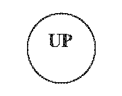
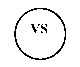
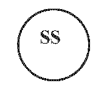
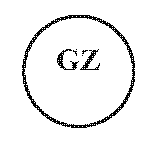
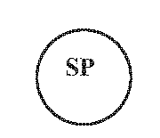

# § 12 Označovanie uznaných zdrojov, génových základní a semenných porastov v teréne a lesníckych mapách

(1) Výberový strom sa v teréne označuje

- a) dvoma rovnobežnými pruhmi so šírkou 5 cm žltej farby vo výške 1,3 m po celom obvode kmeňa s medzerou medzi pruhmi 15 cm,

- b) číslom stromu, podľa uznávacieho listu, žltej farby do medzery vymedzenej pruhmi podľa písmena a).

(2) Uznaný lesný porast sa v teréne označuje jedným 5 cm širokým pruhom zelenej farby po celom obvode kmeňa stromu vo výške 1,3 m na okrajových stromoch lesného porastu. Ak je hranica uznaného lesného porastu totožná s hranicou jednotky priestorového rozdelenia lesa vyznačenou podľa osobitného predpisu,8a) uznaný lesný porast sa v teréne neoznačuje.

(3) Semenný porast sa označuje hospodárskymi kopcami na rohoch a lomových bodoch jednotky priestorového rozdelenia lesa; po odrastení semenného porastu na okrajových stromoch žltým pruhom so šírkou 10 cm po celom obvode kmeňa vo výške 1,3 m.

(4) Hranica génovej základne sa v teréne označuje znakom G zelenej farby vo výške 1,3 m na okrajových stromoch hranice génovej základne.

(5) Hranice uznaných lesných porastov, semenných porastov a génových základní sa označujú tak, aby bolo označenie v teréne zreteľné a ľahko identifikovateľné.

(6) Na označenie semenného zdroja uznaného na viac ako jeden rok sa ustanovenia odsekov 1 až 5 použijú primerane.

(7) Uznaný zdroj označuje v teréne správca zdroja; pri semennom zdroji osoba, na ktorej podnet bol semenný zdroj uznaný.

(8) V lesníckych mapách sa zdroj označuje týmito značkami:

- a) uznaný lesný porast

- b) výberový strom

- c) semenný sad

- d) génová základňa

- e) semenný porast

