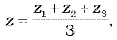
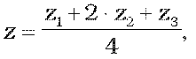

# Čl. I

Vyhláška Ministerstva školstva Slovenskej republiky č. 318/2008 Z. z. o ukončovaní štúdia na stredných školách sa mení a dopĺňa takto:

- 1.V § 6 ods. 9 sa na konci pripája táto veta: „Externú časť maturitnej skúšky, písomnú formu internej časti maturitnej skúšky a ústnu formu internej časti maturitnej skúšky z predmetu podľa odseku 5 písm. b) a odseku 7 písm. b) žiak vykoná na úrovni C1 jazykovej náročnosti Spoločného európskeho referenčného rámca.“.

- 2. V § 6 ods. 10 sa za slovo „B1“ vkladajú slová „alebo B2“.

- 3. V § 7 ods. 10 sa slovo „B2“ nahrádza slovami „B1 alebo B2“.

- 4. V § 7 ods. 10 sa na konci pripája táto veta: „Externú časť maturitnej skúšky, písomnú formu internej časti maturitnej skúšky a ústnu formu internej časti maturitnej skúšky z predmetu podľa odseku 5 písm. b) žiak vykoná na úrovni C1 jazykovej náročnosti Spoločného európskeho referenčného rámca.“.

- 5. V § 7 ods. 11 sa za slovo „B1“ vkladajú slová „alebo B2“.

- 6. V § 8 ods. 2 až 4 a 7 sa za slová „na návrh“ vkladá slovo „predsedu“.

- 7. V § 9 ods. 1 sa za slová „na návrh“ vkladá slovo „predsedu“.

- 8. V § 12 ods. 5 sa za písmeno y) vkladajú nové písmená z) a aa), ktoré znejú:

- „z)

- umenie a kultúra,

- aa)

- rómsky jazyk a literatúra.“.

- Doterajšie písmeno z) sa označuje ako písmeno ab).

- 9. V § 14 ods. 6 sa vypúšťa písmeno d).

- 10. V § 15 odseky 2 a 3 znejú:

- „(2)

- Externá časť a každá forma internej časti maturitnej skúšky sa hodnotí osobitne a toto hodnotenie je uvedené aj na vysvedčení o maturitnej skúške. Externá časť sa hodnotí percentami úspešnosti a percentilom. Písomná forma internej časti sa hodnotí percentami úspešnosti. Ústna forma internej časti sa hodnotí stupňom prospechu. Hodnotenie vyjadrené percentami úspešnosti a percentilom sa zaokrúhľuje na desatiny.

- (3)

- Pokyny na hodnotenie úloh s krátkou odpoveďou externej časti a pokyny na hodnotenie písomnej formy internej časti maturitnej skúšky sú centrálne vypracované a sú prílohou ich zadania.“.

- 11. V § 15 ods. 5 sa vypúšťajú slová „a v maturitnej téme“.

- 12. V § 15 odsek 6 znie:

- „(6)

- Každý predmet maturitnej skúšky má v maturitnom zadaní aspoň dve úlohy vyjadrené ich váhou vzhľadom na celkové hodnotenie. Celkovým hodnotením ústnej formy internej časti maturitnej skúšky z daného predmetu je stupeň prospechu, ktorý vzniká ako vážený priemer stupňov prospechu z odpovedí na jednotlivé úlohy maturitného zadania. Pritom sa vážený priemer pri hodnotení vyjadrenom stupňom prospechu zaokrúhľuje na celé číslo, pričom 1,5 sa zaokrúhľuje na 1; 2,5 sa zaokrúhľuje na 2; 3,5 sa zaokrúhľuje na 3 a 4,5 sa zaokrúhľuje na 4; stupeň prospechu vyjadrený číslom s desatinnou časťou do 0,50 sa zaokrúhľuje na celé číslo smerom nadol a nad 0,50 sa zaokrúhľuje na celé číslo smerom nahor.“.

- 13. V § 15 ods. 7 písmeno a) znie:

- „a)

- nie je horšie ako stupeň prospechu 3 – dobrý a v písomnej forme internej časti maturitnej skúšky získa viac ako 25 % z celkového počtu bodov alebo v externej časti získa viac ako 33 % z celkového počtu bodov, alebo“.

- 14. V § 15 ods. 8 písmeno a) znie:

- „a)

- nie je horšie ako stupeň prospechu 3 – dobrý a v externej časti maturitnej skúšky získa viac ako 25 % z celkového počtu bodov alebo“.

- 15. V § 17 sa vypúšťa odsek 7.

- 16. Za § 17 sa vkladá § 17a, ktorý znie:

- 㤠17a

- Žiak so sluchovým postihnutím si môže v príslušnom školskom roku do 30. septembra 2019 namiesto predmetu cudzí jazyk zvoliť jeden z predmetov matematika alebo náuka o spoločnosti, alebo občianska náuka.“.

- 17. V prílohe I. časti riadky 1, 4, 12, 14, 17 a 18 znejú:

- „

- 1 | anglický jazyk | C1 | 120´ | 60´ | 20´ | 20´

- | | B2 | 120´ | 60´ | 20´ | 20´

- | | B1 | 100´ | 60´ | 20´ | 20´

- 4 | francúzsky jazyk | C1 | 120´ | 60´ | 20´ | 20´

- | | B2 | 120´ | 60´ | 20´ | 20´

- | | B1 | 100´ | 60´ | 20´ | 20´

- 12 | nemecký jazyk | C1 | 120´ | 60´ | 20´ | 20´

- | | B2 | 120´ | 60´ | 20´ | 20´

- | | B1 | 100´ | 60´ | 20´ | 20´

- 14 | ruský jazyk | C1 | 120´ | 60´ | 20´ | 20´

- | | B2 | 120´ | 60´ | 20´ | 20´

- | | B1 | 100´ | 60´ | 20´ | 20´

- 17 | španielsky jazyk | C1 | 120´ | 60´ | 20´ | 20´

- | | B2 | 120´ | 60´ | 20´ | 20´

- | | B1 | 100´ | 60´ | 20´ | 20´

- 18 | taliansky jazyk | C1 | 120´ | 60´ | 20´ | 20´

- | | B2 | 120´ | 60´ | 20´ | 20´

- | | B1 | 100´ | 60´ | 20´ | 20´

- “.

- 18. V prílohe sa I. časť dopĺňa riadkami 41 a 42, ktoré znejú:

- „

- 41 | umenie a kultúra | | - | - | 20´ | 20´

- 42 | rómsky jazyk a literatúra | | - | - | 20´ | 20´

- “.

- 19. V prílohe II. časti prvý bod znie:

- „1.

- Cudzí jazyk – anglický jazyk, francúzsky jazyk, nemecký jazyk, ruský jazyk, talianska jazyk a španielsky jazyk.

- Cudzí jazyk obsahom a úrovňou náročnosti zodpovedá jazykovej úrovni B2 alebo B1 Spoločného európskeho referenčného rámca. Predmet druhý vyučovací jazyk v bilingválnych triedach stredných škôl alebo v bilingválnych školách obsahom a náročnosťou zodpovedá úrovni C1 Spoločného európskeho referenčného rámca.Voliteľný predmet cudzí jazyk obsahom a úrovňou náročnosti zodpovedá jazykovej úrovni B1 alebo B2 Spoločného európskeho referenčného rámca.

- Externá časť maturitnej skúšky z cudzieho jazyka pozostáva z centrálne vypracovanej, vo všetkých školách v rovnakom čase zadanej, pod externým dozorom konanej a externe vyhodnotenej písomnej skúšky – testu. Test overuje komunikačné kompetencie na úrovni B1 a B2 Spoločného európskeho referenčného rámca pre cudzie jazyky v častiach počúvanie s porozumením, čítanie s porozumením a použitie gramatiky a lexiky. Test obsahuje úlohy s výberom odpovede a úlohy s krátkou odpoveďou.

- Externá časť maturitnej skúšky z druhého vyučovacieho jazyka pozostáva z centrálne vypracovanej, vo všetkých školách v rovnakom čase zadanej, pod externým dozorom konanej a externe vyhodnotenej písomnej skúšky – testu. Test overuje komunikačné kompetencie na úrovni C1 Spoločného európskeho referenčného rámca pre cudzie jazyky v častiach počúvanie s porozumením, čítanie s porozumením a použitie gramatiky a lexiky. Test obsahuje úlohy s výberom odpovede a úlohy s krátkou odpoveďou.

- Úpravy pre žiakov so zdravotným znevýhodnením:

- Test z cudzieho jazyka alebo z druhého vyučovacieho jazyka pre žiakov so sluchovým postihnutím neobsahuje úlohy na počúvanie s porozumením.

- Písomnou formou internej časti maturitnej skúšky je vypracovanie centrálne zadanej témy v určenej žánrovej forme. Písomná forma internej časti maturitnej skúšky sa zadáva vo všetkých školách v rovnakom čase, koná sa pod externým dozorom a vyhodnocuje sa interne na základe centrálnych pokynov.

- Charakteristika témy písomnej formy internej časti maturitnej skúšky pre úroveň C1:

- a)

- napísať jasný, detailný a správne kompozične a syntakticky členený text na zložité témy so spoločenskou alebo s odbornou tematikou,

- b)

- písať podrobne, štylisticky a jazykovo správne o udalostiach, reálnych alebo fiktívnych zážitkoch,

- c)

- napísať dobre zrozumiteľný príbeh, esej, recenziu,

- d)

- napísať pozdrav, pozvanie, odkaz, blahoželanie, telegram,

- e)

- napísať súkromný a formálny list, obchodný list, žiadosť, životopis, sťažnosť, reklamáciu, inzerát, odborný referát s využitím adekvátnych štylistických postupov a odbornej terminológie s prihliadnutím na cieľovú skupinu príjemcov,

- f)

- opísať osobu, predmet, miesto, činnosť, situáciu, vytvoriť syntakticky správny opis a imaginatívny test,

- g)

- napísať súvislý text, v ktorom žiak vyjadrí svoje názory, postoje, myšlienky, city a pomocou doplňujúcich argumentov a vhodných príkladov dokáže podrobne vysvetliť a podporiť svoje stanoviská a názory a vhodne ich ukončiť,

- h)

- napísať referát, diskusný príspevok, správu, prejav a použiť zodpovedajúcu odbornú terminológiu,

- i)

- vedieť aplikovať štylistické a kompozičné postupy náučného a populárno-náučného štýlu.

- Charakteristika témy písomnej formy internej časti maturitnej skúšky pre úroveň B2:

- a)

- napísať jasný a detailný text na rôzne témy, ktoré žiaka zaujímajú,

- b)

- písať podrobne, štylisticky a jazykovo správne o udalostiach, reálnych alebo fiktívnych zážitkoch,

- c)

- napísať dobre zrozumiteľný príbeh,

- d)

- napísať pozdrav, pozvanie, odkaz, blahoželanie, telegram,

- e)

- napísať súkromný a formálny list, žiadosť, životopis, sťažnosť, reklamáciu, inzerát,

- f)

- opísať osobu, predmet, miesto, činnosť, situáciu,

- g)

- napísať súvislý text, v ktorom žiak vyjadrí svoje názory, postoje, myšlienky, city,

- h)

- napísať referát, diskusný príspevok, správu, rozprávanie.

- Charakteristika témy písomnej formy internej časti maturitnej skúšky pre úroveň B1:

- a)

- písať jednoducho a jasne o témach, ktoré sú žiakovi známe a zaujímajú ho,

- b)

- vyjadriť svoj názor na témy, ktoré žiaka zaujímajú,

- c)

- vyjadriť svoje pocity (ľútosť, radosť, záujem, súcit a pod.),

- d)

- napísať pozdrav, pozvanie, odkaz, blahoželanie, telegram,

- e)

- napísať súkromný a formálny list, žiadosť, životopis, sťažnosť, reklamáciu, inzerát,

- f)

- opísať osobu, predmet, miesto, činnosť, situáciu.“.

- 20. V prílohe III. časti v prvej vete predmetov Anglický jazyk, Francúzsky jazyk, Nemecký jazyk, Ruský jazyk, Španielsky jazyk a Taliansky jazyk sa slová „pre obidve úrovne“ nahrádzajú slovami „pre všetky úrovne“.

- 21. V prílohe III. časti v predmete Anglický jazyk tretia veta znie: „Charakteristika úloh maturitných zadaní“.

- 22. V prílohe III. časti v predmete Informatika časť „Zastúpenie jednotlivých tematických okruhov v úlohách maturitných zadaní“ znie:

- „Úloha č. 1 – algoritmy a programovanie

- Úloha č. 2 – informácie okolo nás, informačná spoločnosť, počítačové systémy, internet“.

- 23. V prílohe III. časti v predmetoch Biológia, Dejepis, Fyzika, Geografia, Chémia, Maďarský jazyk a literatúra, Matematika, Náuka o spoločnosti, Občianska náuka, Slovenský jazyk a literatúra, Slovenský jazyk a slovenská literatúra, Ukrajinský jazyk a literatúra, Dejiny umenia, Deskriptívna geometria, Ekológia, Ekonomika, Estetika, Evanjelické a. v. náboženstvo, Kresťanská etika, Právo, Psychológia, Reformované náboženstvo, Katolícke náboženstvo, Muzikál a Literárna tvorba v časti „Zastúpenie jednotlivých tematických okruhov v úlohách maturitných zadaní“ sa vypúšťa percentuálne zastúpenie jednotlivých tematických okruhov.

- 24. V prílohe III. časti v predmete Geografia v časti „Zastúpenie jednotlivých tematických okruhov v úlohách maturitných zadaní pre žiakov so zrakovým postihnutím“ sa vypúšťa percentuálne zastúpenie jednotlivých tematických okruhov.

- 25. V prílohe III. časti v predmetoch Matematika, Náuka o spoločnosti a Občianska náuka v časti „Zastúpenie jednotlivých tematických okruhov v úlohách maturitných zadaní pre žiakov so sluchovým postihnutím“ sa vypúšťa percentuálne zastúpenie jednotlivých tematických okruhov.

- 26. V prílohe III. časti v predmetoch Stretnutia s ľudovou kultúrou, Športový manažment a Základy športovej prípravy v časti „Zastúpenie uvedených jednotlivých častí učiva v súbore všetkých otázok v maturitných zadaniach“ sa vypúšťa percentuálne zastúpenie jednotlivých častí učiva.

- 27. V prílohe sa III. časť dopĺňa novými predmetmi UMENIE A KULTÚRA a RÓMSKY JAZYK A LITERATÚRA, ktoré znejú:

- „UMENIE a KULTÚRA

- Charakteristika úloh maturitných zadaní

- Úloha č. 1 – Úloha je zameraná na schopnosti riešenia problémov. Žiak má preukázať schopnosi samostatne riešiť problémy týkajúce sa kultúry a umenia, ako aj schopnosti tvoriť vlastné projekty na riešenie modelových situácií. V úlohe má určené, akých kultúrnych artefaktov alebo situácií sa problém týka, prípadne sa zadáva modelová situácia. Predpokladá sa, že v úlohe bude pracovať s literatúrou a s ukážkami. Prevláda metóda prezentácie riešenia. Ak je súčasťou úlohy prezentácia vlastných názorov a estetických súdov, žiak v dialógu s členmi maturitnej komisie prezentuje schopnosť argumentácie.

- Úloha č. 2 – Úloha je zameraná na aplikáciu. Žiak má preukázať, ako v riešení z prvej úlohy aplikoval poznatky a vedomosti, ako prepája teoretické poznatky o kultúre so skutočným životom, prípadne ako by riešenie z prvej úlohy aplikoval v novej situácii. Žiak preukazuje schopnosti aplikácie, ako aj schopnosti reflektovať túto aplikáciu. V dialógu s členmi komisie prezentuje schopnosť argumentácie.

- Úloha č. 3 – Úloha je zameraná na poznanie a vedomosti. Žiak má preukázať osvojené poznanie, vedomosti a informácie, s ktorými pracoval v prvých úlohách.

- Všeobecné pomôcky

- Dejiny rôznych druhov umenia a kultúry

- Všeobecné encyklopédie

- Monografie umelcov, ukážky tvorby z rôznych umeleckých druhov

- Mapy sveta, Európy, Slovenskej republiky

- Hodnotenie

- a)

- Každá úloha maturitného zadania sa hodnotí stupňom prospechu 1 až 5.

- b)

- Váha hodnotenia jednotlivých úloh je 1 : 1 : 1. Pri výpočte váženého priemeru sa používa vzorec

- 

- pričom z je po zaokrúhlení výsledná známka a zi je známka za úlohu č. i.

- Úpravy pre žiakov so zdravotným znevýhodnením

- Trvanie skúšky: 30 minút

- Čas na prípravu: 30 minút

- RÓMSKY JAZYK A LITERATÚRA

- Charakteristika úloh maturitných zadaní

- Úloha č. 1 – Úloha je zameraná na čítanie textu v rómskom jazyku v rozsahu minimálne troch a maximálne šiestich viet publicistického alebo beletristického žánru. Žiak má vedieť text reprodukovať, prerozprávať obsah. Predmetová maturitná komisia hodnotí obsahovú a jazykovú presnosť, súvislosť prejavu, využívanie neologizmov, lineárnosť vo vyjadrovaní a snahu používať adekvátne jazykové prostriedky zodpovedajúce danej úrovni žiaka (prevláda forma monológu).

- Úloha č. 2 – Úlohou žiaka je zaujať stanovisko k téme a odôvodniť ho v rozhovore s členmi predmetovej maturitnej komisie, ktorá vedie rozhovor podľa zásad uvedených v metodických pokynoch pre predmetové maturitné komisie. Predmetová maturitná komisia hodnotí, ako žiak dokáže zdôvodniť a vysvetliť svoje názory na príslušnú tému a argumentovať k problematike, výber faktov a informácií, gramatickú presnosť, lexikálny rozsah, náročnosť spracovania rozhovoru, argumentáciu, plynulosť a súvislosť vyjadrovania (prevláda forma dialógu s členmi predmetovej maturitnej komisie).

- Úloha č. 3 – Úloha je zameraná na vyriešenie konkrétnej situácie z každodenného života v okruhu príslušných tém. Predmetová maturitná komisia sa zameriava na hodnotenie výberu a adekvátnosť použitia jazykových prostriedkov, pohotovosť vyjadrovania, jazykovú a obsahovú správnosť (prevláda forma dialógu s členmi predmetovej maturitnej komisie).

- Všeobecné pomôcky

- Prekladový slovník

- Hodnotenie

- a)

- Každá úloha maturitného zadania sa hodnotí stupňom prospechu 1 až 5.

- b)

- Váha hodnotenia jednotlivých úloh je 1 : 2 : 1. Pri výpočte váženého priemeru sa používa vzorec

- 

- pričom z je po zaokrúhlení výsledná známka a zi je známka za úlohu č. i.

- Úpravy pre žiakov so zdravotným znevýhodnením

- Trvanie skúšky: 30 minút

- Čas na prípravu: 30 minút“.

- 28. V prílohe IV. časti vo Všeobecných pokynoch sa vypúšťa bod 2.

- Doterajšie body 3 až 6 sa označujú ako body 2 až 5.

- 29. V prílohe IV. časti v Teoretickej časti odbornej zložky a Praktickej časti odbornej zložky názov skupiny študijných odborov s kódom 21 znie:

- „21 Baníctvo, geológia a geotechnika“.

- 30. V prílohe IV. časti v Teoretickej časti odbornej zložky a Praktickej časti odbornej zložky názvy skupín študijných odborov s kódmi 23 a 24 znejú:

- „23 Strojárstvo a ostatná kovospracúvacia výroba I, 24 Strojárstvo a ostatná kovospracúvacia výroba II“.

- 31. V prílohe IV. časti v Teoretickej časti odbornej zložky a Praktickej časti odbornej zložky názov skupiny študijných odborov s kódom 28 znie:

- „28 Technická a aplikovaná chémia“.

- 32. V prílohe IV. časti v Teoretickej časti odbornej zložky a Praktickej časti odbornej zložky názvy skupín študijných odborov s kódmi 42 a 45 znejú:

- „42 Poľnohospodárstvo, lesné hospodárstvo a rozvoj vidieka I, 45 Poľnohospodárstvo, lesné hospodárstvo a rozvoj vidieka II“.

- 33. V prílohe IV. časti v Teoretickej časti odbornej zložky a Praktickej časti odbornej zložky názov skupiny študijných odborov s kódom 53 znie:

- „53 Zdravotnícke odbory vzdelávania na stredných zdravotníckych školách“.

- 34. V prílohe IV. časti v Teoretickej časti odbornej zložky a Praktickej časti odbornej zložky sa slová „63 Ekonomika a organizácia, obchod a služby, 64 Ekonomika a organizácia, obchod a služby“ nahrádzajú slovami „62 Ekonomické vedy, 63 Ekonomika a organizácia, obchod a služby I, 64 Ekonomika a organizácia, obchod a služby II“.

- 35. V prílohe IV. časti v Teoretickej časti odbornej zložky a Praktickej časti odbornej zložky názvy skupín študijných odborov s kódom 82 a 85 znejú:

- „82 Umenie a umeleckoremeselná tvorba I, 85 Umenie a umeleckoremeselná tvorba II“.

- 36. V prílohe V. časti I. skupine písm. E prvom bode sa slovo „50 %“ nahrádza slovom „25 %“.

- 37. V prílohe V. časti II. skupine písm. A sa vypúšťajú body 7 a 8.

- 38. V prílohe V. časti II. skupine písm. B druhý bod znie:

- „2.

- písmo Arial, veľkosť písma 14 – 24 – 36 podľa potreby, riadkovanie 1,5 alebo 2,0, formát A4 alebo A3, voliteľné testy v Braillovom písme a elektronickej verzii (CD),“.

- 39. V prílohe V. časti II. skupine písm. B sa vypúšťajú body 9 a 10.

- Doterajší bod 11 sa označuje ako bod 9.

- 40. V prílohe V. časti II. skupine písm. C druhý bod znie:

- „2.

- písmo Arial, veľkosť písma 14 – 18 podľa potreby, riadkovanie 1,5 alebo 2,0, voliteľné testy v elektronickej verzii (CD),“.

- 41. V prílohe V. časti II. skupine písm. C sa vypúšťa bod 6.

- 42. V prílohe V. časti II. skupine písm. E sa vypúšťa bod 7.

- 43. V prílohe V. časti II. skupine písm. H sa vypúšťa bod 7.

- 44. V prílohe V. časti III. skupina znie:

- „III.

- skupina – ťažký stupeň obmedzenia

- A.

- Žiaci zaradení do tretej skupiny sú schopní absolvovať maturitnú skúšku s úpravami uvedenými v II. skupine s pomocou asistenta alebo tlmočníka posunkovej reči.

- B.

- Žiaci s viacnásobným postihnutím zaradení do tretej skupiny, ktorým sa v priebehu vzdelávania zmenil zdravotný stav tak, že nie sú schopní absolvovať písomnú formu internej časti maturitnej skúšky podľa písmena A, vykonajú iba externú časť a ústnu formu internej časti maturitnej skúšky podľa písmena A.

- Úpravy pre žiakov s viacnásobným postihnutím podľa písmena B

- Predĺženie času skúšky podľa individuálnej potreby s prihliadnutím na aktuálny zdravotný stav.“.
