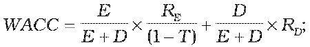
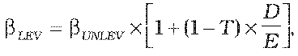

# § 3 Spôsob určenia výšky primeraného zisku

(1) Primeraný zisk zohľadňuje rozsah potrebných investícií na zabezpečenie dlhodobej spoľahlivej, bezpečnej a efektívnej prevádzky siete, primeranú návratnosť prevádzkových aktív a stimuláciu stabilného dlhodobého podnikania.

(2) Spôsob určenia výšky primeraného zisku za prístup do distribučnej siete a distribúciu plynu pre regulovaný subjekt, ktorý distribuuje plyn distribučnou sieťou v roku t a do ktorej je v roku t-1 pripojených menej ako 100 000 odberných miest, je ustanovený v § 13 ods. 5.

(3) Výška primeraného zisku za dodávku plynu pre domácnosti je stanovená v § 18 ods. 8. Výška primeraného zisku za dodávku plynu na výrobu tepla určeného pre domácnosť je stanovená v § 21 ods. 3 písm. f). Výška primeraného zisku za dodávku plynu dodávateľom poslednej inštancie je ustanovená v § 23 ods. 3 písm. f).

(4) Výška primeraného zisku za prístup do distribučnej siete a distribúciu plynu pre regulovaný subjekt, ktorý distribuuje plyn distribučnou sieťou v roku t a do ktorej je v roku t-1 pripojených viac ako 100 000 odberných miest, je určená ako miera výnosnosti regulačnej bázy aktív pred zdanením na regulačné obdobie,

kde

WACC je určená reálna miera výnosnosti regulačnej bázy aktív pred zdanením na regulačné obdobie vypočítaná podľa vzorca

pre rok 2012 je úradom určená miera výnosnosti regulačnej bázy aktív WACC vo výške 6,04 %,

kde

T je sadzba dane z príjmov na rok t,

E je vlastné imanie v eurách k 31. decembru 2010,

D sú cudzie zdroje v eurách k 31. decembru 2010,

RD je reálna cena cudzích zdrojov, prepočítaná priemerná výška úverov poskytnutých nefinančným spoločnostiam na obdobie piatich a viac rokov s výškou úveru nad jeden milión eur, na rok 2012 vo výške 5,13 %,

RE je reálna cena vlastného kapitálu a vlastných zdrojov vypočítaná podľa vzorca

Re = RF + $LEV x (RM - RF)

kde

RF je výnosnosť bezrizikového aktíva, prepočítaný priemerný výnos päť a viacročných štátnych dlhopisov emitovaných na slovenskom trhu za roky 2007 až 2011, na rok 2012 vo výške 4,01 %,

bLEV je vážený koeficient b, ktorý definuje citlivosť akcie spoločnosti na riziko trhu so zohľadnením sadzby dane z príjmov a podielu cudzích zdrojov, vypočítaný podľa vzorca

kde

bUNLEV je nevážený koeficient b bez vplyvu sadzby dane z príjmov a podielu cudzích zdrojov na rok 2012 vo výške 0,30; pre ďalšie roky je určený úradom v intervale ,

T je sadzba dane z príjmov na rok t,

D/E je pomer cudzích zdrojov k vlastnému imaniu; na rok 2012 je určený vo výške 60 % v prospech cudzieho kapitálu,

RM je výkonnosť tržného portfólia určená úradom na rok 2012 vo výške 7,01 %,

(RM – RF) je celková riziková prémia pre rok 2012 určená úradom vo výške 3 %; pre ďalšie roky určená úradom v intervale 3 % až 6 %.

(5) Hodnoty parametrov pre ďalšie roky, ktoré slúžia na výpočet miery výnosnosti regulačnej bázy aktív WACC budú zverejnené na webovom sídle úradu do 30. júna kalendárneho roku.
