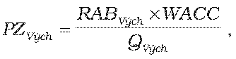

# § 10 Výpočet východiskovej maximálnej ceny za prístup do distribučnej siete a distribúciu plynu

(1) PCDVých je východisková maximálna cena za prístup do distribučnej siete a distribúciu plynu v eurách na objemovú jednotku množstva distribuovaného plynu pre regulačné obdobie 2012 – 2016 a zároveň je cenou za prístup do distribučnej siete a distribúciu plynu na prvý rok tohto regulačného obdobia, teda PCDVých = PCD2012, a vypočíta sa podľa vzorca

PCDVých= OVých + PNVých + PZVých,

kde

OVých je východisková ročná hodnota odpisov regulovaného subjektu v eurách na objemovú jednotku množstva distribuovaného plynu vo východiskovom roku regulačného obdobia. Pre potreby regulácie je OVých určená úradom na základe hodnoty regulovanej bázy aktív regulovaného subjektu RABVých, zohľadňujúc zostatkovú dobu technickej životnosti aktív,

PNVých sú ročné prevádzkové náklady regulovaného subjektu v eurách na objemovú jednotku množstva distribuovaného plynu vo východiskovom roku regulačného obdobia súvisiace s regulovanou činnosťou okrem odpisov, určené podľa § 2 ods. 1. PNVých sú stanovené na celé regulačné obdobie a zahŕňajú aj plánované náklady na plnenie povinností regulovaného subjektu vyplývajúcich z osobitného predpisu28) a hodnotu plánovaných nákladov na krytie strát a vlastnej spotreby plynu v sieti pre rok 2012. Do prevádzkových nákladov vynaložených za prístup do distribučnej siete a distribúciu plynu, ktoré sú zabezpečované regulovaným subjektom, iným ako regulovaným subjektom alebo subjektom, ktorý je alebo bol súčasťou vertikálne integrovaného podniku,23) je možné zarátať len primerané náklady, ktorých výška je v súlade s § 12 ods. 11 písm. f) zákona. Výpočet PNVých sa predloží regulovaným subjektom ako súčasť návrhu ceny spolu s odôvodnením výpočtu jednotlivých nákladových položiek,

PZVých je východisková hodnota primeraného zisku regulovaného subjektu určená podľa odseku 2.

(2) PZvých je východisková hodnota primeraného zisku, ktorá sa vypočíta podľa vzorca

kde

RABVých je hodnota regulovanej bázy aktív vo východiskovom roku regulačného obdobia v eurách, ktorá zohľadňuje hodnotu

- a) majetku regulovaného subjektu z roku 2006 používaného výhradne na regulovanú činnosť, ktorý bol predmetom znaleckého posudku zo strany úradu,

- b) skutočných investícií v rokoch 2007 až 2010,

- c) plánovaných investícií v roku 2011,

- d) stanovených odpisov na obdobie rokov 2007 až 2010 a plánovaných odpisov na rok 2011,

WACC je určená miera výnosnosti regulačnej bázy aktív podľa § 3 ods. 4 a 5,

QVých je celkový objem množstva distribuovaného plynu vo východiskovom roku regulačného obdobia vypočítaný z priemerného množstva distribuovaného plynu v rokoch t-3 až t+1, pričom

za roky t-3 a t-2 sa použije skutočný objem distribuovaného plynu,

za rok t-1 sa použije skutočný objem distribuovaného plynu za mesiace január až jún a plánovaný objem distribuovaného plynu za mesiace júl až december,

za roky t a t+1 sa použije plánovaný objem distribuovaného plynu.

(3) Ak sa regulovaným subjektom v priebehu východiskového roka predloží návrh na zmenu ceny za prístup do distribučnej siete a distribúciu plynu, maximálna cena za prístup do distribučnej siete a distribúciu plynu v eurách na objemovú jednotku na zostávajúce obdobie východiskového roku sa vypočíta podľa vzorca

PCDVýchZ = PCDVých + Z,

kde

PCDVýchZ je maximálna cena za prístup do distribučnej siete a distribúciu plynu v eurách na objemovú jednotku množstva distribuovaného plynu na zostávajúce obdobie východiskového roku,

PCDVých je východisková maximálna cena za prístup do distribučnej siete a distribúciu plynu v eurách na objemovú jednotku množstva distribuovaného plynu na rok 2012,

Z je hodnota zmeny v eurách na objemovú jednotku množstva distribuovaného plynu, ktorá odzrkadľuje zmenu ekonomických parametrov, ktoré ovplyvňujú náklady regulovaného subjektu a z ktorých sa vychádzalo pri určení východiskovej maximálnej ceny za prístup do distribučnej siete a distribúciu plynu na rok 2012. Hodnota zmeny sa zdôvodňuje analýzami v predloženom návrhu na zmenu ceny za prístup do distribučnej siete a distribúciu plynu.
