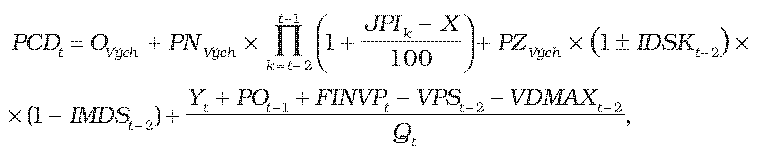

# § 11

(1) Maximálna cena za prístup do distribučnej siete a distribúciu plynu PCDtv eurách na objemovú jednotku množstva distribuovaného plynu na rok 2013 a nasledujúce roky regulačného obdobia sa vypočíta podľa vzorca

kde

OVých je východisková ročná hodnota odpisov podľa § 10 ods. 1,

PNVých je východisková ročná hodnota prevádzkových nákladov podľa § 10 ods. 1,

PZVých je východisková hodnota primeraného zisku podľa § 10 ods. 2,

JPIk je aritmetický priemer hodnôt ukazovateľa „jadrová inflácia“ za mesiace júl až december roku k-1 a január až jún roku k zverejnený Štatistickým úradom Slovenskej republiky v časti „Jadrová a čistá inflácia zmena oproti rovnakému obdobiu minulého roku v percentách“,

X je faktor efektivity v každom roku regulačného obdobia, ktorého hodnota je 3,5 %,

IDSKt-2 je index dosiahnutého plnenia štandardov kvality, ktorý je stanovený na základe dosiahnutej úrovne vybraných štandardov kvality v intervale 0 až 0,02; IDSKt-2 sa prvýkrát uplatní pri stanovení maximálnej ceny za prístup do distribučnej siete a distribúciu plynu na rok 2016; pre roky 2012 až 2015 sa hodnota IDSKt-2 rovná 0,

IMDSt-2 je index miery využitia dosiahnutých disponibilných zdrojov regulovaného subjektu, ktorý je stanovený úradom na základe využitia dosiahnutých disponibilných zdrojov regulovaného subjektu za rok t-2 na obnovu a rozvoj siete v intervale 0 až 0,01; IMDSt-2 sa prvýkrát uplatní pri stanovení maximálnej ceny za prístup do distribučnej siete a distribúciu plynu na rok 2014; pre roky 2012 a 2013 sa hodnota IMDSt-2 rovná 0,

VPSt-2 je hodnota skutočných ročných výnosov za pripojenie do distribučnej siete v eurách za rok t-2; pre roky 2012 a 2013 sa hodnota VPSt-2 rovná 0,

VDMAXt-2 je hodnota skutočných ročných výnosov za prekročenie zmluvne dohodnutej dennej distribučnej kapacity v eurách za rok t-2; pre roky 2012 a 2013 sa hodnota VDMAXt-2 rovná 0,

Ytje hodnota vyjadrená v eurách zohľadňujúca

- a) dodatočné náklady na plnenie povinností regulovaného subjektu vyplývajúcich z osobitného predpisu28) a dodatočné náklady neočakávaných zmien z dôvodu zmeny právnych predpisov,

- b) hodnotu zmeny nákladov na krytie strát a vlastnej spotreby plynu v sieti v roku t oproti plánovanej hodnote nákladov na krytie strát a vlastnej spotreby plynu v sieti v roku t-1,

POt-1 je hodnota odpisov v eurách zo zaradeného nového dlhodobého majetku nevyhnutne potrebného na zabezpečenie prevádzkyschopnosti siete zohľadňujúca technickú dobu životnosti zaradeného majetku v roku t-1 najviac vo výške 2,5 % jeho obstarávacej hodnoty,

FINVPt je faktor investícií v eurách na rok t vypočítaný podľa vzorca

FINVPt = SOt-2 – POt-2,

kde

SOt-2 je skutočná hodnota odpisov v eurách zo skutočnej hodnoty zaradeného nového dlhodobého majetku nevyhnutne potrebného na zabezpečenie prevádzkyschopnosti siete zohľadňujúca technickú dobu životnosti zaradeného majetku v roku t-2, najviac vo výške 2,5 % jeho obstarávacej hodnoty,

POt-2 je plánovaná hodnota odpisov v eurách zo zaradeného nového dlhodobého majetku nevyhnutne potrebného na zabezpečenie prevádzkyschopnosti siete zohľadňujúca technickú dobu životnosti zaradeného majetku v roku t-2 najviac vo výške 2,5 % jeho obstarávacej hodnoty,

FINVPtsa uplatní po prvýkrát na rok 2014, pre roky 2012 a 2013 sa hodnota FINVPt rovná 0.

Qt je plánovaný objem množstva distribuovaného plynu na rok t.

Všetky hodnoty sa zdôvodňujú analýzami v predloženom cenovom návrhu.

(2) Ak je hodnota rozdielu JPIk a X nižšia ako 0, na účely výpočtu maximálnej ceny za prístup do distribučnej siete a distribúciu plynu na rok t sa hodnota rozdielu rovná 0.

(3) Ak sa regulovaným subjektom v priebehu regulačného roka t predloží návrh na zmenu ceny za prístup do distribučnej siete a distribúciu plynu, maximálna cena za prístup do distribučnej siete a distribúciu plynu PCDtz v eurách na objemovú jednotku množstva distribuovaného plynu na zostávajúce obdobie roku t sa vypočíta podľa vzorca

PCDtz = PCDt + Z,

kde

PCDtje maximálna cena za prístup do distribučnej siete a distribúciu plynu na objemovú jednotku množstva distribuovaného plynu v eurách v roku t regulačného obdobia,

Z je hodnota zmeny v eurách na objemovú jednotku množstva distribuovaného plynu, ktorá odzrkadľuje zmenu ekonomických parametrov, ktoré ovplyvňujú náklady regulovaného subjektu a z ktorých sa vychádzalo pri určení maximálnej ceny za prístup do distribučnej siete a distribúciu plynu na rok t. Hodnota zmeny sa zdôvodňuje analýzami v predloženom návrhu na zmenu ceny za prístup do distribučnej siete a distribúciu plynu.
