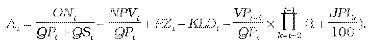
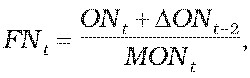
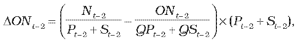
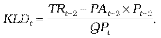

# § 13

(1) Maximálne ceny a tarify za prístup do distribučnej siete a distribúciu plynu na rok t sa navrhujú tak, aby celkové plánované tržby z maximálnych cien a taríf za prístup do distribučnej siete a distribúciu plynu v roku t regulačného obdobia v eurách na objemovú jednotku plynu distribuovaného užívateľom distribučnej siete neprekročili maximálnu cenu na rok t vypočítanú podľa odseku 3.

(2) Maximálne ceny a tarify za prístup do distribučnej siete a distribúciu plynu na rok t sa zároveň navrhujú tak, aby neobsahovali krížové dotácie medzi jednotlivými skupinami odberateľov plynu a zohľadňovali príslušnú tlakovú úroveň distribučnej siete.

(3) Maximálna cena za prístup do distribučnej siete a distribúciu plynu At v eurách za objemovú jednotku plynu distribuovaného pre užívateľov distribučnej siete na rok t sa vypočíta podľa vzorca

kde

ONt sú plánované oprávnené náklady v eurách nevyhnutne vynaložené na distribúciu plynu na rok t, určené podľa § 2 ods. 1, kde celková výška oprávnených nákladov na distribúciu plynu na rok t na účely kalkulácie cien nesmie prekročiť hodnotu maximálnych oprávnených nákladov na rok t určenú podľa odseku 4; na účely kalkulácie oprávnených nákladov možno zvýšiť priemerné ročné osobné náklady na jedného zamestnanca podľa § 2 ods. 1 písm. e),

NPVt je neoprávnený prebytok výnosov v eurách, ktorý predstavuje celkovú sumu neoprávnených výnosov; vypočíta sa ako rozdiel skutočných výnosov z regulovanej činnosti a celkových výnosov z regulovanej činnosti, ktoré bol regulovaný subjekt oprávnený dosiahnuť; takto vypočítaný neoprávnený prebytok výnosov sa použije na účely určenia ceny na nasledujúci regulačný rok po roku, v ktorom úrad dodatočne zistí, že regulovaný subjekt fakturoval nesprávnu cenu alebo že úrad schválil regulovanému subjektu cenu alebo tarify na základe nesprávnych údajov, čím sa mu neoprávnene zvýšili výnosy,

PZt je primeraný zisk na rok t v eurách na objemovú jednotku množstva distribuovaného plynu; najvyššia hodnota primeraného zisku, ktorá sa môže použiť na účely výpočtu maximálnej ceny za prístup do distribučnej siete a distribúciu plynu, sa vypočíta podľa odseku 5,

KLDt je korekčný faktor lokálnej distribúcie plynu pre rok t v eurách na objemovú jednotku množstva distribuovaného plynu, ktorý sa vypočíta podľa odseku 8,

QPt je plánovaný objem distribuovaného plynu pre všetkých užívateľov distribučnej siete v objemových jednotkách na rok t,

QSt je plánovaný objem distribuovaného plynu pre vlastnú spotrebu v objemových jednotkách na rok t,

VPt-2 je výška celkových skutočných výnosov prevádzkovateľa distribučnej siete v eurách za pripojenie do distribučnej siete v roku t -2,

JPIk je aritmetický priemer hodnôt ukazovateľa „jadrová inflácia“ za mesiace júl až december roku k-1 a január až jún roku k zverejnený Štatistickým úradom Slovenskej republiky v časti „Jadrová a čistá inflácia zmena oproti rovnakému obdobiu minulého roku v percentách“.

(4) Hodnota maximálnych oprávnených nákladov MONt v eurách na rok t sa vypočíta podľa vzorca

MONt = MJON (QPt + QSt ),

kde

MJON je hodnota maximálnych jednotkových oprávnených nákladov určená vo výške 0,03319 eura na objemovú jednotku.

(5) Najvyššia hodnota primeraného zisku PZt, ktorá sa môže použiť na účely výpočtu maximálnej ceny za prístup do distribučnej siete a distribúciu plynu, sa vypočíta podľa vzorca

PZt = 0,00342 + 0,01025 ´ (1 – FNt ),

kde

FNt je koeficient oprávnených nákladov na prístup do distribučnej siete a distribúciu plynu v eurách na objemovú jednotku distribuovaného plynu na rok t určený podľa odseku 6; ak je hodnota koeficientu nižšia ako 0, použije sa hodnota rovnajúca sa 0; ak je hodnota koeficientu vyššia ako 1, použije sa hodnota rovnajúca sa 1.

(6) Koeficient oprávnených nákladov na prístup do distribučnej siete a distribúciu plynu na objemovú jednotku distribuovaného plynu na rok t sa vypočíta podľa vzorca

kde

DONt-2 je rozdiel výšky skutočných nákladov na prístup do distribučnej siete a distribúciu plynu za rok t-2 a plánovaných nákladov na prístup do distribučnej siete a distribúciu plynu za rok t-2 v eurách určený podľa odseku 7.

(7) Rozdiel výšky skutočných nákladov na prístup do distribučnej siete a distribúciu plynu za rok t-2 a plánovaných nákladov na prístup do distribučnej siete a distribúciu plynu za rok t-2 v eurách sa vypočíta podľa vzorca

kde

Nt-2 sú skutočné oprávnené náklady v eurách na distribúciu plynu v roku t-2 určené podľa § 2 ods. 1; celková výška oprávnených nákladov na distribúciu plynu v roku t-2 na účely kalkulácie cien nesmie prekročiť hodnotu maximálnych oprávnených nákladov na rok t-2,

Pt-2 je skutočný objem distribuovaného plynu pre všetkých užívateľov distribučnej siete v objemových jednotkách v roku t-2,

St-2 je skutočný objem distribuovaného plynu pre vlastnú spotrebu v objemových jednotkách v roku t-2,

ONt-2 sú plánované oprávnené náklady v eurách na distribúciu plynu použité pri kalkulácii cien na rok t-2,

QPt-2 je plánovaný objem distribuovaného plynu pre všetkých užívateľov distribučnej siete v objemových jednotkách na rok t-2,

QSt-2 je plánovaný objem distribuovaného plynu pre vlastnú spotrebu v objemových jednotkách na rok t-2.

(8) Korekčný faktor lokálnej distribúcie plynu pre rok t v eurách na objemovú jednotku množstva distribuovaného plynu slúži na vyrovnanie nedostatku alebo prebytku príjmov v roku t-2 a vypočíta sa podľa vzorca

kde

TRt-2 sú celkové skutočné výnosy za prístup do distribučnej siete a distribúciu plynu v eurách v roku t–2, ktoré predstavujú súčin skutočného objemu distribuovaného plynu a fakturovanej ceny za prístup do distribučnej siete a distribúciu plynu,

PAt-2 je prepočítaná cena za prístup do distribučnej siete a distribúciu plynu v eurách na objemovú jednotku pre rok t–2; hodnota prepočítanej ceny za prístup do distribučnej siete a distribúciu plynu v eurách na objemovú jednotku pre rok t–2 sa vypočíta tak, že sa do vzorca podľa odseku 3 dosadia skutočné údaje za rok t-2.

(9) Pre regulovaný subjekt, ktorým sa predkladá návrh ceny za prístup do distribučnej siete a distribúciu plynu po prvýkrát na rok t, sa na účely výpočtu cien v roku t a v roku t+1 hodnota

- a) rozdielu výšky skutočných nákladov a plánovaných nákladov na prístup do distribučnej siete a distribúciu plynu za rok t-2 rovná 0,

- b) korekčného faktora lokálnej distribúcie plynu rovná 0.

(10) Na účely výpočtu korekčného faktora lokálnej distribúcie plynu na rok t sa pri výpočte prepočítanej ceny za prístup do distribučnej siete a distribúciu plynu za rok t-2 použijú hodnoty vo vzorcoch na výpočet primeraného zisku a maximálnych jednotkových oprávnených nákladov, na základe ktorých sa počítala priemerná cena za prístup do distribučnej siete a distribúciu plynu na rok t-2.

(11) Pri výpočte prepočítanej ceny za prístup do distribučnej siete a distribúciu plynu za rok t-2 sa použije hodnota korekčného faktora lokálnej distribúcie plynu a hodnota rozdielu výšky skutočných nákladov na prístup do distribučnej siete a distribúciu plynu za rok t-2 a plánovaných nákladov na prístup do distribučnej siete a distribúciu plynu za rok t-2, ktorá bola použitá pri výpočte priemernej ceny za prístup do distribučnej siete a distribúciu plynu na rok t-2.

(12) Pre regulovaný subjekt, ktorý nemal schválenú cenu za prístup do distribučnej siete a distribúciu plynu na celé obdobie roku t-2, sa na účely výpočtu cien v roku t hodnota

- a) rozdielu výšky skutočných nákladov a plánovaných nákladov na prístup do distribučnej siete a distribúciu plynu za rok t-2 rovná 0,

- b) korekčného faktora lokálnej distribúcie plynu rovná 0.

(13) Ak bola regulovanému subjektu na rok t-2 na základe jeho žiadosti schválená cena za prístup do distribučnej siete a distribúciu plynu nižšia o viac ako 10 % oproti priemernej cene za prístup do distribučnej siete a distribúciu plynu At -2 vypočítanej podľa odseku 3, na účely výpočtu KLDt na rok t sa pri výpočte TRt-2 namiesto fakturovanej ceny za prístup do distribučnej siete a distribúciu plynu v roku t-2 použije priemerná cena za prístup do distribučnej siete a distribúciu plynu At -2 vypočítaná podľa odseku 3.

(14) Regulovaným subjektom sa môže predložiť návrh ceny za prístup do distribučnej siete a distribúciu plynu aj na časť roku t. Táto skutočnosť sa regulovaným subjektom primerane zohľadní v predloženom návrhu ceny.

(15) Pri výpočtoch podľa odsekov 10 až 13 sa v rokoch 2014 až 2016 použije namiesto priemernej ceny maximálna cena.
