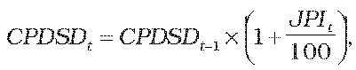
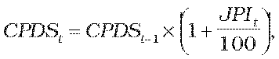

## Pripojenie do distribučnej siete a pripojenie nových výrobcov plynu do distribučnej siete

# § 15

(1) Cenová regulácia pripojenia do distribučnej siete sa vzťahuje na regulovaný subjekt, ktorý prevádzkuje distribučnú sieť v roku t, a vykonáva sa určením spôsobu výpočtu maximálnej ceny.

(2) Maximálna cena za pripojenie do distribučnej siete na východiskový rok regulačného obdobia sa vypočíta v súlade s odsekom 3 na základe plánovaných priemerných nákladov na pripojenie plynového zariadenia do distribučnej siete na rok t, vynaložených prevádzkovateľom distribučnej siete pri úkonoch v štandardnom rozsahu potrebných na pripojenie plynového zariadenia. Úkony v štandardnom rozsahu predstavujú úkony a činnosti, ktoré sú porovnateľné pri vykonávaní každého pripojenia plynového zariadenia do distribučnej siete.

(3) Maximálna cena za pripojenie do distribučnej siete vo východiskovom roku regulačného obdobia obsahuje primerané náklady podľa § 12 ods. 11 písm. f) zákona

- a) spojené so stanovením podmienok pripojenia do distribučnej siete,

- b) spojené s kontrolou žiadosti o realizáciu pripojenia odberného plynového zariadenia do distribučnej siete vrátane kontroly predloženej správy o odbornej prehliadke a skúške odberného plynového zariadenia,

- c) iné náklady spojené s geodetickým zameraním, revíznou správou a dokumentáciou plynového zariadenia.

(4) Maximálna cena za pripojenie do distribučnej siete sa navrhuje osobitne pre odberateľov plynu v domácnosti a osobitne pre odberateľov plynu mimo domácnosti.

(5) Maximálna cena za pripojenie do distribučnej siete pre odberateľov plynu v domácnosti CPDSDt na roky nasledujúce po východiskovom roku regulačného obdobia sa vypočíta podľa vzorca

kde

CPDSDt-1 je maximálna cena za pripojenie do distribučnej siete pre odberateľov plynu v domácnosti v roku t-1 regulačného obdobia,

JPIt je aritmetický priemer hodnôt ukazovateľa „jadrová inflácia“ za mesiace júl až december roku t-2 a január až jún roku t-1 zverejnený Štatistickým úradom Slovenskej republiky v časti „Jadrová a čistá inflácia zmena oproti rovnakému obdobiu minulého roku v percentách“.

(6) Maximálna cena za pripojenie do distribučnej siete pre odberateľov plynu mimo domácnosti CPDSt na roky nasledujúce po východiskovom roku regulačného obdobia sa vypočíta podľa vzorca

kde

CPDSt-1 je maximálna cena za pripojenie do distribučnej siete pre odberateľov plynu mimo domácnosti v roku t-1 regulačného obdobia,

JPIt je aritmetický priemer hodnôt ukazovateľa „jadrová inflácia“ za mesiace júl až december roku t-2 a január až jún roku t-1 zverejnený Štatistickým úradom Slovenskej republiky v časti „Jadrová a čistá inflácia zmena oproti rovnakému obdobiu minulého roku v percentách“.

(7) Skutočné výnosy a náklady regulovaného subjektu súvisiace s pripojením do distribučnej siete sa evidujú oddelene.

(8) Ak sa regulovaným subjektom podáva prvýkrát návrh ceny na iný rok regulačného obdobia, ako je rok 2012, potom tento iný rok sa na účely výpočtu maximálnej ceny za pripojenie do distribučnej siete považuje za východiskový.
