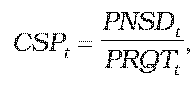
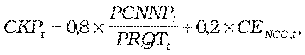

# § 18 Spôsob výpočtu maximálnej ceny za dodávku plynu pre domácnosti

(1) Cenová regulácia dodávky plynu pre domácnosti podľa tohto paragrafu sa vzťahuje na regulovaný subjekt, ktorý dodáva plyn domácnostiam a ktorý podáva návrh ceny prvýkrát na východiskový rok 2012. Ak sa regulovaným subjektom podáva prvýkrát návrh ceny na iný rok regulačného obdobia, ako je rok 2012, potom tento iný rok sa na účely výpočtu ceny za dodávku plynu pre domácnosti považuje za východiskový.

(2) Maximálna východisková cena za dodávku plynu pre domácnosti CDODPVých v eurách na jednotku množstva plynu na rok t, na ktorý sa regulovaným subjektom podáva návrh ceny prvýkrát, sa vypočíta podľa vzorca

CDODPVých = CKPt + CPSt+ CDSt + CSPt + CDDt+ CPZt,

kde

CKPtsú náklady na nákup plynu v eurách na jednotku množstva plynu na rok t podľa odseku 6,

CPSt sú náklady na prístup do prepravnej siete a prepravu plynu v eurách na jednotku množstva plynu na rok t podľa odseku 3,

CDStsú náklady na prístup do distribučnej siete a distribúciu plynu v eurách na jednotku množstva plynu na rok t podľa odseku 4,

CSPt sú náklady na uskladňovanie plynu potrebného na zabezpečenie dodávky plynu v eurách na jednotku množstva plynu na rok t podľa odseku 5,

CDDt sú náklady obchodnej činnosti dodávateľa plynu pre odberateľov plynu v domácnosti v eurách na jednotku množstva plynu na rok t podľa odseku 7,

CPZt je primeraný zisk určený podľa odseku 8.

(3) CPSt sa určia ako podiel plánovaných nákladov dodávateľa plynu za prístup do prepravnej siete a prepravu plynu pre všetkých odberateľov plynu na vymedzenom území na základe plánovaných denných maxím a plánovaného množstva dodaného plynu všetkým odberateľom plynu na rok t.

(4) CDSt sa určia ako podiel plánovaných nákladov dodávateľa plynu za prístup do vysokotlakovej distribučnej siete na základe plánovaných denných maximálnych odberov odberateľov plynu v domácnosti a za distribúciu plynu pre odberateľov plynu v domácnosti zaradených do príslušných taríf za distribúciu plynu podľa plánovaného množstva odobratého plynu a plánovaného množstva dodaného plynu pre odberateľov plynu v domácnosti na rok t.

(5) CSPt sa vypočíta podľa vzorca

kde

PNSDt sú plánované náklady v eurách na uskladňovanie plynu potrebného na zabezpečenie dodávky plynu pre všetkých odberateľov plynu odvodené na základe uzavretých zmlúv na uskladňovanie plynu na rok t,

PRQTt je plánované množstvo dodaného plynu pre všetkých odberateľov plynu okrem odberateľov plynu, ktorí svojím charakterom odberu plynu nevyvolávajú potrebu využitia podzemných zásobníkov na rok t.

(6) CKPt sa vypočíta podľa vzorca

kde

PCNNPt sú celkové plánované náklady v eurách na nákup plynu na rok t vyplývajúce zo všetkých zmlúv o nákupe plynu pre zabezpečenie zmluvných dodávok plynu pre všetkých odberateľov plynu vrátane krátkodobých zmlúv na obchodných miestach Európskej únie,

PRQTt je celkové plánované množstvo nakúpeného plynu pre zabezpečenie dodávky plynu pre všetkých odberateľov plynu na rok t,

CENCG,t je aritmetický priemer denných cien zverejnených burzou EEX (European Energy Exchange) na jej webovom sídle, produktu NCG Natural Gas Year futures Cal-t v eurách na jednotku množstva plynu za obdobie od 1. januára roku t-1 do 30. septembra roku t-1.

(7) CDDt sa určia ako podiel celkových plánovaných oprávnených nákladov podľa § 2 ods. 1 okrem nákladov uvedených v § 2 ods. 1 písm. a) až c) a odseku 2 obchodnej činnosti dodávateľa plynu na dodávku plynu pre odberateľov plynu v domácnosti v eurách na celkové plánované množstvo dodaného plynu pre odberateľov plynu v domácnosti na rok t. Do plánovaných oprávnených nákladov obchodnej činnosti, ktorá je zabezpečovaná regulovaným subjektom, iným ako regulovaným subjektom alebo subjektom, ktorý je alebo bol súčasťou vertikálne integrovaného podniku,23) je možné zarátať len primerané náklady podľa § 12 ods. 11 písm. f) zákona. Výpočet plánovaných nákladov obchodnej činnosti dodávateľa plynu na dodávku plynu pre domácnosti bude dodávateľom plynu predložený ako súčasť návrhu ceny spolu s odôvodnením výpočtu jednotlivých nákladových položiek.

(8) CPZt je najvyššia miera primeraného zisku, ktorý je možné zahrnúť do maximálnej ceny za dodávku plynu pre domácnosti, ktorého hodnota je maximálne 3 % z CKPt, najviac však 0,80 eura za 1 MWh alebo 0,00848 eura na objemovú jednotku.

(9) Ak sa v priebehu východiskového roku 2012 regulovaným subjektom predloží návrh na zmenu ceny za dodávku plynu pre domácnosti, maximálna cena za dodávku plynu pre domácnosti CDODPVýchZ v eurách na jednotku množstva plynu pre zostávajúce obdobie roku t sa vypočíta podľa vzorca

CDODPVýchZ = CDODPVých+ Z,

kde

CDODPVých je maximálna východisková cena za dodávku plynu pre domácnosti v eurách na jednotku množstva plynu na rok t,

Z je hodnota zmeny v eurách na jednotku množstva plynu, ktorá odzrkadľuje zmenu ekonomických parametrov, ktoré ovplyvňujú náklady regulovaného subjektu a z ktorých sa vychádzalo pri určení maximálnej ceny za dodávku plynu pre domácnosti na rok t. Hodnota zmeny sa zdôvodňuje analýzami v predloženom návrhu na zmenu ceny za dodávku plynu pre domácnosti.
