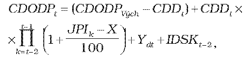

# § 19

(1) Maximálna cena za dodávku plynu pre domácnosti CDODPt v eurách na jednotku množstva plynu na roky nasledujúce po východiskovom roku regulačného obdobia sa vypočíta podľa vzorca

kde

CDODP Vých je maximálna východisková cena za dodávku plynu pre domácnosti v eurách na jednotku množstva plynu vo východiskovom roku,

CDDtje hodnota nákladov obchodnej činnosti dodávateľa plynu v eurách na jednotku množstva plynu určená podľa § 18 ods. 7,

JPIk je aritmetický priemer hodnôt ukazovateľa „jadrová inflácia“ za mesiace júl až december roku k-1 a január až jún roku k zverejnený Štatistickým úradom Slovenskej republiky v časti „Jadrová a čistá inflácia zmena oproti rovnakému obdobiu minulého roku v percentách“,

X je faktor efektivity v každom roku regulačného obdobia, ktorého hodnota je 3,5 %,

Ydt je súčet hodnôt

- a) rozdielu plánovanej nákupnej ceny plynu v eurách na jednotku množstva plynu v roku t a plánovanej nákupnej ceny plynu v eurách na jednotku množstva plynu v roku t -1,

- b) rozdielu plánovanej ceny za prístup do prepravnej siete a prepravu plynu v eurách na jednotku množstva plynu v roku t a plánovanej ceny za prístup do prepravnej siete a prepravu plynu v eurách na jednotku množstva plynu v roku t-1,

- c) rozdielu plánovanej ceny za prístup do distribučnej siete a distribúciu plynu v eurách na jednotku množstva plynu v roku t a plánovanej ceny za prístup do distribučnej siete a distribúciu plynu v eurách na jednotku množstva plynu v roku t-1,

- d) rozdielu plánovanej ceny za uskladňovanie plynu v eurách na jednotku množstva plynu v roku t a plánovanej ceny za uskladňovanie plynu v eurách na jednotku množstva plynu v roku t-1; so zohľadnením výnosov zo sekundárnych obchodov v rámci uskladňovania plynu dodávateľom plynu podľa uzatvorených zmlúv na uskladňovanie plynu na rok t-1,

- e) mimoriadnych nákladov regulovaného subjektu na plnenie povinností vyplývajúcich zo všeobecne záväzných právnych predpisov, ktoré majú vplyv na náklady súvisiace s dodávkou plynu pre domácnosti v eurách na jednotku množstva plynu na rok t,

IDSKt-2 je index dosiahnutého plnenia štandardov kvality, ktorý je stanovený na základe dosiahnutej úrovne vybraných štandardov kvality v intervale 0 až 0,01; IDSKt-2 sa prvýkrát uplatní pri stanovení maximálnej ceny za dodávku plynu pre domácnosti na rok 2016; pre roky 2012 až 2015 sa hodnota IDSKt-2 rovná sa 0.

Hodnota Ydt sa zdôvodňuje analýzami v predloženom cenovom návrhu.

(2) Pri návrhu ceny za dodávku plynu pre domácnosti sa použijú ustanovenia odseku 1 a § 17 ods. 2 a 3. Ak hodnota rozdielu JPIk a X je nižšia ako 0, pri výpočte sa použije hodnota tohto rozdielu rovnajúca sa 0.

(3) Ak sa regulovaným subjektom v priebehu regulačného roka t predloží návrh na zmenu ceny za dodávku plynu pre domácnosti, maximálna cena za dodávku plynu pre domácnosti CDODPtz v eurách na jednotku množstva plynu pre zostávajúce obdobie roku t sa vypočíta podľa vzorca

CDODPtz = CDODPt + Z,

kde

CDODPt je maximálna cena za dodávku plynu pre domácnosti v eurách na jednotku množstva plynu na rok t,

Z je hodnota zmeny v eurách na jednotku množstva plynu, ktorá odzrkadľuje zmenu ekonomických parametrov, ktoré ovplyvňujú náklady regulovaného subjektu a z ktorých sa vychádzalo pri určení maximálnej ceny za dodávku plynu pre domácnosti na rok t. Hodnota zmeny sa zdôvodňuje analýzami v predloženom návrhu na zmenu ceny za dodávku plynu pre domácnosti.
