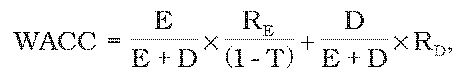
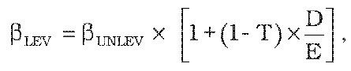

# § 3 Spôsob určenia výšky primeraného zisku

(1) Primeraný zisk sa určí ako súčin hodnoty regulačnej bázy aktív a primeranej miery výnosnosti regulačnej bázy aktív. Regulačná báza aktív RAB je hodnota aktív slúžiacich na vykonávanie regulovanej činnosti podľa § 2 písm. d) zákona a určí sa na základe ich účtovnej hodnoty. Reálna miera výnosnosti regulačnej bázy aktív pred zdanením WACC v percentách na dve desatinné miesta na regulačné obdobie je vypočítaná podľa vzorca

kde

T je sadzba dane z príjmov na rok t,

E je vlastné imanie v eurách k 31. decembru 2010,

D sú cudzie zdroje v eurách k 31. decembru 2010,

REje reálna cena vlastného kapitálu a vlastných zdrojov vypočítaná podľa vzorca

Re = RF + βLEV x (RM - RF)

kde

RF je výnosnosť bezrizikového aktíva, prepočítaný priemerný výnos 5- a viacročných štátnych dlhopisov emitovaných na slovenskom trhu za roky 2007 – 2011; na rok 2012 určená vo výške 4,01 %,

βLEV je vážený koeficient b, ktorý definuje citlivosť akcie spoločnosti na riziko trhu so zohľadnením sadzby dane z príjmov a podielu cudzích zdrojov vypočítaný podľa vzorca

kde

βUNLEV je nevážený koeficient b bez vplyvu sadzby dane z príjmov a podielu cudzích zdrojov; na rok 2012 určený vo výške 0,30 a na ďalšie roky regulačného obdobia určený úradom v intervale ,

D/E je pomer cudzích zdrojov k vlastnému imaniu; na rok 2012 určený vo výške 60 % v prospech cudzieho kapitálu,

(RM – RF) je celková riziková prémia; na rok 2012 určená vo výške 3,00 % a na ďalšie roky regulačného obdobia určená úradom v intervale ,

RM je výkonnosť tržného portfólia určená na rok 2012 vo výške 7,01 %,

RD je reálna cena cudzích zdrojov, prepočítaná priemerná výška úverov poskytnutých nefinančným spoločnostiam na obdobie 5 a viac rokov s výškou úveru nad 1 milión eur; na rok 2012 určená vo výške 5,13 %.

Na rok 2012 miera výnosnosti regulačnej bázy aktív WACC je úradom určená vo výške 6,04 %.

Hodnoty parametrov na ďalšie roky, ktoré slúžia na výpočet miery výnosnosti regulačnej bázy aktív (WACC), budú zverejnené na webovom sídle úradu do 30. júna kalendárneho roku.

(2) Primeraný zisk pri výrobe, distribúcii a dodávke pitnej vody verejným vodovodom pre regulovaný subjekt, ktorého dodávka pitnej vody v roku t nepresiahne 1 000 000 m3, je stanovený v § 6 ods. 3 a pri odvedení a čistení odpadovej vody verejnou kanalizáciou pre regulovaný subjekt, ktorého množstvo odvedenej odpadovej vody v roku t nepresiahne 1 000 000 m3, je stanovený v § 7 ods. 3.

(3) Faktor efektivity X pre regulované činnosti podľa § 2 písm. d) zákona sa stanovuje na hodnotu 3,5 %.
