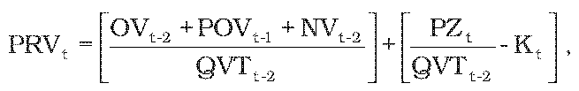
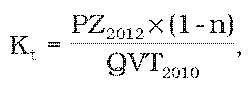
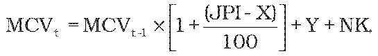

# § 6 Spôsob výpočtu maximálnej ceny za výrobu, distribúciu a dodávku pitnej vody a výšky primeraného zisku

(1) Na určenie maximálnej ceny za výrobu a dodávku pitnej vody, maximálnej ceny za distribúciu pitnej vody alebo maximálnej ceny za výrobu a dodávku pitnej vody pre skupinu odberateľov2) v eurách na objemovú jednotku na prvý rok regulačného obdobia sa vypočíta priemerná cena podľa vzorca

kde

PRVt je priemerná cena za výrobu, distribúciu a dodávku pitnej vody v eurách na objemovú jednotku,

OVt-2sú odpisy hmotného majetku a nehmotného majetku používaného na regulovanú činnosť podľa § 2 písm. d) zákona a nájomné za prenájom hmotného majetku a nehmotného majetku v eurách predložené úradu za rok t-2,

POVt-1 je hodnota odpisov v eurách z nového hmotného a nehmotného majetku používaného na regulovanú činnosť podľa § 2 písm. d) zákona zohľadňujúca technickú dobu životnosti majetku skutočne zaradeného do 30. júna a plánovaného na zaradenie do 31. decembra do účtovníctva v roku t-1 najviac vo výške 2 % jeho obstarávacej ceny; v prípade prevádzkových spoločností preukázateľná zmluvou uzatvorenou medzi vlastníkom majetku a jeho nájomcom,

NVt-2 sú skutočné oprávnené prevádzkové náklady v eurách na výrobu a dodávku pitnej vody v roku t-2 okrem OVt-2,

QVTt-2 je skutočné množstvo dodanej pitnej vody v objemových jednotkách pre všetkých odberateľov2) v roku t-2 vrátane vlastnej spotreby,

PZt je výška primeraného zisku v eurách vypočítaná podľa odseku 2, pričom najvyššia miera primeraného zisku je 0,10 eura na 1m3 skutočného množstva dodanej pitnej vody v roku t-2 vrátane vlastnej spotreby, alebo podľa odseku 3,

Kt je faktor využitia kapacity vodárenského majetku používaného na regulovanú činnosť podľa § 2 písm. d) zákona vypočítaný podľa odseku 4.

(2) Výška primeraného zisku v eurách sa vypočíta podľa vzorca

PZt = RABt-2 × WACC,

kde

RABt-2 je účtovná hodnota (zostatková cena) hmotného majetku a nehmotného majetku v eurách v roku t-2 používaného na výrobu, distribúciu a dodávku pitnej vody podľa prílohy č. 13.

(3) Výška primeraného zisku PZt pre regulovaný subjekt, ktorého dodávka pitnej vody verejným vodovodom nepresiahne 1 000 000 m3, je maximálne 0,05 eura na 1 m3 skutočného množstva dodanej pitnej vody v roku t-2 vrátane vlastnej spotreby.

(4) Hodnota faktora využitia vodárenského majetku používaného na regulovanú činnosť podľa § 2 písm. d) zákona v eurách na objemovú jednotku sa vypočíta podľa vzorca

kde

n je koeficient využitia projektovanej kapacity vodárenského majetku používaného na regulovanú činnosť podľa § 2 písm. d) zákona, ktorý sa vypočíta ako priemer podielov skutočne využívanej kapacity a celkovej projektovanej kapacity jednotlivého vodárenského majetku v roku t-2 podľa prílohy č. 16. Podiel vodárenského majetku, ktorý je už na 100 % a viac využívaný, sa rovná 1. Vypočítaná hodnota sa matematicky zaokrúhli na dve desatinné miesta.

(5) Maximálna cena za výrobu a dodávku pitnej vody MCVtv eurách na objemovú jednotku sa navrhuje tak, aby vážený priemer maximálnej ceny za výrobu a dodávku pitnej vody a maximálnej ceny za distribúciu pitnej vody prepočítaný na objemovú jednotku neprekročil priemernú cenu na rok t vypočítanú podľa odseku 1. Pri návrhu maximálnej ceny sa prihliada na sociálne, environmentálne a ekonomické dôsledky úhrady za vodohospodárske služby, ako aj na geografické podmienky a klimatické podmienky dotknutého regiónu.26)

(6) Ak sa regulovaným subjektom dodáva voda inému prevádzkovateľovi, návrh maximálnej ceny za distribúciu pitnej vody sa predkladá úradu tak, že maximálna cena za distribúciu pitnej vody je cena znížená o priemerné náklady spojené s dodávkou pitnej vody konečným odberateľom.2)

(7) Návrh maximálnej ceny pre jednotlivé skupiny odberateľov2) sa predkladá tak, aby maximálne ceny zohľadňovali oprávnené náklady jednotlivých skupín odberateľov2) a výšku primeraného zisku.

(8) Ak sa predkladá úradu prvýkrát návrh ceny za výrobu a dodávku pitnej vody novým regulovaným subjektom, na určenie maximálnej ceny za výrobu a dodávku pitnej vody sa vypočíta priemerná cena za výrobu, distribúciu a dodávku pitnej vody v eurách na objemovú jednotku na rok t podľa odseku 1, pričom sa do výpočtu použijú plánované údaje na rok t a návrh maximálnej ceny sa predkladá podľa odsekov 5 až 7.

(9) Maximálna cena za výrobu a dodávku pitnej vody, maximálna cena za distribúciu pitnej vody alebo maximálna cena za výrobu a dodávku pitnej vody pre skupinu odberateľov2) v eurách na objemovú jednotku na ďalšie roky regulačného obdobia sa vypočíta podľa vzorca

ak (JPI – X) MCVt je maximálna cena za výrobu a dodávku pitnej vody, maximálna cena za distribúciu pitnej vody alebo maximálna cena za výrobu a dodávku pitnej vody pre skupinu odberateľov2) v eurách na objemovú jednotku na rok t,

MCVt-1 je maximálna cena za výrobu a dodávku pitnej vody, maximálna cena za distribúciu pitnej vody alebo maximálna cena za výrobu a dodávku pitnej vody pre skupinu odberateľov2) v eurách na objemovú jednotku schválená alebo určená úradom v cenovom rozhodnutí na rok t-1, ktorá zohľadňuje oprávnené náklady a primeraný zisk,

JPI je hodnota podľa § 2 ods. 1 písm. c),

X je faktor efektivity podľa § 3 ods. 3,

Y je faktor investičného rozvoja v eurách na objemovú jednotku prioritne určený na podporu investícií do vodárenského majetku používaného na regulovanú činnosť podľa § 2 písm. d) zákona. Vypočíta sa ako podiel hodnoty odpisov v eurách z nového hmotného a nehmotného majetku používaného na regulovanú činnosť podľa § 2 písm. d) zákona zohľadňujúcej technickú dobu životnosti majetku skutočne zaradeného do 30. júna a plánovaného na zaradenie do 31. decembra do účtovníctva v roku t-1 najviac vo výške 2 % jeho obstarávacej ceny, v prípade prevádzkových spoločností preukázateľná zmluvou uzatvorenou medzi vlastníkom majetku a jeho nájomcom a skutočného množstva pitnej vody v objemových jednotkách dodaného všetkým odberateľom podľa § 2 písm. d) zákona za rok t-2 vrátane vlastnej spotreby.

NK je medziročná zmena faktora využitia kapacity vodárenského majetku používaného na regulovanú činnosť podľa § 2 písm. d) zákona v eurách na objemovú jednotku (Kt-1– Kt).

(10) Ak sa regulovaným subjektom v priebehu roka t predkladá návrh na zmenu maximálnej ceny za výrobu a dodávku alebo distribúciu pitnej vody, maximálna cena za výrobu a dodávku alebo distribúciu pitnej vody v eurách na objemovú jednotku na zostávajúce obdobie roku t sa vypočíta podľa vzorca

MCVtz= MCVt + Z,

kde

MCVtz je maximálna cena za výrobu a dodávku alebo distribúciu pitnej vody v eurách na objemovú jednotku na zostávajúce obdobie roku t,

MCVtjemaximálna cena za výrobu a dodávku alebo distribúciu pitnej vody v eurách na objemovú jednotku schválená alebo určená úradom na rok t,

Z je hodnota zmeny v eurách na objemovú jednotku, ktorá vyjadruje zmenu ekonomických parametrov, ktoré ovplyvňujú prevádzkové náklady NV regulovaného subjektu a z ktorých sa vychádzalo pri určení maximálnej ceny za výrobu a dodávku alebo distribúciu pitnej vody v eurách na objemovú jednotku na rok t. Hodnota zmeny sa odôvodňuje analýzami v predloženom návrhu na zmenu ceny.
