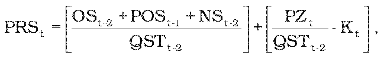
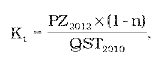
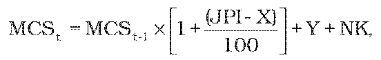

# § 7 Spôsob výpočtu maximálnej ceny za odvedenie a čistenie odpadovej vody a výšky primeraného zisku

(1) Na určenie maximálnej ceny za odvedenie a čistenie odpadovej vody alebo maximálnej ceny za odvedenie a čistenie odpadovej vody pre skupinu producentov3) v eurách na objemovú jednotku na prvý rok regulačného obdobia sa vypočíta priemerná cena podľa vzorca

kde

PRSt je priemerná cena za odvedenie a čistenie odpadovej vody v eurách na objemovú jednotku,

OSt-2sú skutočné odpisy hmotného majetku a nehmotného majetku používaného na regulovanú činnosť podľa § 2 písm. d) zákona a nájomné za prenájom hmotného majetku a nehmotného majetku v eurách predložené úradu za rok t-2,

POSt-1 je hodnota odpisov v eurách z nového hmotného a nehmotného majetku používaného na regulovanú činnosť podľa § 2 písm. d) zákona zohľadňujúca technickú dobu životnosti majetku skutočne zaradeného do 30. júna a plánovaného na zaradenie do 31. decembra do účtovníctva v roku t-1 najviac vo výške 2 % jeho obstarávacej ceny; v prípade prevádzkových spoločností preukázateľná zmluvou uzatvorenou medzi vlastníkom majetku a jeho nájomcom,

NSt-2 sú skutočné oprávnené prevádzkové náklady v eurách na odvedenie a čistenie odpadovej vody v roku t-2 okrem OSt-2,

QSTt-2 je skutočné množstvo odvedenej a čistenej odpadovej vody v objemových jednotkách pre všetkých producentov3) v roku t-2,

PZt je výška primeraného zisku v eurách vypočítaná podľa odseku 2, pričom najvyššia miera primeraného zisku je 0,13 eura na 1m3 skutočného množstva odvedenej odpadovej vody v roku t-2 vrátane vlastnej produkcie, alebo vypočítaná podľa odseku 3,

Kt je faktor využitia kapacity vodárenského majetku používaného na regulovanú činnosť podľa § 2 písm. d) zákona vypočítaný podľa odseku 4.

(2) Výška primeraného zisku sa vypočíta sa podľa vzorca

PZt = RABt-2 × WACC,

kde

RABt-2 je účtovná hodnota (zostatková cena) hmotného majetku a nehmotného majetku v eurách v roku t-2 používaného na odvedenia a čistenie odpadovej vody podľa prílohy č. 13.

(3) Výška primeraného zisku PZt pre regulovaný subjekt, ktorého odvedené a čistené množstvo odpadovej vody verejnou kanalizáciou nepresiahne 1 000 000 m3, je maximálne 0,07 eura za 1m3 skutočného množstva odvedenej odpadovej vody v roku t-2 vrátane vlastnej produkcie.

(4) Hodnota faktora využitia vodárenského majetku používaného na regulovanú činnosť podľa § 2 písm. d) zákona v eurách na objemovú jednotku sa vypočíta podľa vzorca

kde

n je koeficient využitia projektovanej kapacity vodárenského majetku používaného na regulovanú činnosť podľa § 2 písm. d) zákona, ktorý sa vypočíta ako priemer podielov skutočne využívanej kapacity a celkovej projektovanej kapacity jednotlivého vodárenského majetku v roku t-2 podľa prílohy č. 16. Podiel vodárenského majetku, ktorý je už na 100 % a viac využívaný, sa rovná 1. Vypočítaná hodnota sa matematicky zaokrúhli na dve desatinné miesta.

(5) Maximálna cena za odvedenie a čistenie odpadovej vody MCStalebo maximálne ceny pre jednotlivé skupiny producentov3) v eurách na objemovú jednotku sa navrhujú tak, aby zohľadňovali oprávnené náklady jednotlivých skupín producentov3) a výšku primeraného zisku. Pri návrhu maximálnej ceny sa prihliada na sociálne, environmentálne a ekonomické dôsledky úhrady za vodohospodárske služby, ako aj na geografické podmienky a klimatické podmienky dotknutého regiónu.26)

(6) Ak sa novým regulovaným subjektom predkladá úradu prvýkrát návrh ceny za odvedenie a čistenie odpadovej vody, na určenie maximálnej ceny za odvedenie a čistenie odpadovej vody sa vypočíta priemerná cena za odvedenie a čistenie odpadovej vody v eurách na objemovú jednotku na rok t podľa odseku 1, pričom sa do výpočtu použijú plánované údaje na rok t a návrh maximálnej ceny sa predkladá podľa odseku 5.

(7) Maximálna cena za odvedenie a čistenie odpadovej vody alebo maximálna cena za odvedenie a čistenie odpadovej vody pre skupinu producentov3) v eurách na objemovú jednotku na ďalšie roky regulačného obdobia sa vypočíta podľa vzorca

ak (JPI – X) t je maximálna cena za odvedenie a čistenie odpadovej vody alebo maximálna cena za odvedenie a čistenie odpadovej vody pre skupinu producentov3) v eurách na objemovú jednotku na rok t,

MCSt-1 je maximálna cena za odvedenie a čistenie odpadovej vody alebo maximálna cena za odvedenie a čistenie odpadovej vody pre skupinu producentov3) v eurách na objemovú jednotku, schválená alebo určená úradom v cenovom rozhodnutí na rok t-1, ktorá zohľadňuje oprávnené náklady a primeraný zisk,

JPI je hodnota podľa § 2 ods. 1 písm. c),

X je faktor efektivity podľa § 3 ods. 3,

Y je faktor investičného rozvoja v eurách na objemovú jednotku prioritne určený na podporu investícií do vodárenského majetku používaného na regulovanú činnosť podľa § 2 písm. d) zákona. Vypočíta sa ako podiel hodnoty odpisov v eurách z nového hmotného a nehmotného majetku používaného na regulovanú činnosť podľa § 2 písm. d) zákona zohľadňujúcej technickú dobu životnosti majetku skutočne zaradeného do 30. júna a plánovaného na zaradenie do 31. decembra do účtovníctva v roku t-1 najviac vo výške 2 % jeho obstarávacej ceny, v prípade prevádzkových spoločností preukázateľná zmluvou uzatvorenou medzi vlastníkom majetku a jeho nájomcom a skutočného množstva odvedenej a čistenej odpadovej vody v objemových jednotkách od všetkým producentov3) v roku t-2 vrátane vlastnej produkcie,

NK je medziročná zmena faktora využitia kapacity vodárenského majetku používaného na regulovanú činnosť podľa § 2 písm. d) zákona v eurách na objemovú jednotku (Kt-1 – Kt).

(8) Ak sa regulovaným subjektom v priebehu roka t predloží návrh na zmenu ceny za odvedenie a čistenie odpadovej vody, maximálna cena za odvedenie a čistenie odpadovej vody v eurách na objemovú jednotku na zostávajúce obdobie roku t sa vypočíta podľa vzorca

MCStz= MCSt + Z,

kde

MCStz je maximálna cena za odvedenie a čistenie odpadovej vody v eurách na objemovú jednotku na zostávajúce obdobie roku t,

MCStjemaximálna cena za odvedenie a čistenie odpadovej vody v eurách na objemovú jednotku schválená alebo určená úradom na rok t,

Z je hodnota zmeny v eurách na objemovú jednotku, ktorá vyjadruje zmenu ekonomických parametrov, ktoré ovplyvňujú prevádzkové náklady NS regulovaného subjektu a z ktorých sa vychádzalo pri určení maximálnej ceny za odvedenie a čistenie odpadovej vody v eurách na objemovú jednotku na rok t. Hodnota zmeny sa odôvodňuje analýzami v predloženom návrhu na zmenu ceny.
