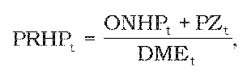

# § 6 Spôsob výpočtu maximálnej ceny za využitie hydroenergetického potenciálu a výšky primeraného zisku

(1) Na určenie maximálnej ceny za využitie hydroenergetického potenciálu sa vypočíta priemerná cena za využitie hydroenergetického potenciálu v eurách na jednotku dodanej mechanickej energie v roku t podľa vzorca

kde

PRHPt je priemerná cena za využitie hydroenergetického potenciálu v eurách na jednotku dodanej mechanickej energie v roku t,

ONHPt sú oprávnené náklady v eurách na využitie hydroenergetického potenciálu v roku t podľa § 2 vypočítané podľa vzorca

ONHPt = ONHPt-1 x [1 + (JPI – X)/100],

ak (JPI – X) t-1 sú oprávnené náklady schválené alebo určené úradom na rok t-1,

JPI je aritmetický priemer hodnôt ukazovateľa „jadrová inflácia“ za mesiace júl až december roku t-2 a január až jún roku t-1 zverejnený Štatistickým úradom Slovenskej republiky v časti „Jadrová a čistá inflácia zmena oproti rovnakému obdobiu minulého roku v percentách“,

X je faktor efektivity, ktorý sa stanovuje na hodnotu 3,5 %,

PZt je maximálna výška primeraného zisku v eurách určená podľa odseku 2,

DMEt je predpokladané množstvo dodanej mechanickej energie v jednotkách množstva mechanickej energie v roku t, vypočítané z množstva predpokladanej vyrobenej elektrickej energie pri predpokladanej 97 % účinnosti energetických zariadení.

(2) Maximálna výška primeraného zisku za využitie hydroenergetického potenciálu v eurách na rok t sa vypočíta podľa vzorca

Mt = PRHPt x k.

(3) Cena za využitie hydroenergetického potenciálu sa navrhuje ako maximálna cena pre jednotlivé skupiny využívateľov hydroenergetického potenciálu; skupiny využívateľov hydroenergetického potenciálu sa členia podľa inštalovaného výkonu vodných elektrární a koeficient rozloženia nákladov k sa ustanovuje takto:

a) | od 100 kW do 1 000 kW | k = 0,30,

b) | od 1 001 kW do 10 000 kW | k = 0,50,

c) | nad 10 000 kW | k = 1,02.

(4) Maximálne ceny pre jednotlivé skupiny využívateľov hydroenergetického potenciálu sa vypočítajú podľa vzorca

Mt = PRHPt x k,

kde

Mt je maximálna cena za využitie hydroenergetického potenciálu v eurách na jednotku dodanej mechanickej energie v roku t,

k je koeficient rozloženia nákladov medzi jednotlivé skupiny využívateľov hydroenergetického potenciálu vodného toku určený podľa odseku 3.

(5) Návrh maximálnych cien pre jednotlivé skupiny využívateľov hydroenergetického potenciálu na rok t sa predkladá tak, aby ich vážený priemer prepočítaný na jednotku dodanej mechanickej energie neprekročil priemernú cenu za využitie hydroenergetického potenciálu určenú podľa odseku 1.
