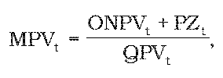

# § 7 Spôsob výpočtu maximálnej ceny za odber povrchových vôd a výšky primeraného zisku

(1) Maximálna cena za odber povrchových vôd v eurách na objemovú jednotku v roku t sa vypočíta podľa vzorca

kde

MPVt je maximálna cena za odber povrchových vôd v eurách na objemovú jednotku v roku t,

ONPVt sú oprávnené náklady na odber povrchových vôd v eurách v roku t podľa § 2 vypočítané podľa vzorca

ONPVt = ONPVt-1 x [1 + (JPI – X)/100],

ak (JPI – X) t-1 sú oprávnené náklady schválené alebo určené úradom na rok t-1,

JPI je aritmetický priemer hodnôt ukazovateľa „jadrová inflácia“ za mesiace júl až december roku t-2 a január až jún roku t-1 zverejnený Štatistickým úradom Slovenskej republiky v časti „Jadrová a čistá inflácia zmena oproti rovnakému obdobiu minulého roku v percentách“,

X je faktor efektivity, ktorý sa stanovuje na hodnotu 3,5 %,

PZt je maximálna výška primeraného zisku v eurách určená podľa odseku 2,

QPVt je predpokladané množstvo povrchových vôd v objemových jednotkách odobratých odberateľmi z vodných tokov v roku t.

(2) Maximálna výška primeraného zisku za odber povrchových vôd v eurách na rok t sa vypočíta podľa vzorca

PZt= ONPVt x p.
