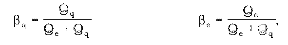
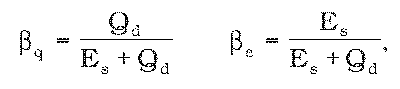
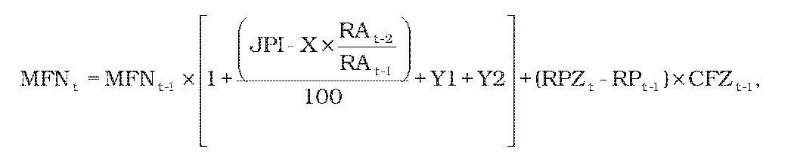
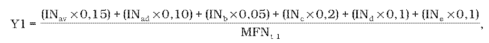
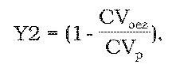
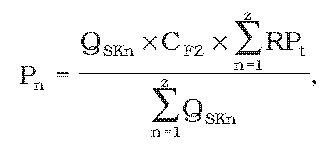

# § 2 Rozsah, štruktúra a výška oprávnených nákladov

(1) Oprávnenými nákladmi sú primerané náklady, ktorých výška je určená podľa § 12 ods. 11 písm. f) zákona a ktoré sú preukázateľne a v nevyhnutnom rozsahu vynaložené na vykonávanie regulovanej činnosti a preukázané účtovnými dokladmi, a náklady, ktorých maximálna výška je určená podľa odseku 9.

(2) Oprávnenými nákladmi sú

- a) obstarávacie náklady na zabezpečenie potrebného množstva priameho materiálu, ktorý slúži na výrobu tepla alebo potrebného množstva nakupovaného tepla; na účely kalkulácie oprávnených nákladov je ich maximálna výška určená podľa odseku 9 písm. a); pri výrobe tepla z obnoviteľných zdrojov energie je cena za jednotkový energetický obsah v palive v eurách/kWh v určenej cene tepla záväzná,

- b) technologické náklady, náklady na elektrinu, dopravu paliva, technologické hmoty a technologickú vodu, náklady na palivo na vlastnú spotrebu tepla súvisiacu s výrobou tepla, ktorá nie je súčasťou ukazovateľa energetickej účinnosti,4)

- c) osobné náklady,5) ktorých maximálna výška na účely kalkulácie oprávnených nákladov je určená podľa odseku 9 písm. b),

- d) náklady na plnenie povinností podľa osobitných predpisov;6) v prípade poplatkov za znečisťovanie ovzdušia len poplatky za znečisťujúce látky vypustené do ovzdušia pri dodržaní podmienok a požiadaviek podľa osobitného zákona7) a v prípade skleníkových plynov len náklady maximálne do výšky 50 % nákladov na nákup emisných kvót nad množstvo bezodplatne pridelených a potrebných na vykonávanie regulovanej činnosti,

- e) náklady na overenie hospodárnosti prevádzky sústavy tepelných zariadení po odberné miesto v termínoch podľa osobitného predpisu,8)

- f) odpisy obstaraného nového hmotného majetku a nehmotného majetku,9) pričom pri hmotnom majetku sa za oprávnené náklady považujú odpisy najviac do výšky rovnomerných odpisov hmotného majetku,10)

- g) odpisy obstaraného už prevádzkovaného hmotného majetku a nehmotného majetku9) vo výške rovnomerných odpisov zo všeobecnej hodnoty hmotného majetku, stanovenej znaleckým posudkom podľa osobitného predpisu11) predloženým úradu, pre hmotný majetok a nehmotný majetok zaradený do účtovníctva regulovaného subjektu po nadobudnutí účinnosti tejto vyhlášky,

- h) odpisy obstaraného už prevádzkovaného hmotného majetku a nehmotného majetku,9) pričom pri hmotnom majetku sa považujú za oprávnené náklady odpisy najviac do výšky rovnomerných odpisov hmotného majetku v prípade, ak sa neuplatňujú odpisy podľa písmena g),

- i) náklady na obstaranie hmotného majetku, ktorý má samostatné prevádzkové určenie, dobu použiteľnosti vyššiu ako jeden rok, jeho obstarávacia cena je nižšia ako vstupná cena podľa osobitného predpisu12) a je používaný výhradne na regulovanú činnosť,

- j) nájomné za prenájom hmotného majetku a nehmotného majetku, o ktorom vlastník účtuje a ktorý sa používa výhradne na regulovanú činnosť, najviac do výšky 28 eur/kW regulačného príkonu z prenajatého zariadenia na výrobu a rozvod tepla,

- k) nájomné za prenájom nehnuteľnosti alebo jej časti, v ktorej je na podlahovej ploche umiestnené tepelné zariadenie vo vlastníctve alebo v nájme regulovaného subjektu, ktoré sa používa výhradne na regulovanú činnosť, najviac vo výške 35 eur/m2podlahovej plochy/rok; nájomné za prenájom nehnuteľnosti alebo jej časti súvisiacej s výrobou a dodávkou tepla a ostatných priestorov alebo plôch na skládku paliva a popola najviac vo výške 15 eur/m2plochy/rok,

- l) náklady na opravy a údržbu tepelných zariadení vrátane osobných nákladov5) zamestnancov vykonávajúcich opravu a údržbu tepelných zariadení, okrem nákladov na technické zhodnotenie hmotného majetku a nehmotného majetku podľa osobitného predpisu;13) náklady na plánované generálne opravy môžu byť rozložené rovnomerne počas celého regulačného obdobia, ak tieto náklady regulovaný subjekt zdôvodní v návrhu ceny tepla,

- m) úrok z úveru poskytnutého bankou alebo pobočkou zahraničnej banky14) (ďalej len „banka“) na nákup hmotného majetku alebo nehmotného majetku, ktorý sa používa výhradne na regulovanú činnosť alebo z prevádzkového úveru na prefinancovanie nákladov na nákup paliva,

- n) úrok z úveru poskytnutého inou právnickou osobou ako bankou na nákup hmotného majetku alebo nehmotného majetku, ktorý sa používa výhradne na regulovanú činnosť, alebo z prevádzkového úveru na prefinancovanie nákladov na nákup paliva do výšky priemerného úroku vypočítaného z porovnateľných úverov aspoň troch bánk v roku t,

- o) náklady na investície realizované v rámci projektu verejno-súkromného partnerstva rovnomerne rozložené v jednotlivých rokoch po dobu trvania projektu verejno-súkromného partnerstva, ak projekt trvá najmenej šesť rokov.

(3) Oprávnenými nákladmi nie sú najmä

- a) sankcie,

- b) náklady spojené s nevyužitými výrobnými kapacitami; nevyužitými výrobnými kapacitami sú zariadenia na výrobu tepla, ktoré nie je potrebné prevádzkovať na zabezpečenie zmluvne dohodnutého ročného množstva tepla dodávaného z iného zariadenia na výrobu tepla v tej istej sústave tepelných zariadení,

- c) odpisy nevyužívaného dlhodobého hmotného majetku, odpisy „goodwill“ a odpisy hmotného majetku a nehmotného majetku vylúčeného z odpisovania,15)

- d) tantiémy a odmeny členov štatutárnych orgánov a ďalších orgánov právnických osôb za výkon funkcie, ktorí nie sú v pracovnoprávnom vzťahu s regulovaným subjektom,

- e) platby poistného za poistenie zodpovednosti za škody spôsobené členmi štatutárnych orgánov a členmi iných orgánov spoločnosti,

- f) príspevky na doplnkové dôchodkové sporenie,16) príspevky na životné poistenie a príspevky na účelové sporenie zamestnanca platené zamestnávateľom,

- g) odstupné a odchodné presahujúce výšku ustanovenú osobitným predpisom,17)

- h) príspevky na stravovanie zamestnancov nad rozsah ustanovený osobitným predpisom,18)

- i) cestovné náhrady nad rozsah ustanovený osobitným predpisom,19)

- j) tvorba sociálneho fondu nad rozsah ustanovený osobitným predpisom,20)

- k) náklady na poskytovanie ochranných pracovných prostriedkov nad rozsah ustanovený osobitným predpisom,21)

- l) dobrovoľné poistenie osôb,

- m) manká a škody na majetku vrátane škody zo zníženia cien nevyužiteľných zásob a likvidácie zásob,

- n) náklady vyplývajúce z chýb vo výpočtoch, v kalkulačných prepočtoch alebo v účtovníctve, duplicitne účtované náklady,

- o) náklady na reprezentáciu a dary,

- p) odmeny a dary pri životných jubileách a pri odchode do dôchodku,

- q) náklady na starostlivosť o zdravie zamestnancov a na vlastné zdravotnícke zariadenia nad rozsah ustanovený osobitným predpisom,22)

- r) príspevky a náklady na rekreačné, regeneračné, rekondičné a ozdravné pobyty, ak povinnosť ich uhrádzania neustanovuje osobitný predpis,23)

- s) náklady na údržbu a prevádzku školiacich a rekreačných zariadení,

- t) daň z nehnuteľnosti platená za školiace a rekreačné zariadenia,

- u) štipendiá poskytnuté študentom a učňom,

- v) odpis nedobytnej pohľadávky,

- w) tvorba rezerv nad rozsah ustanovený osobitným predpisom,24)

- x) rozdiely zo zmien použitých účtovných metód a účtovných zásad,25)

- y) tvorba opravných položiek,

- z) náklady vynaložené na odstránenie nedostatkov zistených pri kolaudačnom konaní,

- aa) náklady spojené s prípravou a zabezpečením nerealizovanej investičnej výstavby,

- ab) straty z predaja dlhodobého majetku a zásob,

- ac) zostatková cena predaného alebo vyradeného hmotného majetku a nehmotného majetku,

- ad) náklady na reklamu alebo propagáciu uskutočňovanú formou sponzorovania športových, kultúrnych a zábavných podujatí,

- ae) spotreba pohonných látok nad normu spotreby pohonných látok,26)

- af) náklady na palivo a nakupované teplo súvisiace s nehospodárnou výrobou a rozvodom tepla z dôvodu nedodržania normatívnych ročných účinností, ktoré boli východiskom na určenie maximálnej ceny tepla,

- ag) odpisy z pomernej časti obstarávacej hodnoty hmotného majetku, ktorý bol obstaraný financovaním z prostriedkov Európskej únie, zo štátneho rozpočtu, bezodplatným prevodom hmotného majetku alebo investíciou v rámci projektu verejno-súkromného partnerstva,

- ah) nájomné za prenájom hmotného majetku a nehmotného majetku obstaraného finančným prenájmom,

- ai) nájomné za prenájom hmotného majetku a nehmotného majetku odpredaného a následne prenajatého pôvodnému vlastníkovi alebo za opätovný prenájom prenajatého hmotného majetku a nehmotného majetku,

- aj) ostatné náklady, ktoré nie sú uvedené v odseku 2.

(4) Na účely výroby, distribúcie a dodávky tepla sa oprávnené náklady členia na

- a) variabilné náklady, ktoré zahŕňajú náklady na palivo, alebo variabilné náklady na nákup tepla,

- b) ostatné variabilné náklady, ktoré zahŕňajú náklady na dopravu paliva, náklady na elektrinu, technologickú vodu, technologické hmoty, náklady na odvoz a likvidáciu popola a náklady na nákup emisných kvót nad množstvo bezodplatne pridelených a potrebných na vykonávanie regulovanej činnosti,

- c) regulovanú zložku fixných nákladov, ktorá zahŕňa osobné náklady vrátane odvodov do poistných fondov, okrem osobných nákladov zamestnancov vykonávajúcich opravu a údržbu, spotrebu materiálu a energie, cestovné, stravné a ostatné služby, náklady na dane a poplatky, prevádzkové náklady, odpisy hmotného majetku a nehmotného majetku, ktoré nepriamo súvisia s výrobou a rozvodom tepla, a finančné náklady,

- d) ostatné fixné náklady, ktoré zahŕňajú fixné náklady na nákup tepla, poistenie majetku, dane, nájomné, revízie a zákonné prehliadky, poplatky za znečistenie, náklady na overenie účtovnej závierky audítorom, odpisy hmotného majetku a nehmotného majetku priamo súvisiaceho s výrobou a rozvodom tepla, náklady na údržbu a opravy priamo súvisiace s výrobou a rozvodom tepla, úroky z investičného a z prevádzkového úveru, odpisy a opravy spoločných zariadení súvisiacich s výrobou a rozvodom tepla.

(5) Ak regulovaný subjekt vykonáva zároveň aj neregulovanú činnosť, do regulovanej zložky fixných nákladov sa zahrnú spoločné náklady na vykonávanie regulovanej činnosti podľa § 2 písm. d) zákona a neregulovanej činnosti, najviac do výšky zodpovedajúcej pomeru dosiahnutých výnosov alebo tržieb z regulovanej činnosti k celkovým výnosom alebo tržbám v roku t-2.

(6) Náklady každého zdroja, množstvo vyrobeného tepla na každom zdroji, ako aj náklady súvisiace s distribúciou tepla príslušnej sústavy tepelných zariadení sa sledujú osobitne.

(7) Oprávnené náklady na výrobu tepla zariadením na kombinovanú výrobu27) sa určia tak, že k osobitným nákladom na výrobu tepla zariadením na kombinovanú výrobu sa pripočíta vypočítaná časť spoločných nákladov kombinovanej výroby elektriny a tepla prislúchajúca výrobe tepla podľa odseku 8, pričom koeficientom delenia sa vynásobia náklady v jednotlivých položkách podľa prílohy č. 7. Do osobitných nákladov na výrobu tepla zariadením na kombinovanú výrobu sa zahrnú len náklady zariadení, ktoré by neboli inštalované, ak by sa vyrábala len elektrina, a to najmä čerpadlá vykurovacej vody, čerpadlá kondenzátu pary na vykurovanie a redukčné stanice.

(8) Časť spoločných nákladov kombinovanej výroby elektriny a tepla prislúchajúca výrobe tepla sa určí tak, aby tieto náklady neboli vyššie ako pri delení spoločných nákladov kombinovanej výroby elektriny a tepla energetickou metódou; spoločné náklady kombinovanej výroby elektriny a tepla nezahŕňajú náklady zariadení, ktoré by neboli inštalované, keby sa nevyrábala elektrina, najmä generátor, parná turbína vrátane kondenzátora, čerpadla turbínového kondenzátu, chladiace čerpadlá, chladiace veže a potrubia, vyvedenie a transformácia vyrobenej elektriny. Koeficienty delenia nákladov pripadajúcich na výrobu tepla a na výrobu elektriny energetickou metódou sa vypočítajú

- a) pri výrobe elektriny protitlakovou parnou turbínou alebo kondenzačnou parnou turbínou s odberom pary podľa vzorcov

- 

- kde

- Qe je teplo spotrebované na výrobu elektriny v megawatthodinách,

- Qqje využiteľné teplo na dodávku tepla v megawatthodinách,

- b) pri výrobe elektriny plynovou turbínou alebo spaľovacím motorom podľa vzorcov

- 

- kde

- Esje svorková výroba elektriny v megawatthodinách,

- Qdje užitočná dodávka tepla v megawatthodinách.

(9) Maximálna výška

- a) variabilných nákladov na nákup paliva a variabilných nákladov na nákup tepla sa určí podľa ukazovateľov energetickej účinnosti určených pri poslednom overovaní hospodárnosti sústav tepelných zariadení pred podaním návrhu ceny, výhrevnosti paliva a ceny paliva alebo nakupovaného tepla; v prípade zníženia cien plynu na trhu s plynom v priebehu regulačného roka predkladá sa úradu záznam z rokovania s dodávateľom plynu o novej cene plynu,

- b) regulovanej zložky fixných nákladov sa určí v rozsahu prílohy č. 2 podľa celkového regulačného príkonu všetkých odberných zariadení v kilowattoch

  - 1. do 300 kW vrátane, maximálne 208 eur/kW,

  - 2. nad 300 kW do 3 500 kW vrátane, maximálne 48,4 eura/kW,

  - 3. nad 3 500 kW do 5 200 kW vrátane, maximálne 169 400 eur + 37,20 eura/kW za každý ďalší kilowatt nad 3 500 kW,

  - 4. nad 5 200 kW do 13 000 kW vrátane, maximálne 232 640 eur + 35,75 eura/kW za každý ďalší kilowatt nad 5 200 kW,

  - 5. nad 13 000 kW do 21 000 kW vrátane, maximálne 511 490 eur + 30 eur/kW za každý ďalší kilowatt nad 13 000 kW,

  - 6. nad 21 000 kW, maximálne 751 490 eur + 26,5 eura/kW za každý ďalší kilowatt nad 21 000 kW.

(10) Maximálna výška celkových oprávnených fixných nákladov regulovaného subjektu na rok t sa vypočíta podľa vzorca

ak RAt-2/RAt-1> 1, na výpočet maximálnej výšky oprávnených fixných nákladov sa použije hodnota RAt-2/RAt-1= 1;

ak (JPI – X x RAt-2/RAt-1) t-2/RAt-1) = 0;

ak (RPZ t – RPt-1) t – RPt-1) = 0,

kde

MFNt je maximálna výška oprávnených fixných nákladov okrem nákladov na nákup tepla v eurách za výrobu, distribúciu a dodávku tepla na rok t bez primeraného zisku,

MFNt-1je výška fixných nákladov okrem nákladov na nákup tepla v eurách za výrobu, distribúciu a dodávku tepla schválená alebo určená úradom v cenovom rozhodnutí na rok t-1 bez primeraného zisku,

JPI je aritmetický priemer hodnôt jadrovej inflácie za obdobie od júla roku t-2 do júna roku t-1 zverejnených Štatistickým úradom Slovenskej republiky v percentách,

X je faktor efektivity využívania nákladov na výrobu, distribúciu a dodávku tepla v percentách; jeho hodnota na regulačné obdobie je 3,50 %,

RAt-1je predpokladaná výška neobežných aktív súvisiacich s regulovanou činnosťou v roku t-1,

RAt-2sú neobežné aktíva súvisiace s regulovanou činnosťou v roku t-2,

RPZt je regulačný príkon odberných zariadení z roku t-1, do ktorých bude dodávateľ tepla dodávať teplo aj v roku t, a regulačný príkon odberných zariadení, ktoré v roku t dodávateľovi pribudnú,

RPt-1 je regulačný príkon odberných zariadení v cene tepla v roku t-1,

CFZt-1je cena fixnej zložky maximálnej ceny tepla v roku t-1,

Y je faktor investičného rozvoja v tepelnej energetike, ktorý zohľadňuje náklady

- a) na investičný rozvoj, ak ich cieľom bude zefektívnenie výroby a distribúcie tepla (zvýšenie účinnosti, zníženie prevádzkových nákladov),

- b) na ekologizáciu zdrojov na výrobu tepla,

- c) na plánovanú generálnu opravu,

- d) odstránenie porúch spôsobených živelnými pohromami alebo nepredvídateľnými haváriami,

- e) na odstránenie porúch, havárií a udalostí zavinenými tretími osobami, ktorých včasné neodstránenie by malo za následok ohrozenie zdravia osôb alebo vznik veľkých materiálnych škôd,

- f) na výstavbu tepelného zdroja alebo jeho časti, v ktorom ako palivo sa budú využívať obnoviteľné energetické zdroje, ktoré regulovaný subjekt realizuje v roku t.

(11) Faktor investičného rozvoja podľa odseku 10 písm. a) až e) sa vypočíta podľa vzorca

kde

INav sú náklady na investičný rozvoj podľa odseku 10 písm. a), ak ich cieľom bude zefektívnenie výroby tepla (zvýšenie účinnosti, zníženie prevádzkových nákladov),

INad sú náklady na investičný rozvoj podľa odseku 10 písm. a), ak ich cieľom bude zefektívnenie distribúcie tepla,

INb sú náklady na ekologizáciu podľa odseku 10 písm. b),

INcsú náklady na generálnu opravu podľa odseku 10 písm. c),

INd sú náklady na odstránenie porúch podľa odseku 10 písm. d),

INe sú náklady na odstránenie porúch podľa odseku 10 písm. e)

a pre náklady podľa písmena f) sa faktor investičného rozvoja vypočíta podľa vzorca

ak / > 1, potom Y2 = 0,

kde

CVoezje prepočítaná cena variabilnej zložky maximálnej ceny tepla pri spaľovaní obnoviteľných zdrojov energie na projektovaný stav po ukončení výstavby,

CVp je prepočítaná cena variabilnej zložky maximálnej ceny tepla s cenou zemného plynu v čase predloženia návrhu ceny.

(12) Pri výrobe tepla z obnoviteľných zdrojov energie, a to zo slnečnej energie a geotermálnej energie alebo z elektriny vyrobenej zo slnečnej energie, sa variabilné náklady na palivo určia vo výške najmenej 30 % z oprávnených celkových nákladov a ostatné náklady tvoria z celkových nákladov fixnú zložku ceny.

(13) Po skončení roku t sa celkový objem oprávnených fixných nákladov a primeraného zisku na dodávku tepla môže prerozdeliť medzi jednotlivých odberateľov podľa skutočne dodaného množstva tepla v roku t podľa vzorca

kde

Pn je platba príslušného odberateľa v eurách,

RPt je fakturovaný regulačný príkon príslušnému odberateľovi v roku tv kilowattoch,

je fixná zložka maximálnej ceny tepla v eurách za kilowatt,

je skutočná dodávka tepla príslušnému odberateľovi v roku t v kilowatthodinách,

z je počet odberateľov, bez odberateľov tepla, ktorí si vyrábajú časť tepla samostatne, ktorí majú dohodnuté prerozdelenie fixných nákladov a primeraného zisku.
