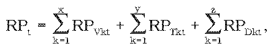

# § 4 Postup a podmienky uplatňovania ceny

(1) Maximálna cena tepla sa skladá z variabilnej zložky maximálnej ceny tepla so spotrebnou daňou28) z elektriny, uhlia, zemného plynu a so spotrebnou daňou z minerálneho oleja a fixnej zložky maximálnej ceny tepla s primeraným ziskom a určuje sa pre obchodný vzťah medzi dodávateľom a odberateľom tepla.29)

(2) Variabilná zložka maximálnej ceny tepla v eurách za kilowatthodinu sa určí na objednané množstvo tepla. Fixná zložka maximálnej ceny tepla s primeraným ziskom sa určí v eurách na kilowatt celkového regulačného príkonu.

(3) Regulačný príkon odberného zariadenia so spotrebou tepla na vykurovanie a spotrebou tepla v teplej úžitkovej vode sa vypočíta ako podiel skutočne dodaného množstva tepla, osobitne aj pre teplo v teplej úžitkovej vode, v kilowatthodinách v roku t-2 do odberného zariadenia a počtu hodín 5 300. Pri výpočte regulačného príkonu odberného zariadenia na technologickú spotrebu vo výrobných procesoch sa použije počet hodín 8000, ak sa dodávateľ a odberateľ nedohodnú inak. Pri odbernom zariadení, v ktorom si časť tepla na vykurovanie alebo na prípravu teplej úžitkovej vody vyrába odberateľ tepla samostatne (ďalej len „doplnkové teplo“), sa na výpočet regulačného príkonu použije počet hodín 2000, ak sa dodávateľ s odberateľom nedohodnú inak. Regulačný príkon odberného zariadenia medzi dodávateľom a odberateľom, ktorý je súčasne aj dodávateľom, sa môže určiť aj dohodou.

(4) Regulačný príkon nového odberného zariadenia sa vypočíta ako podiel objednaného množstva tepla na vykurovanie a prípravu teplej úžitkovej vody alebo na technologické využitie alebo doplnkového tepla na rok t v kilowatthodinách a počtu hodín podľa spôsobu využitia dodávky tepla podľa odseku 3.

(5) Celkový regulačný príkon na rok t sa vypočíta ako súčet regulačných príkonov všetkých odberných zariadení takto:

kde

RPt je celkový regulačný príkon v kilowattoch,

RPVkt sú regulačné príkony odberných zariadení so spotrebou tepla na vykurovanie a spotrebou tepla v teplej úžitkovej vode v kilowattoch,

RPTkt je regulačný príkon odberného zariadenia s technologickou spotrebou tepla vo výrobnom procese v kilowattoch,

RPDkt je regulačný príkon odberného zariadenia so spotrebou doplnkového tepla v kilowattoch,

x, y, z je počet odberných zariadení pre jednotlivé druhy odberných zariadení.

(6) Variabilná zložka maximálnej ceny tepla sa fakturuje za namerané množstvo tepla na odbernom mieste a za namerané alebo vypočítané množstvo tepla v teplej úžitkovej vode na odbernom mieste. Fixná zložka maximálnej ceny tepla sa fakturuje za regulačný príkon odberného zariadenia.
