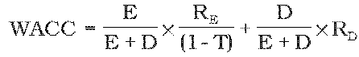
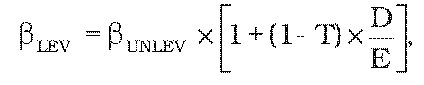

# § 3 Spôsob určenia výšky primeraného zisku

(1) Primeraný zisk zohľadňuje rozsah potrebných investícií na zabezpečenie dlhodobej spoľahlivej, bezpečnej a efektívnej prevádzky sústavy, primeranú návratnosť prevádzkových aktív a stimuláciu stabilného dlhodobého podnikania.

(2) Výška primeraného zisku za prístup do prenosovej sústavy a prenos elektriny prevádzkovateľom prenosovej sústavy a za prístup do distribučnej sústavy a distribúciu elektriny prevádzkovateľom regionálnej distribučnej sústavy je určená ako súčin miery výnosnosti regulačnej bázy aktív pred zdanením WACC a hodnoty regulačnej bázy aktív. WACC je úradom určená miera výnosnosti regulačnej bázy aktív pred zdanením na regulačné obdobie vypočítaná podľa vzorca ; na rok 2012 je WACC určená vo výške 6,04 %;

kde

- a) T – je sadzba dane z príjmov na rok t,

- b) E – je vlastné imanie v eurách k 31. decembru 2010,

- c) D – sú cudzie zdroje v eurách k 31. decembru 2010,

- d) RE – je reálna cena vlastného kapitálu a vlastných zdrojov vypočítaná podľa vzorca

  - RE = RF + βLEV x (RM - RF),

  - kde

  - 1. RF – je výnosnosť bezrizikového aktíva, prepočítaný priemerný výnos päťročných a viacročných štátnych dlhopisov emitovaných na slovenskom trhu za roky 2007 až 2011 na rok 2012 vo výške 4,01 %,

  - 2. βLEV – je vážený koeficient β, ktorý definuje citlivosť akcie spoločnosti na riziko trhu so zohľadnením sadzby dane z príjmov a podielu cudzích zdrojov vypočítaný podľa vzorca

  - 

    - kde

    - 2.1. βUNLEV – je nevážený koeficient β bez vplyvu sadzby dane z príjmov a podielu cudzích zdrojov na rok 2012 vo výške 0,30; pre ďalšie roky určený úradom v intervale od 0,30 do 0,65,

    - 2.2. D/E – je pomer cudzích zdrojov ku vlastnému imaniu; na rok 2012 určený vo výške 60 % v prospech cudzieho kapitálu,

  - 3. RM – je výkonnosť trhového portfólia určená úradom na rok 2012 vo výške 7,01 %,

  - 4. (RM – RF) – je celková riziková prémia pre rok 2012 určená úradom vo výške 3,00 %; pre ďalšie roky určená úradom v intervale od 3 % do 6 %,

- e) RD – je reálna cena cudzích zdrojov, prepočítaná priemerná výška úverov poskytnutých nefinančným spoločnostiam na obdobie päť a viac rokov s výškou úveru nad 1 000 000 eur, na rok 2012 vo výške 5,13 %.

(3) Hodnoty parametrov na roky 2013 až 2016, ktoré slúžia pre výpočet miery výnosnosti regulačnej bázy aktív WACC, sa zverejnia na webovom sídle úradu do 30. júna kalendárneho roku.

(4) Najvyššia miera primeraného zisku pri dodávke elektriny pre domácnosti, ktorý je možné zahrnúť do ceny za dodávku elektriny pre domácnosti, je maximálne 8 % z ceny elektriny CEt bez odchýlky určenej podľa § 28 ods. 1, najviac však 3 eurá/MWh.

(5) Najvyššia miera primeraného zisku, ktorý je možné zahrnúť do ceny za dodávku elektriny dodávateľom poslednej inštancie, je maximálne

- a) 12 % z ceny elektriny určenej spôsobom podľa § 46 ods. 1, najviac však 6 eur/MWh pre odberateľov elektriny v domácnosti,

- b) 16 % z ceny elektriny určenej spôsobom podľa § 46 ods. 1, najviac však 10 eur/MWh pre odberateľov elektriny okrem odberateľov elektriny v domácnosti.
