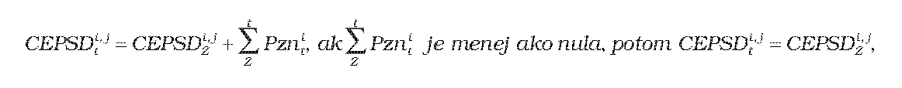
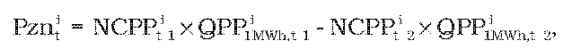
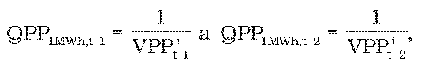

# § 7 Cena elektriny pre stanovenie doplatku na rok t pre výrobcu elektriny, ktorý má na rok predchádzajúci roku t určenú alebo schválenú cenu elektriny pre stanovenie doplatku

(1) Cena elektriny pre stanovenie doplatku na rok t v eurách na jednotku množstva elektriny za elektrinu vyrobenú i-tou technológiou j-tého zariadenia výrobcu elektriny CEPSDti,j sa pre výrobcu elektriny vypočíta podľa vzorca

kde

- a) CEPSDi,jZ –je určená alebo schválená cena elektriny pre stanovenie doplatku na rok Z predchádzajúci roku t vyrobenej i-tou technológiou j-tého zariadenia výrobcu elektriny na základe roku uvedenia zariadenia výrobcu elektriny do prevádzky alebo poslednej uplatnenej rekonštrukcie alebo modernizácie v eurách na jednotku množstva elektriny,

- b) Pznit – je príplatok37) v eurách na jednotku množstva elektriny na rok t uplatňovaný v hodnote podľa tabuľky č. 1; Pznit sa vypočíta podľa odseku 3,

- c) rok Z – je rok uvedenia zariadenia výrobcu elektriny do prevádzky alebo rok poslednej uplatnenej rekonštrukcie alebo modernizácie.

- Tabuľka č. 1

- Technológia výroby elektriny | Primárne palivo | Príplatok Pznit v eur/MWh |

- | | 2012 | 2013

- z obnoviteľných zdrojov energie | biomasa | 0 | 0

- | biokvapalina – rastlinný olej | 17,75 | 0

- | bioplyn | 0 | 0

- | biometán | 0 | 0

- vysoko účinnou kombinovanou výrobou | zemný plyn | 3,77 | 0

- | vykurovací olej | 4,64 | 0

- | hnedé uhlie | 0 | 0

- | čierne uhlie | 0 | 0

(2) Ak má výrobca elektriny na rok predchádzajúci roku t určenú alebo schválenú cenu elektriny pre stanovenie doplatku vzorec a ak si uplatňuje na rok t cenu elektriny pre stanovenie doplatku na základe rekonštrukcie alebo modernizácie, táto cena elektriny pre stanovenie doplatku na rok t sa stanoví podľa § 6 ods. 8 alebo ods. 9.

(3) Príplatok Pznit v eurách na jednotku množstva elektriny na rok t pre i-tú technológiu výroby elektriny s primárnymi palivami podľa tabuľky č. 1 zohľadňujúci vývoj ceny primárneho paliva i-tej technológie na výrobu elektriny z obnoviteľných zdrojov energie alebo vývoj ceny primárneho paliva z neobnoviteľného zdroja energie i-tej technológie na výrobu elektriny vysoko účinnou kombinovanou výrobou sa vypočíta podľa vzorca

kde

kde

- a) NCPPt-1i– je úradom určená nákupná cena primárneho paliva pre i-tú technológiu výroby elektriny v eurách na jednotku množstva v roku t-1,

- b) QPPi1 MWh, t-1– je množstvo primárneho paliva zodpovedajúceho 1 MWh i-tej technológie výroby elektriny v jednotkách množstva na megawatthodinu v roku t-1,

- c) VPPit-1 – je úradom určená výhrevnosť primárneho paliva pre i-tú technológiu výroby elektriny v megawatthodinách na jednotku množstva v roku t-1,

- d) NCPPit-2 – je určená nákupná cena primárneho paliva pre i-tú technológiu výroby elektriny v eurách na jednotku množstva v roku t-2,

- e) QPPi1 MWh, t-2 – je množstvo primárneho paliva zodpovedajúceho 1 MWh i-tej technológie výroby elektriny v jednotkách množstva na megawatthodinu v roku t-2,

- f) VPPit-2 – je úradom určená výhrevnosť primárneho paliva pre i-tú technológiu výroby elektriny v megawatthodinách na jednotku množstva v roku t-2.

(4) PZNit sa uplatní na jeden rok, ak je jeho hodnota kladná a väčšia ako 8 % zo súčinu nákupnej ceny NCPPit-2 a množstva primárneho paliva QPPi1 MWh, t-2 určených podľa odseku 3.
