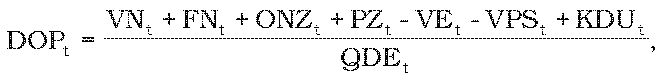
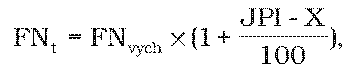

# § 12 Výroba elektriny z domáceho uhlia

(1) Elektrina vyrobená z domáceho uhlia sa dodáva dodávateľom elektriny, ktorého dodávka elektriny do odberných miest koncovým odberateľom elektriny v roku t-2 bola vyššia ako 2 500 000 MWh, na základe rozhodnutia ministerstva o uložení povinnosti vo všeobecnom hospodárskom záujme.

(2) Výrobca elektriny na základe rozhodnutia ministerstva o uložení povinnosti vo všeobecnom hospodárskom záujme vyrábať elektrinu z domáceho uhlia uplatňuje za každú megawatthodinu elektriny dodanej do sústavy, ktorá bola preukázateľne vyrobená z domáceho uhlia, pevnú cenu DOPt v eurách za megawatthodinu vypočítanú podľa vzorca

kde

- a) VNt – sú plánované schválené alebo určené variabilné náklady na výrobu elektriny z domáceho uhlia v eurách na rok t,

- b) FNt – sú plánované schválené alebo určené fixné náklady bez odpisov nových zariadení na výrobu elektriny z domáceho uhlia v eurách na rok t; FNt sú vo výške najviac podľa vzorca

- 

- kde

  - 1. FNvych – je schválená alebo určená východisková hodnota fixných nákladov maximálne do 37 300 000 eur,

  - 2. JPIt– je aritmetický priemer indexov jadrovej inflácie za obdobie od júla roku t-2 do júna roku t-1, zverejnených štatistickým úradom,

  - 3. X – je faktor efektivity podľa § 2 ods. 3,

- c) ONZt – sú plánované schválené alebo určené odpisy nových zariadení na rok t v eurách; faktor ONZt sa na rok 2012 rovná nule,

- d) PZt– je plánovaný primeraný zisk regulovaného subjektu v eurách na rok t určený podľa vzorca

- PZt = (VNt + FNt + ONZt) x WACC,

- kde

- WACC – je miera výnosnosti regulačnej bázy aktív na regulačné obdobie rokov 2012 až 2016 určená podľa § 3 ods. 2 a 3,

- e) VEt – sú plánované výnosy z dodávky vyrobenej elektriny z domáceho uhlia v eurách na rok t vypočítané podľa vzorca

- VEt = (QVt - QTt - QREt,KL) x CEt + QREt,KL x CREt,KL + QREt,ZA x CREt,ZA

- kde

  - 1. QVt – je plánované množstvo elektriny vyrobenej z domáceho uhlia v jednotkách množstva elektriny na rok t,

  - 2. QTt – je plánované množstvo vlastnej spotreby elektriny pri výrobe elektriny z domáceho uhlia v jednotkách množstva elektriny na rok t,

  - 3. QREt,KL – je plánované množstvo dodávky kladnej regulačnej elektriny vyrobenej z domáceho uhlia v jednotkách množstva elektriny na rok t,

  - 4. CEt – je plánovaná vážená priemerná cena celkovej dodávky elektriny okrem dodávky regulačnej elektriny regulovaného subjektu v eurách na jednotku množstva elektriny na rok t,

  - 5. CREt,KL – je plánovaná vážená priemerná cena dodávky kladnej regulačnej elektriny vyrobenej z domáceho uhlia v eurách na jednotku množstva elektriny na rok t,

  - 6. QREt,ZA – je plánované množstvo dodávky zápornej regulačnej elektriny poskytnutej zariadením na výrobu elektriny z domáceho uhlia v jednotkách množstva elektriny na rok t,

  - 7. CREt,ZA – je plánovaná vážená priemerná cena dodávky zápornej regulačnej elektriny poskytnutej zariadením na výrobu elektriny z domáceho uhlia v eurách na jednotku množstva elektriny na rok t,

- e) VPSt – je plánovaný výnos v eurách z poskytovania podporných služieb zariadením na výrobu elektriny z domáceho uhlia na rok t,

- f) QDEt – je elektrina vyrobená z domáceho uhlia v jednotkách množstva elektriny dodaná dodávateľom elektriny podľa odseku 1,

- g) KDUt – je faktor vyrovnania nákladov a výnosov výroby elektriny z domáceho uhlia regulovaného subjektu v eurách na rok t vypočítaná podľa odseku 3.

(3) Faktor vyrovnania nákladov a výnosov výroby elektriny z domáceho uhlia KDUt v eurách na rok t sa vypočíta podľa vzorca

KDUt= SVNt-2 - VNt-2 + SFNt-2 -FNt-2 + SONZt-2 - ONZt-2 + SPZt-2 - PZt-2 - (SVEt-2 - VEt-2) - (SVPSt-2 - VPSt-2)

kde

- a) SVNt-2 – sú skutočné schválené alebo určené variabilné náklady na výrobu elektriny z domáceho uhlia v eurách na rok t-2,

- b) VNt-2 – sú plánované schválené alebo určené variabilné náklady na výrobu elektriny z domáceho uhlia v eurách na rok t-2,

- c) SFNt-2 – sú skutočné schválené alebo určené fixné náklady na výrobu elektriny z domáceho uhlia v eurách na rok t-2,

- d) FNt-2 – sú plánované schválené alebo určené fixné náklady na výrobu elektriny z domáceho uhlia v eurách na rok t-2,

- e) SONZt–2 sú skutočné schválené alebo určené odpisy nových zariadení na rok t-2 v eurách; faktor SONZt-2 sa na účely výpočtu KDUt na roky t = 2012, 2013 a 2014 rovná nule,

- f) ONZt–2 sú plánované schválené alebo určené odpisy nových zariadení na rok t-2 v eurách; faktor ONZt-2 sa na účely výpočtu KDUt na roky t = 2012, 2013 a 2014 rovná nule,

- g) SPZt-2 – je skutočný primeraný zisk regulovaného subjektu v eurách na rok t-2 určený podľa vzorca

- SPZt-2= (SVNt-2 + SFNt-2 + SONZt-2) x WACC,

- kde

- WACC – je miera výnosnosti regulačnej bázy aktív na regulačné obdobie rokov 2012 až 2016 určená podľa § 3 ods. 2 a 3,

- h) PZt-2 – je plánovaný primeraný zisk regulovaného subjektu v eurách na rok t-2 určený podľa vzorca

- PZt-2 = (VNt-2 + FNt-2 + ONZt-2) x WACC,

- i) SVEt-2 – sú skutočné výnosy z dodávky vyrobenej elektriny z domáceho uhlia v eurách na rok t-2 vypočítané podľa vzorca

  - SVEt-2 = (SQVt-2- SQTt-2 - SQREt-2,KL) x SCEt-2 + SQREt-2,KL x SCREt-2,KL + SQREt-2,ZA x SCREt-2,ZA,

  - kde

  - 1. SQVt-2– je skutočné množstvo elektriny vyrobenej z domáceho uhlia v jednotkách množstva elektriny na rok t-2,

  - 2. SQTt-2 – je skutočné množstvo vlastnej spotreby elektriny pri výrobe elektriny z domáceho uhlia v jednotkách množstva elektriny na rok t-2,

  - 3. SQREt-2,KL – je skutočné množstvo dodávky kladnej regulačnej elektriny vyrobenej z domáceho uhlia v jednotkách množstva elektriny na rok t-2,

  - 4. SCEt-2– je skutočná vážená priemerná cena celkovej dodávky elektriny okrem dodávky regulačnej elektriny regulovaného subjektu v eurách na jednotku množstva elektriny na rok t,

  - 5. SCREt-2,KL– je skutočná vážená priemerná cena dodávky kladnej regulačnej elektriny vyrobenej z domáceho uhlia v eurách na jednotku množstva elektriny na rok t-2,

  - 6. SQREt-2,ZA – je skutočné množstvo dodávky zápornej regulačnej elektriny poskytnutej zariadením na výrobu elektriny z domáceho uhlia v jednotkách množstva elektriny na rok t-2,

  - 7. SCREt-2,ZA – je skutočná vážená priemerná cena dodávky zápornej regulačnej elektriny poskytnutej zariadením na výrobu elektriny z domáceho uhlia v eurách na jednotku množstva elektriny na rok t-2,

- j) VEt-2 – plánované výnosy z dodávky vyrobenej elektriny z domáceho uhlia v eurách na rok t-2 vypočítané podľa vzorca

- VEt-2 = (QVt-2 - QTt-2 - QREt-2,KL) x CEt-2 + QREt-2,KL x CREt-2,KL + QREt-2,ZA x CREt-2,ZA,

- kde

  - 1. QVt-2 – je plánované množstvo elektriny vyrobenej z domáceho uhlia v jednotkách množstva elektriny na rok t-2,

  - 2. QTt-2 – je plánované množstvo vlastnej spotreby elektriny pri výrobe elektriny z domáceho uhlia v jednotkách množstva elektriny na rok t-2,

  - 3. QREt-2,KL– je plánované množstvo dodávky kladnej regulačnej elektriny vyrobenej z domáceho uhlia v jednotkách množstva elektriny na rok t-2,

  - 4. CEt-2– je plánovaná vážená priemerná cena celkovej dodávky elektriny okrem dodávky regulačnej elektriny regulovaného subjektu v eurách na jednotku množstva elektriny na rok t,

  - 5. CREt-2,KL – je plánovaná vážená priemerná cena dodávky kladnej regulačnej elektriny vyrobenej z domáceho uhlia v eurách na jednotku množstva elektriny na rok t-2,

  - 6. QREt-2,ZA – je plánované množstvo dodávky zápornej regulačnej elektriny poskytnutej zariadením na výrobu elektriny z domáceho uhlia v jednotkách množstva elektriny na rok t-2,

  - 7. CREt-2,ZA – je plánovaná vážená priemerná cena dodávky zápornej regulačnej elektriny poskytnutej zariadením na výrobu elektriny z domáceho uhlia v eurách na jednotku množstva elektriny na rok t-2,

- k) SVPSt-2 – je skutočný výnos v eurách z poskytovania podporných služieb zariadením na výrobu elektriny z domáceho uhlia na rok t-2,

- l) VPSt-2 – je plánovaný výnos v eurách z poskytovania podporných služieb zariadením na výrobu elektriny z domáceho uhlia na rok t-2.
