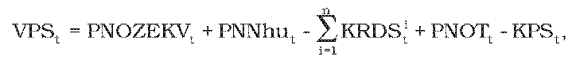

## Tarifa za prevádzkovanie systému

# § 13 Spôsob výpočtu tarify za prevádzkovanie systému, postup a podmienky uplatňovania tarify

(1) Výnos za prevádzkovanie systému na rok t VPSt v eurách, ktorý je uplatňovaný prostredníctvom tarify za prevádzkovanie systému TPStv eurách na jednotku množstva elektriny, sa vypočíta podľa vzorca

kde

- a) PNOZEKVt – sú plánované náklady v eurách zohľadňujúce alikvotnú časť nákladov výrobcov elektriny na výrobu elektriny z obnoviteľných zdrojov energie a technológiami kombinovanej výroby vrátane nákladov súvisiacich s nákupom zvyškového diagramu na pokrytie strát elektriny v regionálnych distribučných sústavách v roku t, určené podľa § 14,

- b) PNNhut – sú plánované náklady v eurách zohľadňujúce alikvotnú časť nákladov na výrobu elektriny z domáceho uhlia v roku t určené ako súčin tarify DOPt podľa § 12 ods. 2 a množstva elektriny vykúpenej podľa § 12 ods. 1,

- c) n – je počet regionálnych distribučných sústav v roku t-2 na vymedzenom území,

- d) KRDSti – je korekcia i-tého prevádzkovateľa regionálnej distribučnej sústavy v eurách, ktorá zohľadňuje náklady a výnosy z platieb z taríf za prevádzkovanie systému v roku t-2 určená podľa § 25 ods. 3.

- e) PNOTt – sú plánované náklady v eurách na rok t zohľadňujúce alikvotnú časť nákladov na organizovanie a vyhodnotenie krátkodobého trhu s elektrinou PNOTt v roku t určené podľa § 43 ods. 2 písm. b),

- f) KPSt – je korekcia prevádzkovateľa prenosovej sústavy KPSt v eurách, ktorá zohľadňuje náklady a výnosy z platieb za prevádzkovanie systému v roku t-2 určená podľa § 18 ods. 2.

(2) Pre odberateľa elektriny priamo pripojeného do prenosovej sústavy sa uplatňuje tarifa za prevádzkovanie systému TPStv eurách na jednotku množstva elektriny za prenesenú elektrinu vrátane elektriny vyrobenej v jeho vlastnom zariadení na výrobu elektriny a spotrebovanej na vlastnú spotrebu elektriny tohto odberateľa elektriny alebo dodanej iným odberateľom elektriny bez použitia prenosovej sústavy okrem vlastnej spotreby elektriny pri výrobe elektriny.

(3) Pre i-tého prevádzkovateľa regionálnej distribučnej sústavy priamo pripojeného do prenosovej sústavy sa uplatňuje tarifa za prevádzkovanie systému TPSit prepočítaná na spotrebu elektriny na časti vymedzeného územia príslušného i-tého prevádzkovateľa regionálnej distribučnej sústavy, ktorá predstavuje spolu s uplatnením TPStalikvotnú časť nákladov na výrobu elektriny vyrobenej z obnoviteľných zdrojov energie a vysoko účinnou kombinovanou výrobou, alikvotnú časť nákladov na výrobu elektriny z domáceho uhlia v roku t upravených o korekciu KRDSti, ktorá zohľadňuje náklady a výnosy z platieb z taríf za prevádzkovanie systému v roku t-2.

(4) Korekcia zohľadňujúca náklady a výnosy súvisiace s uplatnením tarify za prevádzkovanie systému za rok t-2 sa prevádzkovateľovi prenosovej sústavy zohľadní vo výške jeho výnosu PCNOTt z uplatnenia tarify za prevádzkovanie systému v roku t.

(5) Pre odberateľa elektriny pripojeného do regionálnej distribučnej sústavy sa uplatňuje tarifa za prevádzkovanie systému TPSt za distribuovanú elektrinu vrátane elektriny vyrobenej v jeho vlastnom zariadení na výrobu elektriny a spotrebovanej na vlastnú spotrebu elektriny tohto odberateľa elektriny alebo dodanej iným odberateľom elektriny bez použitia regionálnej distribučnej sústavy okrem vlastnej spotreby elektriny pri výrobe elektriny.

(6) Pre odberateľa elektriny pripojeného do miestnej distribučnej sústavy sa uplatňuje tarifa za prevádzkovanie systému TPSt za všetku elektrinu odobratú z nadradenej sústavy a distribuovanú odberateľom elektriny pripojeným do tejto miestnej distribučnej sústavy vrátane elektriny vyrobenej vo vlastnom zariadení na výrobu elektriny alebo v inom zariadení na výrobu elektriny pripojených do tejto miestnej distribučnej sústavy a spotrebovanej na vlastnú spotrebu elektriny alebo dodanej odberateľom elektriny bez použitia nadradenej sústavy okrem vlastnej spotreby elektriny pri výrobe elektriny.

(7) Pre odberateľa elektriny, ktorý odoberá elektrinu od výrobcu elektriny bez použitia prenosovej sústavy alebo distribučnej sústavy, sa výrobcom elektriny uplatňuje tomuto odberateľovi elektriny tarifa za prevádzkovanie systému TPSt na celé množstvo takto odobratej elektriny.

(8) Tarifa za prevádzkovanie systému sa neuplatňuje za vlastnú spotrebu elektriny pri výrobe elektriny ani za spotrebu elektriny na prečerpávanie v prečerpávacích vodných elektrárňach.

(9) Na účely cenovej regulácie sa do 30. apríla roku t predkladajú prevádzkovateľmi prenosovej a distribučných sústav a výrobcami elektriny údaje o skutočných množstvách elektriny v roku t-1, očakávaných množstvách elektriny v roku t a plánovaných množstvách elektriny na rok t+1 prepravenej koncovým odberateľom elektriny vrátane údajov o množstve elektriny vyrobenej vo vlastnom zariadení na výrobu elektriny, v inom zariadení na výrobu elektriny a údaje o spotrebe takto vyrobenej elektriny spotrebovanej na vlastnú spotrebu elektriny, dodanej odberateľom elektriny bez použitia prenosovej alebo regionálnej distribučnej sústavy, vlastnej spotrebe elektriny pri výrobe elektriny, ako aj údaje o skutočných nákladoch a skutočných výnosoch za prevádzkovanie systému v roku t-1.
