# § 14 Spôsob výpočtu alikvotnej časti nákladov vynaložených na podporu výroby elektriny z obnoviteľných zdrojov energie a vysoko účinnou kombinovanou výrobou zohľadnených v tarife za prevádzkovanie systému

(1) Plánovaná alikvotná časť nákladov v eurách vynaložených na podporu výroby elektriny vyrobenej z obnoviteľných zdrojov energie a kombinovanou výrobou PNOZEKVt zohľadnených v tarife za prevádzkovanie systému v roku t sa vypočíta podľa vzorca

PNOZEKVt = NSTRt + KSTRt + NDOPt + KDOPt + NDDt + KDDt + NODt + KNODt,

kde

- a) NSTRt– sú náklady súvisiace s odberom elektriny na účel pokrytia strát elektriny v regionálnych distribučných sústavách v eurách v roku t vypočítané podľa vzorca

- 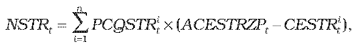

- kde

  - 1. n – je počet regionálnych distribučných sústav v roku t,

  - 2. PCQSTRit– je plánované množstvo strát elektriny v sústave i-tého prevádzkovateľa regionálnej distribučnej sústavy v jednotkách množstva elektriny na rok t,

  - 3. ACESTRZPt – je určená cena elektriny na straty, ktorou je aritmetický priemer cien elektriny základného pásma na obdobie od 1. januára do 31. decembra roku t na účely pokrytia strát všetkých prevádzkovateľov regionálnych distribučných sústav bez nákladov na odchýlku; ceny elektriny základného pásma na účely pokrytia strát pre prevádzkovateľov regionálnych distribučných sústav v eurách na jednotku množstva elektriny na rok t sú schválené alebo určené úradom v cenovom konaní za prístup do distribučnej sústavy a distribúciu elektriny,

  - 4. CESTRit– je cena elektriny na straty i-tého prevádzkovateľa regionálnej distribučnej sústavy bez nákladov na odchýlku schválená alebo určená cenovým rozhodnutím za prístup do distribučnej sústavy a distribúciu elektriny v eurách na jednotku množstva elektriny na rok t,

- b) KSTRt – je korekčný faktor nákladov súvisiacich s odberom elektriny na účel pokrytia strát elektriny v regionálnych distribučných sústavách v eurách v roku t, ktorý sa na roky 2013 a 2014 vypočíta podľa vzorca; na rok t nasledujúci po roku 2014 sa KSTRt vypočíta podľa vzorca

- 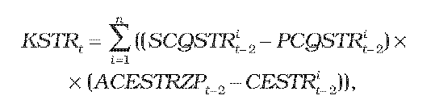

- kde

  - 6. n – je počet regionálnych distribučných sústav v roku t-2,

  - 7. PCQSTRit-2– je plánované množstvo strát elektriny v sústave i-tého prevádzkovateľa regionálnej distribučnej sústavy v jednotkách množstva elektriny na rok t-2,

  - 8. SCQSTRit-2 – je skutočné množstvo strát elektriny v sústave i-tého prevádzkovateľa regionálnej distribučnej sústavy v jednotkách množstva elektriny v roku t-2,

  - 9. ACESTRZPt-2– je určená cena elektriny na straty základného pásma na obdobie od 1. januára do 31. decembra roku t-2, ktorou je aritmetický priemer cien elektriny na účely pokrytia strát všetkých prevádzkovateľov regionálnych distribučných sústav bez nákladov na odchýlku; ceny elektriny základného pásma na účely pokrytia strát pre prevádzkovateľov regionálnych distribučných sústav v eurách na jednotku množstva elektriny na rok t-2 sú schválené alebo určené úradom v rámci cenového konania za prístup do distribučnej sústavy a distribúciu elektriny,

  - 10. CESTRit-2– je cena elektriny na účely pokrytia strát i-tého prevádzkovateľa regionálnej distribučnej sústavy bez nákladov na odchýlku schválená alebo určená cenovým rozhodnutím za prístup do distribučnej sústavy a distribúciu elektriny v eurách na jednotku množstva elektriny na rok t-2,

- c) NDOPt – sú náklady súvisiace s doplatkom v eurách v roku t, ktoré sa vypočítajú podľa vzorca

- 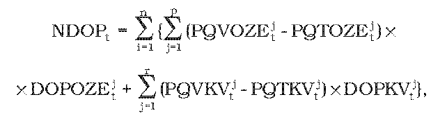

- kde

  - 1. n – je počet regionálnych distribučných sústav v roku t,

  - 2. p – je počet zariadení výrobcov elektriny z obnoviteľných zdrojov energie v roku t, ktorí sú pripojení do i-tej regionálnej distribučnej sústavy alebo na vymedzenom území ktorej sa nachádzajú,

  - 3. r – je počet zariadení výrobcov elektriny vysoko účinnou kombinovanou výrobou v roku t, ktorí sú pripojení do i-tej regionálnej distribučnej sústavy alebo na vymedzenom území ktorej sa nachádzajú,

  - 4. PQVOZEjt– je plánované množstvo elektriny, na ktoré je možné uplatniť doplatok, vyrobenej v roku t v j-tom zariadení na výrobu elektriny výrobcov elektriny z obnoviteľných zdrojov energie, ktorí sú pripojení do i-tej regionálnej distribučnej sústavy alebo na vymedzenom území ktorej sa nachádzajú, v jednotkách množstva elektriny,

  - 5. PQTOZEjt – je plánované množstvo technologickej vlastnej spotreby elektriny v roku t v j-tom zariadení na výrobu elektriny výrobcov elektriny z obnoviteľných zdrojov energie, ktorí sú pripojení do i-tej regionálnej distribučnej sústavy alebo na vymedzenom území ktorej sa nachádzajú, v jednotkách množstva elektriny,

  - 6. DOPOZEjt – je doplatok pre j-té zariadenie na výrobu elektriny výrobcov elektriny z obnoviteľných zdrojov energie, ktorí sú pripojení do i-tej regionálnej distribučnej sústavy alebo na vymedzenom území ktorej sa nachádzajú, v eurách na jednotku množstva elektriny v roku t, ktorý sa vypočíta podľa vzorca

    - DOPOZEjt = CEPSDOZEjt- ACESTRt ,

    - ak je CEPSDOZEjt- ACESTRZPt ≤ 0, potom DOPOZEit sa rovná nule,

    - kde

    - CEPSDOZEjt – je cena elektriny pre stanovenie doplatku pre zariadenie na výrobu elektriny výrobcov elektriny z obnoviteľných zdrojov energie v eurách na jednotku množstva elektriny na rok t,

  - 7. PQVKVjt – je plánované množstvo elektriny, na ktoré je možné uplatniť doplatok, vyrobenej v j-tom zariadení na výrobu elektriny výrobcov elektriny vysoko účinnou kombinovanou výrobou, ktorí sú pripojení do i-tej regionálnej distribučnej sústavy alebo na vymedzenom území ktorej sa nachádzajú, v jednotkách množstva elektriny v roku t,

  - 8. PQTKVjt – je plánované množstvo technologickej vlastnej spotreby elektriny v j-tom zariadení na výrobu elektriny výrobcov elektriny vysoko účinnou kombinovanou výrobou, ktorí sú pripojení do i-tej regionálnej distribučnej sústavy alebo na vymedzenom území ktorej sa nachádzajú, v jednotkách množstva elektriny v roku t,

  - 9. DOPKVjt– je doplatok pre j-té zariadenie na výrobu elektriny výrobcov elektriny vysoko účinnou kombinovanou výrobou, ktorí sú pripojení do i-tej regionálnej distribučnej sústavy alebo na vymedzenom území ktorej sa nachádzajú, v eurách na jednotku množstva elektriny v roku t, ktorý sa vypočíta podľa vzorca

    - DOPKVtj= CEPSDKVtj - ACESTRZPt ,

    - ak je CEPSDKVtj - ACESTRZPt ≤ 0, potom DOPKVitsa rovná nule,

    - kde

    - CEPSDKVjt – je cena elektriny pre stanovenie doplatku pre zariadenie na výrobu elektriny výrobcov elektriny vysoko účinnou kombinovanou výrobou v eurách na jednotku množstva elektriny na rok t,

- d) KDOPt – je korekčný faktor súvisiaci s nákladmi na doplatok v eurách v roku t, ktorý sa vypočíta podľa vzorca

- 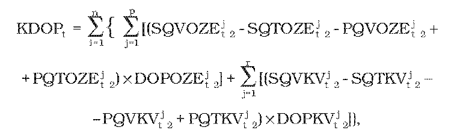

- kde

  - 1. n – je počet regionálnych distribučných sústav v roku t-2,

  - 2. p – je počet zariadení výrobcov elektriny z obnoviteľných zdrojov energie, ktorí sú pripojení do i-tej regionálnej distribučnej sústavy alebo na vymedzenom území ktorej sa nachádzajú, v roku t-2,

  - 3. r – je počet zariadení výrobcov elektriny vysoko účinnou kombinovanou výrobou, ktorí sú pripojení do i-tej regionálnej distribučnej sústavy alebo na vymedzenom území ktorej sa nachádzajú v roku t-2,

  - 4. PQVOZEjt-2 – je plánované množstvo elektriny, na ktoré je možné uplatniť doplatok, vyrobenej v j-tom zariadení na výrobu elektriny výrobcov z obnoviteľných zdrojov energie, ktorí sú pripojení do i-tej regionálnej distribučnej sústavy alebo na vymedzenom území ktorej sa nachádzajú, v jednotkách množstva elektriny v roku t-2,

  - 5. PQTOZEjt-2 – je plánované množstvo technologickej vlastnej spotreby elektriny v j-tom zariadení na výrobu elektriny výrobcov elektriny z obnoviteľných zdrojov energie, ktorí sú pripojení do i-tej regionálnej distribučnej sústavy alebo na vymedzenom území ktorej sa nachádzajú, v jednotkách množstva elektriny v roku t-2,

  - 6. SQVOZEjt-2 – je skutočné množstvo elektriny, na ktoré je možné uplatniť doplatok, vyrobenej v j-tom zariadení na výrobu elektriny výrobcov z obnoviteľných zdrojov energie, ktorí sú pripojení do i-tej regionálnej distribučnej sústavy alebo na vymedzenom území ktorej sa nachádzajú, v jednotkách množstva elektriny v roku t-2,

  - 7. SQTOZEjt-2 – je skutočné množstvo technologickej vlastnej spotreby elektriny v j-tom zariadení na výrobu elektriny výrobcov elektriny z obnoviteľných zdrojov energie, ktorí sú pripojení do i-tej regionálnej distribučnej sústavy alebo na vymedzenom území ktorej sa nachádzajú, v jednotkách množstva elektriny v roku t-2,

  - 8. DOPOZEjt-2 – je doplatok pre j-té zariadenie na výrobu elektriny výrobcov elektriny z obnoviteľných zdrojov energie, ktorí sú pripojení do i-tej regionálnej distribučnej sústavy alebo na vymedzenom území ktorej sa nachádzajú, v eurách na jednotku množstva elektriny v roku t-2, ktorý sa vypočíta podľa vzorca

    - DOPOZEjt-2 = CEPSDOZEjt-2 - ACESTRt-2,

    - kde

    - CEPSDOZEjt-2 – je cena elektriny pre stanovenie doplatku pre zariadenie výrobcu elektriny z obnoviteľných zdrojov energie v eurách na jednotku množstva elektriny na rok t-2,

  - 9. PQVKVjt-2 – je plánované množstvo elektriny, na ktoré je možné uplatniť doplatok, vyrobenej v j-tom zariadení na výrobu elektriny výrobcov elektriny vysoko účinnou kombinovanou výrobou, ktorí sú pripojení do i-tej regionálnej distribučnej sústavy alebo na vymedzenom území ktorej sa nachádzajú, v jednotkách množstva elektriny v roku t-2,

  - 10. PQTKVjt-2 – je plánované množstvo technologickej vlastnej spotreby elektriny v j-tom zariadení na výrobu elektriny výrobcov elektriny vysoko účinnou kombinovanou výrobou, ktorí sú pripojení do i-tej regionálnej distribučnej sústavy alebo na vymedzenom území ktorej sa nachádzajú, v jednotkách množstva elektriny v roku t-2,

  - 11. SQVKVjt-2 – je skutočné množstvo elektriny, na ktoré je možné uplatniť doplatok, vyrobenej v j-tom zariadení na výrobu elektriny výrobcov elektriny vysoko účinnou kombinovanou výrobou, ktorí sú pripojení do i-tej regionálnej distribučnej sústavy alebo na vymedzenom území ktorej sa nachádzajú, v jednotkách množstva elektriny v roku t-2,

  - 12. SQTKVjt-2 – je skutočné množstvo technologickej vlastnej spotreby elektriny v j-tom zariadení na výrobu elektriny výrobcov elektriny vysoko účinnou kombinovanou výrobou, ktorí sú pripojení do i-tej regionálnej distribučnej sústavy alebo na vymedzenom území ktorej sa nachádzajú, v jednotkách množstva elektriny v roku t-2,

  - 13. DOPKVjt-2 – je doplatok pre j-té zariadenie na výrobu elektriny výrobcov elektriny vysoko účinnou kombinovanou výrobou, ktorí sú pripojení do i-tej regionálnej distribučnej sústavy alebo na vymedzenom území ktorej sa nachádzajú, v eurách na jednotku množstva elektriny v roku t-2, ktorý sa vypočíta podľa vzorca

    - DOPKVjt-2 = CEPSDKVjt-2 - ACESTRt-2,

    - kde

    - CEPSDKVjt-2 - je cena elektriny pre stanovenie doplatku pre zariadenie na výrobu elektriny výrobcov elektriny vysoko účinnou kombinovanou výrobou v eurách na jednotku množstva elektriny na rok t-2,

    - pri výpočte KDOPt sa na roky 2013 a 2014 zohľadní hodnota ceny elektriny na straty určená na roky 2011 a 2012,

- e) NDDt – je plánovaná alikvotná časť nákladov na dokúpenie zvyškového diagramu na pokrytie strát elektriny v regionálnych distribučných sústavách a predaj prekúpeného množstva elektriny v súvislosti s odberom elektriny na straty v eurách na rok t, ktorá sa vypočíta podľa vzorca

- 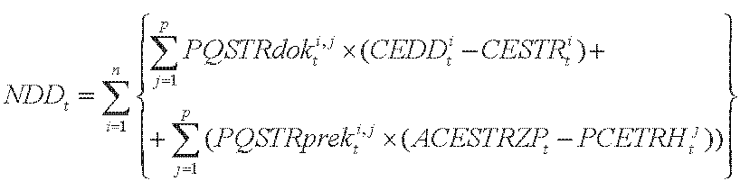

- kde

  - 1. n – je počet regionálnych distribučných sústav v roku t,

  - 2. p – je počet hodín roku t,

  - 3. PQSTRdokti,j – je plánované množstvo elektriny v jednotkách množstva elektriny v j-tej hodine roku t na dokúpenie zvyškového diagramu na pokrytie strát elektriny v i-tej regionálnej distribučnej sústave; vzorec sa vypočíta ako rozdiel v j-tej hodine roku t plánovaného diagramu na pokrytie strát v i-tej regionálnej distribučnej sústave a plánovaného diagramu odberu elktriny i-tého prevádzkovateľa regionálnej distribučnej sústavy zo zariadení výrobcov elektriny s právom na podporu, ak je tento rozdiel záporný, vzorec sa rovná nule,

  - 4. CEDDit – je schválená alebo určená cena elektriny na dokúpenie zvyškového diagramu na pokrytie strát elektriny v i-tej regionálnej distribučnej sústave bez nákladov na odchýlku v eurách na jednotku množstva elektriny na rok t,

  - 5. CESTRit – je cena elektriny na straty i-tého prevádzkovateľa regionálnej distribučnej sústavy bez nákladov na odchýlku schválená alebo určená cenovým rozhodnutím za prístup do distribučnej sústavy a distribúciu elektriny v eurách na jednotku množstva elektriny na rok t,

  - 6. PQSTRprekti,j – je plánované množstvo elektriny v jednotkách množstva elektriny v j-tej hodine roku t prekúpené i-tým prevádzkovateľom regionálnej distribučnej sústavy v súvislosti s odberom elektriny i-tého prevádzkovateľa regionálnej distribučnej sústavy zo zariadení výrobcov elektriny s právom na podporu na účely pokrytia strát distribučnej sústavy; PQSTRprekti,j sa vypočíta ako rozdiel v j-tej hodine roku t plánovaného diagramu na pokrytie strát v i-tej regionálnej distribučnej sústave a plánovaného diagramu odberu elektriny i-tého prevádzkovateľa regionálnej distribučnej sústavy zo zariadení výrobcov elektriny s právom na podporu, ak je tento rozdiel kladný, PQSTRprekti,j sa rovná nule,

  - 7. PCETRHjt – je plánovaná určená cena elektriny v eurách na jednotku množstva elektriny na rok t v j-tej hodine roku t; PCETRHjt sa vypočíta pre každú hodinu každého dňa na rok t ako aritmetický priemer cien elektriny príslušných hodín v dňoch v období od 1. apríla roku t-1 do 30. septembra roku t-1 pri dennom obchodovaní v obchodnej oblasti, v rámci ktorej je denný trh s elektrinou organizovaný organizátorom krátkodobého trhu s elektrinou,

  - 8. ACESTRZPt – je určená cena elektriny na straty, ktorou je aritmetický priemer cien elektriny základného pásma na obdobie od 1. januára do 31. decembra roku t na účely pokrytia strát všetkých prevádzkovateľov regionálnych distribučných sústav bez nákladov na odchýlku; ceny elektriny základného pásma na účely pokrytia strát pre prevádzkovateľov regionálnych distribučných sústav v eurách na jednotku množstva elektriny na rok t sú schválené alebo určené úradom v cenovom konaní za prístup do distribučnej sústavy a distribúciu elektriny,

- f) KDDt – je korekčný faktor súvisiaci s alikvotnou časťou nákladov na dokúpenie zvyškového diagramu na pokrytie strát elektriny v regionálnych distribučných sústavách a predaj prekúpeného množstva elektriny v súvislosti s odberom elektriny na straty v eurách na rok t, ktorý sa vypočíta podľa vzorca

- 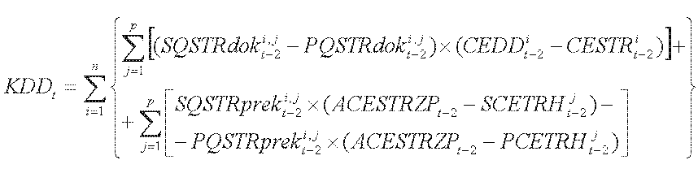

- kde

  - 1. n – je počet regionálnych distribučných sústav v roku t-2,

  - 2. p – je počet hodín roku t,

  - 3. SQSTRdoki,jt-2 – je skutočné množstvo elektriny v jednotkách množstva elektriny v j-tej hodine roku t-2 na dokúpenie zvyškového diagramu na pokrytie strát elektriny v i–tej regionálnej distribučnej sústave; SQSTRdoki,jt-2 sa vypočíta ako rozdiel v j-tej hodine roku t-2 skutočného diagramu na pokrytie strát v i-tej regionálnej distribučnej sústave a skutočného diagramu odberu elektriny i-tého prevádzkovateľa regionálnej distribučnej sústavy zo zariadení výrobcov elektriny s právom na podporu, ak je tento rozdiel záporný, SQSTRdoki,jt-2 sa rovná nule,

  - 4. PQSTRdoki,jt-2 – je plánované množstvo elektriny v jednotkách množstva elektriny v j-tej hodine roku t-2 na dokúpenie zvyškového diagramu na pokrytie strát elektriny v i–tej regionálnej distribučnej sústave; PQSTRdoki,jt-2 sa vypočíta ako rozdiel v j-tej hodine roku t-2 plánovaného diagramu na pokrytie strát v i-tej regionálnej distribučnej sústave a plánovaného diagramu odberu elektriny i-tého prevádzkovateľa regionálnej distribučnej sústavy zo zariadení výrobcov elektriny s právom na podporu, ak je tento rozdiel záporný, PQSTRdoki,jt-2 sa rovná nule,

  - 5. CEDDit-2 – je schválená alebo určená cena elektriny na dokúpenie zvyškového diagramu na pokrytie strát elektriny v i-tej regionálnej distribučnej sústave bez nákladov na odchýlku v eurách na jednotku množstva elektriny na rok t-2,

  - 6. CESTRit-2 – je cena elektriny na straty i-tého prevádzkovateľa regionálnej distribučnej sústavy bez nákladov na odchýlku schválená alebo určená cenovým rozhodnutím za prístup do distribučnej sústavy a distribúciu elektriny v eurách na jednotku množstva elektriny na rok t-2,

  - 7. SQSTRpreki,jt-2 – je skutočné množstvo elektriny v jednotkách množstva elektriny v j-tej hodine roku t-2 prekúpené i-tým prevádzkovateľom regionálnej distribučnej sústavy v súvislosti s odberom elektriny i-tého prevádzkovateľa regionálnej distribučnej sústavy zo zariadení výrobcov elektriny s právom na podporu na účely pokrytia strát distribučnej sústavy; SQSTRpreki,jt-2 sa vypočíta ako rozdiel v j-tej hodine roku t skutočného diagramu na pokrytie strát v i-tej regionálnej distribučnej sústave a skutočného diagramu odberu elektriny i-tého prevádzkovateľa regionálnej distribučnej sústavy zo zariadení výrobcov elektriny s právom na podporu, ak je tento rozdiel kladný, SQSTRpreki,jt-2 sa rovná nule,

  - 8. PQSTRpreki,jt-2 – je plánované množstvo elektriny v jednotkách množstva elektriny v j-tej hodine roku t-2 prekúpené i-tým prevádzkovateľom regionálnej distribučnej sústavy v súvislosti s odberom elektriny i-tého prevádzkovateľa regionálnej distribučnej sústavy zo zariadení výrobcov elektriny s právom na podporu na účely pokrytia strát distribučnej sústavy; PQSTRpreki,jt-2 sa vypočíta ako rozdiel v j-tej hodine roku t plánovaného diagramu na pokrytie strát v i-tej regionálnej distribučnej sústave a plánovaného diagramu odberu elektriny i-tého prevádzkovateľa regionálnej distribučnej sústavy zo zariadení výrobcov elektriny s právom na podporu; ak je tento rozdiel kladný, PQSTRpreki,jt-2 sa rovná nule,

  - 9. SCETRHjt-2– je skutočná určená cena elektriny v eurách na jednotku množstva elektriny na rok t-2 v j-tej hodine roku t-2; SCETRHjt-2 sa rovná pre každú hodinu roka t-2 váženému priemeru cien elektriny príslušnej hodiny roka t-2, za ktoré boli odpredané jednotlivé časti množstva SQSTRpreki,jt-2; prekúpené množstvo elektriny SQSTRpreki,jt-2i-tým prevádzkovateľom regionálnej distribučnej sústavy v súvislosti s odberom elektriny i-tého prevádzkovateľa regionálnej distribučnej sústavy zo zariadení výrobcov elektriny s právom na podporu na účely pokrytia strát distribučnej sústavy sa umožňuje odpredať na ročnej báze vo forme štandardného produktu ročného základného pásma s rovnakou hodnotou množstva elektriny v každej hodine roka t-2 a v dennom obchodovaní v obchodnej oblasti, v rámci ktorej je denný trh s elektrinou organizovaný organizátorom krátkodobého trhu s elektrinou,

  - 10. PCETRHjt-2 – je plánovaná určená cena elektriny v eurách na jednotku množstva elektriny na rok t-2 v j-tej hodine roku t-2; PCETRHjt-2 sa vypočíta pre každú hodinu každého dňa na rok t-2 ako aritmetický priemer cien elektriny príslušných hodín dní v období od 1. apríla roku t-1 do 30. septembra roku t-1 pri dennom obchodovaní v obchodnej oblasti, v rámci ktorej je denný trh organizovaný organizátorom krátkodobého trhu s elektrinou; na účely výpočtu parametra KDD2012sa pre regulovaný subjekt uplatní parameter PCETRHj2010 pre každú hodinu roku 2010 v hodnote rovnajúcej sa hodnote parametra PCEPTRH2010 uvedeného v cenovom rozhodnutí pre prevádzkovateľa regionálnej distribučnej sústavy o cenách za poskytovanie systémových služieb v elektroenergetike a za prevádzkovanie systému na rok 2010,

  - 11. ACESTRZPt-2 – je určená cena elektriny na straty, ktorou je aritmetický priemer cien elektriny základného pásma na obdobie od 1. januára do 31. decembra roku t-2 na účely pokrytia strát všetkých prevádzkovateľov regionálnych distribučných sústav bez nákladov na odchýlku; ceny elektriny základného pásma na účely pokrytia strát pre prevádzkovateľov regionálnych distribučných sústav v eurách na jednotku množstva elektriny na rok t-2 sú schválené alebo určené úradom v cenovom konaní za prístup do distribučnej sústavy a distribúciu elektriny,

- g) NODt – sú plánované náklady v eurách na rok t súvisiace s odchýlkou spôsobenou odberom elektriny na účel pokrytia strát elektriny v regionálnych distribučných sústavách zo zariadení výrobcov elektriny, ktorí majú právo na uplatnenie podpory prevzatím zodpovednosti za odchýlku, vypočítané podľa vzorca

- 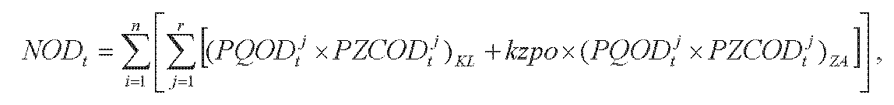

- kde

  - 1. n – je počet regionálnych distribučných sústav v roku t,

  - 2. r – je počet štvrťhodín v roku t,

  - 3. PQODtj– je plánovaná schválená alebo určená odchýlka subjektu zúčtovania v jednotkách množstva elektriny v j-tej štvrťhodine roku t súvisiaca s odberom elektriny i-tého prevádzkovateľa regionálnej distribučnej sústavy zo zariadení výrobcov elektriny, ktorí majú právo na uplatnenie podpory prevzatím zodpovednosti za odchýlku; subjektom zúčtovania je subjekt, ktorý prevzal zodpovednosť za odchýlku i-tého prevádzkovateľa regionálnej distribučnej sústavy,

  - 4. PZCODtj–je plánovaná schválená alebo určená zúčtovacia cena odchýlky v eurách na jednotku množstva elektriny v j-tej štvrťhodine roku t; PZCODtj sa rovná na obdobie január až september roku t hodnotám za obdobie január až september roku t-1 a na obdobie október až december roku t sa primerane použijú hodnoty z obdobia október až december roku t-2,

  - 5. kzpo – je plánovaný určený koeficient zápornej platby za odchýlku na rok t,

  - 6. KL – je parameter označujúci tie štvrťhodiny, v ktorých je súčin PQODtj a PZCODtj kladný alebo rovný nule,

  - 7. ZA – je parameter označujúci tie štvrťhodiny, v ktorých je súčin PQODtj a PZCODtj záporný,

- h) KNODt– je korekčný faktor nákladov v eurách na rok t súvisiacich s odchýlkou spôsobenou odberom elektriny na účel pokrytia strát elektriny v regionálnych distribučných sústavách zo zariadení výrobcov elektriny, ktorí majú právo na uplatnenie podpory prevzatím zodpovednosti za odchýlku; KNODtsa na rok t = 2013 vypočíta podľa vzorca

- 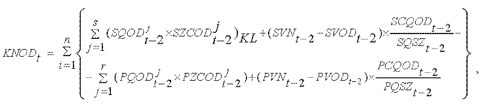

- kde

  - 1. n – je počet regionálnych distribučných sústav v roku t-2,

  - 2. s – je počet štvrťhodín v roku t-2,

  - 3. SQODt-2j – je skutočná schválená alebo určená odchýlka subjektu zúčtovania v jednotkách množstva elektriny v j-tej štvrťhodine roku t-2 súvisiaca s odberom elektriny i-tého prevádzkovateľa regionálnej distribučnej sústavy zo zariadení výrobcov elektriny, ktorí majú právo na uplatnenie podpory prevzatím zodpovednosti za odchýlku,

  - 4. SZCODt-2j – je skutočná schválená alebo určená zúčtovacia cena odchýlky v eurách na jednotku množstva elektriny v j-tej štvrťhodine roku t-2 stanovená zúčtovateľom odchýlok,

  - 5. SVNt-2 – sú skutočné viacnáklady v eurách na rok t-2 uplatnené zúčtovateľom odchýlok subjektu zúčtovania, ktorý prevzal zodpovednosť za odchýlku i-tého prevádzkovateľa regionálnej distribučnej sústavy,

  - 6. SVODt-2 – je skutočný celkový výnos za odchýlku v eurách na rok t-2 uplatnený subjektom zúčtovania zúčtovateľovi odchýlok; subjektom zúčtovania je subjekt, ktorý prevzal zodpovednosť za odchýlku i-tého prevádzkovateľa regionálnej distribučnej sústavy,

  - 7. SCQODt-2 – je skutočná celková odchýlka v jednotkách množstva elektriny na rok t-2 súvisiaca s odberom elektriny i-tého prevádzkovateľa regionálnej distribučnej sústavy zo zariadení výrobcov elektriny, ktorí majú právo na uplatnenie podpory prevzatím zodpovednosti za odchýlku, vypočítaná podľa vzorca

  - 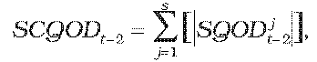

    - kde

    - 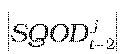 – je absolútna hodnota skutočnej odchýlky subjektu zúčtovania v jednotkách množstva elektriny v j-tej štvrťhodine roku t-2 súvisiacej s odberom elektriny i-tého prevádzkovateľa regionálnej distribučnej sústavy zo zariadení výrobcov elektriny, ktorí majú právo na uplatnenie podpory prevzatím zodpovednosti za odchýlku; subjektom zúčtovania je subjekt, ktorý prevzal zodpovednosť za odchýlku i-tého prevádzkovateľa regionálnej distribučnej sústavy,

  - 8. SQSZt-2 – je skutočné množstvo dodávky elektriny subjektu zúčtovania v jednotkách množstva elektriny na rok t-2 pozostávajúce zo súčtu absolútnych hodnôt dodanej a odobratej elektriny týmto subjektom zúčtovania, ktorý prevzal zodpovednosť za odchýlku i-tého prevádzkovateľa regionálnej distribučnej sústavy,

  - 9. r – je počet štvrťhodín v roku t-2, počas ktorých je súčin plánovanej odchýlky subjektu zúčtovania v j-tej štvťhodine roku t-2 v MWh a plánovanej zúčtovacej ceny odchýlky určenej zúčtovateľom odchýlok v j-tej štvťhodine roku t-2 kladný; subjektom zúčtovania je subjekt, ktorý prevzal zodpovednosť za odchýlku i-tého prevádzkovateľa regionálnej distribučnej sústavy,

  - 10. PQODt-2j – je plánovaná schválená alebo určená odchýlka subjektu zúčtovania v jednotkách množstva elektriny v j-tej štvrťhodine roku t-2 súvisiaca s odberom elektriny i-tého prevádzkovateľa regionálnej distribučnej sústavy zo zariadení výrobcov elektriny, ktorí majú právo na uplatnenie podpory prevzatím zodpovednosti za odchýlku,

  - 11. PZCODt-2j – je plánovaná schválená alebo určená zúčtovacia cena odchýlky v eurách na jednotku množstva elektriny v j-tej štvrťhodine roku t-2 stanovená zúčtovateľom odchýlok,

  - 12. PVNt-2 – sú plánované viacnáklady v eurách na rok t-2 uplatnené zúčtovateľom odchýlok subjektu zúčtovania, ktorý prevzal zodpovednosť za odchýlku i-tého prevádzkovateľa regionálnej distribučnej sústavy,

  - 13. PVODt-2 – je plánovaný celkový výnos za odchýlku v eurách na rok t-2 uplatnený subjektom zúčtovania zúčtovateľovi odchýlok; subjektom zúčtovania je subjekt, ktorý prevzal zodpovednosť za odchýlku i-tého prevádzkovateľa regionálnej distribučnej sústavy,

  - 14. PCQODt-2 – je plánovaná celková odchýlka v jednotkách množstva elektriny na rok t-2 súvisiaca s odberom elektriny i-tého prevádzkovateľa regionálnej distribučnej sústavy zo zariadení výrobcov elektriny, ktorí majú právo na uplatnenie podpory prevzatím zodpovednosti za odchýlku, vypočítaná podľa vzorca

  - 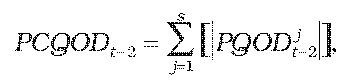

    - kde

    - 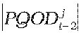 – je absolútna hodnota plánovanej odchýlky subjektu zúčtovania v jednotkách množstva elektriny v j-tej štvrťhodine roku t-2 súvisiacej s odberom elektriny i-tého prevádzkovateľa regionálnej distribučnej sústavy zo zariadení výrobcov elektriny, ktorí majú právo na uplatnenie podpory prevzatím zodpovednosti za odchýlku; subjektom zúčtovania je subjekt, ktorý prevzal zodpovednosť za odchýlku i-tého prevádzkovateľa regionálnej distribučnej sústavy,

  - 15. PQSZt-2 – je plánované množstvo dodávky elektriny subjektu zúčtovania v jednotkách množstva elektriny na rok t-2 pozostávajúce zo súčtu absolútnych hodnôt dodanej a odobratej elektriny týmto subjektom zúčtovania, ktorý prevzal zodpovednosť za odchýlku i-tého prevádzkovateľa regionálnej distribučnej sústavy; a na rok t nasledujúci po roku 2013 sa KNODtvypočíta podľa vzorca

  - 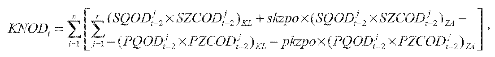

  - kde

  - 16. n – je počet regionálnych distribučných sústav v roku t,

  - 17. r – je počet štvrťhodín v roku t,

  - 18. SQODt-2j – je skutočná schválená alebo určená odchýlka subjektu zúčtovania v jednotkách množstva elektriny v j-tej štvrťhodine roku t-2 súvisiaca s odberom elektriny i-tého prevádzkovateľa regionálnej distribučnej sústavy zo zariadení výrobcov elektriny, ktorí majú právo na uplatnenie podpory prevzatím zodpovednosti za odchýlku; subjektom zúčtovania je subjekt, ktorý prevzal zodpovednosť za odchýlku i-tého prevádzkovateľa regionálnej distribučnej sústavy,

  - 19. SZCODt-2j – je skutočná schválená alebo určená zúčtovacia cena odchýlky v eurách na jednotku množstva elektriny v j-tej štvrťhodine roku t-2,

  - 20. PQODt-2j – je plánovaná schválená alebo určená odchýlka subjektu zúčtovania v jednotkách množstva elektriny v j-tej štvrťhodine roku t-2 súvisiaca s odberom elektriny i-tého prevádzkovateľa regionálnej distribučnej sústavy zo zariadení výrobcov elektriny, ktorí majú právo na uplatnenie podpory prevzatím zodpovednosti za odchýlku; subjektom zúčtovania je subjekt, ktorý prevzal zodpovednosť za odchýlku i-tého prevádzkovateľa regionálnej distribučnej sústavy,

  - 21. PZCODt-2j – je plánovaná schválená alebo určená zúčtovacia cena odchýlky v eurách na jednotku množstva elektriny v j-tej štvrťhodine roku t-2 použitá na výpočet NOD na rok t-2,

  - 22. skzpo – je skutočný určený koeficient zápornej platby za odchýlku za rok t-2, ktorý sa určí ako aritmetický priemer mesačných koeficientov zápornej platby za odchýlku na konečný prepočet vyhodnotenia odchýlky použitých organizátorom krátkodobého trhu s elektrinou v roku t-2,

  - 23. KL – je parameter označujúci tie štvrťhodiny, v ktorých je súčin PQODt-2j a PZCODt-2j kladný alebo rovný nule,

  - 24. ZA – je parameter označujúci tie štvrťhodiny, v ktorých je súčin PQODt-2j a PZCODt-2j záporný.

(2) Množstvo nakúpenej elektriny vyrobenej z obnoviteľných zdrojov energie alebo vysoko účinnou kombinovanou výrobou, ktoré prevyšuje diagram strát prevádzkovateľa regionálnej distribučnej sústavy, sa predáva prevádzkovateľom regionálnej distribučnej sústavy. Ak má prevádzkovateľ regionálnej distribučnej sústavy prenesenú zodpovednosť za odchýlku, uvedené množstvo nakúpenej elektriny sa predáva prevádzkovateľom regionálnej distribučnej sústavy subjektu zúčtovania, ktorý prevzal za neho zodpovednosť za odchýlku.

(3) Plánovaná alikvotná časť nákladov v eurách na výrobu elektriny vyrobenej z obnoviteľných zdrojov energie alebo vysoko účinnou kombinovanou výrobou PNOZEKVt podľa odseku 1 sa upraví o rozdiel vyplateného doplatku a doplatku, ktorý zodpovedá množstvu elektriny podľa potvrdenia o pôvode elektriny z obnoviteľných zdrojov energie alebo potvrdenia o pôvode elektriny vyrobenej vysoko účinnou kombinovanou výrobou za uplynulé obdobie podľa osobitného predpisu.40)
