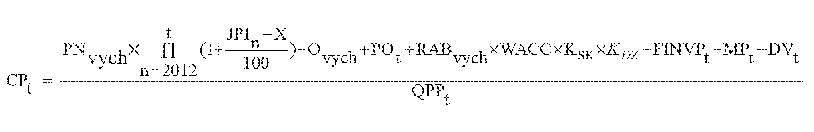

# § 16 Cena za prístup do prenosovej sústavy a prenos elektriny, postup a podmienky uplatňovania cien

(1) Maximálna cena za prístup do prenosovej sústavy a prenos elektriny CPt okrem strát elektriny pri prenose elektriny v eurách na jednotku množstva elektriny na rok t sa vypočíta podľa vzorca

kde

- a) PNvych– sú schválené alebo určené skutočné oprávnené prevádzkové ročné náklady v eurách v roku 2010 súvisiace s regulovanou činnosťou okrem odpisov súvisiacich s regulovanou činnosťou a nákladov na dispečerskú činnosť prevádzkovateľa prenosovej sústavy na zabezpečenie systémových služieb,

- b) JPIn – je aritmetický priemer indexov jadrovej inflácie v percentách zverejnených štatistickým úradom za obdobie od júla roku n-2 do júna roku n-1,

- c) X – je faktor efektivity podľa § 2 ods. 3,

- d) Ovych – je schválená alebo určená východisková hodnota odpisov regulovaného subjektu vo východiskovom roku regulačného obdobia v eurách súvisiacich s regulovanou činnosťou a vypočítaných z RABvych na základe zostatkovej doby technickej životnosti tried aktív nevyhnutne využívaných pre regulovanú činnosť podľa prílohy č. 1 tabuľky č. 2,

- e) POt – sú plánované schválené alebo určené odpisy v eurách na rok t súvisiace s regulovanou činnosťou vypočítané na základe dôb technických životností tried aktív nevyhnutne využívaných na regulovanú činnosť podľa prílohy č. 1 tabuľky č. 3 z plánovaných hodnôt schválených alebo určených investícií v eurách zaradených v roku t-1 do hodnoty regulačnej bázy aktív nevyhnutne využívaných na regulovanú činnosť,

- f) RABvych ˜– je východisková schválená alebo určená hodnota regulačnej bázy aktív v eurách, ktorá sa rovná všeobecnej hodnote majetku42) regulačnej bázy aktív nevyhnutne súvisiacej s regulovanou činnosťou precenenej k 1. januáru 2011,

- g) WACC – je miera výnosnosti regulačnej bázy aktív na regulačné obdobie rokov 2012 až 2016 určená podľa § 3 ods. 2 a 3,

- h) KSK – je koeficient dosiahnutého plnenia štandardov kvality; KSKsa na roky 2012 až 2015 rovná jednej a na rok 2016 sa určí úradom na základe dosiahnutej úrovne vybraných štandardov kvality v roku 2014 v intervale od 0,98 do 1,00,

- i) KDZ – je koeficient miery využitia disponibilných zdrojov do investícii súvisiacich s regulovanou činnosťou; KDZ sa na roky 2012 až 2014 rovná jednej a na roky 2015 a 2016 sa určí úradom v intervale od 0,99 do 1,00,

- j) FINVPt – je faktor investícií v eurách na rok t; FINVPt sa na roky 2012 a 2013 rovná nule a na roky 2014 až 2016 sa vypočíta podľa vzorca

- FINVPt = SOt-2 – POt-2 ,

- kde

  - 1. SOt-2– sú skutočné schválené alebo určené odpisy v eurách na rok t-2 súvisiace s regulovanou činnosťou vypočítané na základe dôb technických životností tried aktív nevyhnutne využívaných na regulovanú činnosť podľa prílohy č. 1 tabuľky č. 3 zo skutočných hodnôt schválených alebo určených investícií v eurách zaradených v roku t-3 do hodnoty regulačnej bázy aktív nevyhnutne využívaných na regulovanú činnosť,

  - 2. POt-2 – sú plánované schválené alebo určené odpisy v eurách na rok t-2 súvisiace s regulovanou činnosťou vypočítané na základe dôb technických životností tried aktív nevyhnutne využívaných na regulovanú činnosť podľa prílohy č. 1 tabuľky č. 3 z plánovaných hodnôt schválených alebo určených investícií v eurách zaradených v roku t-3 do hodnoty regulačnej bázy aktív nevyhnutne využívaných na regulovanú činnosť,

- k) MPt – je alikvotná časť plánovaných výnosov z medzinárodnej prevádzky v eurách na rok t vypočítaná podľa vzorca

- MPt = (ITCt + VAt) x (1 - m),

- kde

  - 1. ITCt – je celkový plánovaný čistý výnos v eurách na rok t po odpočítaní nákladov fakturovaných regulovanému subjektu z platieb účtovaných v rámci ITC mechanizmu,

  - 2. VAt – je plánovaný čistý výnos v eurách na rok t po odčítaní nákladov fakturovaných regulovanému subjektu z aukcii prenosovej kapacity na hraničných profiloch prenosovej sústavy,

  - 3. m – je koeficient určený cenovým rozhodnutím v rozsahu nula až jeden,

- l) DVt – sú skutočné výnosy v eurách v roku t-2 z uplatnenia úhrad nákladov prevádzkovateľmi distribučných sústav, výrobcami elektriny a koncovými odberateľmi elektriny za pripojenie do sústavy; DVtsa na roky 2012 a 2013 rovná nule,

- m) QPPt – je plánované priemerné množstvo prenesenej elektriny odobratej z prenosovej sústavy koncovými odberateľmi elektriny, ktorí sú priamo pripojení do prenosovej sústavy a prevádzkovateľmi distribučnej sústavy v jednotkách množstva elektriny na rok t, vypočítané ako ročný priemer zo súčtu skutočného príslušného množstva elektriny za roky t-3 a t-2, očakávaného príslušného množstva za rok t-1 a plánovaného príslušného množstva za roky t a t+1.

(2) Rezervovaná kapacita v megawattoch v roku t pre každého odberateľa elektriny sa určí ako aritmetický priemer jeho mesačných maxím štvrťhodinového výkonu zo štyroch mesiacov, a to november roku t-2 až február roku t-1. Hodnoty výkonov sa určujú v megawattoch s rozlíšením na tri desatinné miesta.

(3) Podiel výnosov z platieb za rezerváciu kapacity sa z celkových výnosov z platieb za rezerváciu kapacity a z platieb za prenesenú elektrinu určuje koeficientom 0,8. Podiel výnosov z platieb za prenesenú elektrinu sa z celkových výnosov z platieb za rezerváciu kapacity a z platieb za prenesenú elektrinu určuje koeficientom 0,2.

(4) Spolu s cenovým návrhom na rok t sa predkladá spôsob výpočtu navrhovaných zložiek taríf za rezervovanú kapacitu v megawattoch a za prenesenú elektrinu.
