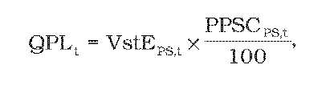
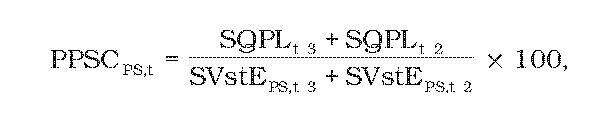
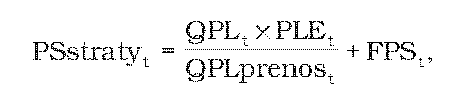
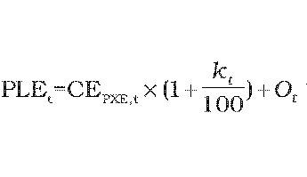
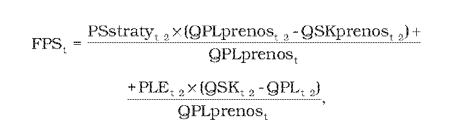

# § 17 Spôsob výpočtu tarify za straty pri prenose elektriny, postup a podmienky uplatňovania cien

(1) Povolené plánované množstvo strát elektriny pri prenose QPLt v jednotkách množstva elektriny na rok t sa vypočíta podľa vzorca

kde

- a) VstEPS,t – je celkové plánované množstvo elektriny v jednotkách množstva elektriny vstupujúce do prenosovej sústavy na rok t vrátane tokov zahraničia,

- b) PPSCPS,t– je percento plánovaných strát pri prenose elektriny prenosovou sústavou na rok t vypočítané podľa vzorca

- 

- kde

  - 1. SQPLt-3 – je skutočné množstvo strát elektriny pri prenose elektriny v jednotkách množstva elektriny v roku t-3,

  - 2. SQPLt-2 – je skutočné množstvo strát elektriny pri prenose elektriny v jednotkách množstva elektriny v roku t-2,

  - 3. SVstEPS,t-3 – je celkové skutočné množstvo elektriny v jednotkách množstva elektriny vstupujúce do prenosovej sústavy v roku t-3 vrátane tokov zahraničia,

  - 4. SVstEPS,t-2 – je celkové skutočné množstvo elektriny v jednotkách množstva elektriny vstupujúce do prenosovej sústavy v roku t-2 vrátane tokov zahraničia.

(2) Užívateľom prenosovej sústavy sa uplatňuje tarifa za straty elektriny pri prenose elektriny PSstratyt, výnos z týchto platieb sa nezahŕňa do výnosu za prístup do prenosovej sústavy a prenos elektriny. Výška tarify za straty elektriny pri prenose elektriny PSstratyt v eurách na jednotku množstva elektriny odobratej z prenosovej sústavy v roku t sa vypočíta podľa vzorca

kde

- a) QPLt – je povolené plánované množstvo strát elektriny pri prenose elektriny v jednotkách množstva elektriny na rok t podľa odseku 1,

- b) PLEt – je úradom schválená alebo určená cena elektriny na účely pokrytia strát elektriny pri prenose elektriny v eurách na jednotku množstva elektriny na rok t vypočítaná podľa vzorca

- 

- kde

  - 1. CEPXE,t– je aritmetický priemer denných cien oficiálneho kurzového lístka, zverejneného burzou PXE (POWER EXCHANGE CENTRAL EUROPE) na jej webovom sídle, produktu F PXE CZ BL Cal-t v eurách na jednotku množstva elektriny za obdobie od 1. januára roku t-1 do 30. júna roku t-1,

  - 2. kt – je koeficient na rok t v percentách určený cenovým rozhodnutím v rozsahu najviac 12 % v závislosti od plánovaného diagramu strát elektriny pri prenose elektriny na rok t,

  - 3. Ot – sú úradom schválené alebo určené plánované náklady regulovaného subjektu v eurách na jednotku množstva elektriny na rok t na odchýlku súvisiacu s plánovaným diagramom strát elektriny na rok t pri prenose elektriny; tieto náklady sa stanovia pomerne k skutočným nákladom za obdobie január až jún t-1,

- c) QPLprenost – je plánované množstvo elektriny odobratej z prenosovej sústavy v jednotkách množstva elektriny na rok t,

- d) FPSt – je faktor strát pri prenose elektriny v eurách na jednotku množstva elektriny na rok t, ktorý sa vypočíta podľa vzorca

- 

- kde

  - 1. PSstratyt-2 – je tarifa za straty elektriny pri prenose elektriny v eurách na jednotku množstva elektriny odobratej z prenosovej sústavy v roku t-2,

  - 2. QPLprenost-2 – je plánované množstvo elektriny odobratej z prenosovej sústavy v jednotkách množstva elektriny na rok t-2,

  - 3. QSKprenost-2 – je skutočné množstvo elektriny odobratej z prenosovej sústavy v jednotkách množstva elektriny v roku t-2,

  - 4. PLEt-2 – je schválená alebo určená cena elektriny na účely pokrytia strát elektriny pri prenose elektriny v eurách na jednotku množstva elektriny na rok t-2,

  - 5. QPLt-2 – je povolené plánované množstvo strát elektriny pri prenose na rok t-2,

  - 6. QSKt-2 – je skutočné množstvo strát elektriny pri prenose elektriny nakúpenej v roku t-2.
