# § 18 Uplatnenie tarify za prevádzkovanie systému prevádzkovateľom prenosovej sústavy

(1) Tarifa za prevádzkovanie systému sa uplatňuje pre prevádzkovateľov distribučnej sústavy a koncových odberateľov elektriny pripojených do prenosovej sústavy, pričom schválený alebo určený maximálny plánovaný výnos PCNOTt z týchto platieb v eurách v roku t sa vypočíta podľa vzorca

PCNOTt = PNOTt - KPSt,

kde

- a) PNOTt – je alikvotná časť nákladov v eurách na organizovanie a vyhodnotenie krátkodobého trhu s elektrinou na rok t určených podľa § 43 ods. 2 písm. b),

- b) KPSt – je korekcia v eurách na rok t zohľadňujúca náklady a výnosy regulovaného subjektu z platieb za prevádzkovanie systému v roku t-2 podľa odseku 2.

(2) Tarify za prevádzkovanie systému TPSt a TPSit v eurách na jednotku množstva elektriny na rok t sa určia tak, aby výnos z uplatnenia týchto taríf neprekročil maximálny plánovaný výnos PCNOTturčený podľa odseku 1; tieto tarify sa vypočítajú z nasledujúceho vzorca

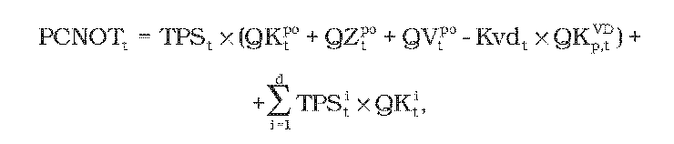

kde

- a) TPSt – je tarifa za prevádzkovanie systému určená cenovým rozhodnutím pre koncových odberateľov elektriny a prevádzkovateľov miestnej distribučnej sústavy pripojených priamo do prenosovej sústavy v eurách na jednotku množstva elektriny v roku t,

- b) QKtpo – je celkový plánovaný objem elektriny odobratej koncovými odberateľmi elektriny a prevádzkovateľmi miestnej distribučnej sústavy, ktorí sú priamo pripojení do prenosovej sústavy, v jednotkách množstva elektriny na rok t,

- c) QZtpo – je celkový plánovaný objem elektriny distribuovanej prevádzkovateľmi miestnej distribučnej sústavy, ktorá je priamo pripojená do prenosovej sústavy, vyrobený vo vlastnom zariadení na výrobu elektriny prevádzkovateľa miestnej distribučnej sústavy alebo v inom zariadení na výrobu elektriny pripojenom do miestnej distribučnej sústavy a dodaný odberateľom elektriny v rámci miestným distribučnej sústavy a spotrebovaný pre vlastnú spotrebu v rámci miestnej distribučnej sústavy, okrem elektriny spotrebovanej pre vlastnú spotrebu elektriny pri výrobe elektriny, v jednotkách množstva elektriny na rok t,

- d) QVtpo – je celkový plánovaný objem elektriny vyrobenej v zariadení výrobcov elektriny pripojených priamo do prenosovej sústavy a dodanej odberateľom elektriny priamym vedením a spotrebovanej pre vlastnú spotrebu výrobcu elektriny v mieste umiestnenia zariadenia na výroby elektriny okrem elektriny spotrebovanej pre vlastnú spotrebu elektriny pri výrobe elektriny, v jednotkách množstva elektriny na rok t,

- e) Kvdt – je koeficient zvýhodnenia odberového diagramu na rok t ktorého hodnota je 0,95,

- f) 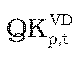 – je celkový plánovaný objem elektriny v jednotkách množstva elektriny v roku t odobratej koncovými odberateľmi elektriny priamo pripojenými do prenosovej sústavy s dobou ročného využitia maxima v roku t–2 vyššou ako 6 800 hodín a súčasne pomernou odchýlkou subjektu zúčtovania menšou ako 0,025; dobou ročného využitia maxima sa rozumie podiel celkového ročného preneseného množstva elektriny v roku t-2 a rezervovanej kapacity určenej ako aritmetický priemer mesačných maxím štvrťhodinového výkonu za mesiace november roku t-4 až február roku t-3,

- g) TPSti – je tarifa za prevádzkovanie systému určená cenovým rozhodnutím pre i-tého prevádzkovateľa regionálnej distribučnej sústavy v eurách na jednotku množstva elektriny na rok t,

- h) QKti – je celkový plánovaný objem elektriny odobratý všetkými koncovými odberateľmi elektriny z regionálnej distribučnej sústavy i-tého prevádzkovateľa regionálnej distribučnej sústavy vrátane odberateľov elektriny pripojených v rámci prevádzky preukázateľne oddelenej od sústavy Slovenskej republiky v jednotkách množstva elektriny na rok t,

- i) d – je počet prevádzkovateľov regionálnej distribučnej sústavy,

(3) Korekcia v eurách na rok t KPSt zohľadňujúca náklady a výnosy regulovaného subjektu z platieb za prevádzkovanie systému v roku t-2 sa vypočíta podľa vzorca

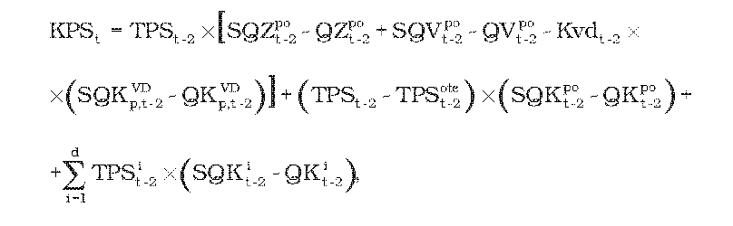

kde

- a) TPSt-2 – je tarifa za prevádzkovanie systému určená rozhodnutím pre koncových odberateľov elektriny a prevádzkovateľov miestnej distribučnej sústavy pripojených priamo do prenosovej sústavy v eurách na jednotku množstva elektriny v roku t-2,

- b) 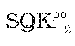 – je celkové skutočné množstvo elektriny odobratej koncovými odberateľmi elektriny a prevádzkovateľmi miestnej distribučnej sústavy, ktorí sú priamo pripojení do prenosovej sústavy, v jednotkách množstva elektriny v roku t-2,

- c) 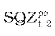 – je celkové skutočné množstvo elektriny distribuovanej prevádzkovateľmi miestnej distribučnej sústavy, ktorá je priamo pripojená do prenosovej sústavy, vyrobenej vo vlastnom zariadení na výrobu elektriny prevádzkovateľa miestnej distribučnej sústavy alebo v inom zariadení na výrobu elektriny pripojenom do miestnej distribučnej sústavy dodané odberateľom elektriny v rámci tejto miestnej distribučnej sústavy a spotrebované pre vlastnú spotrebu v rámci miestnej distribučnej sústavy okrem vlastnej spotreby elektriny pri výrobe elektriny, v jednotkách množstva elektriny v roku t-2,

- d) 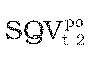 – je celkové skutočné množstvo elektriny vyrobenej v zariadeniach na výrobu elektriny pripojených priamo do prenosovej sústavy a dodanej odberateľom elektriny priamym vedením a spotrebovanej pre vlastnú spotrebu výrobcu elektriny v mieste umiestnenia zariadenia na výrobu elektriny okrem vlastnej spotreby elektriny pri výrobe elektriny v jednotkách množstva elektriny v roku t-2,

- e) TPSit-2 – je tarifa za prevádzkovanie systému určená cenovým rozhodnutím pre i-tého prevádzkovateľa regionálnej distribučnej sústavy v eurách na jednotku množstva elektriny na rok t-2,

- f) SQKit-2 – je celkové skutočné množstvo elektriny odobratej všetkými koncovými odberateľmi elektriny z distribučnej sústavy i-tého prevádzkovateľa regionálnej distribučnej sústavy vrátane odberateľov elektriny pripojených v rámci prevádzky preukázateľne oddelenej od sústavy Slovenskej republiky v jednotkách množstva elektriny v roku t-2,

- g) d – je počet prevádzkovateľov regionálnej distribučnej sústavy,

- h) 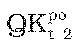 – je celkové plánované množstvo elektriny odobratej koncovými odberateľmi elektriny a prevádzkovateľmi miestnej distribučnej sústavy, ktorí sú priamo pripojení do prenosovej sústavy, v jednotkách množstva elektriny v roku t-2,

- i) 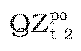 – je celkové plánované množstvo elektriny distribuovanej prevádzkovateľmi miestnej distribučnej sústavy, ktorá je priamo pripojená do prenosovej sústavy, vyrobenej vo vlastnom zariadení na výrobu elektriny prevádzkovateľa miestnej distribučnej sústavy alebo v inom zariadení na výrobu elektriny pripojenom do miestnej distribučnej sústavy dodané odberateľom elektriny v rámci tejto miestnej distribučnej sústavy a spotrebované pre vlastnú spotrebu v rámci miestnej distribučnej sústavy okrem vlastnej spotreby elektriny pri výrobe elektriny, v jednotkách množstva elektriny v roku t-2,

- j) 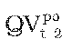 – je celkové plánované množstvo elektriny vyrobenej v zariadeniach na výrobu elektriny pripojených priamo do prenosovej sústavy a dodanej odberateľom elektriny priamym vedením a spotrebovanej pre vlastnú spotrebu výrobcu elektriny v mieste umiestnenia zariadenia na výrobu elektriny okrem vlastnej spotreby elektriny pri výrobe elektriny, v jednotkách množstva elektriny v roku t-2,

- k) Kvdt-2 – je koeficient zvýhodnenia odberového diagramu na rok t-2 určený cenovým rozhodnutím,

- l) 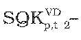 je celkové skutočné množstvo elektriny v jednotkách množstva elektriny v roku t-2 odobratej koncovými odberateľmi elektriny priamo pripojenými do prenosovej sústavy s dobou ročného využitia maxima v roku t–4 vyššou ako 6 800 hodín a súčasne pomernou odchýlkou subjektu zúčtovania menšou ako 0,025; dobou ročného využitia maxima sa rozumie podiel celkového ročného preneseného množstva elektriny v roku t-4 a rezervovanej kapacity určenej ako aritmetický priemer mesačných maxím štvrťhodinového výkonu za mesiace november roku t-6 až február roku t-5,

- m) 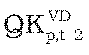 – je celkové plánované množstvo elektriny v jednotkách množstva elektriny na rok t-2 odobratej koncovými odberateľmi elektriny priamo pripojenými do prenosovej sústavy s dobou ročného využitia maxima v roku t–4 vyššou ako 6 800 hodín a súčasne pomernou odchýlkou subjektu zúčtovania menšou ako 0,025; dobou ročného využitia maxima sa rozumie podiel celkového ročného preneseného množstva elektriny v roku t-4 a rezervovanej kapacity určenej ako aritmetický priemer mesačných maxím štvrťhodinového výkonu za mesiace november roku t-6 až február roku t-5,

- n) QKit-2 – je celkové plánované množstvo elektriny odobratej všetkými koncovými odberateľmi elektriny z distribučnej sústavy i-tého prevádzkovateľa regionálnej distribučnej sústavy vrátane odberateľov elektriny pripojených v rámci prevádzky preukázateľne oddelenej od sústavy Slovenskej republiky v jednotkách množstva elektriny v roku t-2,

- o) 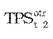 – je tarifa za prevádzkovanie systému určená rozhodnutím pre organizátora krátkodobého trhu s elektrinou na rok t-2.

(4) Korekcia v eurách na rok t KPSt pre roky 2012 a 2013 zohľadní spôsob uplatnenia tarify za prevádzkovanie systému v rokoch 2010 a 2011.
