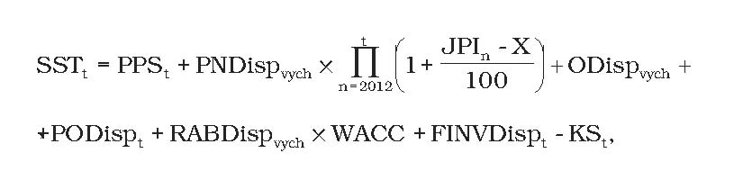
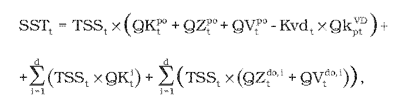
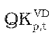
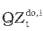

# § 20 Uplatnenie tarify za poskytovanie systémových služieb v elektroenergetike prevádzkovateľom prenosovej sústavy

(1) Prevádzkovateľom distribučnej sústavy a koncovým odberateľom elektriny priamo pripojeným do prenosovej sústavy sa uplatňujú tarify za systémové služby, kde schválený alebo určený maximálny plánovaný výnos SSTt z týchto platieb v eurách v roku t sa vypočíta podľa vzorca

kde

- a) PPSt – sú celkové schválené alebo určené plánované náklady prevádzkovateľa prenosovej sústavy na nákup podporných služieb v roku t od výrobcov elektriny a ostatných poskytovateľov podporných služieb v eurách,

- b) PNDispvych – sú schválené alebo určené skutočné oprávnené prevádzkové ročné náklady v eurách v roku 2010 na dispečerskú činnosť prevádzkovateľa prenosovej sústavy na zabezpečenie systémových služieb okrem odpisov,

- c) JPIn – je aritmetický priemer indexov jadrovej inflácie zverejnených štatistickým úradom; na za obdobie od júla roku n-2 do júna roku n-1,

- d) X – je faktor efektivity podľa § 2 ods. 3,

- e) ODispvych – je schválená alebo určená východisková hodnota odpisov regulovaného subjektu vo východiskovom roku regulačného obdobia v eurách súvisiacich s dispečerskou činnosťou vzťahujúcich sa na RABDispvych a vypočítaných na základe zostatkovej doby technickej životnosti tried aktív nevyhnutne využívaných na dispečerskú činnosť podľa prílohy č. 1 tabuľky č. 2,

- f) PODispt– sú plánované schválené alebo určené odpisy v eurách na rok t súvisiace s dispečerskou činnosťou vypočítané na základe dôb technických životností tried aktív nevyhnutne využívaných na regulovanú činnosť podľa prílohy č. 1 tabuľky č. 3 z plánovaných hodnôt schválených alebo určených investícií v eurách zaradených v roku t-1 do hodnoty regulačnej bázy aktív nevyhnutne využívaných na dispečerskú činnosť,

- g) RABDispvych – je východisková schválená alebo určená hodnota regulačnej bázy aktív v eurách, ktorá sa rovná všeobecnej hodnote majetku42) regulačnej bázy aktív nevyhnutne súvisiacej s dispečerskou činnosťou, precenenej k 1. januáru roka 2011,

- h) WACC – je miera výnosnosti regulačnej bázy aktív na regulačné obdobie rokov 2012 až 2016 určená podľa § 3 ods. 2 a 3,

- i) FINVDispt – je faktor investícií v eurách na rok t; FINVDispt sa na roky 2012 a 2013 rovná nule a na roky 2014 až 2016 sa vypočíta podľa vzorca

- FINVDispt = SODispt-2 – PODispt-2 ,

- kde

  - 1. SODispt-2– sú skutočné schválené alebo určené odpisy v eurách na rok t-2 súvisiace s dispečerskou činnosťou vypočítané na základe dôb technických životností tried aktív nevyhnutne využívaných na regulovanú činnosť podľa prílohy č. 1 tabuľky č. 3 zo skutočných hodnôt schválených alebo určených investícií v eurách zaradených v roku t-3 do hodnoty regulačnej bázy aktív nevyhnutne využívaných na dispečerskú činnosť,

  - 2. PODispt-2 – sú plánované schválené alebo určené odpisy v eurách na rok t-2 súvisiace s dispečerskou činnosťou vypočítané na základe dôb technických životností tried aktív nevyhnutne využívaných na regulovanú činnosť podľa prílohy č. 1 tabuľky č. 3 z plánovaných hodnôt schválených alebo určených investícií v eurách zaradených v roku t-3 do hodnoty regulačnej bázy aktív nevyhnutne využívaných na dispečerskú činnosť,

- j) KS t – je faktor vyrovnania v eurách v roku t vypočítaný podľa odseku 2.

(2) Faktor vyrovnania v eurách na rok t sa vypočíta podľa vzorca

KSt=SVSTt-2– SSTt-2 – (1– s) × (SPSt-2 – PPSt–2) – Naukct–2– CVt–2+ 0,5 × GCCt–2

kde

- a) SVSTt-2 – je celkový skutočný výnos v eurách v roku t-2 z platieb za systémové služby vybratý od prevádzkovateľov distribučnej sústavy a od koncových odberateľov elektriny priamo pripojených do prenosovej sústavy,

- b) SSTt-2 – je schválený alebo určený maximálny plánovaný výnos z platieb za systémové služby v eurách v roku t-2,

- c) s – je koeficient delenia rozdielu medzi skutočnými nákladmi a plánovanými nákladmi na nákup podporných služieb regulovaného subjektu medzi regulovaný subjekt a odberateľov elektriny, ktorí sú pripojení na prenosovú sústavu, určený cenovým rozhodnutím v rozsahu nula až jeden,

- d) SPSt-2 – sú celkové skutočné náklady prevádzkovateľa prenosovej sústavy na nákup podporných služieb od výrobcov elektriny a ostatných poskytovateľov podporných služieb v eurách v roku t-2,

- e) PPSt-2 – sú celkové schválené alebo určené plánované náklady prevádzkovateľa prenosovej sústavy na nákup podporných služieb v roku t od výrobcov elektriny a ostatných poskytovateľov podporných služieb v eurách v roku t-2,

- f) Naukct-2 – sú skutočné náklady prevádzkovateľa prenosovej sústavy na aukcie potrebné na dovoz podporných služieb zo zahraničia v roku t-2,

- g) CVt-2 – je skutočný dopad z cezhraničnej výpomoci v eurách v roku t-2, ktorý sa vypočíta podľa vzorca

- CVt -2 = NOcvt -2 - COcvt -2 - VVcvt -2 + NREcvt -2 - VREcvt -2 + Ncvt -2 - Vcvt -2 ,

- kde

  - 1. NOcvt-2 – sú skutočné náklady prevádzkovateľa prenosovej sústavy ako subjektu zúčtovania odchýlok za spôsobenú odchýlku súvisiace s cezhraničnou výpomocou v roku t-2,

  - 2. VOcvt-2 – sú skutočné výnosy prevádzkovateľa prenosovej sústavy ako subjektu zúčtovania odchýlok za spôsobenú odchýlku súvisiace s cezhraničnou výpomocou v roku t-2,

  - 3. NVcvt-2 – sú skutočné náklady prevádzkovateľa prenosovej sústavy ako subjektu zúčtovania odchýlok za viacnáklady súvisiace s cezhraničnou výpomocou v roku t-2,

  - 4. VVcvt-2 – sú skutočné výnosy prevádzkovateľa prenosovej sústavy ako subjektu zúčtovania odchýlok za viacnáklady súvisiace s cezhraničnou výpomocou v roku t-2,

  - 5. NREcvt-2 – sú skutočné náklady prevádzkovateľa prenosovej sústavy ako dodávateľa regulačnej elektriny z cezhraničnej výpomoci v roku t-2,

  - 6. VREcvt-2 – sú skutočné výnosy prevádzkovateľa prenosovej sústavy ako dodávateľa regulačnej elektriny z cezhraničnej výpomoci v roku t-2,

  - 7. Ncvt-2 – sú skutočné náklady prevádzkovateľa prenosovej sústavy za cezhraničnú výpomoc poskytnutú ostatnými prevádzkovateľmi prenosových sústav v roku t-2,

  - 8. Vcvt-2 – sú skutočné výnosy prevádzkovateľa prenosovej sústavy za cezhraničnú výpomoc poskytnutú ostatným prevádzkovateľom prenosových sústav v roku t-2.

  - h) GCCt-2 – je skutočný dopad z regulačnej elektriny obstaranej v rámci systému GCC v eurách v roku t-2; GCCt-2 za rok 2011 sa rovná nule a za roky 2012 až 2014 sa vypočíta podľa vzorca

  - GCCt-2 = VGCCt-2 – NGCCt-2 + VREGCCt-2 – NREGCCt-2 ,

  - kde

    - 1. VGCCt-2– sú skutočné výnosy prevádzkovateľa prenosovej sústavy za predaj regulačnej elektriny obstaranej automatickou aktiváciu regulačnej elektriny s parametrami sekundárnej regulácie výkonu prostredníctvom riadiaceho informačného systému dispečingu prevádzkovateľa prenosovej sústavy v spolupráci so susednými prevádzkovateľmi prenosových sústav v rámci systému GCC v eurách v roku t-2,

    - 2. NGCCt-2 – sú skutočné náklady prevádzkovateľa prenosovej sústavy na nákup regulačnej elektriny obstaranej automatickou aktiváciu regulačnej elektriny s parametrami sekundárnej regulácie výkonu prostredníctvom riadiaceho informačného systému dispečingu prevádzkovateľa prenosovej sústavy v spolupráci so susednými prevádzkovateľmi prenosových sústav v rámci systému GCC v eurách v roku t-2,

    - 3. VREGCCt-2 - sú skutočné výnosy prevádzkovateľa prenosovej sústavy ako dodávateľa regulačnej elektriny typu sekundárnej regulácie výkonu obstaranej prevádzkovateľom prenosovej sústavy v systéme GCC v eurách v roku t-2,

    - 4. NREGCCt-2 – sú skutočné náklady prevádzkovateľa prenosovej sústavy ako dodávateľa regulačnej elektriny typu sekundárnej regulácie výkonu obstaranej prevádzkovateľom prenosovej sústavy v systéme GCC v eurách v roku t-2.

(3) Tarifa za systémové služby TSSt v eurách na jednotku množstva elektriny na rok t sa určí tak, aby výnos z uplatnenia tejto tarify neprekročil maximálny plánovaný výnos SSTt určený podľa odseku 1; tarifa TSSt sa vypočíta z nasledujúceho vzorca

kde

- a) TSSt – je tarifa v eurách na jednotku množstva elektriny za poskytovanie systémových služieb určená cenovým rozhodnutím pre koncových odberateľov elektriny a prevádzkovateľov miestnej distribučnej sústavy priamo pripojených do prenosovej sústavy a pre koncových odberateľov elektriny pripojených do distribučnej sústavy,

- b) QKtpo – je celkový plánovaný objem elektriny odobratý z prenosovej sústavy koncovými odberateľmi elektriny a prevádzkovateľmi miestnej distribučnej sústavy, ktorí sú priamo pripojení do prenosovej sústavy, v jednotkách množstva elektriny v roku t,

- c) QZtpo – je celkový plánovaný objem elektriny distribuovanej prevádzkovateľmi miestnej distribučnej sústavy, ktorá je priamo pripojená do prenosovej sústavy vyrobenej vo vlastnom zariadení na výrobu elektriny prevádzkovateľa miestnej distribučnej sústavy alebo v inom výrobnom zariadení na výrobu elektriny pripojených do miestnej distribučnej sústavy, a dodanej koncovým odberateľom elektriny v rámci miestnej distribučnej sústavy alebo spotrebovanej pre vlastnú spotrebu v rámci miestnej distribučnej sústavy okrem vlastnej spotreby elektriny pri výrobe elektriny v jednotkách množstva elektriny v roku t,

- d) QVtpo – je celkový plánovaný objem elektriny vyrobenej v zariadení na výrobu elektriny pripojených priamo do prenosovej sústavy a dodanej koncovým odberateľom elektriny priamym vedením alebo spotrebovanej pre vlastnú spotrebu výrobcu elektriny v mieste umiestnenia zariadenia na výrobu elektriny okrem vlastnej spotreby elektriny pri výrobe elektriny v jednotkách množstva elektriny v roku t,

- e) Kvdt – je koeficient zvýhodnenia odberového diagramu na rok t , ktorého hodnota je 0,95,

- f)  – je celkový plánovaný objem elektriny v jednotkách množstva elektriny v roku t odobratej koncovými odberateľmi elektriny priamo pripojenými do prenosovej sústavy s dobou ročného využitia maxima v roku t–2 vyššou ako 6 800 hodín a súčasne pomernou odchýlkou subjektu zúčtovania menšou ako 0,025; dobou ročného využitia maxima sa rozumie podiel celkového ročného preneseného množstva elektriny v roku t-2 a rezervovanej kapacity určenej ako aritmetický priemer mesačných maxím štvrťhodinového výkonu za mesiace november roku t-4 až február roku t-3,

- g) QKit – je celkový plánovaný objem elektriny odobratej koncovými odberateľmi elektriny z regionálnej distribučnej sústavy i-tého prevádzkovateľa distribučnej sústavy vrátane odberateľov elektriny pripojených v rámci prevádzky preukázateľne oddelenej od sústavy Slovenskej republiky v jednotkách množstva elektriny v roku t,

- h)  – je celkový plánovaný objem elektriny distribuovanej prevádzkovateľmi miestnej distribučnej sústavy, ktorá je priamo pripojená do regionálnej distribučnej sústavy i-tého prevádzkovateľa distribučnej sústavy, vyrobenej vo vlastnom zariadení na výrobu elektriny prevádzkovateľa miestnej distribučnej sústavy alebo v inom zariadení na výrobu elektriny, pripojených do miestnej distribučnej sústavy a dodanej odberateľom elektriny v rámci miestnej distribučnej sústavy alebo spotrebovanej pre vlastnú spotrebu v rámci miestnej distribučnej sústavy okrem vlastnej spotreby elektriny pri výrobe elektriny v jednotkách množstva elektriny v roku t,

- i) Vzorec – je celkový plánovaný objem elektriny vyrobenej v zariadení na výrobu elektriny výrobcov elektriny pripojených do regionálnej distribučnej sústavy i-tého prevádzkovateľa distribučnej sústavy a dodanej odberateľom elektriny priamym vedením alebo spotrebovanej pre vlastnú spotrebu výrobcu elektriny v mieste umiestnenia zariadenia na výrobu elektriny okrem vlastnej spotreby elektriny pri výrobe elektriny v jednotkách množstva elektriny v roku t,

- j) d – je počet prevádzkovateľov regionálnej distribučnej sústavy.
