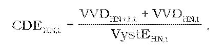
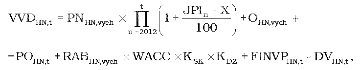
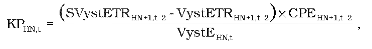
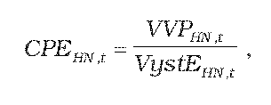
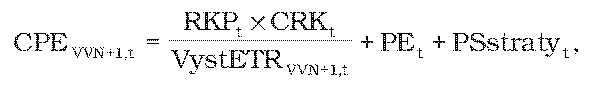

# § 23 Cena za prístup do distribučnej sústavy a distribúciu elektriny regionálnou distribučnou sústavou

(1) Maximálna cena za prístup do distribučnej sústavy a distribúciu elektriny na príslušnej napäťovej úrovni CDHN,t zohľadňuje vlastnú distribúciu elektriny, prenos elektriny vrátane strát pri prenose elektriny v eurách na jednotku množstva elektriny distribuovanej koncovým odberateľom elektriny v roku t sa vypočíta podľa vzorca

CDHN,t = CDEHN,t + CPDHN,t

kde

- a) CDEHN,t – je schválená alebo určená zložka maximálnej ceny za prístup do distribučnej sústavy a distribúciu elektriny na príslušnej napäťovej úrovni na rok t v eurách na jednotku množstva elektriny zohľadňujúca náklady a primeraný zisk vlastnej distribúcie elektriny podľa odseku 2,

- b) CPDHN,t – je priemerná zložka ceny za prístup do prenosovej sústavy a prenos elektriny vrátane strát pri prenose v eurách na jednotku množstva elektriny na príslušnej napäťovej úrovni na rok t podľa odseku 4.

(2) Schválená alebo určená zložka maximálnej ceny za prístup do distribučnej sústavy a distribúciu elektriny na príslušnej napäťovej úrovni CDEHN,t na rok t v eurách na jednotku množstva elektriny zohľadňujúca náklady a primeraný zisk vlastnej distribúcie elektriny vypočítaná podľa vzorca

kde

- a) VystEHN,t– je plánované množstvo distribuovanej elektriny v jednotkách množstva elektriny na rok t vystupujúce z príslušnej napäťovej úrovne vypočítané podľa vzorca

- VystEHN,t=VystEOHN,t+VystETRHN,t ,

- kde

  - 1. VystEOHN,t– plánované množstvo elektriny v jednotkách množstva elektriny na rok t distribuované na príslušnej napäťovej úrovni koncovým odberateľom elektriny a prevádzkovateľom miestnej distribučnej sústavy vypočítané ako ročný priemer zo súčtu skutočného príslušného množstva elektriny za roky t-3 a t-2, očakávaného príslušného množstva za rok t-1 a plánovaného príslušného množstva za roky t a t+1,

  - 2. VystETRHN,t – je plánované množstvo elektriny v jednotkách množstva elektriny na rok t vystupujúce z príslušnej napäťovej úrovne do transformácie na nižšiu napäťovú úroveň vypočítané ako ročný priemer zo súčtu skutočného príslušného množstva elektriny za roky t-3 a t-2, očakávaného príslušného množstva za rok t-1 a plánovaného príslušného množstva za roky t a t+1,

- b) VVDHN+1,t– je alikvotná časť povolených nákladov a zisku za distribúciu elektriny v eurách na rok t priradených z vyššej napäťovej úrovne podľa vzorca

- VVDHN+1,t = CDEHN+1,tx VystETRHN+1,t,

- kde

  - 1. CDEHN+1,t – je zložka maximálnej ceny za prístup do distribučnej sústavy a distribúciu elektriny na vyššej napäťovej úrovni na rok t v eurách na jednotku množstva elektriny; CDEVVN+1,t na vstupe do napäťovej úrovne VVN je rovné nule,

  - 2. VystETRHN+1,t – je plánované množstvo elektriny v jednotkách množstva elektriny na rok t vystupujúce z vyššej napäťovej úrovne HN+1 do transformácie na napäťovú úroveň HN vypočítané ako ročný priemer zo súčtu skutočného príslušného množstva elektriny za roky t-3 a t-2, očakávaného príslušného množstva za rok t-1 a plánovaného príslušného množstva za roky t a t+1,

- c) VVDHN,t – sú schválené alebo určené náklady a zisk za prístup do distribučnej sústavy a distribúciu elektriny v eurách na rok t na napäťovej úrovni okrem alikvotnej časti povolených nákladov a zisku za distribúciu elektriny priradených z vyššej napäťovej úrovne vypočítané podľa odseku 3.

(3) Schválené alebo určené náklady a zisk za prístup do distribučnej sústavy a distribúciu elektriny v eurách na rok t na napäťovej úrovni okrem alikvotnej časti povolených nákladov a zisku za distribúciu elektriny priradených z vyššej napäťovej úrovne vypočítané podľa vzorca

kde

- a) PNHN,vych – sú schválené alebo určené skutočné oprávnené prevádzkové ročné náklady v eurách v roku 2010 na napäťovej úrovni súvisiace s regulovanou činnosťou okrem odpisov,

- b) JPIn– aritmetický priemer indexov jadrovej inflácie v percentách zverejnených štatistickým úradom za obdobie od júla roku n-2 do júna roku n-2,

- c) X – je faktor efektivity podľa § 2 ods. 3,

- d) OHN,vych – je schválená alebo určená východisková hodnota odpisov regulovaného subjektu vo východiskovom roku regulačného obdobia v eurách vztiahnutá na RABHN,ych na napäťovej úrovni a vypočítaná na základe zostatkovej doby technickej životnosti tried aktív nevyhnutne využívaných na regulovanú činnosť podľa prílohy č. 1 tabuľky č. 2,

- e) POHN,t – sú plánované schválené alebo určené odpisy na napäťovej úrovni v eurách na rok t súvisiace s regulovanou činnosťou z plánovanej hodnoty schválených alebo určených investícií na napäťovej úrovni v eurách zaradených do hodnoty regulačnej bázy aktív nevyhnutne využívaných na regulovanú činnosť v roku t-1 a vypočítané na základe doby technickej životnosti tried aktív nevyhnutne využívaných na regulovanú činnosť podľa prílohy č. 1 tabuľky č. 3,

- f) RABHN,vych – je východisková schválená alebo určená hodnota regulačnej bázy aktív na napäťovej úrovni v eurách rovnajúca sa hodnote regulačnej bázy aktív nevyhnutne súvisiacej s regulovanou činnosťou k 31. decembru 2010 a vypočíta sa podľa vzorca

- RABHN,vych= RABHN,2005+INVHN,2006-2010-OHN,2006-2010,

- kde

  - 1. RABHN,2005 – je hodnota regulačnej bázy aktív regulovaného subjektu na napäťovej úrovni v eurách rovnajúca sa schválenej alebo určenej hodnote majetku na napäťovej úrovni k 31. decembru 2005 vo výške všeobecnej hodnoty majetku42) podľa znaleckých posudkov vyhotovených z podnetu úradu, a to znaleckého posudku č. 26/2006 pre regulovaný subjekt ZSE Distribúcia, a. s., znaleckého posudku č. 38/2006 pre regulovaný subjekt SSE Distribúcia, a. s., a znaleckého posudku č. 49/2006 pre regulovaný subjekt Východoslovenská distribučná, a. s.,

  - 2. INVHN,2006-2010 – je schválená alebo určená hodnota investícií na napäťovej úrovni v eurách zaradených do hodnoty regulačnej bázy aktív na napäťovej úrovni nevyhnutne využívaných na regulovanú činnosť v rokoch 2006 až 2010,

  - 3. OHN,2006-2010 – sú schválené alebo určené odpisy na napäťovej úrovni v eurách súvisiace s regulovanou činnosťou v období rokov 2006 až 2010 a vypočítané na základe zostatkovej doby technickej životnosti tried aktív nevyhnutne využívaných pre regulovanú činnosť podľa prílohy č. 1 tabuľky č. 2,

- g) WACC – je miera výnosnosti regulačnej bázy aktív na regulačné obdobie rokov 2012 až 2016 určená podľa § 3 ods. 2 a 3,

- h) KSK – je koeficient dosiahnutého plnenia štandardov kvality uplatnený na základe dosiahnutej úrovne vybraných štandardov kvality; KSK sa na roky 2012 až 2015 rovná jeden; KSK sa na rok 2016 určí v intervale od 0,98 do 1,00,

- i) KDZ – je koeficient miery využitia disponibilných zdrojov do investícií súvisiacich s regulovanou činnosťou; KDZ sa na roky 2012 až 2014 rovná jeden a na roky 2015 a 2016 sa určí v intervale od 0,99 do 1,00,

- j) FINVPHN,t – je faktor investícií na napäťovej úrovni v eurách na rok t; FINVPHN,t sa na rok 2012 rovná nule a na roky 2013 až 2016 sa vypočíta podľa vzorca

- FINVPHN,t = SOHN,t-2 - POHN,t-2,

- kde

  - 1. SOHN,t-2 – sú skutočné schválené alebo určené odpisy na napäťovej úrovni v eurách zo skutočnej hodnoty schválených alebo určených investícií na napäťovej úrovni v eurách zaradených do hodnoty regulačnej bázy aktív nevyhnutne využívaných na regulovanú činnosť v období roku t-2 vypočítané na základe doby technickej životnosti tried aktív nevyhnutne využívaných na regulovanú činnosť podľa prílohy č. 1 tabuľky č. 3,

  - 2. POHN,t-2 – sú plánované schválené alebo určené odpisy na napäťovej úrovni v eurách z plánovanej hodnoty schválených alebo určených investícií na napäťovej úrovni v eurách zaradených do hodnoty regulačnej bázy aktív nevyhnutne využívaných na regulovanú činnosť v období roku t-2 vypočítané na základe doby technickej životnosti tried aktív nevyhnutne využívaných na regulovanú činnosť podľa prílohy č. 1 tabuľky č. 3,

- k) DVHN,t – sú skutočné dodatočné výnosy na napäťovej úrovni v eurách v roku t-2 z uplatnenia ceny za pripojenie do sústavy, zo sankcií za prekročenie dohodnutej kapacity a za neoprávnený odber elektriny;44)DVHN,t sa na roky 2012 a 2013 rovná nule.

(4) Zložka maximálnej ceny za prístup do distribučnej sústavy a distribúciu elektriny v eurách na jednotku množstva elektriny na rok t CPDHN,t súvisiaca s nákladmi za prístup do prenosovej sústavy a prenos elektriny vrátane strát pri prenose elektriny na príslušnej napäťovej úrovni sa vypočíta podľa vzorca

CPDHN,t=CPEHN,t+KPHN,t,

kde

- a) CPEHN,t – je priemerná zložka ceny za prístup do prenosovej sústavy a prenos elektriny vrátane nákladov na straty pri prenose v eurách na jednotku množstva elektriny na príslušnej napäťovej úrovni v roku t a vypočíta sa podľa odseku 5,

- b) KPHN,t – je faktor vyrovnania zložky ceny za prístup do prenosovej sústavy a prenos elektriny v eurách na jednotku množstva elektriny na rok t a po prvýkrát sa uplatní na rok 2014 podľa vzorca

- 

- kde

  - 1. SVystETRHN+1,t-2 – je skutočné množstvo elektriny v jednotkách množstva elektriny vstupujúce do príslušnej napäťovej úrovne cez transformáciu z vyššej napäťovej úrovne v roku t-2,

  - 2. VystETRHN+1,t-2 –je plánované množstvo elektriny v jednotkách množstva elektriny vstupujúce do príslušnej napäťovej úrovne cez transformáciu z vyššej napäťovej úrovne v roku t-2,

  - 3. CPEHN+1,t-2 – je cena za prístup do prenosovej sústavy a prenos elektriny vrátane strát pri prenose elektriny v eurách na jednotku množstva elektriny na vyššej napäťovej úrovni distribúcie elektriny v roku t-2, z ktorej sa transformuje elektrina do príslušnej napäťovej úrovne HN; hodnota CPEVVN+1,t-2 sa stanoví primerane podľa odseku 6,

  - 4. VystEHN,t – je celkové plánované množstvo elektriny v jednotkách množstva elektriny vystupujúce z príslušnej napäťovej úrovne v roku t vypočítané podľa vzorca

    - VystEHN,t= VystEOHN,t + VystETRHN,t,

    - kde

    - 4.1. VystEOHN,t – je plánované množstvo elektriny v jednotkách množstva elektriny distribuované na príslušnej napäťovej úrovni ku koncovým odberateľom elektriny v roku t,

    - 4.2. VystETRHN,t – je plánované množstvo elektriny v jednotkách množstva elektriny vystupujúce z príslušnej napäťovej úrovne do transformácie na nižšiu napäťovú úroveň v roku t.

(5) Priemerná zložka ceny za prístup do prenosovej sústavy a prenos elektriny vrátane nákladov na straty pri prenose v eurách na jednotku množstva elektriny na príslušnej napäťovej úrovni v roku t vypočítaná podľa vzorca

kde

- a) VVPHN,t – sú vstupujúce náklady za prístup do prenosovej sústavy a prenos elektriny vrátane nákladov na straty pri prenose elektriny v eurách v roku t vypočítané podľa vzorca

- VVPHN,t = CPEHN + 1,t x VystETRHN + 1,t ,

- kde

  - 1. CPEHN+1,t– je cena za prístup do prenosovej sústavy a prenos elektriny vrátane strát pri prenose elektriny v eurách na jednotku množstva elektriny na vyššej napäťovej úrovni distribúcie elektriny v roku t, z ktorej sa transformuje elektrina do príslušnej napäťovej úrovne,

  - 2. VystETRHN+1,t– je plánované množstvo elektriny v jednotkách množstva elektriny vstupujúce do príslušnej napäťovej úrovne cez transformáciu z vyššej napäťovej úrovne v roku t,

- b) VystEHN,t – je celkové plánované množstvo elektriny v jednotkách množstva elektriny vystupujúce z príslušnej napäťovej úrovne v roku t vypočítané podľa odseku 4 písm. b) štvrtého bodu.

(6) Cena za prístup do prenosovej sústavy a prenos elektriny v eurách na jednotku množstva elektriny CPEVVN+1,t na vstupe do napäťovej úrovne veľmi vysokého napätia distribučnej sústavy je jednozložková cena zahŕňajúca náklady regulovaného subjektu na rezervovaný výkon, prenesenú elektrinu a straty elektriny pri prenose elektriny v roku t určené úradom na základe schváleného návrhu ceny za prístup do prenosovej sústavy a prenos elektriny na rok t vypočítaná podľa vzorca

kde

- a) RKPt – je rezervovaná kapacita v megawattoch na rok t uplatňovaná regulovanému subjektu prevádzkovateľom prenosovej sústavy,

- b) CRKt – je cena za rezervovanú kapacitu v roku t v eurách na megawatt na rok uplatňovaná regulovanému subjektu prevádzkovateľom prenosovej sústavy,

- c) VystETRVVN+1,t – je plánované množstvo elektriny v jednotkách množstva elektriny na rok t vstupujúce do napäťovej úrovne veľmi vysokého napätia regulovaného subjektu z prenosovej sústavy,

- d) PEt – je cena za prenesenú elektrinu v eurách na jednotku množstva elektriny na rok t uplatňovaná regulovanému subjektu prevádzkovateľom prenosovej sústavy,

- e) PSstratyt – je tarifa za straty pri prenose elektriny v eurách na jednotku množstva elektriny na rok t uplatňovaná regulovanému subjektu prevádzkovateľom prenosovej sústavy.
