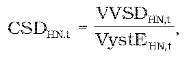
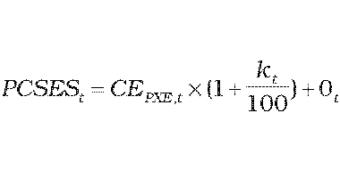
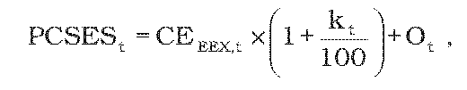
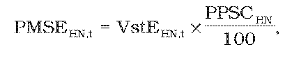

# § 24 Spôsob výpočtu tarify za straty pri distribúcii elektriny regionálnou distribučnou sústavou, postup a podmienky uplatňovania cien

(1) Tarifa za straty pri distribúcii elektriny CSDHN,tv eurách na jednotku množstva elektriny sa v roku t vypočíta postupným výpočtom na jednotlivých napäťových úrovniach začínajúcim od napäťovej úrovne veľmi vysokého napätia podľa vzorca

kde

- a) VVSDHN,t – sú náklady za straty pri distribúcii elektriny v eurách priradené príslušnej napäťovej úrovni vypočítané podľa odseku 2,

- b) VystEHN,t – je celkové plánované množstvo elektriny v jednotkách množstva elektriny vystupujúce z príslušnej napäťovej úrovne v roku t, vypočítané podľa vzorca

- VystEHN,t= VystEOHN,t + VystETRHN,t ,

- kde

  - 1. VystEOHN,t – je plánované množstvo elektriny v jednotkách množstva elektriny distribuované na príslušnej napäťovej úrovni prevádzkovateľom distribučnej sústavy a koncovým odberateľom elektriny v roku t,

  - 2. VystETRHN,t – je plánované množstvo elektriny v jednotkách množstva elektriny vystupujúce z príslušnej napäťovej úrovne do transformácie na nižšiu napäťovú úroveň v roku t.

(2) Náklady za straty pri distribúcii elektriny priradené príslušnej napäťovej úrovni VVSDHN,t v eurách v roku t sú zložené z alikvotnej časti nákladov za straty pri distribúcii elektriny priradených z vyššej napäťovej úrovne a nákladov za straty pri distribúcii elektriny vlastnej napäťovej úrovne a vypočítajú sa podľa vzorca

VVSDHN,t = CSDHN + 1,t x VxstERTHN + 1,t + CSHDHN,t x VystEHN,t ,

kde

- a) CSDHN+1,t – je tarifa za straty pri distribúcii elektriny v eurách na jednotku množstva elektriny na vyššej napäťovej úrovni, z ktorej sa transformuje elektrina do príslušnej napäťovej úrovne; na distribučnej napäťovej úrovni veľmi vysokého napätia sa tarifa za straty na vyššej napäťovej úrovni v eurách na jednotku množstva elektriny v roku t CSDVVN+1,t rovná nule,

- b) CSHDHN,t – je cena za straty pri distribúcii elektriny v eurách na jednotku množstva elektriny príslušnej napäťovej úrovne v roku t.

(3) Cena za straty pri distribúcii elektriny na príslušnej napäťovej úrovni CSHDHN,t v eurách na jednotku množstva elektriny v roku t sa vypočíta podľa vzorca

kde

- a) PMSEHN,t – je povolené množstvo strát elektriny v jednotkách množstva elektriny na príslušnej napäťovej úrovni v roku t podľa odseku 4,

- b) PCSESt – je schválená alebo určená cena elektriny na účely pokrytia strát elektriny pri distribúcii elektriny v eurách na jednotku množstva elektriny na rok t vypočítaná podľa vzorca

- , ak hodnota PCSES2012vypočítaná podľa vzorca je viac ako 62,80 eura/MWh, PCSES2012sa rovná 62,80 eura/MWh,

- kde

  - 1. CEPXE,t– je aritmetický priemer denných cien oficiálneho kurzového lístka, zverejneného burzou PXE (POWER EXCHANGE CENTRAL EUROPE) na jej webovom sídle, produktu F PXE CZ BL Cal-t v eurách na jednotku množstva elektriny za obdobie od 1. januára roku t-1 do 30. júna roku t-1,

  - 2. kt – je koeficient na rok t v percentách, ktorého hodnota je 10 % na rok 2013, 9 % na rok 2014, 8 % na rok 2015 a 7 % na rok 2016,

  - 3. Ot – sú schválené alebo určené plánované náklady regulovaného subjektu na odchýlku v eurách na jednotku množstva elektriny na rok t súvisiace s plánovaným diagramom strát elektriny na rok t pri distribúcii elektriny.

(4) Povolené množstvo strát elektriny PMSEHN,t v jednotkách množstva elektriny na príslušnej napäťovej úrovni v roku t sa vypočíta podľa vzorca

kde

- a) VstEHN,t – je celkové plánované množstvo elektriny v jednotkách množstva elektriny vstupujúce do príslušnej napäťovej úrovne v roku t cez transformáciu z vyššej napäťovej úrovne, zo všetkých zdrojov elektriny pripojených na príslušnú napäťovú úroveň, z prítokov elektriny zo susedných distribučných sústav, z dovozov elektriny zo susedných elektrizačných sústav a z prítokov elektriny prepravenej cez miestne distribučné sústavy pripojené do distribučnej sústavy regulovaného subjektu,

- b) PPSCHN,t – je hodnota počiatočného percenta celkových strát pri distribúcii elektriny na príslušnej napäťovej úrovni určená podľa odseku 5,

- c) XSHN,n– je faktor efektivity strát elektriny na príslušnej napäťovej úrovni; XSHN,n sa na rok 2012 rovná nule a na roky 2013 až 2016 sa určí podľa odseku 5.

(5) Hodnota počiatočného percenta celkových strát pri distribúcii elektriny PPSCHN na príslušnej napäťovej úrovni a hodnota faktora efektívnosti strát XSHN,n je určená takto:

| Regionálna distribučná sústava |

| PPSCHN | XSHN,n

VVN | 0,878 % | 0,1 %

VN | 3,692 % | 1,5 %

NN | 12,504 % | 5,0 %
