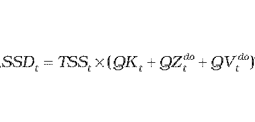
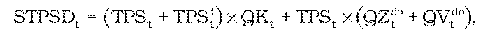
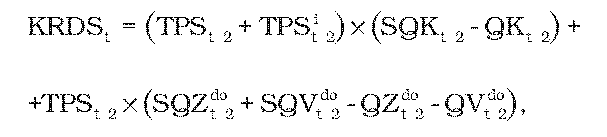
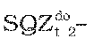
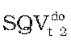
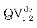

# § 25 Uplatnenie tarify za systémové služby a tarify za prevádzkovanie systému prevádzkovateľom regionálnej distribučnej sústavy

(1) Maximálny povolený výnos v eurách, ktorý regulovaný subjekt dosiahne za poskytovanie systémových služieb SSDt v eurách v roku t, sa vypočíta podľa vzorca

kde

- a) TSSt – je tarifa za systémové služby určená cenovým rozhodnutím pre koncových odberateľov elektriny a prevádzkovateľov miestnej distribučnej sústavy, ktorí sú pripojení do regionálnej distribučnej sústavy regulovaného subjektu v eurách na jednotku množstva elektriny v roku t,

- b) QKt – je celkové plánované množstvo elektriny v jednotkách množstva elektriny, ktoré odoberú koncoví odberatelia elektriny a prevádzkovatelia miestnej distribučnej sústavy, ktorí sú pripojení do regionálnej distribučnej sústavy regulovaného subjektu, z distribučnej sústavy regulovaného subjektu, vrátane prevádzkovateľov miestnej distribučnej sústavy a odberateľov elektriny pripojených v rámci prevádzky preukázateľne oddelenej od sústavy Slovenskej republiky v roku t,

- c) QZtdo– je celkové plánované množstvo elektriny distribuované prevádzkovateľmi miestnej distribučnej sústavy, ktorá je priamo pripojená do distribučnej sústavy regulovaného subjektu, vyrobenej vo vlastnom zariadení na výrobu elektriny prevádzkovateľa miestnej distribučnej sústavy alebo v inom zariadení na výrobu elektriny pripojených do tejto miestnej distribučnej sústavy a dodanej koncovým odberateľom elektriny v rámci miestnej distribučnej sústavy alebo spotrebované pre vlastnú spotrebu v rámci miestnej distribučnej sústavy okrem elektriny spotrebovanej pre vlastnú spotrebu elektriny pri výrobe elektriny v jednotkách množstva elektriny v roku t,

- d) QVtdo – je celkové plánované množstvo elektriny vyrobené v zariadení na výrobu elektriny výrobcov elektriny pripojených priamo do distribučnej sústavy regulovaného subjektu a dodané koncovým odberateľom elektriny priamym vedením alebo spotrebované pre vlastnú spotrebu výrobcu elektriny v mieste umiestnenia zariadenia na výrobu elektriny okrem vlastnej spotreby elektriny pri výrobe elektriny v jednotkách množstva elektriny v roku t.

(2) Maximálny povolený výnos v eurách, ktorý regulovaný subjekt dosiahne uplatnením taríf za prevádzkovanie systému STPSDt v eurách v roku t, sa vypočíta podľa vzorca

kde

- a) TPSt – je tarifa za prevádzkovanie systému určená cenovým rozhodnutím pre koncových odberateľov elektriny a prevádzkovateľov miestnej distribučnej sústavy, ktorí sú pripojení do regionálnej distribučnej sústavy regulovaného subjektu v eurách na jednotku množstva elektriny v roku t,

- b) QKt– je celkový plánovaný objem elektriny v jednotkách množstva elektriny, ktorý odoberú koncoví odberatelia elektriny a prevádzkovatelia miestnej distribučnej sústavy, ktorí sú pripojení do regionálnej distribučnej sústavy regulovaného subjektu, z distribučnej sústavy regulovaného subjektu vrátane odberateľov elektriny pripojených v rámci prevádzky preukázateľne oddelenej od sústavy Slovenskej republiky v roku t,

- c) QZtdo – je celkový plánovaný objem elektriny distribuovanej prevádzkovateľmi miestnej distribučnej sústavy, ktorá je priamo pripojená do regionálnej distribučnej sústavy regulovaného subjektu vyrobenej vo vlastnom zariadení na výrobu elektriny prevádzkovateľa miestnej distribučnej sústavy alebo v inom zariadení na výrobu elektriny pripojených do miestnej distribučnej sústavy a dodanej odberateľom elektriny v tejto miestnej distribučnej sústave alebo spotrebovanej pre vlastnú spotrebu v tejto miestnej distribučnej sústave okrem vlastnej spotreby elektriny pri výrobe elektriny v jednotkách množstva elektriny v roku t,

- d) QVtdo – je celkový plánovaný objem elektriny vyrobenej v zariadení na výrobu elektriny výrobcov elektriny pripojených priamo do regionálnej distribučnej sústavy regulovaného subjektu a dodanej týmito výrobcami elektriny odberateľom elektriny bez použitia regionálnej distribučnej sústavy alebo spotrebovanej pre vlastnú spotrebu týchto výrobcov elektriny v mieste umiestnenia zariadenia na výrobu elektriny okrem vlastnej spotreby elektriny pri výrobe elektriny v jednotkách množstva elektriny v roku t,

- e) TPSit – je tarifa za prevádzkovanie systému určená rozhodnutím pre i-tého prevádzkovateľa regionálnej distribučnej sústavy v eurách na jednotku množstva elektriny na rok t.

(3) Korekcia KRDSt regulovaného subjektu v eurách zohľadňujúca náklady a výnosy z platieb z taríf za prevádzkovanie systému v roku t-2 sa vypočíta podľa vzorca

kde

- a) TPSt-2– je tarifa za prevádzkovanie systému určená cenovým rozhodnutím pre koncových odberateľov elektriny a prevádzkovateľov miestnej distribučnej sústavy, ktorí sú pripojení do regionálnej distribučnej sústavy regulovaného subjektu v eurách na jednotku množstva elektriny v roku t-2,

- b) TPSit-2 – je tarifa za prevádzkovanie systému určená cenovým rozhodnutím pre i-tého prevádzkovateľa regionálnej distribučnej sústavy v eurách na jednotku množstva elektriny na rok t-2,

- c) SQKt-2 – je celkový skutočný objem elektriny v jednotkách množstva elektriny odobratý prevádzkovateľmi miestnej distribučnej sústavy a koncovými odberateľmi elektriny z distribučnej sústavy regulovaného subjektu vrátane prevádzkovateľov miestnej distribučnej sústavy a odberateľov elektriny pripojených v rámci prevádzky preukázateľne oddelenej od sústavy Slovenskej republiky v roku t,

- d) QKt-2 – je celkový plánovaný objem elektriny v jednotkách množstva elektriny, ktorý odoberú prevádzkovatelia miestnej distribučnej sústavy a koncoví odberatelia elektriny z distribučnej sústavy regulovaného subjektu vrátane prevádzkovateľov miestnej distribučnej sústavy a odberateľov elektriny pripojených v rámci prevádzky preukázateľne oddelenej od sústavy Slovenskej republiky v roku t-2,

- e)  je celkový skutočný objem elektriny distribuovanej prevádzkovateľmi miestnej distribučnej sústavy, ktorá je priamo pripojená do regionálnej distribučnej sústavy regulovaného subjektu, vyrobenej vo vlastnom zariadení na výrobu elektriny prevádzkovateľa miestnej distribučnej sústavy alebo v inom zariadení na výrobu elektriny pripojených do tejto miestnej distribučnej sústavy a dodanej odberateľom elektriny v tejto miestnej distribučnej sústave alebo spotrebovanej pre vlastnú spotrebu v tejto miestnej distribučnej sústave okrem vlastnej spotreby elektriny pri výrobe elektriny v jednotkách množstva elektriny v roku t-2,

- f)  – je celkový skutočný objem elektriny vyrobenej v zariadení na výrobu elektriny výrobcov elektriny pripojených priamo do regionálnej distribučnej sústavy regulovaného subjektu a dodanej týmito výrobcami elektriny odberateľom elektriny bez použitia regionálnej distribučnej sústavy alebo spotrebovanej pre vlastnú spotrebu týchto výrobcov elektriny v mieste umiestnenia zariadenia na výrobu elektriny okrem vlastnej spotreby elektriny pri výrobe elektriny v jednotkách množstva elektriny v roku t-2,

- g) Vzorec – je celkový plánovaný objem elektriny distribuovanej prevádzkovateľmi miestnej distribučnej sústavy, ktorá je priamo pripojená do distribučnej sústavy regulovaného subjektu, vyrobenej vo vlastnom zariadení na výrobu elektriny prevádzkovateľa miestnej distribučnej sústavy alebo v inom zariadení na výrobu elektriny pripojených do tejto miestnej distribučnej sústavy a dodanej odberateľom elektriny v tejto miestnej distribučnej sústave alebo spotrebovanej pre vlastnú spotrebu v tejto miestnej distribučnej sústave okrem vlastnej spotreby elektriny pri výrobe elektriny v jednotkách množstva elektriny v roku t-2,

- h)  – je celkový plánovaný objem elektriny vyrobenej v zariadení na výrobu elektriny výrobcov elektriny pripojených priamo do regionálnej distribučnej sústavy regulovaného subjektu a dodanej týmito výrobcami elektriny odberateľom elektriny bez použitia regionálnej distribučnej sústavy alebo spotrebovanej pre vlastnú spotrebu týchto výrobcov elektriny v mieste umiestnenia zariadenia na výrobu elektriny okrem vlastnej spotreby elektriny pri výrobe elektriny v jednotkách množstva elektriny v roku t-2.

(4) Pri výpočte korekcie v eurách na rok t KRDStsa pre roky 2012 a 2013 zohľadní spôsob uplatnenia tarify za prevádzkovanie systému v rokoch 2010 a 2011.
