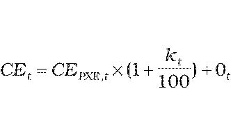

# § 28 Spôsob výpočtu maximálnej ceny za dodávku elektriny pre domácnosti

(1) Maximálna cena za elektrinu CEtna účely dodávky elektriny pre domácnosti schválená alebo určená cenovým rozhodnutím sa vypočíta podľa vzorca

, ak hodnota CE2012 vypočítaná podľa tohto vzorca je viac ako 62,80 eura/MWh, CE2012 sa rovná 62,80 eura/MWh,

kde

- a) CEPXE,t– je aritmetický priemer denných cien oficiálneho kurzového lístka, zverejneného burzou PXE (POWER EXCHANGE CENTRAL) na jej webovom sídle, produktu F PXE CZ BL Cal-t v eurách na jednotku množstva elektriny za obdobie od 1. januára roku t-1 do 30. júna roku t-1,

- b) kt – je koeficient na rok t v percentách určený cenovým rozhodnutím v rozsahu najviac 12 % v závislosti od plánovaného diagramu dodávky elektriny pre domácnosti na rok t,

- c) Ot – sú úradom schválené náklady regulovaného subjektu na odchýlku súvisiace s dodávkou elektriny domácnostiam v eurách na jednotku množstva elektriny v roku t; ak je regulovaným subjektom dodávateľ elektriny, ktorý je súčasne prevádzkovateľom miestnej distribučnej sústavy a nie je subjektom zúčtovania, hodnota Ot je maximálne vo výške aritmetickej priemernej hodnoty povolených odchýlok schválených alebo určených úradom pre regulované subjekty na rok t podľa § 24 ods. 3.

(2) Jednopásmové sadzby podľa § 27 ods. 2 sú zložené z

- a) mesačnej platby za jedno odberné miesto NDOt; NDOtsú náklady na dodávku elektriny na jedno odberné miesto za mesiac, ktoré možno zahrnúť do ceny vo výške maximálne 0,65 eura na jedno odberné miesto a mesiac,

- b) ceny za elektrinu CEDi v eurách na jednotku množstva elektriny, ktorá sa vypočíta podľa vzorca

- CEDi=KJPDi x CEt+PZt

- kde

  - 1. KJPDi – je koeficient ceny jednopásmového odberu elektriny určený podľa odseku 4,

  - 2. CEt – je cena elektriny určená podľa odseku 1,

  - 3. PZt– je primeraný zisk v roku t v eurách na jednotku množstva elektriny podľa § 3 ods. 4, ktorý je možné zahrnúť do ceny,

  - 4. i – je číselný znak jednopásmovej sadzby.

(3) Dvojpásmové sadzby podľa § 27 ods. 2 sú zložené z

- a) mesačnej platby za jedno odberné miesto NDOt; NDOtsú náklady na dodávku elektriny na jedno odberné miesto za mesiac, ktoré možno zahrnúť do ceny vo výške 0,65 eura na jedno odberné miesto a mesiac,

- b) ceny za elektrinu CEVTDi v eurách na jednotku množstva elektriny odobranej vo vysokom pásme, ktorá sa vypočíta podľa vzorca

- CEVTDi=KVTDix CEt + PZt,

- kde

  - 1. KVTDi– je koeficient ceny odberu elektriny vo vysokom pásme podľa odseku 4,

  - 2. CEt – je cena elektriny určená podľa odseku 1,

  - 3. PZt– je primeraný zisk v roku t v eurách na jednotku množstva elektriny podľa § 3 ods. 4, ktorý je možné zahrnúť do ceny,

  - 4. i – je číselný znak dvojpásmovej sadzby,

- c) ceny za elektrinu CENTDi v eurách na jednotku množstva elektriny odobratej v nízkom pásme, ktorá sa vypočíta podľa vzorca

- CENTDi=KNTDix CEt + PZt,

- kde

  - 1. KNTDi – je koeficient ceny odberu elektriny v nízkom pásme podľa odseku 4,

  - 2. CEt – je cena elektriny určená podľa odseku 1,

  - 3. PZt – je primeraný zisk v roku t v eurách na jednotku množstva elektriny podľa § 3 ods. 4, ktorý je možné zahrnúť do ceny,

  - 4. i –je číselný znak dvojpásmovej sadzby.

(4) Koeficienty ceny jednopásmového odberu elektriny KJPDi, koeficienty ceny odberu elektriny vo vysokom pásme KVTDia koeficienty ceny odberu elektriny v nízkom pásme KNTDi sa stanovia v návrhu ceny regulovaného subjektu tak, aby vážený priemer cien elektriny bez primeraného zisku PZt všetkých sadzieb bol najviac vo výške rovnajúcej sa CEt podľa odseku 1.

(5) K sadzbám podľa odsekov 2 a 3 sa dodávateľom elektriny pripočíta cena za distribúciu elektriny vrátane prenosu elektriny a strát elektriny pri prenose a cena za straty elektriny pri distribúcii elektriny, tarifa za systémové služby a tarifa za prevádzkovanie systému podľa cenového rozhodnutia, ktorým boli schválené alebo určené ceny za prístup do distribučnej sústavy a distribúciu elektriny pre prevádzkovateľa distribučnej sústavy, do ktorej je domácnosť pripojená.
