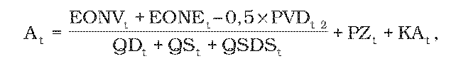
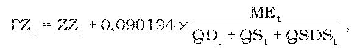
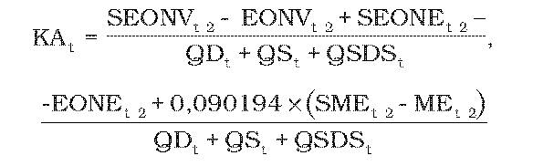
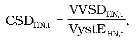
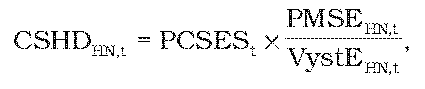
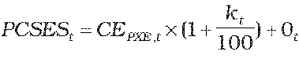
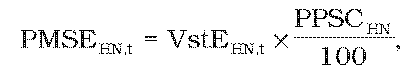

# § 31 Cena za prístup do distribučnej sústavy a distribúciu elektriny a tarifa za straty pri distribúcii elektriny

(1) Maximálna cena za prístup do distribučnej sústavy a distribúciu elektriny At v eurách na jednotku množstva elektriny na rok t okrem strát pri distribúcii elektriny sa pre regulovaný subjekt, ktorý predkladá vlastný návrh ceny, vypočíta podľa vzorca

kde

- a) EONVt – sú plánované schválené alebo určené oprávnené náklady v eurách na distribúciu elektriny v roku t vrátane nákladov z uplatnenia tarify za systémové služby, tarify za prevádzkovanie systému a efektívnej sadzby45) na množstvo elektriny na straty miestnej distribučnej sústavy regulovaného subjektu prevádzkovateľom nadradenej distribučnej sústavy okrem nákladov na obstaranie elektriny na krytie strát pri distribúcii elektriny a plánovaných nákladov na distribúciu elektriny od prevádzkovateľa sústavy, do sústavy ktorého je regulovaný subjekt pripojený; celkové množstvo elektriny na straty miestnej distribučnej sústavy regulovaného subjektu, ktoré možno do výpočtu nákladov z uplatnenia tarify za systémové služby, tarify za prevádzkovanie systému a efektívnej sadzby45) započítať, je najviac súčet strát na jednotlivých napäťových úrovniach PMSEHN,turčených podľa odseku 5,

- b) EONEt – sú plánované schválené alebo určené oprávnené náklady v eurách na distribúciu elektriny v roku t, ktoré zahŕňajú náklady na distribúciu elektriny vrátane strát elektriny pri distribúcii elektriny od prevádzkovateľa sústavy, do sústavy ktorého je regulovaný subjekt pripojený,

- c) QDt – je plánované množstvo elektriny v jednotkách množstva elektriny v roku t, odobratej z distribučnej sústavy regulovaného subjektu koncovými odberateľmi elektriny,

- d) QSt – je plánované množstvo elektriny spotrebované regulovaným subjektom okrem vlastnej spotreby pri distribúcii elektriny a vlastnej spotreby elektriny pri výrobe elektriny vo vlastnom zariadení na výrobu elektriny v jednotkách množstva elektriny v roku t,

- e) QSDSt – je plánované množstvo elektriny spotrebované regulovaným subjektom, ktoré zahŕňa vlastnú spotrebu pri distribúcii elektriny regulovaného subjektu v jednotkách množstva elektriny v roku t,

- f) PZt – je plánovaný maximálny primeraný zisk na rok t vo výške najviac 6,23 eura na jednotku množstva distribuovanej elektriny vypočítaný podľa vzorca

- 

- kde

  - 1. ZZt – je schválená alebo určená základná výška zisku v rozsahu 0 až 2,77 eura na jednotku množstva elektriny,

  - 2. MEt – je očakávaná účtovná zostatková cena dlhodobého majetku v eurách používaného výhradne na distribúciu elektriny k 31. decembru roku t-1,

- g) PVD t-2 – je celkový skutočný objem výnosov v eurách v roku t-1 nesúvisiacich s vykonávaním regulovanej činnosti využívaním prevádzkových aktív nevyhnutne využívaných pre distribúciu elektriny, ktoré sa zohľadnia pri návrhu ceny za prístup do distribučnej sústavy a distribúciu elektriny v roku t; PVD t-2 sa pre roky 2012 a 2013 rovná nule,

- h) KAt – je faktor vyrovnania maximálnej ceny za prístup do miestnej distribučnej sústavy a distribúciu elektriny v eurách na jednotku množstva elektriny na rok t zohľadňujúci skutočnosť za rok t-2, KAt sa na roky 2012 a 2013 rovná nule a na roky 2014 až 2016 sa vypočíta podľa vzorca

- 

- kde

  - 1. SEONVt-2 – sú skutočné schválené alebo určené oprávnené náklady v eurách na distribúciu elektriny v roku t-2 vrátane nákladov z uplatnenia tarify za systémové služby, tarify za prevádzkovanie systému a efektívnej sadzby45) prevádzkovateľom nadradenej distribučnej sústavy na celkové množstvo elektriny na straty miestnej distribučnej sústavy regulovaného subjektu okrem nákladov na obstaranie elektriny na krytie strát pri distribúcii elektriny a oprávnených nákladov na distribúciu elektriny od prevádzkovateľa sústavy, do sústavy ktorého je regulovaný subjekt pripojený; celkové množstvo elektriny na straty miestnej distribučnej sústavy regulovaného subjektu, ktoré možno do výpočtu nákladov z uplatnenia tarify za systémové služby a tarify za prevádzkovanie systému započítať, je najviac súčet strát na jednotlivých napäťových úrovniach PMSEHN,t určených podľa odseku 5,

  - 2. EONVt-2 – sú plánované schválené alebo určené oprávnené náklady v eurách na distribúciu elektriny v roku t-2 vrátane nákladov z uplatnenia tarify za systémové služby, tarify za prevádzkovanie systému a efektívnej sadzby45) prevádzkovateľom nadradenej distribučnej sústavy na celkové množstvo elektriny na straty miestnej distribučnej sústavy regulovaného subjektu okrem nákladov na obstaranie elektriny na krytie strát pri distribúcii elektriny a oprávnených nákladov na distribúciu elektriny od prevádzkovateľa sústavy, do sústavy ktorého je regulovaný subjekt pripojený; celkové množstvo elektriny na straty miestnej distribučnej sústavy regulovaného subjektu, ktoré možno do výpočtu nákladov z uplatnenia tarify za systémové služby a tarify za prevádzkovanie systému započítať, je najviac súčet strát na jednotlivých napäťových úrovniach PMSEHN,t určených podľa odseku 5,

  - 3. SEONEt-2 – sú skutočné schválené alebo určené oprávnené náklady v eurách na distribúciu elektriny v roku t-2, ktoré zahŕňajú náklady na distribúciu elektriny a straty elektriny pri distribúcii od prevádzkovateľa sústavy, do sústavy ktorého je regulovaný subjekt pripojený,

  - 4. EONEt-2 – sú plánované schválené alebo určené oprávnené náklady v eurách na distribúciu elektriny v roku t-2, ktoré zahŕňajú náklady na distribúciu elektriny a straty elektriny pri distribúcii od prevádzkovateľa sústavy, do sústavy ktorého je regulovaný subjekt pripojený,

  - 5. SMEt-2 – je skutočná účtovná zostatková cena dlhodobého majetku v eurách používaného výhradne na distribúciu elektriny k 31. decembru roku t-3,

  - 6. MEt-2 – je očakávaná účtovná zostatková cena dlhodobého majetku v eurách používaného výhradne na distribúciu elektriny k 31. decembru roku t-3.

(2) Tarifa za straty pri distribúcii elektriny CSDHN,tv eurách na jednotku množstva elektriny sa v roku t vypočíta postupným výpočtom na jednotlivých napäťových úrovniach začínajúcim od napäťovej úrovne, do ktorej je distribučná sústava regulovaného subjektu pripojená, a vypočíta sa podľa vzorca

kde

- a) VVSDHN,t – sú náklady za straty pri distribúcii elektriny v eurách priradené príslušnej napäťovej úrovni vypočítané podľa odseku 3,

- b) VystEHN,t – je celkové plánované množstvo elektriny v jednotkách množstva elektriny vystupujúce z príslušnej napäťovej úrovne v roku t vypočítané podľa vzorca

- VystEHN,t = VystEOHN,t+ VystETRHN,t ,

- kde

  - 1. VystEOHN,t – je plánované množstvo elektriny v jednotkách množstva elektriny na rok t distribuované na príslušnej napäťovej úrovni koncovým odberateľom elektriny a pre vlastnú spotrebu elektriny prevádzkovateľa sústavy46) regulovaného subjektu a ostatnú spotrebu elektriny prevádzkovateľa sústavy47) regulovaného subjektu,

  - 2. VystETRHN,t – je plánované množstvo elektriny v jednotkách množstva elektriny na rok t vystupujúce z príslušnej napäťovej úrovne do transformácie na nižšiu napäťovú úroveň.

(3) Náklady za straty pri distribúcii elektriny priradené príslušnej napäťovej úrovni VVSDHN,t v eurách v roku t skladajúce sa z alikvotnej časti nákladov za straty pri distribúcii elektriny priradených z vyššej napäťovej úrovne a nákladov za straty pri distribúcii vlastnej napäťovej úrovne sa vypočítajú podľa vzorca

VVSDHN,t = CSDHN+1,t x VystETRHN+1,t +

+ CSHDHN,t x VystEHN,t

kde

- a) CSDHN+1,t – je tarifa za straty pri distribúcii elektriny v eurách na jednotku množstva elektriny na vyššej napäťovej úrovni, z ktorej sa transformuje elektrina do príslušnej napäťovej úrovne; na distribučnej napäťovej úrovni, do ktorej je miestna distribučná sústava pripojená, je tarifa za straty na vyššej napäťovej úrovni v eurách na jednotku množstva elektriny v roku t CSDHN+1,t rovná nule,

- b) CSHDHN,t – je cena za straty pri distribúcii elektriny v eurách na jednotku množstva elektriny príslušnej napäťovej úrovne v roku t podľa odseku 4.

(4) Cena za straty pri distribúcii elektriny na príslušnej napäťovej úrovni CSHDHN,t v eurách na jednotku množstva elektriny v roku t sa vypočíta podľa vzorca

kde

- a) PCSESt – je schválená alebo určená cena elektriny na účely pokrytia strát elektriny pri distribúcii elektriny v eurách na jednotku množstva elektriny na rok t vypočítaná podľa vzorca

- 

- kde

  - 1. CEPXE,t– je aritmetický priemer denných cien oficiálneho kurzového lístka, zverejneného burzou PXE (POWER EXCHANGE CENTRAL EUROPE) na jej webovom sídle, produktu F PXE CZ BL Cal-t v eurách na jednotku množstva elektriny za obdobie od 1. januára roku t-1 do 30. júna roku t-1,

  - 2. kt – je koeficient na rok t v percentách určený cenovým rozhodnutím v rozsahu najviac 12 % v závislosti od plánovaného diagramu strát elektriny pri distribúcii elektriny na rok t,

  - 3. Ot – sú úradom schválené alebo určené plánované náklady regulovaného subjektu na odchýlku v eurách na jednotku množstva elektriny na rok t súvisiacu s plánovaným diagramom strát elektriny na rok t pri distribúcii elektriny,

- b) PMSEHN,t – je povolené množstvo strát elektriny v jednotkách množstva elektriny na príslušnej napäťovej úrovni v roku t vypočítané podľa odseku 5.

(5) Povolené množstvo strát elektriny PMSEHN,t v jednotkách množstva elektriny na príslušnej napäťovej úrovni v roku t sa vypočíta podľa vzorca

kde

- a) VstEHN,t – je celkové plánované množstvo elektriny v jednotkách množstva elektriny vstupujúce do príslušnej napäťovej úrovne v roku t z nadradenej distribučnej sústavy, cez transformáciu z vyššej napäťovej úrovne, zo všetkých zdrojov elektriny pripojených na danú napäťovú úroveň, z prítokov elektriny z iných miestnych distribučných sústav,

- b) PPSCHN – je hodnota percenta strát pri distribúcii elektriny na príslušnej napäťovej úrovni v závislosti od napäťovej úrovne pripojenia miestnej distribučnej sústavy a je najviac,

  - 1. ak je sústava pripojená na úrovni veľmi vysokého napätia,

    - 1.1. 0,1 % na napäťovej úrovni veľmi vysokého napätia,

    - 1.2. 2,2 % na napäťovej úrovni vysokého napätia,

    - 1.3. 5 % na napäťovej úrovni nízkeho napätia,

  - 2. ak je sústava pripojená na napäťovej úrovni vysokého napätia,

    - 2.1. 0,2 % na napäťovej úrovni vysokého napätia,

    - 2.2. 5 % na napäťovej úrovni nízkeho napätia,

  - 3. ak je sústava pripojená na napäťovej úrovni nízkeho napätia, 1 % na napäťovej úrovni nízkeho napätia.

(6) Hodnota percenta strát pri distribúcii elektriny na príslušnej napäťovej úrovni PPSCHNsa pre miestnu distribučnú sústavu, ktorá je rozlohou porovnateľná s regionálnou distribučnou sústavou, určí individuálne.
