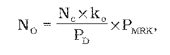

# § 38 Pripojenie odberateľa elektriny alebo výrobcu elektriny do distribučnej sústavy do napäťovej úrovne 110 kV

(1) Maximálna cena za pripojenie NO pri pripojení do 110 kV distribučnej sústavy alebo pri zvýšení maximálnej rezervovanej kapacity v 110 kV distribučnej sústave zahrňuje náklady na výstavbu požadovaného elektroenergetického zariadenia prevádzkovateľa distribučnej sústavy a všetky nevyhnutné úpravy elektroenergetických zariadení v 110 kV distribučnej sústave a v prenosovej sústave a vypočíta sa podľa vzorca

kde

- a) Nc – sú celkové náklady prevádzkovateľa distribučnej sústavy na výstavbu pripojenia a súvisiace úpravy v distribučnej sústave a prenosovej sústave v eurách,

- b) PMRK – je maximálna rezervovaná kapacita pripojenia žiadateľa v megawattoch,

- c) PD – je disponibilná kapacita pre pripojenie vytvorená nevyhnutnými úpravami energetických zariadení v distribučnej sústave prevádzkovateľa distribučnej sústavy súvisiacimi s pripojením žiadateľa do distribučnej sústavy v megawattoch,

- d) ko – je koeficient výšky spoluúčasti žiadateľa o pripojenie; ak je žiadateľom odberateľ elektriny, hodnota koeficientu ko sa rovná 0,5; ak je žiadateľom výrobca elektriny, hodnota koeficientu ko sa rovná jednej; ak je žiadateľom výrobca elektriny z obnoviteľných zdrojov energie alebo kombinovanou výrobou, ko sa rovná 0,98.

(2) Ak sa zvýši maximálna rezervovaná kapacita existujúceho odberateľa elektriny alebo výrobcu elektriny, potom pre výpočet podľa odseku 1 platí, že

- a) Nc je celkový náklad prevádzkovateľa distribučnej sústavy v eurách súvisiaci s pripojením žiadateľov na napäťovej úrovni 110 kV za predchádzajúcich päť kalendárnych rokov,

- b) PD je celkový disponibilný výkon v megawattoch vytvorený nevyhnutnými úpravami elektroenergetických zariadení v sústave prevádzkovateľa distribučnej sústavy na základe žiadostí žiadateľov o pripojenie na napäťovej úrovni 110 kV do distribučnej sústavy za predchádzajúcich päť kalendárnych rokov,

- c) PMRK je maximálna rezervovaná kapacita určená podľa § 37 ods. 4.

(3) Ak sa za predchádzajúcich päť kalendárnych rokov neuskutočnili nové pripojenia, použije sa na určenie ceny za pripojenie výpočet podľa odseku 1, kde

- a) PMRK – je maximálna rezervovaná kapacita určená podľa § 37 ods. 4,

- b) Nc – sú celkové náklady prevádzkovateľa distribučnej sústavy na zvýšenie maximálnej rezervovanej kapacity pripojenia a súvisiace úpravy v distribučnej sústave a prenosovej sústave v eurách.
