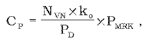

# § 39 Pripojenie odberateľa elektriny alebo výrobcu elektriny do napäťovej úrovne od 1 kV vrátane do 110 kV

(1) Maximálna cena za pripojenie Cp pri pripojení odberateľa elektriny alebo výrobcu elektriny do distribučnej sústavy od 1 kV vrátane do 110 kV, alebo pri zvýšení maximálnej rezervovanej kapacity v distribučnej sústave od 1 kV vrátane do 110 kV, zahrňuje náklady na výstavbu požadovaného elektroenergetického zariadenia prevádzkovateľa distribučnej sústavy a všetky nevyhnutné úpravy elektroenergetických zariadení v distribučnej sústave a vypočíta sa podľa vzorca

kde

- a) NVN – sú celkové náklady prevádzkovateľa distribučnej sústavy v eurách súvisiace s pripojením žiadateľov na napäťovej úrovni od 1 kV vrátane do 110 kV v roku t-1,

- b) PD – je celkový disponibilný výkon v kilowattoch vytvorený nevyhnutnými úpravami elektroenergetických zariadení v sústave prevádzkovateľa distribučnej sústavy na základe žiadostí žiadateľov o pripojenie na napäťovej úrovni od 1 kV vrátane do 110 kV do distribučnej sústavy v roku t-1,

- c) PMRK – je maximálna rezervovaná kapacita žiadateľa o pripojenie v kilowattoch,

- d) ko – je koeficient výšky spoluúčasti žiadateľa o pripojenie, ktorého hodnota sa rovná

  - 1. 0,5, ak je žiadateľom o pripojenie odberateľ elektriny,

  - 2. 1,0, ak je žiadateľom o pripojenie výrobca elektriny okrem výrobcu elektriny podľa tretieho bodu,

  - 3. 0,98, ak je žiadateľom o pripojenie výrobca elektriny z obnoviteľných zdrojov energie alebo kombinovanou výrobou,

  - 4. 0,50, ak je žiadateľom o pripojenie osoba, ktorej zariadenie na výrobu elektriny je pripojené do sústavy cez existujúce odberné miesto, pričom požadovaná maximálna rezervovaná kapacita pripojenia je rozdielom medzi dohodnutou maximálnou rezervovanou kapacitou pripojenia odberného miesta a skutočne využitou maximálnou rezervovanou kapacitou pripojenia, a v mieste pripojenia existujúceho odberného miesta do distribučnej sústavy je v distribučnej sústave k dispozícii požadovaná maximálna rezervovaná kapacita pre zariadenie na výrobu elektriny tak, aby nedošlo k ohrozeniu stability a bezpečnosti prevádzky distribučnej sústavy. Za skutočne využitú maximálnu rezervovanú kapacitu pripojenia sa považuje najvyššia nameraná hodnota príkonu za obdobie maximálne dvoch predchádzajúcich rokov. Ak požadovaná maximálna kapacita pripojenia pre zariadenie na výrobu elektriny prekročí maximálnu rezervovanú kapacitu dohodnutú v zmluve pre existujúce odberné zariadenie, na výpočet ceny za pripojenie pripadajúcej na rozdiel maximálnej rezervovanej kapacity pred pripojením a po pripojení zariadenia na výrobu elektriny sa použije koeficient ko podľa druhého bodu alebo tretieho bodu.

(2) Maximálna cena za pripojenie Cp určená podľa odseku 1 v eurách na kilowatt na rok t-1 a na rok t sa oznamuje úradu najneskôr do konca februára roku t.
