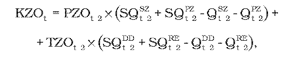
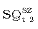
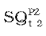
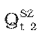
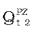
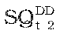
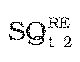
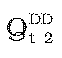
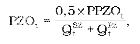
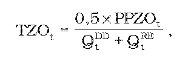

# § 42 Postup určenia tarify za zúčtovanie, vyhodnotenie a vysporiadanie odchýlok

(1) Pre subjekty zúčtovania sa uplatňujú tarify za zúčtovanie, vyhodnotenie a vysporiadanie odchýlok v štvrťhodinovom rozlíšení, kde maximálny výnos PPZOt z týchto platieb v eurách v roku t sa vypočíta podľa vzorca

PPZOt = PNZOt + PVAt + INVZOt – KZOt

kde

- a) PNZOt– sú úradom schválené alebo určené plánované prevádzkové náklady súvisiace so zúčtovaním, vyhodnotením a vysporiadaním odchýlok zúčtovateľa odchýlok v eurách v roku t,

- b) PVAt – je primeraný zisk za zúčtovanie, vyhodnotenie a vysporiadanie odchýlok v roku t v eurách vypočítaný podľa vzorca

- PVAt = AR x 0,065,

- kde

- AR – sú úradom schválené alebo určené regulované aktíva využívané v súvislosti so zúčtovaním, s vyhodnotením a vysporiadaním odchýlok k 31. decembru roku t-1,

- c) INVZOt – je faktor investícií v roku t, ktorým je objem finančných prostriedkov v eurách, a slúži zúčtovateľovi odchýlok na vyrovnanie nedostatku alebo prebytku investícií súvisiacich so zúčtovaním odchýlok v roku t-1, ktorého hodnota v roku 2012 sa rovná nule a pre roky 2013 až 2016 sa vypočíta podľa vzorca

- INVZOt=[INVZOSKt-2 - INVZOPLt-2 ] x 0,1, ak INVZOSKt-2 < (0,8 x INVZOPLt-2),

- INVZOt=0, ak (1,2 x INVZOPLt-2) ≥ INVZOSKt-2≥ (0,8 x INVZOPLt-2)

- INVZOt= [INVZOSKt-2 - INVZOPLt-2] x 0,1, ak INVZOSKt-2> (1,2 x INVZOPLt-2),

- kde

  - 1. INVZOSKt-2 – je skutočný objem investícií súvisiacich so zúčtovaním odchýlok uskutočnený zúčtovateľom odchýlok v roku t-2 v eurách,

  - 2. INVZOPLt-2 – je celkový plánovaný objem investícií súvisiacich so zúčtovaním odchýlok v roku t-2 v eurách,

- d) KZOt – je fakor vyrovnania v eurách na rok t; KZOtsa na roky 2012 a 2013 rovná nule a vypočíta sa podľa vzorca

- 

- kde

  - a) PZOt-2 – je ročná fixná platba za prístup do systému zúčtovania, vyhodnotenia a vysporiadania odchýlok v eurách v roku t-2 určený pre subjekt zúčtovania odchýlok, ktorý si zvolil režim vlastnej zodpovednosti za odchýlku a ktorý má uzavretú zmluvu o zúčtovaní, vyhodnotení a vysporiadaní odchýlok, a pre subjekt, ktorý poskytuje podporné služby, ale má prenesenú zodpovednosť za odchýlku na inú bilančnú skupinu,

  - b)  – je skutočný počet subjektov zúčtovania odchýlok v roku t-2, ktoré si zvolili režim vlastnej zodpovednosti za odchýlku a ktoré majú uzavretú zmluvu o zúčtovaní, vyhodnotení a vysporiadaní odchýlok,

  - c)  – je skutočný počet subjektov v roku t-2, ktoré poskytujú podporné služby, ale majú prenesenú zodpovednosť za odchýlku na inú bilančnú skupinu,

  - d)  – je predpokladaný počet subjektov zúčtovania odchýlok v roku t-2, ktoré si zvolili režim vlastnej zodpovednosti za odchýlku a ktoré majú uzavretú zmluvu o zúčtovaní, vyhodnotení a vysporiadaní odchýlok,

  - e)  – je predpokladaný počet subjektov v roku t-2, ktoré poskytujú podporné služby, ale majú prenesenú zodpovednosť za odchýlku na inú bilančnú skupinu,

  - f) TZOt-2 – je tarifa za zúčtovanie, vyhodnotenie a vysporiadanie odchýlok v eurách za jednotku množstva elektriny v roku t-2 určená pre subjekt zúčtovania odchýlok, ktorý si zvolil režim vlastnej zodpovednosti za odchýlku a ktorý má uzavretú zmluvu o zúčtovaní, vyhodnotení a vysporiadaní odchýlok, a pre subjekt, ktorý poskytuje podporné služby, ale má prenesenú zodpovednosť za odchýlku na inú bilančnú skupinu,

  - g)  – je celkový skutočný objem dohodnutého množstva elektriny, ktorý sa vypočíta ako suma zmluvnej dodávky a zmluvného odberu vrátane plánovaných cezhraničných prenosov, bilančných skupín subjektov zúčtovania odchýlok, ktoré si zvolili režim vlastnej zodpovednosti za odchýlku a ktoré majú uzavretú zmluvu o zúčtovaní, vyhodnotení a vysporiadaní odchýlok, podľa denných diagramov v jednotkách množstva elektriny v roku t-2,

  - h)  – je celkový skutočný objem poskytnutej regulačnej elektriny subjektov, ktoré poskytujú podporné služby, ale majú prenesenú zodpovednosť za odchýlku na inú bilančnú skupinu, v jednotkách množstva elektriny v roku t-2,

  - i)  – je celkový plánovaný objem dohodnutého množstva elektriny, ktorý sa vypočíta ako suma zmluvnej dodávky a zmluvného odberu vrátane plánovaných cezhraničných prenosov, bilančných skupín subjektov zúčtovania odchýlok, ktoré si zvolili režim vlastnej zodpovednosti za odchýlku a ktoré majú uzavretú zmluvu o zúčtovaní, vyhodnotení a vysporiadaní odchýlok, podľa denných diagramov v jednotkách množstva elektriny v roku t-2,

  - j) Vzorec – je celkový plánovaný objem poskytnutej regulačnej elektriny subjektov, ktoré poskytujú podporné služby, ale majú prenesenú zodpovednosť za odchýlku na inú bilančnú skupinu, v jednotkách množstva elektriny v roku t-2.

(2) Ročná fixná platba za prístup do systému zúčtovania, vyhodnotenia a vysporiadania odchýlok PZOt v eurách v roku t určený pre subjekt zúčtovania odchýlok, ktorý si zvolil režim vlastnej zodpovednosti za odchýlku a ktorý má uzavretú zmluvu o zúčtovaní, vyhodnotení a vysporiadaní odchýlok, a pre subjekt, ktorý poskytuje podporné služby, ale má prenesenú zodpovednosť za odchýlku na inú bilančnú skupinu, sa vypočíta podľa vzorca

kde

- a) PPZOt – je maximálny povolený výnos v eurách za zúčtovanie, vyhodnotenie a vysporiadanie odchýlok v roku t,

- b) QtSZ – je predpokladaný počet subjektov zúčtovania odchýlok v roku t, ktoré si zvolili režim vlastnej zodpovednosti za odchýlku a ktoré majú uzavretú zmluvu o zúčtovaní, vyhodnotení a vysporiadaní odchýlok,

- c) QtPZ – je predpokladaný počet subjektov v roku t, ktoré poskytujú podporné služby, ale majú prenesenú zodpovednosť za odchýlku na inú bilančnú skupinu.

(3) Tarifa za zúčtovanie, vyhodnotenie a vysporiadanie odchýlok TZOtv eurách za jednotku množstva elektriny v roku t určená pre subjekt zúčtovania odchýlok, ktorý si zvolil režim vlastnej zodpovednosti za odchýlku a ktorý má uzavretú zmluvu o zúčtovaní, vyhodnotení a vysporiadaní odchýlok, a pre subjekt, ktorý poskytuje podporné služby, ale má prenesenú zodpovednosť za odchýlku na inú bilančnú skupinu, sa vypočíta podľa vzorca

kde

- a) PPZOt – je maximálny povolený výnos v eurách za zúčtovanie, vyhodnotenie a vysporiadanie odchýlok v roku t,

- b) QtDD – je celkový plánovaný objem dohodnutého množstva elektriny, ktorý sa vypočíta ako suma zmluvnej dodávky a zmluvného odberu vrátane plánovaných cezhraničných prenosov elektriny, bilančných skupín subjektov zúčtovania odchýlok, ktoré si zvolili režim vlastnej zodpovednosti za odchýlku a ktoré majú uzavretú zmluvu o zúčtovaní, vyhodnotení a vysporiadaní odchýlok, podľa denných diagramov v jednotkách množstva elektriny v roku t,

- c) QtRE – je celkový plánovaný objem poskytnutej regulačnej elektriny subjektov, ktoré poskytujú podporné služby, ale majú prenesenú zodpovednosť za odchýlku na inú bilančnú skupinu, v jednotkách množstva elektriny v roku t.

(4) Pre subjekty zúčtovania odchýlok, ktoré si zvolili režim vlastnej zodpovednosti za odchýlku a ktoré majú uzavretú zmluvu o zúčtovaní, vyhodnotení a vysporiadaní odchýlok, a pre subjekty, ktoré poskytujú podporné služby, ale majú prenesenú zodpovednosť za odchýlku na inú bilančnú skupinu, sa uplatňuje ročná fixná platba za prístup do systému zúčtovania, vyhodnotenia a vysporiadania odchýlok PZOt podľa odseku 2 v eurách v roku t.

(5) Pre subjekty zúčtovania odchýlok, ktoré si zvolili režim vlastnej zodpovednosti za odchýlku a ktoré majú uzavretú zmluvu o zúčtovaní, vyhodnotení a vysporiadaní odchýlok, sa uplatňuje tarifa za zúčtovanie, vyhodnotenie a vysporiadanie odchýlok TZOt podľa odseku 3 k jednotke množstva elektriny dohodnutého množstva elektriny ich bilančných skupín podľa denných diagramov v roku t.

(6) Pre subjekty, ktoré poskytujú podporné služby, ale majú prenesenú zodpovednosť za odchýlku na inú bilančnú skupinu, sa uplatňuje tarifa za zúčtovanie, vyhodnotenie a vysporiadanie odchýlok TZOt podľa odseku 3 k jednotke množstva elektriny objemu poskytnutej regulačnej elektriny určeného prevádzkovateľom prenosovej sústavy v roku t.
