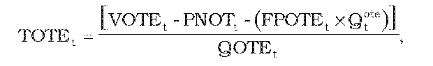
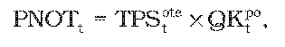
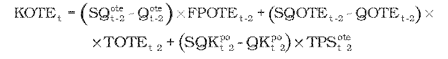
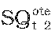
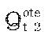
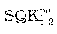
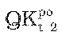
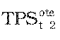

# § 43 Postup určenia cien za organizovanie a vyhodnotenie krátkodobého trhu s elektrinou

(1) Pre subjekty zúčtovania, ktoré majú s organizátorom krátkodobého trhu s elektrinou uzatvorenú zmluvu o prístupe a podmienkach účasti na organizovanom krátkodobom trhu s elektrinou, sa uplatňujú tarify za organizovanie a vyhodnotenie krátkodobého trhu s elektrinou, pričom úradom schválený alebo určený maximálny výnos VOTEt z týchto platieb a z alikvotnej časti výnosu z tarify za prevádzkovanie systému v eurách v roku t sa vypočíta podľa vzorca

VOTEt = PNOTEt + PVAt + INVOTEt - KOTEt ,

kde

- a) PNOTEt – sú úradom schválené alebo určené plánované prevádzkové náklady súvisiace s organizovaním a vyhodnotením krátkodobého trhu s elektrinou v eurách na rok t,

- b) PVAt – je primeraný zisk za organizovanie a vyhodnotenie krátkodobého trhu s elektrinou v roku t v eurách vypočítaný podľa vzorca

- PVAt = AR x 0,065,

- kde

- AR – sú úradom schválené alebo určené regulované aktíva využívané v súvislosti s organizovaním a vyhodnotením krátkodobého trhu s elektrinou k 31. decembru roku t-1,

- c) INVOTEt – je faktor investícií v eurách v roku t, ktorý predstavuje objem finančných prostriedkov a slúži organizátorovi krátkodobého trhu s elektrinou na vyrovnanie nedostatku investícií alebo prebytku investícií súvisiacich s organizovaním a vyhodnotením krátkodobého trhu s elektrinou v roku t-2 a ktorého hodnota je na rok 2012 rovná nule a na roky 2013 až 2016 sa vypočíta podľa vzorca

- INVOTEt = [INVOTESKt-2 - INVOTEPLt-2] x 0,1, ak INVOTESKt-2 < 0,8 x INVOTEPLt-2,

- INVOTEt = 0, ak (1,2 x INVZOTEPLt-2) ≥ INVOTESKt-2≥ (0,8 x INVZOTEPLt-2),

- INVZOTEt = [INVZOTESKt-2 - INVZOTEPLt-2] x 0,1, ak INVZOTESKt-2 > (1,2 x INVZOTEPLt-2)

- kde

  - 1. INVOTESKt-2 – je skutočný objem investícií súvisiacich s organizovaním a vyhodnotením krátkodobého trhu s elektrinou v roku t-2 v eurách,

  - 2. INVOTEPLt-2 – je celkový plánovaný objem investícií súvisiacich s organizovaním a vyhodnotením krátkodobého trhu s elektrinou v roku t-2 v eurách,

- d) KOTEt – je faktor vyrovnania v eurách v roku t vypočítaný podľa odseku 3.

(2) Tarifa za organizovanie a vyhodnotenie krátkodobého trhu s elektrinou TOTEt schválená alebo určená cenovým rozhodnutím na rok t v eurách za jednotku množstva elektriny nakúpenej a predanej účastníkom krátkodobého trhu s elektrinou sa vypočíta podľa vzorca

kde

- a) VOTEt – je schválený alebo určený maximálny výnos podľa odseku 1,

- b) PNOTt– sú schválené alebo určené plánované náklady v eurách zohľadňujúce alikvotnú časť nákladov na organizovanie a vyhodnotenie krátkodobého trhu s elektrinou v eurách na rok t; PNOTt sa uplatňujú u prevádzkovateľa prenosovej sústavy a vypočítajú sa podľa vzorca

- 

- kde

  - 1. TPStote – je tarifa za prevádzkovanie systému určená rozhodnutím pre organizátora krátkodobého trhu s elektrinou na rok t,

  - 2. QKtpo– je celkové plánované množstvo elektriny odobratej koncovými odberateľmi elektriny a prevádzkovateľmi miestnej distribučnej sústavy, ktorí sú priamo pripojení do prenosovej sústavy, v jednotkách množstva elektriny na rok t,

- c) FPOTEt – je schválená alebo určená ročná fixná platba v eurách určená na rok t cenovým rozhodnutím uplatneným subjektu zúčtovania, ktorý je účastníkom organizovaného krátkodobého trhu s elektrinou,

- d) Qtote– je plánovaný počet účastníkov organizovaného krátkodobého trhu s elektrinou v roku t,

- e) QOTEt – je plánované množstvo elektriny v jednotkách množstva elektriny na rok t nakúpenej a predanej účastníkmi krátkodobého trhu s elektrinou.

(3) Faktor vyrovnania KOTEtv eurách v roku t; KOTEt sa na rok 2012 rovná nule a na roky 2013 až 2016 sa vypočíta podľa vzorca

kde

- a)  – je skutočný počet účastníkov organizovaného krátkodobého trhu s elektrinou v roku t-2,

- b)  – je plánovaný počet účastníkov organizovaného krátkodobého trhu s elektrinou v roku t-2,

- c) FPOTEt-2 – je ročná fixná platba v eurách určená na rok t-2 cenovým rozhodnutím pre subjekt zúčtovania, ktorý je účastníkom organizovaného krátkodobého trhu s elektrinou,

- d) SQOTEt-2 – je skutočné množstvo elektriny v jednotkách množstva elektriny v roku t-2 nakúpenej a predanej účastníkom krátkodobého trhu s elektrinou,

- e) QOTEt-2 – je plánované schválené množstvo elektriny v jednotkách množstva elektriny na rok t-2 nakúpenej na krátkodobom trhu s elektrinou,

- f) TOTEt-2 – je tarifa za organizovanie a vyhodnotenie krátkodobého trhu s elektrinou schválená alebo určená cenovým rozhodnutím na rok t-2 v eurách za jednotku množstva elektriny nakúpenej na krátkodobom trhu s elektrinou,

- g)  – je skutočné množstvo elektriny odobratej koncovými odberateľmi elektriny, ktorí sú priamo pripojení do prenosovej sústavy, v jednotkách množstva elektriny v roku t-2,

- h)  – je celkový plánovaný objem elektriny odobratej koncovými odberateľmi elektriny, ktorí sú priamo pripojení do prenosovej sústavy v jednotkách množstva elektriny na rok t-2,

- i)  – je tarifa za prevádzkovanie systému určená rozhodnutím pre organizátora krátkodobého trhu s elektrinou v roku t-2.
