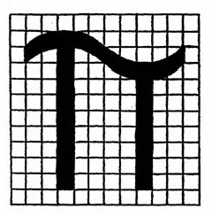

Príloha č. 3 k zákonu č. 254/2011 Z. z.

- 1. Označenie π pozostáva z gréckeho písmena v tejto podobe

- 

- 2. Minimálna výška označenia p musí byť 5 mm. Ak má zariadenie priemer 140 mm alebo menší ako 140 mm, musí byť minimálna výška 2,5 mm.

- 3. Proporcie uvedené na nákrese s mriežkou podľa prvého bodu sa musia dodržať. Mriežka nie je súčasťou označenia.
