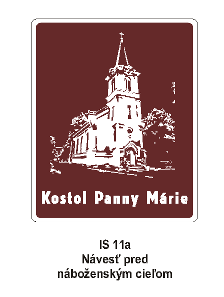
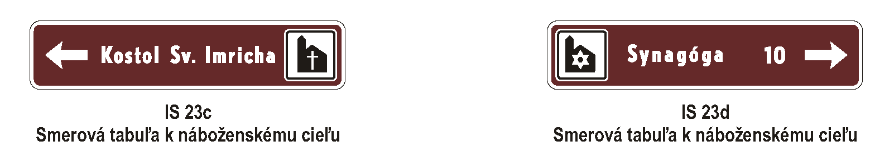
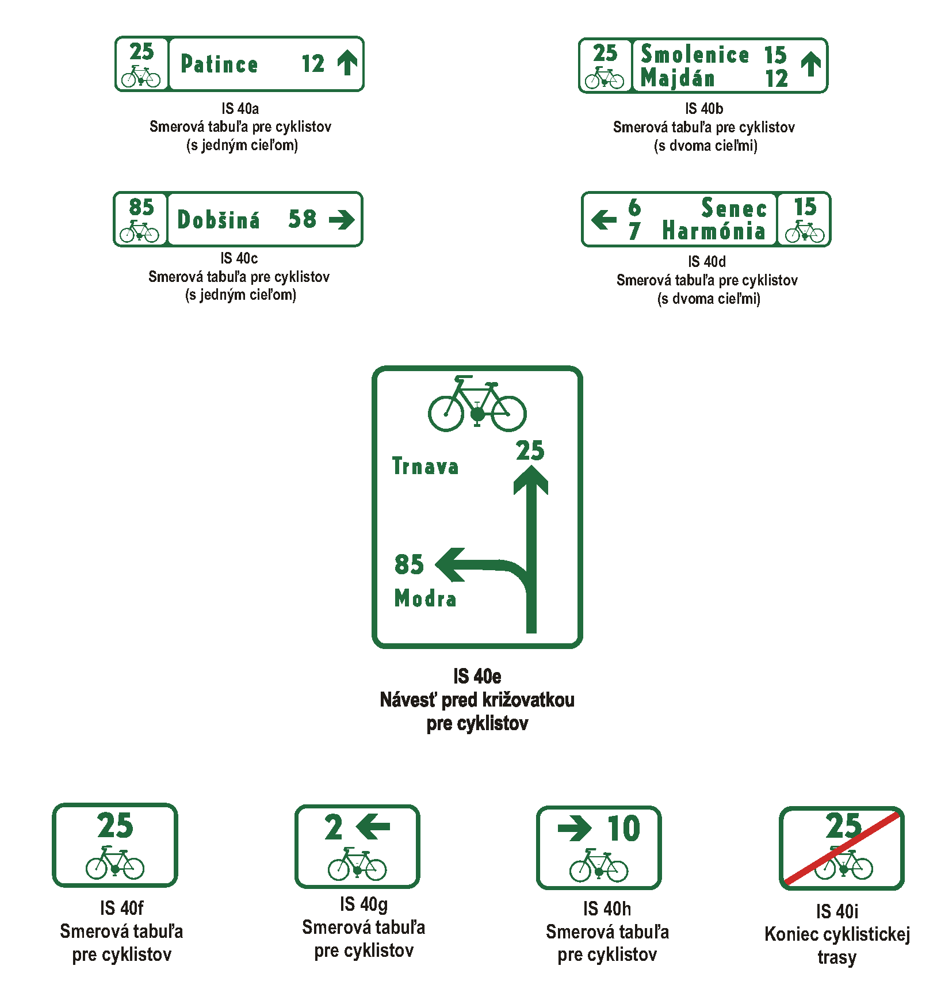
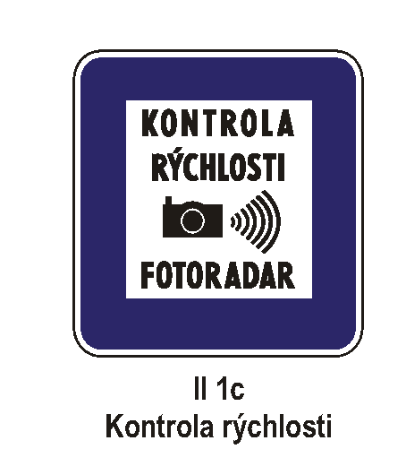
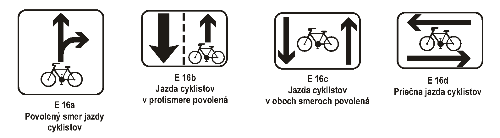
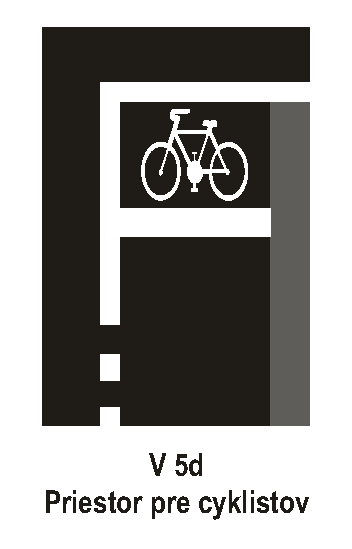
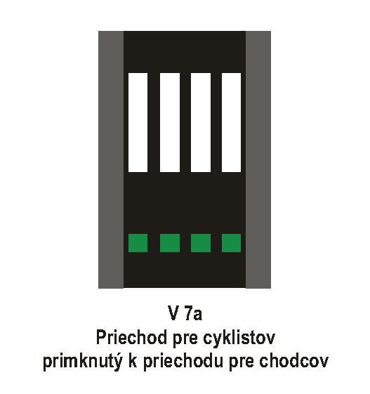
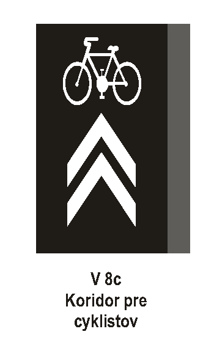

# Čl. I

Vyhláška Ministerstva vnútra Slovenskej republiky č. 9/2009 Z. z., ktorou sa vykonáva zákon o cestnej premávke a o zmene a doplnení niektorých zákonov v znení vyhlášky č. 130/2010 Z. z. a vyhlášky č. 413/2010 Z. z. sa mení a dopĺňa takto:

- 1. V § 15 ods. 3 sa za písmeno d) vkladá nové písmeno e), ktoré znie:

- „e)

- žiadosť o vykonanie osobitnej skúšky podľa § 78 ods. 2 písm. c) alebo ods. 3 písm. c) zákona, ak ide o osobu, ktorá žiada o vykonanie takejto osobitnej skúšky,“.

- Doterajšie písmená e) až g) sa označujú ako písmená f) až h).

- 2. V § 15 ods. 4 sa v uvádzacej vete vypúšťajú slová „doklad o“.

- 3. V § 15 ods. 4 písm. a) až c) sa na začiatok vkladajú slová „doklad o“.

- 4. V § 15 sa odsek 4 dopĺňa písmenami d) a e), ktoré znejú:

- „d)

- žiadosť o vykonanie osobitnej skúšky podľa § 76 ods. 7 zákona, ak ide o osobu, ktorá žiada o vykonanie takejto osobitnej skúšky,

- e)

- osvedčenie o absolvovaní osobitného výcviku podľa § 76 ods. 7, § 78 ods. 2 písm. c) alebo ods. 3 písm. c) zákona, ak ide o osobu, ktorá absolvovala takýto osobitný výcvik.“.

- 5. V § 15 ods. 10 a § 23 ods. 3 písm. i) sa vypúšťajú slová „alebo podskupiny“.

- 6. § 15 sa dopĺňa odsekom 11, ktorý znie:

- „(11)

- Žiadateľ o vykonanie osobitnej skúšky podľa § 76 ods. 7, § 78 ods. 2 písm. c) alebo ods. 3 písm. c) zákona vykoná len skúšku z vedenia motorových vozidiel.“.

- 7. V § 16 odsek 7 znie:

- „(7)

- Vzor prihlášky je uvedený v prílohe č. 2. Menný zoznam žiadateľov o udelenie vodičského oprávnenia prihlásených na skúšku z odbornej spôsobilosti je uvedený na druhej strane prihlášky. Vzor žiadosti o udelenie vodičského oprávnenia podľa § 15 ods. 1 a vzor záznamu o skúške z odbornej spôsobilosti sú uvedené v prílohe č. 2a. Žiadosť o udelenie vodičského oprávnenia a záznam o skúške z odbornej spôsobilosti sú uvedené na jednom liste formátu A3 zloženom do formátu A4, pričom prvá strana obsahuje žiadosť o udelenie vodičského oprávnenia, druhá až štvrtá strana obsahujú záznam o skúške z odbornej spôsobilosti v poradí uvedenom v prílohe č. 2a. Vzor protokolu o skúškach je uvedený v prílohe č. 3.“.

- 8. V § 18 ods. 6 sa slová „C, C + E, D, D + E a T a podskupiny C1, C1 + E, D1 a D1 + E“ nahrádzajú slovami „C1, C1E, C, CE, D1, D1E, D, DE a T“.

- 9. V § 18 ods. 7 sa na konci pripájajú tieto vety: „Správne odpovede sa označujú prečiarknutím príslušného písmena po uhlopriečke v tvare X guľôčkovým alebo plniacim perom; chybne označená odpoveď sa prečiarkne trikrát vodorovne cez stred označenej odpovede. Správna odpoveď sa opäť označí po uhlopriečke v tvare X.“.

- 10. V § 18 ods. 8 sa slová „C, D, C + E, D + E a podskupinu C1, D1, C1 + E a D1 + E“ nahrádzajú slovami „C1, C1E, C, CE, D1, D1E, D a DE“ a vypúšťajú sa slová „a podskupín“.

- 11. V § 18 ods. 11 sa za slová „vydané aj“ vkladajú slová „v anglickom jazyku a“.

- 12. V § 20 ods. 2 a 3 sa v uvádzacích vetách slová „AM a A a podskupiny A1“ nahrádzajú slovami „AM, A1, A2 a A“.

- 13. V § 20 ods. 4 a 5 sa v uvádzacích vetách slová „B a B + E a podskupiny B1“ nahrádzajú slovami „B1, B a BE“.

- 14. V § 20 ods. 4 písm. a) piatom a šiestom bode a písm. b) piatom bode sa slovo „B+E“ nahrádza slovom „BE“.

- 15. V § 20 ods. 6 a 7 sa v uvádzacích vetách slová „C, D, C + E, D + E a T a podskupiny C1, D1, C1 + E a D1 + E“ nahrádzajú slovami „C1, C1E, C, CE, D1, D1E, D, DE a T“.

- 16. V § 20 ods. 6 písm. a) piatom a šiestom bode sa slová „C, D, C + E, D + E a podskupiny C1, D1, C1 + E a D1 + E“ nahrádzajú slovami „C1, C1E, C, CE, D1, D1E, D a DE“.

- 17. V § 20 ods. 6 písm. a) deviatom bode sa slová „C, C + E a T a podskupiny C1 a C1 + E“ nahrádzajú slovami „C1, C1E, C, CE a T“.

- 18. V § 20 ods. 6 písm. a) desiatom a dvanástom bode sa slová „C + E , D + E a T a podskupiny C1 + E a D1 + E“ nahrádzajú slovami „C1E, CE, D1E, DE a T“.

- 19. V § 20 ods. 6 písm. a) jedenástom bode sa slová „D + E a podskupiny D1 + E“ nahrádzajú slovami „D1, D1E, D a DE“.

- 20. V § 20 ods. 6 písm. b) štvrtom bode sa slová „C, C + E a T a podskupiny C1 a C1 + E“ nahrádzajú slovami „C1, C1E, C, CE a T“.

- 21. V § 20 ods. 6 písm. b) piatom bode sa slová „D a D + E a podskupiny D1 a D1 + E“ nahrádzajú slovami „D1, D1E, D a DE“.

- 22. V § 20 sa za odsek 7 vkladá nový odsek 8, ktorý znie:

- „(8)

- Preverovanie schopností podľa odseku 2 písm. b), odseku 4 písm. b) alebo odseku 6 písm. b) trvá najviac

- a)

- 10 minút u žiadateľa o vykonanie skúšky skupiny AM, A, B, C, D a T a podskupiny A1, B1, C1 a D1,

- b)

- 15 minút u žiadateľa o vykonanie skúšky ostatných skupín a podskupín, ktoré nie sú uvedené v písmene a).“.

- Doterajšie odseky 8 až 11 sa označujú ako odseky 9 až 12.

- 23. V § 20 odsek 9 znie:

- „(9)

- Skúška z vedenia motorových vozidiel podľa odseku 1 písm. b) trvá najmenej

- a)

- 25 minút u žiadateľa o vykonanie skúšky skupiny AM, A1, A2, A, B1, B, BE a T,

- b)

- 45 minút u žiadateľa o vykonanie skúšky ostatných skupín, ktoré nie sú uvedené v písmene a).“.

- 24. V § 21 ods. 1 sa slová „preveruje schopnosť bezpečne viesť vozidlo, správne a bezpečne zvládanie“ nahrádzajú slovami „hodnotí, či žiadateľ preukáže schopnosti a bezpečné a správne zvládnutie“ a slová „vždy preveruje“ sa nahrádzajú slovami „vždy hodnotí“.

- 25. V § 21 sa vypúšťa odsek 2.

- Doterajšie odseky 3 až 7 sa označujú ako odseky 2 až 6.

- 26. V § 21 odsek 3 znie:

- „(3)

- Žiadateľ o vykonanie skúšky, ktorý nepreukázal schopnosti a bezpečné a správne zvládnutie úkonov podľa § 20 ods. 2 až 7 v závislosti od skupiny alebo podskupiny vodičského oprávnenia a správanie podľa odseku 1, je hodnotený klasifikačným stupňom neprospel.“.

- 27. V § 22 odsek 2 znie:

- „(2)

- Skúška z vedenia motorových vozidiel

- a)

- skupiny AM sa vykonáva na dvojkolesovom vozidle skupiny AM s najväčšou konštrukčnou rýchlosťou najmenej 25 km.h-1,

- b)

- skupiny A1 sa vykonáva na dvojkolesovom vozidle skupiny A1 bez postranného vozíka s objemom valcov spaľovacieho motora najmenej 120 cm3 a s najväčšou konštrukčnou rýchlosťou najmenej 90 km.h-1,

- c)

- skupiny A2 sa vykonáva na dvojkolesovom vozidle skupiny A2 bez postranného vozíka s výkonom s objemom valcov spaľovacieho motora najmenej 400 cm3 a s výkonom motora najmenej 25 kW,

- d)

- skupiny A sa vykonáva na dvojkolesovom vozidle skupiny A bez postranného vozíka s objemom valcov spaľovacieho motora najmenej 600 cm3 a s výkonom motora najmenej 40 kW,

- e)

- skupiny B1 sa vykonáva na štvorkolesovom motorovom vozidle skupiny B1, ktorého najväčšia konštrukčná rýchlosť je najmenej 60 km.h-1,

- f)

- skupiny B sa vykonáva na štvorkolesovom motorovom vozidle skupiny B, ktorého najväčšia konštrukčná rýchlosť je najmenej 100 km.h-1,

- g)

- skupiny BE sa vykonáva na jazdnej súprave s najväčšou konštrukčnou rýchlosťou najmenej 100 km.h-1, ktorá nepatrí do skupiny B a ktorá je zložená z motorového vozidla skupiny B podľa písmena f) a prípojného vozidla, ktorého najväčšia prípustná celková hmotnosť je najmenej 1 000 kg a skutočná hmotnosť je najmenej 800 kg a ktorého nákladný priestor tvorí uzatvorená karoséria široká a vysoká minimálne ako kabína vodiča; uzatvorená karoséria môže byť o trochu užšia ako motorové vozidlo, ak výhľad z miesta vodiča dozadu je možný len s použitím vonkajších spätných zrkadiel motorového vozidla,

- h)

- skupiny C1 sa vykonáva na motorovom vozidle skupiny C1 s najväčšou prípustnou celkovou hmotnosťou najmenej 4 000 kg, s dĺžkou najmenej 5 m a najväčšou konštrukčnou rýchlosťou najmenej 80 km.h-1, vybavenom brzdami s antiblokovacím zariadením, ustanoveným záznamovým zariadením3) a s nákladným priestorom tvoreným uzatvorenou karosériou širokou a vysokou minimálne ako kabína vodiča,

- i)

- skupiny C1E sa vykonáva na jazdnej súprave s dĺžkou najmenej 8 m zloženej z motorového vozidla skupiny C1 podľa písmena h) a prípojného vozidla, ktorého najväčšia prípustná celková hmotnosť je najmenej 1 250 kg a skutočná hmotnosť je najmenej 800 kg, s najväčšou konštrukčnou rýchlosťou najmenej 80 km.h-1a nákladným priestorom tvoreným uzatvorenou karosériou širokou a vysokou minimálne ako kabína vodiča; uzatvorená karoséria môže byť o trochu užšia ako motorové vozidlo, ak výhľad z miesta vodiča dozadu je možný len s použitím vonkajších spätných zrkadiel motorového vozidla,

- j)

- skupiny C sa vykonáva na motorovom vozidle skupiny C s najväčšou prípustnou celkovou hmotnosťou najmenej 12 000 kg, skutočnou hmotnosťou najmenej 10 000 kg, dĺžkou najmenej 8 m, šírkou najmenej 2,4 m, najväčšou konštrukčnou rýchlosťou najmenej 80 km.h-1, vybavenom brzdami s antiblokovacím zariadením, prevodovkou s minimálne ôsmimi prevodovými stupňami vpred a ustanoveným záznamovým zariadením3) a s nákladným priestorom tvoreným uzatvorenou karosériou širokou a vysokou minimálne ako kabína vodiča,

- k)

- skupiny CE sa vykonáva na jazdnej súprave zloženej

- 1.

- z motorového vozidla skupiny C a návesu, pričom

- 1a.

- motorové vozidlo skupiny C musí byť vybavené brzdami s antiblokovacím zariadením, prevodovkou s minimálne ôsmimi prevodovými stupňami vpred a ustanoveným záznamovým zariadením,3)

- 1b.

- náves musí mať nákladný priestor tvorený uzatvorenou karosériou širokou a vysokou minimálne ako kabína vodiča a

- 1c.

- jazdná súprava musí mať najväčšiu prípustnú hmotnosť najmenej 20 000 kg, skutočnú hmotnosť najmenej 15 000 kg, dĺžku najmenej 14 m, šírku najmenej 2,4 m a najväčšiu konštrukčnú rýchlosť najmenej 80 km.h-1, alebo

- 2.

- z motorového vozidla skupiny C podľa písmena j) a prípojného vozidla s dĺžkou najmenej 7,5 m, pričom jazdná súprava musí mať najväčšiu prípustnú hmotnosť najmenej 20 000 kg, skutočnú hmotnosť najmenej 15 000 kg, dĺžku najmenej 14 m, šírku najmenej 2,4 m a najväčšiu konštrukčnú rýchlosť najmenej 80 km.h-1,

- l)

- skupiny D1 sa vykonáva na motorovom vozidle skupiny D1, ktorého najväčšia prípustná celková hmotnosť je najmenej 4 000 kg, dĺžka najmenej 5 m, najväčšia konštrukčná rýchlosť je najmenej 80 km.h-1, vybavenom brzdami s antiblokovacím zariadením a ustanoveným záznamovým zariadením,3)

- m)

- skupiny D1E sa vykonáva na jazdnej súprave s najväčšou konštrukčnou rýchlosťou najmenej 80 km.h-1, zloženej z motorového vozidla skupiny D1 podľa písmena l) a prípojného vozidla, ktorého nákladný priestor tvorí uzatvorená karoséria vysoká najmenej 2 m a široká najmenej 2 m, najväčšia prípustná celková hmotnosť je najmenej 1 250 kg a skutočná hmotnosť je najmenej 800 kg,

- n)

- skupiny D sa vykonáva na motorovom vozidle skupiny D s dĺžkou najmenej 10 m, šírkou najmenej 2,4 m, najväčšou konštrukčnou rýchlosťou najmenej 80 km.h-1, vybavenom brzdami s antiblokovacím zariadením a ustanoveným záznamovým zariadením,3)

- o)

- skupiny DE sa vykonáva na jazdnej súprave s najväčšou konštrukčnou rýchlosťou najmenej 80 km.h-1 a šírkou najmenej 2,4 m, zloženej z motorového vozidla skupiny D podľa písmena n) a prípojného vozidla, ktorého nákladný priestor tvorí uzatvorená karoséria vysoká najmenej 2 m a široká najmenej 2 m, najväčšia prípustná celková hmotnosť je najmenej 1 250 kg a skutočná hmotnosť je najmenej 800 kg,

- p)

- skupiny T sa vykonáva na kolesovom traktore s najväčšou konštrukčnou rýchlosťou najmenej 25 km.h-1a najväčšou prípustnou celkovou hmotnosťou najmenej 3 500 kg, ktorý má najmenej dve nápravy s rázvorom najmenej 1,5 m, ku ktorému je pripojené prípojné vozidlo s najväčšou konštrukčnou rýchlosťou najmenej 25 km.h-1 a s najväčšou prípustnou celkovou hmotnosťou najmenej 3 500 kg; skúška z vedenia motorového vozidla podľa § 20 ods. 1 písm. a) sa vykonáva bez prípojného vozidla.“.

- 28. V § 22 odsek 7 znie:

- „(7)

- Ak sa skúška z vedenia motorových vozidiel vykonáva na vozidle, ktorého počet miest na sedenie nedovoľuje prepravu troch osôb, skúška sa vykoná bez osoby oprávnenej vykonávať výcvik vo vedení týchto motorových vozidiel.“.

- 29. V § 22 sa vypúšťa odsek 8.

- 30. Za § 22 sa vkladá § 22a, ktorý znie:

- 㤠22a

- (1)

- Na vykonanie osobitnej skúšky podľa § 76 ods. 7 zákona sa primerane vzťahuje § 16 ods. 1 až 3, 5 a 6, § 17, § 20 ods. 1, 4, 5, ods. 8 písm. b), ods. 9 písm. a), ods. 10 až 12, § 21 a § 22 ods. 1, 3, 5 až 8.

- (2)

- Osobitná skúška podľa odseku 1 sa vykoná na jazdnej súprave s najväčšou prípustnou celkovou hmotnosťou jazdnej súpravy nepresahujúcou 4 250 kg, ktorá je zložená z motorového vozidla skupiny B a prípojného vozidla s uzatvorenou karosériou širokou a vysokou minimálne ako kabína vodiča, ktorého najväčšia prípustná celková hmotnosť presahuje 750 kg a skutočná hmotnosť je najmenej 800 kg, pričom uzatvorená karoséria môže byť o trochu užšia ako motorové vozidlo, ak výhľad z miesta vodiča dozadu je možný len s použitím vonkajších spätných zrkadiel motorového vozidla.

- (3)

- Na vykonanie osobitnej skúšky podľa § 78 ods. 2 písm. c) alebo ods. 3 písm. c) zákona sa primerane vzťahuje § 16 ods. 1 až 3, 5 a 6, § 17, § 20 ods. 1 až 3, ods. 9 písm. a), ods. 10 a 12, § 21, § 22 ods. 1, 5 až 8. Na vykonanie osobitnej skúšky podľa § 78 ods. 2 písm. c) zákona sa vzťahuje § 22 ods. 2 písm. c). Na vykonanie osobitnej skúšky podľa § 78 ods. 3 písm. c) zákona sa vzťahuje § 22 ods. 2 písm. d).

- (4)

- Vzor žiadosti o vykonanie osobitnej skúšky podľa odseku 1 je uvedený v prílohe č. 1a.“.

- 31. V § 23 ods. 1 písmená b) a c) znejú:

- „b)

- bezpečnosti cestnej premávky so zameraním na schopnosť viesť motorové vozidlo tak, že vodič preukáže predvídavosť vo vzťahu ku konaniu iných účastníkov cestnej premávky, zohľadňuje stav cesty, poveternostné podmienky, výkon, rozmery, hmotnosť vozidla a iné okolnosti, ktoré s vedením vozidla súvisia,

- c)

- schopností objektívne, jednotne a nediskriminačným spôsobom hodnotiť u žiadateľa o udelenie vodičského oprávnenia zvládnutie úkonov podľa § 20 ods. 2 až 7 a preukázanie schopností podľa § 21,“.

- 32. V § 23 sa odsek 1 dopĺňa písmenom k), ktoré znie:

- „k)

- obsahu skúšky z odbornej spôsobilosti žiadateľa o udelenie vodičského oprávnenia a spôsobu jej vykonávania.“.

- 33. § 24 vrátane nadpisu nad paragrafom znie:

- „Skúška na vydanie preukazu skúšobného komisára (k § 85 zákona)

- § 24

- (1)

- Skúška na vydanie preukazu skúšobného komisára sa skladá z teoretickej skúšky a zo skúšky z vedenia motorových vozidiel.

- (2)

- Výsledok každej časti skúšky na vydanie preukazu skúšobného komisára sa hodnotí klasifikačným stupňom prospel alebo neprospel.

- (3)

- Teoretická skúška sa vykonáva pred trojčlennou komisiou zloženou zo zamestnancov ministerstva vnútra alebo z policajtov, z ktorých jeden je predsedom komisie.

- (4)

- Skúška z vedenia motorových vozidiel sa vykonáva pred osobou, ktorú poverí ministerstvo vnútra.

- (5)

- Žiadateľ o vydanie preukazu skúšobného komisára musí pri teoretickej skúške preukázať zvládnutie vedomostí podľa § 23 ods. 2.

- (6)

- Žiadateľ o vydanie preukazu skúšobného komisára musí pri skúške z vedenia motorových vozidiel preukázať zvládnutie úkonov podľa § 20 ods. 2 až 7 a preukázanie schopností podľa § 21.

- (7)

- Teoretická skúška sa vykonáva pred skúškou z vedenia motorových vozidiel a jej úspešné absolvovanie je podmienkou na vykonanie skúšky z vedenia motorových vozidiel.

- (8)

- Výsledok skúšky z vedenia motorových vozidiel potvrdí podpisom osoba poverená podľa odseku 4 v zázname o vykonaní skúšky z vedenia motorových vozidiel, kde v prípade, ak je skúška hodnotená klasifikačným stupňom neprospel, uvedie dôvody takého hodnotenia.

- (9)

- Obsah teoretickej skúšky sa určuje podľa toho, pre ktorú skupinu motorových vozidiel žiadateľ o vydanie preukazu skúšobného komisára absolvoval odbornú prípravu.

- (10)

- Skúška z vedenia motorového vozidla sa vykonáva na motorovom vozidle rovnakej skupiny, na ktorú žiadateľ o vydanie preukazu skúšobného komisára absolvoval odbornú prípravu.“.

- 34. V § 25 odsek 1 znie:

- „(1)

- Výsledok skúšky na vydanie preukazu skúšobného komisára sa hodnotí stupňom prospel alebo neprospel a zaznamená sa do protokolu o skúške žiadateľov o vydanie preukazu skúšobného komisára a do záznamu o vyhodnotení skúšky žiadateľa o vydanie preukazu skúšobného komisára, kde sa v prípade, ak je skúška hodnotená klasifikačným stupňom neprospel, uvedú dôvody takého hodnotenia.“.

- 35. Za § 25 sa vkladajú § 25a až 25c, ktoré znejú:

- 㤠25a

- (1)

- Skúšobný komisár sa zúčastňuje každý rok pravidelného výcviku.

- (2)

- Pravidelný výcvik sa skladá z výučby teórie v trvaní 16 hodín a z praktického výcviku v trvaní 8 hodín.

- (3)

- Výučba teórie je zameraná na udržiavanie a rozvíjanie vedomostí podľa § 23.

- (4)

- Praktický výcvik je zameraný na udržiavanie a rozvíjanie schopnosti zvládať úkony podľa § 20 ods. 2 až 7 a na udržiavanie a rozvíjanie schopností podľa § 21.

- § 25b

- (1)

- U skúšobného komisára sa po dobu jedného roka od dátumu vydania preukazu skúšobného komisára vykonáva

- a)

- dohľad nad spôsobom vykonávania skúšky z odbornej spôsobilosti žiadateľa o udelenie vodičského oprávnenia,

- b)

- hodnotenie vykonaných skúšok z odbornej spôsobilosti žiadateľa o udelenie vodičského oprávnenia,

- c)

- metodické usmerňovanie zamerané na vykonávanie skúšok z odbornej spôsobilosti žiadateľa o udelenie vodičského oprávnenia.

- (2)

- O vykonaní opatrení podľa odseku 1 sa po uplynutí doby podľa odseku 1 vyhotovuje písomný záznam, ktorý je súčasťou evidencie skúšobných komisárov na ministerstve vnútra.

- (3)

- Najmenej raz za päť rokov sa u skúšobného komisára vykoná kontrola spôsobu vykonávania skúšky z odbornej spôsobilosti žiadateľa o udelenie vodičského oprávnenia. Táto kontrola trvá najmenej šesť hodín.

- (4)

- Z kontroly vykonanej podľa odseku 3 sa vyhotovuje písomný záznam, ktorý je súčasťou evidencie skúšobných komisárov na ministerstve vnútra.

- § 25c

- (1)

- Skúšobný komisár, u ktorého boli počas dohľadu podľa § 25b ods. 1 písm. a) alebo počas kontroly podľa § 25b ods. 3 zistené vážne nedostatky v spôsobe vedenia skúšky z odbornej spôsobilosti žiadateľa o udelenie vodičského oprávnenia, bezodkladne absolvuje výučbu teórie podľa § 25a.

- (2)

- Do piatich dní od absolvovania teórie podľa odseku 1 skúšobný komisár absolvuje mimoriadnu skúšku.

- (3)

- Na vykonanie mimoriadnej skúšky a na jej hodnotenie sa primerane vzťahujú ustanovenia § 24 a 25.“.

- 36. V § 29 ods. 1 písmená a) a b) znejú:

- „a)

- žiadatelia o udelenie vodičského oprávnenia skupiny AM, A1, A2, A, B1, B, BE a T a držitelia vodičského oprávnenia skupiny AM, A1, A2, A, B1, B, BE a T patria do skupiny 1,

- b)

- žiadatelia o udelenie vodičského oprávnenia skupiny C1, C1E, C, CE, D1, D1E, D a DE a držitelia vodičského oprávnenia skupiny C1, C1E, C, CE, D1, D1E, D a DE patria do skupiny 2.“.

- 37. V § 29 sa za odsek 2 vkladajú nové odseky 3 a 4, ktoré znejú:

- „(3)

- Osoba, ktorá sa podrobuje lekárskej prehliadke na základe rozhodnutia o preskúmaní zdravotnej spôsobilosti, predloží posudzujúcemu lekárovi aj kópiu príslušného rozhodnutia.

- (4)

- Osoba, ktorá sa podrobuje lekárskej prehliadke na základe rozhodnutia o preskúmaní zdravotnej spôsobilosti osobitne vo vzťahu k závislosti od alkoholu, inej návykovej látky alebo liečiva, predloží posudzujúcemu lekárovi aj záver tohto preskúmania vykonaného podľa § 91 ods. 4 zákona.“.

- Doterajšie odseky 3 až 11 sa označujú ako odseky 5 až 13.

- 38. V § 29 odsek 5 znie:

- „(5)

- Posudzovaná osoba, ktorá je držiteľom vodičského oprávnenia skupiny podľa odseku 1 písm. b) alebo ktorá je vodičom podľa § 87 ods. 3 písm. b) zákona a žiada o udelenie vodičského oprávnenia skupiny A1, A2, A, BE alebo T, sa posudzuje ako vodič skupiny 2. Posudzujúci lekár sa v záveroch lekárskej prehliadky vyjadruje aj ku skupinám vodičského oprávnenia, ktorých už posudzovaná osoba je držiteľom.“.

- 39. V § 29 sa za odsek 7 vkladá nový odsek 8, ktorý znie:

- „(8)

- Pri vykonaní lekárskej prehliadky osoby, ktorá sa prehliadke podrobuje na základe rozhodnutia o preskúmaní zdravotnej spôsobilosti, posudzujúci lekár pri rozhodovaní o predmete lekárskej prehliadky podľa odseku 6 a o potrebe odborného vyšetrenia podľa odseku 7 berie do úvahy skutočnosti uvedené v príslušnom rozhodnutí.“.

- Doterajšie odseky 8 až 13 sa označujú ako odseky 9 až 14.

- 40. V § 29 odsek 9 znie:

- „(9)

- Posudzujúci lekár zaznamená výsledok lekárskej prehliadky do zdravotnej dokumentácie posudzovanej osoby a do žiadosti o udelenie vodičského oprávnenia v časti „Potvrdenie o výsledku lekárskej prehliadky“ alebo do dokladu o zdravotnej spôsobilosti. Výsledok lekárskej prehliadky sa zaznamená do žiadosti o udelenie vodičského oprávnenia spôsobom ustanoveným pre zaznamenanie výsledku lekárskej prehliadky do dokladu o zdravotnej spôsobilosti v prílohe č. 7.“.

- 41. V § 29 ods. 10 a 11 sa vypúšťajú slová „alebo podskupiny“ a slová „v záveroch“ sa nahrádzajú slovami „vo výsledku“.

- 42. V § 29 ods. 13 sa slová „zdravotnej dokumentácie a do dokladu o zdravotnej spôsobilosti“ nahrádzajú slovami „zdravotnej dokumentácie a do žiadosti o udelenie vodičského oprávnenia alebo do dokladu o zdravotnej spôsobilosti“.

- 43. V § 30 ods. 1 sa za slovo „testy“ vkladá čiarka a slová „ktoré sú štandardizované na populácii vodičov a ich štandardizácia nie je staršia ako 15 rokov,“.

- 44. V § 31 sa vypúšťajú slová „a podskupiny“.

- 45. V § 31 ods. 1 písmeno c) znie:

- „c)

- vodiča, ktorý má povinnosť podľa § 87 ods. 4, § 89 ods. 1 alebo § 143b zákona,“.

- 46. V § 31 ods. 3 sa slová „§ 15 ods. 3 písm. e)“ nahrádzajú slovami „§ 15 ods. 3 písm. f)“.

- 47. V § 31 odsek 4 znie:

- „(4)

- Platnosť dokladu o zdravotnej spôsobilosti podľa odseku 1 písm. c) je päť rokov od dátumu vyhotovenia; ak ide o vodiča podľa § 87 ods. 3 zákona staršieho ako 65 rokov, platnosť je dva roky. Platnosť dokladu o zdravotnej spôsobilosti podľa odseku 1 písm. d) určuje posudzujúci lekár, najviac však na päť rokov; ak je posudzovaná osoba staršia ako 65 rokov, najviac na dva roky.“.

- 48. V § 31 ods. 7 písmeno c) znie:

- „c)

- vodiča, ktorý má povinnosť podľa § 89 ods. 1 alebo § 143b zákona,“.

- 49. V § 31 sa odsek 8 dopĺňa písmenom i), ktoré znie:

- „i)

- evidenčné číslo.“.

- 50. V § 31 odsek 10 znie:

- „(10)

- Platnosť dokladu o psychickej spôsobilosti podľa odseku 7 písm. c) je päť rokov od dátumu vyhotovenia; ak ide o vodiča podľa § 88 ods. 6 zákona staršieho ako 65 rokov, platnosť je dva roky. Platnosť dokladu o psychickej spôsobilosti podľa odseku 7 písm. d) určuje posudzujúci psychológ, najviac však na päť rokov; ak je posudzovaná osoba staršia ako 65 rokov, najviac na dva roky.“.

- 51. Za § 31 sa vkladajú § 31a až 31c, ktoré vrátane nadpisov znejú:

- 㤠31a

- Odborné poradenstvo (k § 91 ods. 8 zákona)

- (1)

- Odborné poradenstvo je profesionálna odborná činnosť zameraná na osobu, ktorá sa dopustila priestupku alebo trestného činu vedenia motorového vozidla pod vplyvom alkoholu, inej návykovej látky alebo liečiva, prípadne na osobu, ktorej taká povinnosť vyplýva zo zákona. Odborné poradenstvo má viesť k zodpovednému a bezpečnému správaniu takej osoby ako účastníka cestnej premávky.

- (2)

- Odborné poradenstvo, ktorému sa osoba podrobuje, vykonáva po dobu celého trvania rovnaký posudzujúci psychológ.

- (3)

- Osoba, ktorá sa podrobuje odbornému poradenstvu, môže zmeniť posudzujúceho psychológa iba z dôvodu čerpania materskej alebo rodičovskej dovolenky posudzujúcim psychológom, dlhodobej pracovnej neschopnosti posudzujúceho psychológa, pozastavenia alebo ukončenia odbornej praxe posudzujúceho psychológa alebo úmrtia posudzujúceho psychológa.

- (4)

- Odborné poradenstvo pozostáva zo štyroch skupinových stretnutí a individuálneho výstupného rozhovoru. Jedno skupinové stretnutie trvá tri hodiny, pričom jedna hodina trvá 45 až 60 minút. Interval, v ktorom sa jednotlivé skupinové stretnutia realizujú, je najmenej 7 a najviac 14 kalendárnych dní. Individuálny výstupný rozhovor trvá najviac jednu hodinu a musí sa absolvovať najneskôr do 30 kalendárnych dní odo dňa posledného skupinového stretnutia.

- (5)

- Skupinového stretnutia sa môže zúčastniť v jednej skupine najviac 12 osôb, ktoré sa podrobujú odbornému poradenstvu.

- (6)

- Ak sa osoba zo závažných dôvodov nemôže zúčastniť skupinového stretnutia, posudzujúci psychológ určí dátum, čas a miesto náhradného skupinového stretnutia. Závažnosť dôvodov posudzuje posudzujúci psychológ, pričom náhradné skupinové stretnutie možno určiť len raz počas odborného poradenstva.

- (7)

- Podmienkou na vystavenie dokladu o podrobení sa odbornému poradenstvu je absolvovanie všetkých skupinových stretnutí s aktívnou účasťou a absolvovanie individuálneho výstupného rozhovoru.

- (8)

- Osobe, ktorá sa nedostaví na všetky skupinové stretnutia v čase určenom posudzujúcim psychológom, posudzujúci psychológ nevystaví doklad o podrobení sa odbornému poradenstvu.

- (9)

- Osobe, ktorá sa dostaví na skupinové stretnutie alebo individuálny výstupný rozhovor pod vplyvom alkoholu, inej návykovej látky alebo liečiva, nebude povolená účasť na skupinovom stretnutí alebo individuálnom výstupnom rozhovore a posudzujúci psychológ jej nevystaví doklad o podrobení sa odbornému poradenstvu.

- (10)

- Rozsah a obsah odborného poradenstva je uvedený v prílohe č. 13a.

- § 31b

- Doklad o preskúmaní zdravotnej spôsobilosti osobitne vo vzťahu k závislosti od alkoholu, inej návykovej látky alebo liečiva a doklad o podrobení sa odbornému poradenstvu (k § 91 ods. 9 zákona)

- (1)

- Doklad o preskúmaní zdravotnej spôsobilosti osobitne vo vzťahu k závislosti od alkoholu, inej návykovej látky alebo liečiva vydáva lekár so špecializáciou v špecializačnom odbore psychiatria (ďalej len „psychiater“) osobe, ktorá sa podrobila preskúmaniu zdravotnej spôsobilosti osobitne vo vzťahu k závislosti od alkoholu, inej návykovej látky alebo liečiva.

- (2)

- Doklad o preskúmaní zdravotnej spôsobilosti osobitne vo vzťahu k závislosti od alkoholu, inej návykovej látky alebo liečiva obsahuje

- a)

- meno, priezvisko a adresu (sídlo) psychiatra (aj vo forme odtlačku pečiatky, ak obsahuje požadované údaje),

- b)

- meno, priezvisko, dátum narodenia alebo rodné číslo posudzovanej osoby,

- c)

- zameranie odborného vyšetrenia,

- d)

- odporúčanie rozhodnúť o preskúmaní zdravotnej spôsobilosti vo vzťahu k závislosti od alkoholu alebo inej návykovej látky alebo liečiva alebo odporúčanie rozhodnúť o povinnosti podrobiť sa odbornému poradenstvu,

- e)

- miesto a dátum vyhotovenia,

- f)

- odtlačok pečiatky a podpis psychiatra.

- (3)

- Vzor dokladu podľa odseku 1 je uvedený v prílohe č. 7a.

- (4)

- Doklad o podrobení sa odbornému poradenstvu vydáva posudzujúci psychológ osobe, ktorá sa podrobila odbornému poradenstvu.

- (5)

- Doklad o podrobení sa odbornému poradenstvu obsahuje

- a)

- meno, priezvisko a adresu (sídlo) posudzujúceho psychológa (aj vo forme odtlačku pečiatky, ak obsahuje požadované údaje),

- b)

- meno, priezvisko, dátum narodenia alebo rodné číslo osoby, ktorá sa podrobila odbornému poradenstvu,

- c)

- potvrdenie o podrobení sa osoby odbornému poradenstvu,

- d)

- miesto a dátum vyhotovenia,

- e)

- odtlačok pečiatky a podpis posudzujúceho psychológa,

- f)

- evidenčné číslo.

- (6)

- Vzor dokladu podľa odseku 4 je uvedený v prílohe č. 13b.

- § 31c

- Doklad o preskúšaní odbornej spôsobilosti (k § 91 ods. 10 zákona)

- (1)

- Doklad o preskúšaní odbornej spôsobilosti obsahuje

- a)

- meno, priezvisko, dátum narodenia alebo rodné číslo osoby, ktorá sa podrobuje preskúšaniu odbornej spôsobilosti,

- b)

- adresu pobytu osoby podľa písmena a),

- c)

- číslo a dátum rozhodnutia, na základe ktorého sa preskúšanie odbornej spôsobilosti vykonáva,

- d)

- skupinu alebo podskupinu vodičského oprávnenia, na ktorú sa preskúšanie odbornej spôsobilosti vzťahuje,

- e)

- rozsah preskúšania odbornej spôsobilosti,

- f)

- záznam o preskúšaní odbornej spôsobilosti,

- g)

- hodnotenie preskúšania odbornej spôsobilosti a potvrdenie osoby, ktorá sa podrobila preskúšaniu odbornej spôsobilosti, že bola oboznámená s hodnotením preskúšania odbornej spôsobilosti.

- (2)

- Vzor a spôsob vypĺňania dokladu o preskúšaní odbornej spôsobilosti sú uvedené v prílohe č. 13c.“.

- 52. V § 32 sa slová „(pod)skupina(y)“ a „(pod)skupina“ vo všetkých tvaroch nahrádzajú slovami „skupina(y)“ a „skupina“ v príslušnom tvare.

- 53. V § 33 ods. 4 sa vypúšťajú slová „a podskupiny vodičských oprávnení“, „alebo podskupine vodičského oprávnenia“ a „alebo podskupiny“.

- 54. V § 35 sa za odsek 1 vkladá nový odsek 2, ktorý znie:

- „(2)

- Tabuľka s evidenčným číslom prideleným vozidlu kategórie O1, ktorého ťažným vozidlom je vozidlo kategórie L, môže mať aj rozmery 24 cm x 15 cm alebo 14,5 cm x 11 cm.“.

- Doterajšie odseky 2 až 15 sa označujú ako odseky 3 až 16.

- 55. V § 35 ods. 3 sa bodka na konci nahrádza bodkočiarkou a pripájajú sa tieto slová: „to neplatí, ak ide o vozidlo kategórie O1, ktorého ťažným vozidlom je vozidlo kategórie L.“.

- 56. V § 35 ods. 14 sa slová „odseku 12“ nahrádzajú slovami „odseku 13“ a slová „odseku 11“ sa nahrádzajú slovami „odseku 12“.

- 57. V § 40 sa vypúšťa písmeno p).

- Doterajšie písmená q) až ae) sa označujú ako písmená p) až ad).

- 58. V § 41 ods. 1 sa slová „skupín B + E, C, D, C + E, D + E a podskupín C1, D1, C1 + E a D1 + E“ nahrádzajú slovami „skupiny BE, C1, C1E, C, CE, D1, D1E, D, DE“.

- 59. Za § 41a sa vkladá § 41b, ktorý vrátane nadpisu znie:

- 㤠41b

- Prechodné ustanovenia k úpravám účinným od 19. januára 2013

- U skúšobného komisára, ktorému bol vydaný preukaz skúšobného komisára do 19. januára 2013, sa vykonávajú opatrenia podľa § 25b ods. 1 do 19. januára 2014.“.

- 60. V prílohe č. 1 I. diele I. časti piatom bode sa za vyobrazenie dopravnej značky č. IS 11 vkladá vyobrazenie novej dopravnej značky č. IS 11a:

- 

- 61. V prílohe č. 1 I. diele I. časti piatom bode sa za vyobrazenie dopravnej značky č. IS 23b vkladá vyobrazenie nových dopravných značiek č. IS 23c a č. IS 23d:

- 

- 62. V prílohe č. 1 I. diele I. časti piatom bode sa za vyobrazenie dopravnej značky č. IS 39 vkladá vyobrazenie nových dopravných značiek č. IS 40a až IS 40i:

- 

- 63. V prílohe č. 1 I. diele piatom bode sa za vyobrazenie dopravnej značky č. II 1b vkladá vyobrazenie novej dopravnej značky č. II 1c:

- 

- 64. V prílohe č. 1 I. diele I. časti šiestom bode sa za vyobrazenie dodatkovej tabuľky č. E 15 vkladá vyobrazenie nových dodatkových tabuliek č. E 16a až E 16d:

- 

- 65. V prílohe č. 1 I. diele II. časti sa za vyobrazenie vodorovnej dopravnej značky č. V 5c vkladá vyobrazenie novej vodorovnej dopravnej značky č. V 5d:

- 

- 66. V prílohe č. 1 I. diele II. časti sa za vyobrazenie vodorovnej dopravnej značky č. V 7 vkladá vyobrazenie novej vodorovnej dopravnej značky č. V 7a:

- 

- 67. V prílohe č. 1 I. diele II. časti sa za vyobrazenie vodorovnej dopravnej značky č. V 8b vkladá vyobrazenie novej vodorovnej dopravnej značky č. V 8c:

- 

- 68. V prílohe č. 1 II. diele čl. 1 odsek 18 znie:

- „(18) K značke č. A 16:

- Značka Cyklisti (č. A 16) upozorňuje na miesto alebo úsek cesty, kde je zvýšený pohyb cyklistov, alebo upozorňuje na miesto, kde cyklisti prechádzajú cez cestu alebo na ňu vchádzajú.“.

- 69. V prílohe č. 1 II. diele čl. 1 odsek 34 znie:

- „(34) K značke č. A 33:

- Značka Nehoda (č. A 33) upozorňuje, ak je to potrebné v záujme bezpečnosti cestnej premávky, na vznik dopravnej nehody v smere jazdy vozidiel, ak je vyobrazená na elektronickom alebo elektromechanickom paneli pre premenné značky č. Z 11a alebo č. Z 11b. Ak je použitá ako značka v kombinácii s dodatkovou tabuľkou č. E 12 s textom „ÚSEK ČASTÝCH DOPRAVNÝCH NEHÔD“ alebo ak je použitá ako značka na žltozelenom fluorescenčnom podklade a vo vrchnej časti tohto podkladu nad značkou č. A 33 je v čiernej farbe text „POZOR“ a v spodnej časti tohto podkladu je pod touto značkou text „NEHODOVÝ ÚSEK“ alebo „NEHODOVÉ MIESTO“ a pod týmto textom je dodatkovou tabuľkou č. E 4 vyznačená dĺžka úseku platnosti významu tejto značky, potom táto značka upozorňuje na úsek cesty s častým výskytom dopravných nehôd, kde vodiči musia dbať na zvýšenú opatrnosť pri prejazde takto označeným úsekom cesty.“.

- 70. V prílohe č. 1 II. diele čl. 4 odsek 24 znie:

- „(24) K značke č. C 24a:

- Značka Vyhradený jazdný pruh (č. C 24a) označuje jazdný pruh vyhradený v smere jazdy pre vozidlá vyznačené na značke príslušnými významovými symbolmi zo zvislých značiek a jeho situovanie vo vzťahu k ostatným jazdným pruhom. Značka sa taktiež používa na označenie kombinovaného vyhradeného jazdného pruhu pre vyznačené vozidlá vyznačením viacerých významových symbolov zo zvislých značiek na značke, ako napríklad významového symbolu zo značky č. B 7 pre vozidlá pravidelnej verejnej dopravy, ako sú autobusy alebo trolejbusy, a významového symbolu zo značky č. B 11 pre cyklistov; vyhradený jazdný pruh pre vozidlá pravidelnej verejnej dopravy môžu používať okrem vozidiel pravidelnej verejnej dopravy aj vozidlá taxislužby zriadené na prepravu osôb. Značka č. C 24a sa používa najmä so značkami č. V 1a, č. V 2a alebo so značkou č. V 14 s príslušným nápisom na ceste (napríklad „BUS“) alebo s príslušným významovým symbolom zo zákazových značiek. V priestore križovatky sa vyhradený jazdný pruh označuje iba príslušnými vodorovnými značkami. Ak vyhradený jazdný pruh je vyhradený len na určitý čas, tento čas je uvedený v spodnej časti značky č. C 24a.“.

- 71. V prílohe č. 1 II. diele čl. 5 ods. 8 sa na konci prvej vete pripájajú tieto slová: „alebo priechod pre cyklistov primknutý k priechodu pre chodcov vyznačený značkou č. V 7a“.

- 72. V prílohe č. 1 II. diele čl. 6 sa za odsek 13 vkladá nový odsek 14, ktorý znie:

- „(14) K značke č. IS 11a:

- Značka Návesť pred náboženským cieľom (č. IS 11a) informuje o významných náboženských stavbách, ako napríklad kaplnka, kalvária, kostol, kláštor, zvonica, cintorín, synagóga a podobne; na značke možno použiť vhodný nápis, symbol alebo siluetu konkrétneho cieľa.“.

- Doterajšie odseky 14 až 46 sa označujú ako odseky 15 až 47.

- 73. V prílohe č. 1 II. diele čl. 6 sa za odsek 28 vkladá nový odsek 29, ktorý znie:

- „(29) K značkám č. IS 23c a č. IS 23d:

- Značky Smerová tabuľa k náboženskému cieľu (č. IS 23c a č. IS 23d) vhodným nápisom, symbolom alebo siluetou informujú o smere, prípadne o vzdialenosti k označenej významnej náboženskej stavbe, ako napríklad kaplnka, kalvária, kostol, kláštor, zvonica, cintorín, synagóga a podobne.“.

- Doterajšie odseky 29 až 47 sa označujú ako odseky 30 až 48.

- 74. V prílohe č. 1 II. diele sa článok 6 dopĺňa odsekom 49, ktorý znie:

- „(49) K značkám č. IS 40a až IS 40i:

- Značky Smerová tabuľa pre cyklistov (s jedným cieľom) (č. IS 40a a č. IS 40c), Smerová tabuľa pre cyklistov (s dvoma cieľmi) (č. IS 40b a č. IS 40d), Návesť pred križovatkou pre cyklistov (č. IS 40e), Smerová tabuľa pre cyklistov (č. IS 40f až IS 40h) a Koniec cyklistickej trasy (č. IS 40i) informujú o smere a prípadne aj o vzdialenosti v kilometroch k vyznačeným cieľom a o čísle, prípadne o inom označení cyklistickej trasy alebo o konci cyklistickej trasy; v miestach, kde sa vedú dve alebo viac cyklistických trás po spoločnej ceste, možno zobraziť čísla, prípadne iné označenie cyklistických trás na jednej spoločnej dopravnej značke.“.

- 75. V prílohe č. 1 II. diele čl. 7 sa za odsek 2 vkladá nový odsek 3, ktorý znie:

- „(3) K značke č. II 1c:

- Značka Kontrola rýchlosti (č. II 1c) informuje o mieste alebo úseku cesty, kde sa vykonáva kontrola najvyššej dovolenej rýchlosti vozidiel zariadením s automatickou detekciou a zaznamenávaním nameraných hodnôt a identifikačných znakov vozidla.“.

- Doterajšie odseky 3 až 28 sa označujú ako odseky 4 až 29.

- 76. V prílohe č. 1 II. diele čl. 8 ods. 17 a 18 sa slovo „zásobovanie,“ nahrádza slovami „zásobovanie (nakládku alebo vykládku tovaru),“.

- 77. V prílohe č. 1 II. diele čl. 8 odsek 19 znie:

- „(19) Dodatková tabuľka s textom (č. E 12) sa môže použiť v prípadoch, keď je nutné obmedziť platnosť zákazu vyplývajúceho z príslušnej zákazovej alebo príkazovej značky (výnimka z platnosti značky) len pre určitú skupinu vozidiel alebo pre určené vozidlá. Na dodatkovej tabuľke sa vždy vyznačuje text „OKREM“ a následne sa uvedie určitá skupina vozidiel alebo určené vozidlá. Napríklad v kombinácii so značkou č. B 1 sa vyznačí text „OKREM VOZIDIEL STAVBY“ a podobne alebo text „OKREM VOZIDIEL“ a údaj evidenčných čísiel alebo pod text „OKREM“ sa vyznačí príslušný významový symbol, ako napríklad bicykel a podobne; vyznačený údaj poskytuje vždy úplný a jednoznačný výklad.“.

- 78. V prílohe č. 1 II. diele sa článok 8 dopĺňa odsekmi 27 až 30, ktoré znejú:

- „(27) K dodatkovej tabuľke č. E 16a:

- Dodatková tabuľka Povolený smer jazdy cyklistov (č. E 16a) s použitím zodpovedajúcich smerových šípok vyznačuje možný smer jazdy cyklistov. Umiestňuje sa pod značky č. C 1 až C 5 alebo sa vyznačuje ako príslušný symbol značky na vyznačenom radení do jazdných pruhov v smere jazdy cez križovatku na značke č. C 25.

- (28) K dodatkovej tabuľke č. E 16b:

- Dodatková tabuľka Jazda cyklistov v protismere povolená (č. E 16b), ak je umiestnená pod značkou č. B 2, potom povoľuje vjazd cyklistom v protismere jazdy do jednosmernej cesty; v smere jazdy sa pod značkou č. IP 3a alebo č. IP 3b umiestňuje dodatková tabuľka č. E 16c.

- (29) K dodatkovej tabuľke č. E 16c:

- Dodatková tabuľka Jazda cyklistov v oboch smeroch povolená (č. E 16c), ak je umiestnená pod značkou č. IP 3a alebo č. IP 3b, potom upozorňuje na možnosť jazdy cyklistu v protismere jazdy jednosmernej cesty; v protismere jazdy sa pod značkou č. B 2 umiestňuje dodatková tabuľka č. E 16b.

- (30) K dodatkovej tabuľke č. E 16d:

- Dodatková tabuľka Priečna jazda cyklistov (č. E 16d) sa používa najmä v kombinácii so značkami č. A 16, č. P 1 alebo č. P 2, pričom ak je umiestnená pod značkou č. P 1 alebo č. P 2, nielen upozorňuje na priečnu jazdu cyklistov, ale tiež zdôrazňuje vodičovi povinnosť dať prednosť v jazde vyplývajúcu z príslušnej značky aj cyklistom idúcim po cestičke pre cyklistov v pridruženom dopravnom priestore hlavnej cesty.“.

- 79. V prílohe č. 1 II. diele čl. 9 ods. 2 druhá veta znie: „Značku je zakázané prechádzať alebo nákladom presahovať, ak to nie je potrebné na obchádzanie.“.

- 80. V prílohe č. 1 II. diele čl. 10 sa za odsek 1 vkladá nový odsek 2, ktorý znie:

- „(2) K značke č. V 5d:

- Značka Priestor pre cyklistov (č. V 5d) vyznačuje priestor určený pre cyklistov čakajúcich na svetelný signál so znamením „Voľno“; značka sa používa aj ako súčasť vyznačeného vyhradeného pruhu pre cyklistov alebo cestičky pre cyklistov.“.

- Doterajšie odseky 2 až 4 sa označujú ako odseky 3 až 5.

- 81. V prílohe č. 1 II. diele čl. 10 ods. 3 sa na konci pripája táto veta: „Značku nemožno použiť na vyznačenie priechodu pre chodcov cez vozovku bez svetelného signalizačného zariadenia, ak značku križuje električka; v odôvodnených prípadoch možno značku použiť za podmienky, že značka bude po oboch stranách na vozovke doplnená nápisom „POZOR ELEKTRIČKA“.“.

- 82. V prílohe č. 1 II. diele čl. 10 ods. 5 sa bodka na konci prvej vety nahrádza bodkočiarkou a pripájajú sa tieto slová: „značku možno použiť v kombinácii s významovým symbolom značky č. C 8.“.

- 83. V prílohe č. 1 II. diele sa článok 10 dopĺňa odsekom 6, ktorý znie:

- „(2) K značke č. V 7a:

- Značka Priechod pre cyklistov primknutý k priechodu pre chodcov (č. V 7a) vyznačuje kríženie cestičky pre cyklistov a cestičky pre chodcov s vozovkou, pričom priechod pre cyklistov je označený značkou č. IP 7, a bezprostredne susediaci priechod pre chodcov, ktorý je vyznačený značkou č. V 6a alebo č. V 6b, je označený značkou č. IP 6. Značku č. V 7a možno použiť v kombinácii s významovým symbolom značky č. C 8. Na prejazd cyklistov sa vopred upozorňuje značkou č. A 16, ak je to technicky možné.“.

- 84. V prílohe č. 1 II. diele čl. 11 sa za odsek 1 vkladá nový odsek 2, ktorý znie:

- „(2) K značke č. V 8c:

- Značka Koridor pre cyklistov (č. V 8c) vyznačuje priestor a smer jazdy cyklistov. Vodičov motorových vozidiel upozorňuje, že sa nachádzajú na vozovke so zvýšeným pohybom cyklistov.“.

- Doterajšie odseky 2 a 3 sa označujú ako odseky 3 a 4.

- 85. V prílohe č. 1 II. diele čl. 18 sa za odsek 26 vkladá nový odsek 27, ktorý znie:

- „(27) K značke č. A 33:

- V prípade potreby, ak dopravná značka je na žltozelenom fluorescenčnom podklade, možno vo vrchnej časti tohto podkladu, bezprostredne nad symbolom dopravnej značky, vyznačiť v čiernej farbe text „POZOR“ a v spodnej časti tohto podkladu, bezprostredne pod symbolom dopravnej značky, vyznačiť v čiernej farbe text „NEHODOVÝ ÚSEK“ alebo „NEHODOVÉ MIESTO“, pod ktorým sa dodatkovou tabuľkou č. E 4 vyznačí dĺžka úseku platnosti významu tejto dopravnej značky.“.

- Doterajší odsek 27 sa označí ako odsek 28.

- 86. V prílohe č. 1 II. diele čl. 18 odsek 28 znie:

- „(28) K značke č. A 34:

- Značka č. A 34 musí obsahovať údaj, o aký konkrétny druh nebezpečenstva ide, najmä vyznačením vhodného symbolu alebo textu na dodatkovej tabuľke č. E 12, ako napríklad „BEZ CHEMICKÉHO POSYPU“, „REPNÁ KAMPAŇ“ a podobne.“.

- 87. V prílohe č. 1 II. diele sa článok 18 dopĺňa odsekom 29, ktorý znie:

- „(29) K zvislým dopravným značkám č. A 1a až A 26, č. A 31, č. A 32 a č. A 34, ktoré sú na žltozelenom fluorescenčnom podklade, možno vo vrchnej časti tohto podkladu, bezprostredne nad symbolom dopravnej značky, vyznačiť v čiernej farbe text „POZOR“.

- 88. Za prílohu č. 1 sa vkladá príloha č. 1a, ktorá znie:

- „Príloha č. 1a k vyhláške č. 9/2009 Z. z.

- ŽIADOSŤ O VYKONANIE OSOBITNEJ SKÚŠKY

- [Vzor 01a](assets/0c9cce9a101d1e5bd5b1d92dd8adc8ed9f0390cd4920a132fcdba26909801438.pdf)“.

- 89. Príloha č. 2a znie:

- „Príloha č. 2a k vyhláške č. 9/2009 Z. z.

- ŽIADOSŤ O UDELENIE VODIČSKÉHO OPRÁVNENIA

- [Vzor 02a](assets/009cce53fe653cf13f9a987febe0c14ecb0a013bd077b9ad447d7c3414261cac.pdf)“.

- 90. V prílohe č. 3 sa v 1. stĺpci za slovami „Poradové číslo“ vypúšťa lomka a slová „Dátum zaevidovania žiadosti o udelenie VO“.

- 91. V prílohe č. 5 časti VI. ods. 6 sa za slová „Posudzovaná osoba“ vkladajú slová „patriaca do skupiny 2“.

- 92. Prílohy č. 6 a 7 znejú:

- „Príloha č. 6 k vyhláške č. 9/2009 Z. z.

- ČESTNÉ VYHLÁSENIE POSUDZOVANEJ OSOBY VO VZŤAHU K JEJ ZDRAVOTNEJ SPÔSOBILOSTI NA VEDENIE MOTOROVÝCH VOZIDIEL

- I.

- [Vzor 06](assets/b2d457b6b85e818bf0e16c2726c17a51af47b48c00f860149df1dccd3c29c91a.pdf)

- II.

- Forma, obsah a spôsob vypĺňania čestného vyhlásenia posudzovanej osoby vo vzťahu k jej zdravotnej spôsobilosti na vedenie motorových vozidiel

- (1) Úvodná časť čestného vyhlásenia posudzovanej osoby vo vzťahu k jej zdravotnej spôsobilosti na vedenie motorových vozidiel (ďalej len „čestné vyhlásenie posudzovanej osoby“) sa vypĺňa podľa predtlače takto:

- 1. meno a priezvisko posudzovanej osoby,

- 2. dátum narodenia posudzovanej osoby,

- 3. adresa trvalého alebo prechodného pobytu posudzovanej osoby,

- 4.

- a) uvedú sa skupiny vodičských oprávnení, o udelenie ktorých posudzovaná osoba žiada,

- b) uvedú sa skupiny vodičských oprávnení, ktorých je posudzovaná osoba držiteľom,

- c) uvedie sa skupina, do ktorej posudzovaná osoba patrí v zmysle § 29 ods. 1 vyhlášky Ministerstva vnútra Slovenskej republiky č. 9/2009 Z. z.

- (2) Bod 5 čestného vyhlásenia posudzovanej osoby sa vypĺňa podľa poznámok k jednotlivým položkám.

- (3) V bode 6 sa uvedie miesto a dátum spísania čestného vyhlásenia.

- (4) Bod 7 je vyhradený pre podpis posudzovanej osoby podávajúcej čestné vyhlásenie.“.

- Príloha č. 7 k vyhláške č. 9/2009 Z. z.

- DOKLAD O ZDRAVOTNEJ SPÔSOBILOSTI ŽIADATEĽA O UDELENIE VODIČSKÉHO OPRÁVNENIA/VODIČA, KTORÝ SA PODROBUJE PRESKÚMANIU ZDRAVOTNEJ SPÔSOBILOSTI

- I.

- [Vzor 07](assets/edeb830da95daf255c80c692c88134cc43030d80237e6a26ce4de9d72964d45e.pdf)

- II.

- Forma, obsah a spôsob vypĺňania dokladu o zdravotnej spôsobilosti žiadateľa o udelenie vodičského oprávnenia/vodiča, ktorý sa podrobuje preskúmaniu zdravotnej spôsobilosti

- (1) Doklad o zdravotnej spôsobilosti žiadateľa o udelenie vodičského oprávnenia/vodiča, ktorý sa podrobuje preskúmaniu zdravotnej spôsobilosti sa vypĺňa podľa predtlače (pričom položky 1, 5, 6, 7 a 8 vypĺňa posudzujúci lekár; položky 2, 3 a 4 vypĺňa posudzovaná osoba)

- 1. meno, adresa (sídlo) posudzujúceho lekára (aj vo forme pečiatky, ak táto obsahuje požadované údaje),

- 2. meno a priezvisko posudzovanej osoby,

- 3. dátum narodenia posudzovanej osoby,

- 4.

- a) označia sa skupiny vodičských oprávnení, ktorých je posudzovaná osoba držiteľom takým spôsobom, že zakrúžkovaním sa označia skupiny vodičského oprávnenia, ktorých je posudzovaná osoba držiteľom, a preškrtnutím v tvare X sa označia skupiny vodičského oprávnenia, ktorej posudzovaná osoba nie je držiteľom,

- b) označia sa skupiny vodičských oprávnení, o ktorých udelenie posudzovaná osoba žiada takým spôsobom, že zakrúžkovaním sa označia skupiny vodičského oprávnenia, o ktorých udelenie posudzovaná osoba žiada, a preškrtnutím v tvare X sa označia skupiny vodičského oprávnenia, o udelenie ktorých posudzovaná osoba nežiada,

- 5.

- a) prečiarkne sa skupina, do ktorej posudzovaná osoba nepatrí podľa § 29 ods. 1 vyhlášky Ministerstva vnútra Slovenskej republiky č. 9/2009 Z. z., ktorou sa vykonáva zákon o cestnej premávke a o zmene a doplnení niektorých zákonov v znení neskorších predpisov (ďalej len „vyhláška“),

- b)

- 1. – 2. posudzujúci lekár uvedie tie skupiny vodičského oprávnenia, ktorých je posudzovaná osoba držiteľom a o ktorých udelenie žiada, na ktoré sa vzťahuje záver uvedený v tomto bode,

- 3. posudzujúci lekár uvedie tie skupiny vodičského oprávnenia, ktorých je posudzovaná osoba držiteľom a o ktorých udelenie žiada, na ktoré sa vzťahuje záver uvedený v tomto bode takým spôsobom, že uvedie príslušný kód (prípadne kódy) podľa prílohy č. 9 k vyhláške, slovo „pre“ a označenie skupiny vodičského oprávnenia (napr. „5.01 pre C“, „5.01, 6.01 pre C, CE“); ak je zaznamenaný jeden kód pre viacero skupín, viaceré kódy pre jednu skupinu alebo pre viacero skupín vodičského oprávnenia, kódy, skupiny vodičského oprávnenia sa oddelia čiarkami,

- 6. miesto a dátum vyhotovenia dokladu o zdravotnej spôsobilosti,

- 7. dátum uplynutia platnosti dokladu podľa § 31 vyhlášky,

- 8. odtlačok pečiatky a podpis posudzujúceho lekára.

- (2) Ak v položke 5 písm. b) niektorý z bodov 1 až 3 nie je pre posudzovanú osobu relevantný, posudzujúci lekár tento bod prečiarkne a prečiarknutie potvrdí svojím podpisom.

- (3) Posudzujúci lekár v názve dokladu o zdravotnej spôsobilosti prečiarkne možnosť, ktorá pre posudzovanú osobu nie je relevantná.“.

- 93. Za prílohu č. 7 sa vkladá príloha č. 7a, ktorá znie:

- „Príloha č. 7a k vyhláške č. 9/2009 Z. z.

- DOKLAD O PRESKÚMANÍ ZDRAVOTNEJ SPÔSOBILOSTI OSOBITNE VO VZŤAHU K ZÁVISLOSTI OD ALKOHOLU, INEJ NÁVYKOVEJ LÁTKY ALEBO LIEČIVA

- [Vzor 07a](assets/4438be2b17f5b3e6f8ccd26365c43ec1f1849b26e5f265c0e08f4a141d0db57f.pdf)“.

- 94. Príloha č. 8 znie:

- „Príloha č. 8 k vyhláške č. 9/2009 Z. z.

- DOKLAD O ZDRAVOTNEJ SPÔSOBILOSTI VODIČA/DOKLAD O PODMIENENEJ ZDRAVOTNEJ SPÔSOBILOSTI

- I.

- [Vzor 08](assets/dfda962a7119cfd7d5d2dea24d082de6699a13aab6de30e603b5c5800d8b2010.pdf)

- II.

- Forma, obsah a spôsob vypĺňania dokladu o zdravotnej spôsobilosti vodiča/dokladu o podmienenej zdravotnej spôsobilosti

- (1) Doklad o zdravotnej spôsobilosti vodiča/doklad o podmienenej zdravotnej spôsobilosti má rozmer 86 mm 55 mm a vypĺňa sa podľa predtlače:

- 1. meno, priezvisko, adresa (sídlo) posudzujúceho lekára (aj vo forme odtlačku pečiatky, ak táto obsahuje požadované údaje),

- 2. meno a priezvisko posudzovanej osoby,

- 3. dátum narodenia alebo rodné číslo posudzovanej osoby,

- 4. uvedú sa skupiny vodičských oprávnení, ktorých je posudzovaná osoba držiteľom,

- 5.

- a) skupina, do ktorej posudzovaná osoba patrí podľa § 29 ods. 1 vyhlášky Ministerstva vnútra Slovenskej republiky č. 9/2009 Z. z., ktorou sa vykonáva zákon o cestnej premávke a o zmene a doplnení niektorých zákonov v znení neskorších predpisov (ďalej len „vyhláška“),

- b)

- 1. – 2. posudzujúci lekár uvedie tie skupiny vodičského oprávnenia, ktorých je posudzovaná osoba držiteľom, na ktoré sa vzťahuje záver uvedený v tomto bode,

- 3. posudzujúci lekár uvedie tie skupiny vodičského oprávnenia, ktorých je posudzovaná osoba držiteľom, na ktoré sa vzťahuje záver uvedený v tomto bode takým spôsobom, že uvedie príslušný kód (prípadne kódy) podľa prílohy č. 9 k vyhláške, slovo „pre“ a označenie skupiny vodičského oprávnenia (napr. „5.01 pre C“, „5.01, 6.01 pre C, CE“); ak je zaznamenaný jeden kód pre viacero skupín, viaceré kódy pre jednu skupinu alebo pre viacero skupín vodičského oprávnenia, kódy, skupiny vodičského oprávnenia sa oddelia čiarkami,

- 6. miesto a dátum vyhotovenia dokladu o zdravotnej spôsobilosti,

- 7. dátum uplynutia platnosti dokladu podľa § 31 vyhlášky,

- 8. odtlačok pečiatky a podpis posudzujúceho lekára.

- (2) Ak v bode 5 písm. b) niektorý z bodov 1 až 3 nie je pre posudzovanú osobu relevantný, posudzujúci lekár tento bod prečiarkne a prečiarknutie potvrdí svojím podpisom.“.

- 95. V prílohe č. 9 I. časti C. ADMINISTRATÍVNE ZÁLEŽITOSTI sa slovo „kategórie“ nahrádza slovom „skupiny“, slová „C1 + E“ sa nahrádzajú slovami „C1E“ a slová „D1 + E“ sa nahrádzajú slovami „D1E“.

- 96. V prílohe č. 9 I. časti sa za harmonizovaný kód 95. vkladá harmonizovaný kód 96., ktorý znie:

- „96. Vodič, ktorý absolvoval odborný výcvik alebo zložil skúšku zručností a správania podľa § 76 ods. 7 zákona“.

- 97. Príloha č. 11 znie:

- „Príloha č. 11 k vyhláške č. 9/2009 Z. z.

- ČESTNÉ VYHLÁSENIE POSUDZOVANEJ OSOBY VO VZŤAHU K JEJ PSYCHICKEJ SPÔSOBILOSTI NA VEDENIE MOTOROVÝCH VOZIDIEL

- [Vzor 11](assets/b566db4b47f05f35038b11d520e9c2be179407f9354d778c81d003cb7d023014.pdf)“.

- 98. Prílohy č. 12 a 13 znejú:

- „Príloha č. 12 k vyhláške č. 9/2009 Z. z.

- DOKLAD O PSYCHICKEJ SPÔSOBILOSTI ŽIADATEĽA O UDELENIE VODIČSKÉHO OPRÁVNENIA/VODIČA, KTORÝ SA PODROBUJE PRESKÚMANIU PSYCHICKEJ SPÔSOBILOSTI

- I.

- [Vzor 12](assets/20aee13ab81877a3d0c64d37b86b5c1013e8b5a17f9945d3546ca0c4758bfc55.pdf)

- II.

- Forma, obsah a spôsob vypĺňania dokladu o psychickej spôsobilosti žiadateľa o udelenie vodičského oprávnenia/vodiča, ktorý sa podrobuje preskúmaniu psychickej spôsobilosti

- (1) Doklad o psychickej spôsobilosti žiadateľa o udelenie vodičského oprávnenia/vodiča, ktorý sa podrobuje preskúmaniu psychickej spôsobilosti sa vypĺňa podľa predtlače (pričom položky 1, 5, 6, 7, 8 a 9 vypĺňa posudzujúci psychológ; položky 2, 3 a 4 vypĺňa posudzovaná osoba)

- 1. meno, adresa (sídlo) posudzujúceho psychológa (aj vo forme odtlačku pečiatky, ak táto obsahuje požadované údaje),

- 2. meno a priezvisko posudzovanej osoby,

- 3. dátum narodenia posudzovanej osoby,

- 4.

- a) označia sa skupiny a podskupiny vodičských oprávnení, ktorých je posudzovaná osoba držiteľom takým spôsobom, že zakrúžkovaním sa označia skupiny a podskupiny vodičského oprávnenia, ktorých je posudzovaná osoba držiteľom, a preškrtnutím v tvare X sa označia skupiny a podskupiny vodičského oprávnenia, ktorých posudzovaná osoba nie je držiteľom,

- b) označia sa skupiny a podskupiny vodičských oprávnení, o ktorých udelenie posudzovaná osoba žiada takým spôsobom, že zakrúžkovaním sa označia skupiny a podskupiny vodičského oprávnenia, o ktorých udelenie posudzovaná osoba žiada, a preškrtnutím v tvare X sa označia skupiny a podskupiny vodičského oprávnenia, o udelenie ktorých posudzovaná osoba nežiada,

- 5.

- 1. – 2. posudzujúci psychológ uvedie tie skupiny a podskupiny vodičského oprávnenia, ktorých je posudzovaná osoba držiteľom a o ktorých udelenie žiada, na ktoré sa vzťahuje záver uvedený v tomto bode,

- 3. posudzujúci psychológ uvedie tie skupiny a podskupiny vodičského oprávnenia, ktorých je posudzovaná osoba držiteľom a o ktorých udelenie žiada, na ktoré sa vzťahuje záver uvedený v tomto bode takým spôsobom, že uvedie príslušný kód (prípadne kódy) podľa prílohy č. 9 k vyhláške Ministerstva vnútra Slovenskej republiky č. 9/2009 Z. z., ktorou sa vykonáva zákon o cestnej premávke a o zmene a doplnení niektorých zákonov v znení neskorších predpisov, slovo „pre“ a označenie skupiny a podskupiny vodičského oprávnenia (napr. „600. pre C“, „600.01, 600.02-0 pre B“); ak je zaznamenaný jeden kód pre viacero skupín a podskupín, viaceré kódy pre jednu skupinu a podskupinu alebo pre viacero skupín a podskupín vodičského oprávnenia, kódy, skupiny a podskupiny vodičského oprávnenia sa oddelia čiarkami,

- 6. miesto a dátum vyhotovenia dokladu o psychickej spôsobilosti,

- 7. dátum uplynutia platnosti dokladu podľa § 31 vyhlášky,

- 8. odtlačok pečiatky a podpis posudzujúceho psychológa,

- 9. evidenčné číslo dokladu.

- (2) Ak v položke 5 niektorý z bodov 1 až 3 nie je pre posudzovanú osobu relevantný, posudzujúci psychológ tento bod prečiarkne a prečiarknutie potvrdí svojím podpisom.

- (3) Posudzujúci psychológ v názve dokladu o psychickej spôsobilosti prečiarkne možnosť, ktorá pre posudzovanú osobu nie je relevantná.“.

- Príloha č. 13 k vyhláške č. 9/2009 Z. z.

- DOKLAD O PSYCHICKEJ SPÔSOBILOSTI VODIČA/DOKLAD O PODMIENENEJ PSYCHICKEJ SPÔSOBILOSTI

- I.

- [Vzor 13](assets/f4721940df296f2ab8753b22c6aa81a1d574bbec803283234b6ba768d930e17b.pdf)

- II.

- Forma, obsah a spôsob vypĺňania dokladu o psychickej spôsobilosti vodiča/dokladu o podmienenej psychickej spôsobilosti

- (1) Doklad o psychickej spôsobilosti vodiča/doklad o podmienenej psychickej spôsobilosti má rozmer 86 mm 55 mm a vypĺňa sa podľa predtlače:

- 1. meno, priezvisko, adresa (sídlo) posudzujúceho psychológa (aj vo forme odtlačku pečiatky, ak táto obsahuje požadované údaje),

- 2. meno a priezvisko posudzovanej osoby,

- 3. dátum narodenia alebo rodné číslo posudzovanej osoby,

- 4. uvedú sa skupiny a podskupiny vodičských oprávnení, ktorých je posudzovaná osoba držiteľom,

- 5.

- 1. – 2. posudzujúci psychológ uvedie tie skupiny a podskupiny vodičského oprávnenia, ktorých je posudzovaná osoba držiteľom, na ktoré sa vzťahuje záver uvedený v tomto bode,

- 3. posudzujúci psychológ uvedie tie skupiny a podskupiny vodičského oprávnenia, ktorých je posudzovaná osoba držiteľom, na ktoré sa vzťahuje záver uvedený v tomto bode takým spôsobom, že uvedie príslušný kód (prípadne kódy) podľa prílohy č. 9 k vyhláške Ministerstva vnútra Slovenskej repuvliky č. 9/2009 Z. z., ktorou sa vykonáva zákon o cestnej premávke a o zmene a doplnení niektorých zákonov v znení neskorších predpisov, slovo „pre“ a označenie skupiny a podskupiny vodičského oprávnenia (napr. „600. pre C“, „600.01, 600.02-0 pre B“); ak je zaznamenaný jeden kód pre viacero skupín a podskupín, viaceré kódy pre jednu skupinu a podskupinu alebo pre viacero skupín a podskupín vodičského oprávnenia, kódy, skupiny a podskupiny vodičského oprávnenia sa oddelia čiarkami,

- 6. miesto a dátum vyhotovenia dokladu o psychickej spôsobilosti,

- 7. dátum uplynutia platnosti dokladu podľa § 31 vyhlášky,

- 8. odtlačok pečiatky a podpis posudzujúceho psychológa,

- 9. evidenčné číslo dokladu.

- (2) Ak v bode 5 niektorý z bodov 1 až 3 nie je pre posudzovanú osobu relevantný, posudzujúci psychológ tento bod prečiarkne a prečiarknutie potvrdí svojím podpisom.“.

- 99. Za prílohu č. 13 sa vkladajú prílohy č. 13a až 13c, ktoré znejú:

- „Príloha č. 13a k vyhláške č. 9/2009 Z. z.

- ROZSAH A OBSAH ODBORNÉHO PORADENSTVA

- I. Odborné poradenstvo so zameraním na alkohol

- 1. stretnutie

- Predstavenie psychológa, zákonná úprava odborného poradenstva, pravidlá odborného poradenstva, organizačné pokyny, administratíva, zoznámenie sa v rámci skupiny.

- Očakávania a obavy účastníkov skupiny, opis okolností porušenia pravidiel cestnej premávky a zákonných ustanovení pod vplyvom alkoholu z hľadiska samotných účastníkov skupiny, štatistika nehodovosti, somatické, psychické, sociálne a právne dôsledky dopravnej nehody.

- Vysvetlenie modelu „učenie – správanie – zvyky“, zhodnotenie prvých dojmov účastníkmi odborného poradenstva, zadanie domácej úlohy.

- 2. stretnutie

- Analýza okolností porušenia pravidiel cestnej premávky a zákonných ustanovení pod vplyvom alkoholu účastníkmi odborného poradenstva, skupinová diskusia.

- Analýza motívov porušenia pravidiel cestnej premávky a zákonných ustanovení pod vplyvom alkoholu účastníkmi odborného poradenstva, vodičská anamnéza.

- Somatické, psychické, sociálne a právne dôsledky porušenia pravidiel cestnej premávky a zákonných ustanovení pod vplyvom alkoholu konkrétnym účastníkom odborného poradenstva, možné následky pretrvávajúceho správania.

- 3. stretnutie

- Pôsobenie alkoholu na fyziologickej, kognitívnej a behaviorálnej úrovni, analýza motívov pitia jednotlivých účastníkov odborného poradenstva, rola alkoholu v spoločnosti a skupinové procesy.

- Koncentrácia alkoholu v krvi, problematika zvyškového alkoholu, odhadová výpočtová formulka podľa Widmarka.

- Narušenie dopravného správania pod vplyvom alkoholu, nebezpečenstvá a riziká v cestnej premávke.

- 4. stretnutie

- Požívanie, zneužívanie, závislosť od alkoholu, stratégie odmietnutia alkoholu, konkrétne techniky odmietnutia alkoholu.

- Sebaobraz a ako ma vnímajú druhí vzhľadom k aktuálnej situácii, individuálne zvyklosti pri pití alkoholu, kognitívne preštruktúrovanie, situácie s vysokým rizikom recidívy.

- Priestor na doplňujúce otázky, témy, pripomienky a podobne; vyhodnotenie očakávaní a obáv, vzájomná spätná väzba účastníkov skupiny a posudzujúceho psychológa.

- Výstupný individuálny rozhovor.

- Prínos odborného poradenstva pre účastníka a jeho využitie pri vedení motorového vozidla v cestnej premávke, vyhodnotenie aktivity účastníka, vystavenie dokladu o podrobení sa odbornému poradenstvu.

- II. Odborné poradenstvo so zameraním na iné návykové látky a liečivá

- 1. stretnutie

- Predstavenie psychológa, zákonná úprava odborného poradenstva, pravidlá odborného poradenstva, organizačné pokyny, administratíva, zoznámenie sa v rámci skupiny.

- Očakávania a obavy účastníkov skupiny, opis okolností porušenia pravidiel cestnej premávky a zákonných ustanovení pod vplyvom inej návykovej látky alebo liečiva z hľadiska samotných účastníkov skupiny, štatistika nehodovosti, somatické, psychické, sociálne a právne dôsledky dopravnej nehody.

- Vysvetlenie modelu „učenie – správanie – zvyky“, zhodnotenie prvých dojmov účastníkmi odborného poradenstva, zadanie domácej úlohy.

- 2. stretnutie

- Analýza okolností porušenia pravidiel cestnej premávky a zákonných ustanovení pod vplyvom inej návykovej látky alebo liečiva účastníkmi odborného poradenstva, skupinová diskusia.

- Analýza motívov porušenia pravidiel cestnej premávky a zákonných ustanovení pod vplyvom inej návykovej látky alebo liečiva účastníkmi odborného poradenstva, vodičská anamnéza.

- Somatické, psychické, sociálne a právne dôsledky porušenia pravidiel cestnej premávky a zákonných ustanovení pod vplyvom inej návykovej látky alebo liečiva konkrétnym účastníkom odborného poradenstva, možné následky pretrvávajúceho správania.

- 3. stretnutie

- Rozdelenie iných návykových látok a liečiv a ich pôsobenie na fyziologickej, kognitívnej a behaviorálnej úrovni, analýza motívov požívania inej návykovej látky alebo liečiva jednotlivých účastníkov odborného poradenstva, rola inej návykovej látky alebo liečiva v spoločnosti a skupinové procesy.

- Narušenie dopravného správania pod vplyvom inej návykovej látky alebo liečiva, nebezpečenstvá a riziká v cestnej premávke.

- 4. stretnutie

- Požívanie, zneužívanie, závislosť od inej návykovej látky alebo liečiva, stratégie odmietnutia inej návykovej látky alebo liečiva, konkrétne techniky odmietnutia inej návykovej látky alebo liečiva.

- Sebaobraz a ako ma vnímajú druhí vzhľadom k aktuálnej situácii, individuálne zvyklosti pri požívaní inej návykovej látky alebo liečiva, kognitívne preštruktúrovanie, situácie s vysokým rizikom recidívy.

- Priestor na doplňujúce otázky, témy, pripomienky a podobne; vyhodnotenie očakávaní a obáv, vzájomná spätná väzba účastníkov skupiny a posudzujúceho psychológa.

- Výstupný individuálny rozhovor.

- Prínos odborného poradenstva pre účastníka a jeho využitie pri vedení motorového vozidla v cestnej premávke, vyhodnotenie aktivity účastníka, vystavenie dokladu o podrobení sa odbornému poradenstvu.

- Príloha č. 13b k vyhláške č. 9/2009 Z. z.

- DOKLAD O PODROBENÍ SA ODBORNÉMU PORADENSTVU

- [Vzor 13b](assets/3730bbdc0329baad00590ec992b69dea4c1a7a7c01372ac44a2d4c79ace4ba35.pdf)

- Príloha č. 13c k vyhláške č. 9/2009 Z. z.

- DOKLAD O PRESKÚŠANÍ ODBORNEJ SPÔSOBILOSTI

- [Vzor 13c](assets/c9638251d31dcc8110752c889947434c8c76504d2c36bc0582aa5cd8536bbacb.pdf)“.

- 100. V prílohe č. 17 štvrtom bode sa za slová „kategórie L7e“ vkladajú slová „alebo vozidlu kategórie O1, ktorého ťažným vozidlom je vozidlo kategórie L“.

- 101. V prílohe č. 17 piatom bode sa za slovo „L6e“ vkladajú slová „alebo vozidlu kategórie O1, ktorého ťažným vozidlom je vozidlo kategórie L“.
