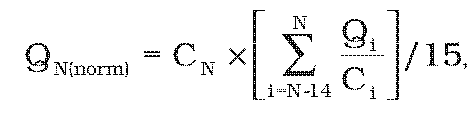
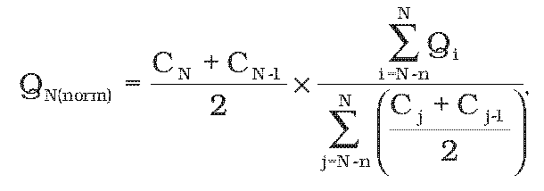

Príloha č. 1 k vyhláške č. 373/2011 Z. z.

- NORMALIZAČNÉ VZORCE NA ZAPOČÍTANIE ELEKTRINY VYRÁBANEJ Z VODNEJ A VETERNEJ ENERGIE

  - (1) Na účely započítania elektriny vyrábanej vo vodných elektrárňach sa uplatňuje vzorec

  - 

  - kde

  - N – referenčný rok,

  - QN(norm) – normalizované množstvo elektriny na účely započítania vyrobenej vo všetkých vodných elektrárňach členského štátu za rok N,

  - Qi – množstvo elektriny skutočne vyrobenej vo všetkých vodných elektrárňach členského štátu za rok i, merané v GWh, okrem výroby prostredníctvom prečerpávacích vodných elektrární z vody, ktorú predtým prečerpali do hornej nádrže,

  - Ci – celková inštalovaná kapacita všetkých vodných elektrární členského štátu na konci roku i bez prečerpania, meraná v MW.

  - (2) Na účely započítania elektriny vyrábanej z veternej energie sa uplatňuje vzorec

  - 

  - kde

  - N – referenčný rok,

  - QN(norm) – normalizované množstvo elektriny na účely započítania vyrobenej vo všetkých veterných elektrárňach členského štátu v roku N,

  - Qi – množstvo elektriny skutočne vyrobenej vo všetkých veterných elektrárňach členského štátu v roku i, merané v GWh,

  - Cj – celková inštalovaná kapacita všetkých veterných elektrární členského štátu na konci roku j, meraná v MW,

  - n – 4 alebo počet rokov, ktoré predchádzali roku N, za ktorý sú k dispozícii údaje o kapacite a výrobe pre daný členský štát, podľa toho, ktorá hodnota je nižšia.
