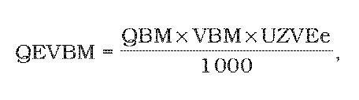

# Čl. I

Vyhláška Úradu pre reguláciu sieťových odvetví č. 490/2009 Z. z., ktorou sa ustanovujú podrobnosti o podpore obnoviteľných zdrojov energie, vysoko účinnej kombinovanej výroby a biometánu sa mení takto:

- § 5 vrátane nadpisu znie:

- 㤠5

- Množstvo elektriny vyrobenej z biometánu

- Množstvo elektriny vyrobenej z biometánu QEVBM v MWh sa vypočíta podľa vzorca

- 

- pričom

- QBM – množstvo biometánu vstupujúce do zariadenia výrobcu elektriny ako primárne palivo v m3,

- VBM – výhrevnosť biometánu v kWh/m3,

- UZVEe – elektrická účinnosť zariadenia výrobcu elektriny; harmonizovaná referenčná hodnota účinnosti pre samostatnú výrobu elektriny pri použití paliva zemný plyn je 0,525.“.
