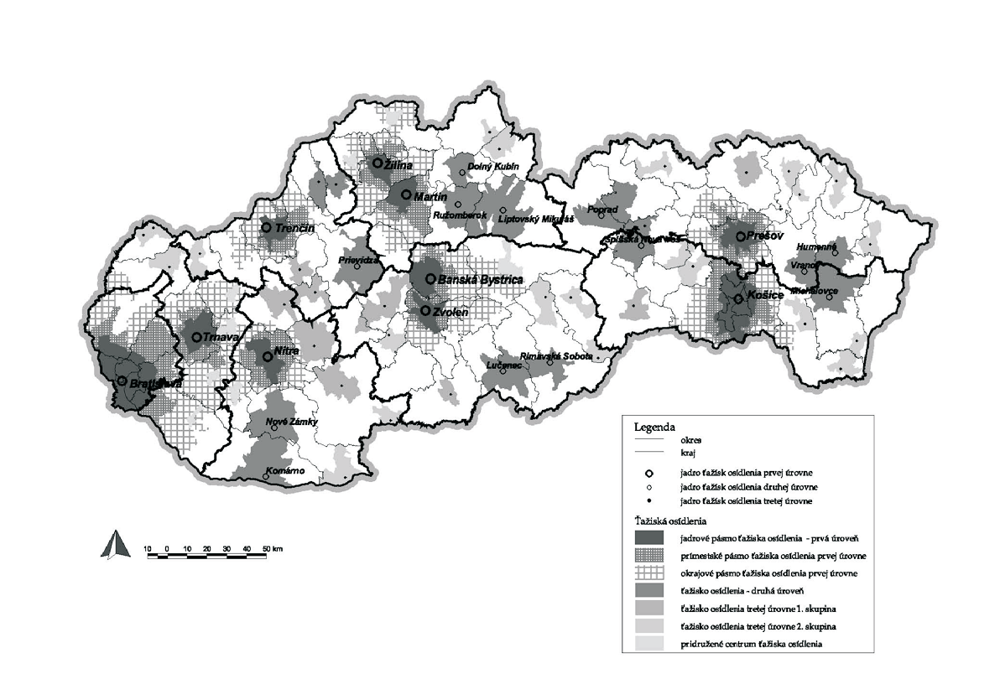
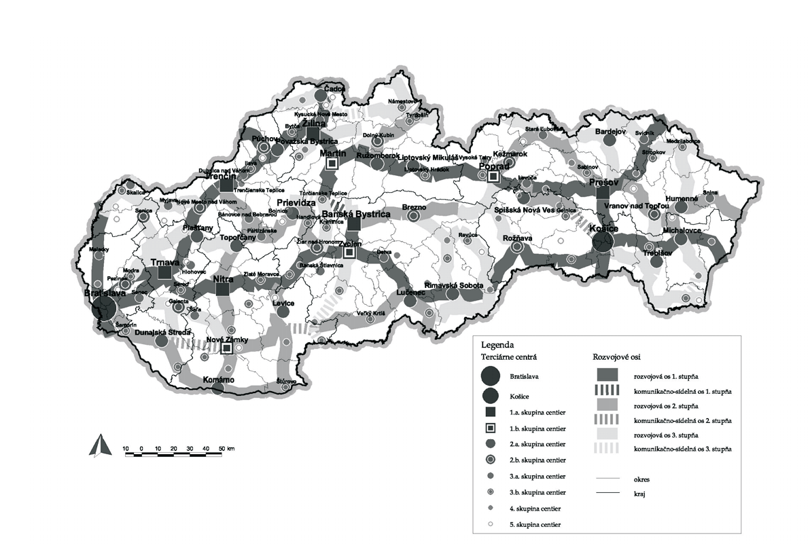
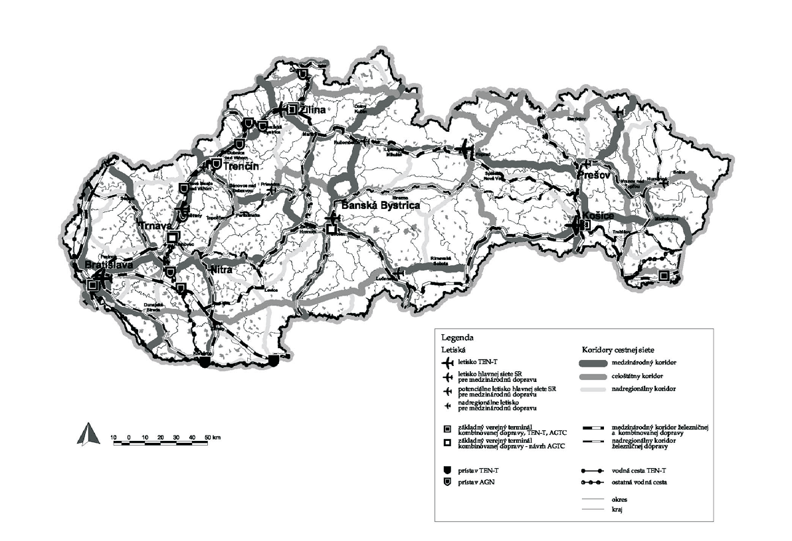

# § 1

Záväzná časť Koncepcie územného rozvoja Slovenska 2001 sa mení a dopĺňa takto:

- 1. V prílohe bod 2.2 znie:

- „2.2. Podporovať rozvoj osídlenia vo východnej časti republiky s dominantným postavením košicko-prešovskej aglomerácie s nadväznosťou na michalovsko-vranovsko-humenské ťažisko osídlenia a popradsko – spišskonovoveské ťažisko osídlenia a s previazaním na sídelnú sieť v smere južnoslovenskej rozvojovej osi.“.

- 2. V prílohe v bode 2.9. sa za slovo „Prešov“ vkladá čiarka a slová „Trenčín, Trnava“.

- 3. V prílohe v bode 2.10. sa za slovo „Martin“ vkladá čiarka a slová „Nové Zámky“, za slovo „Poprad,“ sa vkladá slovo „Zvolen“ a na konci sa vypúšťajú slová „Trenčín, Trnava“.

- 4. V prílohe v bode 2.11. sa vypúšťajú slová „Nové Zámky,“ a slovo „Zvolen“, za slovo „Prievidza“ sa vkladá čiarka a slová „Rimavská Sobota“ a na konci sa pripájajú slová „Topoľčany, Trebišov“.

- 5. V prílohe v bode 2.12. sa vypúšťajú slová „Rimavská Sobota,“, slovo „Topoľčany,“ a slovo „Trebišov“, za slovo „Brezno“ sa vkladá čiarka a slová „Dolný Kubín, Galanta“, za slovo „Kežmarok“ sa vkladá čiarka a slová „Nové Mesto nad Váhom, Pezinok“, za slovo „Rožňava“ sa vkladá čiarka a slovo „Senica“ a za slová „Vranov nad Topľou“ sa na konci pripájajú slová „Žiar nad Hronom“.

- 6. V prílohe v bode 2.13. sa vypúšťa slovo „Galanta,“, slová „Nové Mesto nad Váhom,“, slovo „Pezinok,“, slovo „Senica,“, slová „Žiar nad Hronom,“ a slová „,Dolný Kubín“, za slová „Bánovce nad Bebravou“ sa vkladá čiarka a slová „Banská Štiavnica, Detva, Dubnica nad Váhom“, za slovo „Hlohovec“ sa vkladá čiarka a slová „Kysucké Nové Mesto“, za slovo „Malacky“ sa vkladá čiarka a slovo „Myjava“ a za slovo „Partizánske“ sa vkladá čiarka a slovo „Senec“.

- 7. V prílohe v bode 2.14. sa vypúšťajú slová „Banská Štiavnica,“, slovo „Detva,“, slová „Dubnica nad Váhom, Kysucké Nové Mesto,“, slovo „Myjava,“, slovo „Senec,“, slová „Trenčianske Teplice“, za slovo „Bytča“ sa vkladá čiarka a slovo „Fiľakovo“, za slovo „Handlová“ sa vkladá čiarka a slová „Hnúšťa, Holíč“, za slovo „Ilava“ sa vkladá čiarka a slová „Kolárovo, Kráľovský Chlmec“, za slovo „Kremnica“ sa vkladá čiarka a slovo „Krupina“, za slovo „Modra“ sa vkladá čiarka a slová „Moldava nad Bodvou“, za slovo „Námestovo“ sa vkladá čiarka a slová „Nová Baňa, Rajec“, za slovo „Sabinov“ sa vkladá čiarka a slovo „Sečovce“, za slovo „Stropkov“ sa vkladá čiarka a slovo „Svit“, za slovo „Šamorín“ sa vkladá čiarka a slovo „Šahy“, za slovo „Štúrovo“ sa vkladá čiarka a slová „Šurany, Trstená“ a za slová „Veľký Krtíš“ sa vkladá čiarka a slová „Veľký Meder, Vráble“.

- 8. V prílohe v bode 2.15. sa vypúšťajú slová „Fiľakovo, Hnúšťa, Holíč,“, slová „Kolárovo, Kráľovský Chlmec,“, slovo „Krupina,“, slová „Moldava nad Bodvou, Nová Baňa,“, slovo „Rajec,“, slovo „Sečovce,“ slová „Svit, Šahy, Šurany,“, slovo „Trstená,“, slová „Veľký Meder, Vráble“, za slovo „Dudince“ sa vkladá čiarka a slovo „Giraltovce“ a za slovo „Tornaľa“ sa vkladá čiarka a slová „Trenčianske Teplice, Turzovka“.

- 9. V prílohe v bode 2.16. sa vypúšťajú slová „Čierny Balog,“, slovo „Giraltovce,“, slová „Spišské Vlachy,“ a slovo „Turzovka“, za slovo „Sliač“ sa vkladá čiarka a slovo „Smižany“ a za slová „Svätý Jur“ sa vkladá čiarka a slová „Šaštín – Stráže“.

- 10. V prílohe v bode 2.17.3 sa na konci vety spojka „a“ nahrádza čiarkou.

- 11. V prílohe sa za bod 2.20.6. sa vkladá nový bod 2.20.7., ktorý znie:

- „2.20.7. zlatomoravecké ťažisko osídlenia,“.

- Doterajší bod 2.20.7 sa označuje ako bod 2.20.8.

- 12. V prílohe sa za bod 2.21.4. sa vkladá nový bod 2.21.5., ktorý znie:

- „2.21.5. krompašské ťažisko osídlenia,“.

- Doterajšie body 2.21.5. až 2.21.18. sa označujú ako body 2.21.6. až 2.21.19.

- 13. V prílohe v bode 2.27.4. sa za slová „košicko-prešovskú rozvojovú os:“ vkladajú slová „hranica s Poľskou republikou – Svidník –“.

- 14. V prílohe v bode 2.27.6 sa slová „(návrh v úseku Banská Bystrica - Martin)“ nahrádzajú slovami „v úseku Banská Bystrica – Turčianske Teplice ako komunikačno-sídelnú os“.

- 15. V prílohe v bode 2.27.8. sa na konci vety vypúšťajú slová „(návrh vo výhľade)“.

- 16. V prílohe v bode 2. sa bod 2.27. dopĺňa bodom 2.27.10., ktorý znie:

- „2.27.10. lyskú rozvojovú os: Beluša – Púchov – Lysá pod Makytou – hranica s Českou republikou.“.

- 17. V prílohe v bode 2.28.1. sa slovo „žitnoostrovnú“ nahrádza slovami „žitnoostrovno-dunajskú“ a na konci sa za slovami „Dunajská Streda“ pripájajú slová „– Komárno – Štúrovo“.

- 18. V prílohe v bode 2.28.4. sa slovo „Tlmače“ nahrádza slovami „Hronský Beňadik“.

- 19. V prílohe v bode 2.28.5. sa pred slová „Nové Zámky“ vkladajú slová „Dunajská Streda“ a slová „(návrh vo výhľade)“ sa nahrádzajú slovami „v úsekoch Dunajská Streda – Nové Zámky, Želiezovce – Dudince ako komunikačno-sídelnú os“.

- 20. V prílohe bod 2.28.9. znie:

- „2.28.9. kežmarsko-toryskú rozvojovú os: Poprad – Kežmarok – Stará Ľubovňa – Sabinov – Prešov,“.

- 21. V prílohe sa vypúšťa bod 2.28.10.

- Doterajšie body 2.28.11. a 2.28.12. sa označujú ako body 2.28.10. a 2.28.11.

- 22. V prílohe v bode 2.28.10. sa vypúšťajú slová „s odbočkou na“.

- 23. V prílohe v bode 2. sa bod 2.28. dopĺňa bodmi 2.28.12. a 2.28.13., ktoré znejú:

- „2.28.12. hornádsku rozvojovú os: Spišský Štvrtok – Spišská Nová Ves – Krompachy – Košice (v úseku Gelnica – Košice ako komunikačno-sídelnú os),

- 2.28.13. skaliťanskú rozvojovú os: Svrčinovec – Čierne – Skalité – hranica s Poľskou republikou.“.

- 24. V prílohe body 2.29.1. až 2.29.26. znejú:

- „2.29.1. záhorsko-trnavskú rozvojovú os: hranica s Českou republikou – Holíč – Senica – Trnava,

- 2.29.2. dolnomoravskú rozvojovú os: Kúty – Holíč – Skalica – hranica s Českou republikou,

- 2.29.3. malokarpatskú rozvojovú os: Modra – Smolenice – Chtelnica – Vrbové,

- 2.29.4. piešťansko-topoľčiansku rozvojovú os: Vrbové – Piešťany – Topoľčany,

- 2.29.5. myjavskú rozvojovú os: Senica – Myjava – Stará Turá – Nové Mesto nad Váhom,

- 2.29.6. podunajskú rozvojovú os: Senec – Galanta – Nové Zámky,

- 2.29.7. dudvážsko-dunajskú rozvojovú os: Galanta – Dunajská Streda,

- 2.29.8. kremnicko-turčiansku rozvojovú os: Žiar nad Hronom – Kremnica – Turčianske Teplice,

- 2.29.9. hornonitriansko-turčiansku rozvojovú os: Prievidza – Turčianske Teplice (v úseku Nitrianske Pravno – Turčianske Teplice ako komunikačno-sídelnú os),

- 2.29.10. kysuckú rozvojovú os: Čadca – Turzovka – Makov,

- 2.29.11. kysucko-oravskú rozvojovú os: Krásno nad Kysucou – Nová Bystrica – Námestovo – Tvrdošín – Trstená – Suchá Hora – hranice s Poľskou republikou (v úseku Krásno nad Kysucou – Nová Bystrica – Oravská Lesná ako komunikačno-sídelnú os),

- 2.29.12. kraľoviansku rozvojovú os: Kraľovany – Dolný Kubín,

- 2.29.13. polhoranskú rozvojovú os: Námestovo – Oravská Polhora – hranica s Poľskou republikou,

- 2.29.14. žilinskú rozvojovú os: Žilina – Varín – Terchová,

- 2.29.15. rajeckú rozvojovú os: Žilina – Rajec,

- 2.29.16. starohorskú rozvojovú os: Banská Bystrica – Staré Hory,

- 2.29.17. šarišskú rozvojovú os: Prešov – Bardejov – hranica s Poľskou republikou,

- 2.29.18. ľubovniansko-svidnícku rozvojovú os: Stará Ľubovňa – Bardejov – Svidník,

- 2.29.19. zamagurskú rozvojovú os: Stará Ľubovňa – Spišská Stará Ves,

- 2.29.20. laboreckú rozvojovú os: Svidník – Stropkov – Medzilaborce – hranica s Poľskou republikou/Humenné,

- 2.29.21. zemplínsku rozvojovú os: Košice – Slovenské Nové Mesto – Kráľovský Chlmec – Čierna nad Tisou,

- 2.29.22. vranovsko-trebišovskú rozvojovú os: Vranov nad Topľou – Sečovce – Trebišov – Slovenské Nové Mesto – hranica s Maďarskou republikou,

- 2.29.23. horehronskú rozvojovú os: Heľpa – Vernár – Poprad,

- 2.29.24. rožňavsko-dobšinskú rozvojovú os: Rožňava – Dobšiná – Vernár,

- 2.29.25. muráňsku rozvojovú os: hranica s Maďarskou republikou – Tornaľa – Revúca – Tisovec,

- 2.29.26. rimavickú rozvojovú os: Rimavská Sobota – Hnúšťa – Tisovec – Brezno,“.

- 25. V prílohe v bode 2. sa bod 2.29. dopĺňa bodmi 2.29.27. až 2.29.29., ktoré znejú:

- „2.29.27. cerovskú rozvojovú os: Fiľakovo – Rimavská Sobota/Rimavská Seč – hranica s Maďarskou republikou/Tornaľa,

- 2.29.28. krupinskú rozvojovú os: Zvolen – Krupina – Šahy – hranica s Maďarskou republikou (v úseku Krupina – Šahy – hranica s Maďarskou republikou ako komunikačno-sídelnú os),

- 2.29.29. juholaboreckú rozvojovú os: Michalovce – Veľké Kapušany – Kráľovský Chlmec (v úseku Veľké Kapušany – Kráľovský Chlmec ako komunikačno-sídelnú os).“.

- 26. V prílohe v bode 3.1. sa pred slová „kultúrno-historických“ vkladá slovo „prírodných,“ a na konci vety sa bodka nahrádza čiarkou a pripájajú sa slová „pričom pri ich rozvoji zohľadniť koordinovaný proces prepojenia sektorových strategických a rozvojových dokumentov.“.

- 27. V prílohe v bode 3.3. sa za slová „zohľadňovať ich“ vkladajú slová „ekonomické danosti,“.

- 28. V prílohe bod 4.2.2. znie:

- „4.2.2. pamiatkový fond, ktorý tvoria pamiatkové rezervácie, pamiatkové zóny a národné kultúrne pamiatky, ako aj ochranné pásma všetkých kategórií pamiatkového fondu,“.

- 29. V prílohe bod 4.2.4. znie:

- „4.2.4. známe a predpokladané archeologické náleziská a archeologické nálezy,“.

- 30. V prílohe sa vypúšťa bod 4.2.5.

- Doterajšie body 4.2.6. až 4.2.9. sa označujú ako 4.2.5. až 4.2.8.

- 31. V prílohe v bode 4.2.5. sa vypúšťajú slová „ako aj časti rozptýleného osídlenia,“.

- 32. V prílohe v bode 4. sa bod 4.2. dopĺňa bodom 4.2.9., ktorý znie:

- „4.2.9. historické krajinné štruktúry vrátane území s rozptýleným osídlením.“.

- 33. V prílohe v bode 4.3. sa pred slová „kultúrne pamiatky“ vkladá slovo „národné“, vypúšťajú sa slová „ako aj“, za slovo „rezervácie“ sa vkladá čiarka a na konci vety sa bodka nahrádza čiarkou a pripájajú tieto slová: „ako aj objekty vedené v evidenciách pamätihodností miest a obcí.“.

- 34. V prílohe v bode 5. sa v nadpise za slová „prírodných zdrojov“ vkladá čiarka a slová „nerastného bohatstva a starostlivosti o krajinu“.

- 35. V prílohe v bode 5.2. druhá veta znie: „V chránených územiach (európska sústava chránených území NATURA 2000 vrátane navrhovaných, národná sústava chránených území, chránené územia vyhlásené v zmysle medzinárodných dohovorov), v prvkoch prírodného dedičstva UNESCO, v NECONET, v biotopoch európskeho významu, národného významu a v biotopoch druhov európskeho a národného významu zosúladiť využívanie územia s funkciou ochrany prírody a krajiny s cieľom udržania resp. dosiahnutia priaznivého stavu druhov, biotopov a častí krajiny.“.

- 36. V prílohe bod 5.3. znie:

- „5.3. Rešpektovať pri umiestňovaní činností do územia hodnotovo-významové vlastnosti krajiny integrujúce v sebe prírodné a kultúrne dedičstvo, nerastné bohatstvo, vrátane energetických surovín, zohľadňovať ich predpokladané vplyvy na životné prostredie, na charakteristický vzhľad krajiny a realizáciou vhodných opatrení dosiahnuť odstránenie, obmedzenie alebo zmiernenie prípadných negatívnych vplyvov, ako aj elimináciu nežiaducich zmien v charakteristickom vzhľade krajiny.“.

- 37. V prílohe bod 5.9 znie:

- „5.9. Rešpektovať kvalitnú poľnohospodársku pôdu ako základný pilier potravinovej bezpečnosti štátu. Zabezpečiť ochranu najkvalitnejších a najprodukčnejších poľnohospodárskych pôd pred ich zástavbou už v rámci územnoplánovacej činnosti. Zabezpečovať ochranu pôdnych zdrojov vhodným a racionálnym využívaním poľnohospodárskej a lesnej krajiny a to aj s dôrazom na zamedzovanie erózie pôdy.“.

- 38. V prílohe bod 5.11. znie:

- „5.11. Zabezpečiť ochranu a racionálne využívanie prírodných zdrojov, nerastného bohatstva vrátane energetických surovín a obnoviteľných zdrojov energie, eliminovať nadmerné čerpanie neobnoviteľných zdrojov, regulovať využívanie obnoviteľných zdrojov v súlade s mierou ich samoreprodukcie a revitalizovať narušené prírodné zdroje, najmä tie, ktoré sú poškodené alebo zničené následkom klimatických zmien, živelných pohrôm a prírodných katastrof.“.

- 39. V prílohe sa bod 5. dopĺňa bodmi 5.12. a 5.13., ktoré znejú:

- „5.12. Riešiť ochranu nerastného bohatstva a jeho racionálneho využívanie v súlade s organizáciou priestorového usporiadania a funkčného využívania a s požiadavkami na ochranu prírody a krajiny.

- 5.13. Zabezpečovať trvalo ochranu krajiny v zmysle Európskeho dohovoru o krajine smerujúcu k zachovaniu a udržaniu významných alebo charakteristických čŕt krajiny vyplývajúcich z jej historického dedičstva a prírodného usporiadania, alebo ľudskej aktivity.“.

- 40. V prílohe v bode 6.1. sa na konci pripájajú tieto slová: „v súlade s platnými strategickými a programovými dokumentmi v oblasti regionálneho rozvoja“.

- 41. V prílohe v bode 6.2. sa pred slovo „územia“ vkladajú slová „a modernizáciou“ a slová „výkonnou komunikačnou a technickou“ sa nahrádzajú slovom „verejnou“.

- 42. V prílohe v bode 6.4. sa na konci pripájajú slová: „a zvyšovať vzdelanostnú úroveň a mobilitu pracovnej sily v regiónoch“.

- 43. V prílohe bod 6.6. znie:

- „6.6. Zvyšovať kvalitu riadenia a koordinácie nástrojov regionálnej a územnoplánovacej politiky.“.

- 44. V prílohe sa bod 6. dopĺňa bodom 6.7., ktorý znie:

- „6.7. Zvyšovať konkurencieschopnosť a ekonomickú výkonnosť regiónov rozvíjaním inovačného potenciálu regiónov a efektívnejším využívaním existujúcich výrobných zdrojov.“.

45. V prílohe v bode 7.1. sa na konci pripája táto veta: „V územnom rozvoji rešpektovať zachovalé a prevádzkyschopné závlahové sústavy a odvodňovacie kanálové siete a čerpacie stanice.“.

46. V prílohe v bode 7.4. sa pred slovo „lesnou“ vkladajú slová „poľnohospodárskou a“ a slová „lesného hospodárstva“ sa nahrádzajú slovami „hospodárenia na pôde“.

47. V prílohe sa bod 7. dopĺňa bodmi 7.6. a 7.7., ktoré znejú:

„7.6. Rešpektovať lesné pozemky a ich ochranné pásmo ako limitujúci prvok pri územnom rozvoji krajiny.

7.7. Zabezpečiť pri reštrukturalizácii krajiny vrátane projektov pozemkových úprav podmienky pre uplatňovanie zásad tvorby krajiny s rešpektovaním špecifických foriem osídlenia a historických krajinných štruktúr v typickom charaktere poľnohospodárskej krajiny.“.

- 48. V prílohe v bode 9.1. sa za slová „medzinárodného záujmu“ vkladajú slová „a ktoré z hľadiska potenciálu patria medzi ťažiskové formy na Slovensku“ a slová „(kúpeľný, poznávací kultúrny, horský letný a zimný, tranzitný turizmus a poľovníctvo)“ sa nahrádzajú slovami „vidiecky cestovný ruch a agroturistika, mestský a kultúrno-poznávací cestovný ruch, zimný cestovný ruch a zimné športy, kúpeľný a zdravotný cestovný ruch, letná turistika a pobyty pri vode“.

- 49. V prílohe bod 9.7. znie:

- „9.7. Podporovať rozvoj kúpeľných miest so zriadenými prírodnými liečebnými kúpeľmi alebo kúpeľnými liečebňami, za súčasného rešpektovania tvorby kúpeľného prostredia a ochrany kúpeľných území kúpeľných miest.“.

- 50. V prílohe bod 9.9. znie:

- „9.9. Na podporu rozvojových smerov turizmu využívať železničnú a cestnú dopravu, rozvoj a prepájanie cyklotrás, ako aj budovanie príslušnej technickej infraštruktúry.“.

- 51. V prílohe bod 9.10. znie:

- „9.10. Zabezpečovať na územiach európskej sústavy chránených území a územiach národnej sústavy chránených území funkcie spojené s rozvojom turizmu a rekreácie tak, aby nedochádzalo k zhoršeniu stavu ochrany týchto území a predmetu ich ochrany.“.

- 52. V prílohe v bode 10.2.1. sa slová „Rozvíjať zariadenia liečebnej starostlivosti“ nahrádzajú slovami „Rozvíjať zdravotnícke zariadenia“.

- 53. V prílohe bod 10.2.3. znie:

- „10.2.3. Rozšíriť kapacitu liečební, hospicov a domov ošetrovateľskej starostlivosti v súlade s potrebami obyvateľstva v regiónoch.“.

- 54. V prílohe bod 10.3 znie:

- „10.3. Sociálne veci“.

- 55. V prílohe bod 10.3.1. znie:

- „10.3.1. Podporovať rozvoj a dostupnosť sociálnych služieb poskytovaných v zariadeniach sociálnych služieb v súlade s národnými prioritami rozvoja sociálnych služieb a potrebami obyvateľov v území a opatrení sociálnoprávnej ochrany detí a sociálnej kurately vykonávaných v zariadeniach sociálnoprávnej ochrany detí a sociálnej kurately.“.

- 56. V prílohe bod 10.3.2. znie:

- „10.3.2. Vytvoriť podmienky pre postupné transformovanie veľkokapacitných zariadení sociálnych služieb na komunitne orientované formy sociálnych služieb, spojené s modernizáciou a zvyšovaním kvality poskytovaných služieb a ich efektívnym zabezpečovaním a vytvoriť podmienky na pokračovanie procesu transformácie a humanizácie zariadení sociálnoprávnej ochrany detí a sociálnej kurately.“.

- 57. V prílohe bod 11. znie:

- „11. V oblasti rozvoja nadradeného dopravného vybavenia

- 11.1. Stabilizovať základné zónovanie Slovenskej republiky v priestoroch

- 11.1.1. Bratislava,

- 11.1.2. juhozápadné Slovensko a dopravno-gravitačné centrum Nitra/Trnava,

- 11.1.3. severozápadné Slovensko a dopravno-gravitačné centrum Žilina/Martin,

- 11.1.4. stredné Slovensko a dopravno-gravitačné centrum Zvolen/Banská Bystrica,

- 11.1.5. východné Slovensko a dopravno-gravitačné centrum Košice/Prešov.

- 11.2. Rešpektovať nadradené postavenie paneurópskych multimodálnych koridorov Medzinárodného dopravného fóra (ďalej len ITF), ktorá je nástupníckou organizáciou Európskej konfederácie ministrov dopravy (CEMT) a dopravných sietí TEN-T. V ich rámci rešpektovať prioritnú pozíciu projektov európskeho záujmu:

- 11.2.1. železničnej infraštruktúry osi (Paríž – Štrasburg – Štuttgard – Viedeň) Bratislava, na území Slovenska alokovanej a plánovanej v rámci paneurópskeho multimodálneho koridoru č. V. vetva Va,

- 11.2.2. infraštruktúry vnútrozemskej vodnej cesty Rýn – Mohan – Dunaj, na území Slovenska alokovanej a plánovanej v rámci paneurópskeho multimodálneho koridoru č. VII.,

- 11.2.3. železničnej infraštruktúry osi (Gdansk – Varšava – Katovice) – Brno/Žilina – Bratislava – (Viedeň), na území Slovenska alokovanej a plánovanej v rámci paneurópskych multimodálnych koridorov č. V. vetva Va a VI,

- 11.2.4. cestnej infraštruktúry osi (Gdansk – Varšava – Katovice) – Brno/Žilina – Bratislava – (Viedeň), na území Slovenska alokovanej a plánovanej v rámci paneurópskych multimodálnych koridorov č. V. vetva Va a VI.

- 11.3. Rešpektovať dopravné siete a zariadenia TEN-T a európskych dohôd alokované a plánované v trasách paneurópskych multimodálnych koridorov ITF:

- 11.3.1. multimodálny koridor č. IV. (Berlín/Norimberg – Praha) – Kúty – Bratislava/Rusovce – (Budapešť – Rumunsko/Turecko/Grécko) lokalizovaný pre cesty siete TEN-T, (Berlín/Norimberg – Praha) – Kúty – Bratislava – Nové Zámky – Štúrovo – (Budapešť – Rumunsko/Turecko/Grécko) lokalizovaný pre konvenčné trate železničnej a kombinovanej dopravy siete TEN-T,

- 11.3.2. multimodálny koridor č. V. vetva Va. (Rakúsko) – Bratislava/Jarovce – Žilina – Košice – Záhor/Čierna nad Tisou – (Užhorod – Ľvov) lokalizovaný pre cesty, pre konvenčné trate železničnej a kombinovanej dopravy a pre vysokorýchlostnú železničnú trať Bratislava – Žilina,

- 11.3.3. multimodálny koridor č. VI. (Gdansk – Varšava – Katovice) – Skalité – Čadca – Žilina/Hričovské Podhradie/Dubná Skala lokalizovaný pre cesty, pre konvenčné trate železničnej a kombinovanej dopravy sieti TEN-T a pre vysokorýchlostnú železničnú trať Skalité – Žilina,

- 11.3.4. multimodálny koridor č. VII. vodná cesta Dunaj s verejnými prístavmi v Bratislave, Komárne a Štúrove,

- 11.3.5. hlavné železničné uzlové body a základné verejné terminály kombinovanej dopravy sieti TEN-T v Bratislave (multimodálne koridory č. IV. a V. – vetva Va), Žiline (multimodálne koridory č. V. – vetva Va, VI.), Košiciach a Dobrej – ako náhrada za pôvodný terminál v Čiernej nad Tisou (multimodálny koridor č. V. – vetva Va),

- 11.3.6. letiská siete TEN-T pre medzinárodnú dopravu v Bratislave (multimodálne koridory č. IV. a V. vetva Va), Košiciach a Poprade (multimodálny koridor č. V. vetva Va).

- 11.4. Rešpektovať dopravnú infraštruktúru alokovanú a plánovanú v trasách mimokoridorových ITF sieti konvenčnej železničnej a kombinovanej dopravy TEN-T

- 11.4.1. (Krakov) – Plaveč – Prešov – Košice – Kechnec (Miškovec – Rumunsko), v úseku Košice – Kechnec – (Miškovec),

- 11.4.2. Leopoldov – Galanta,

- 11.4.3. Nové Zámky – Komárno – (Komárom),

- 11.4.4. Púchov – Strelenka – (Olomouc),

- 11.4.5. Čadca – Svrčinovec – (Ostrava),

- 11.4.6. Nové Zámky/Palárikovo – Levice – Zvolen – Lučenec – Košice s hlavným železničným uzlovým bodom vo Zvolene.

- 11.5. Rešpektovať dopravnú infraštruktúru alokovanú a schválenú v trasách mimokoridorovej ITF cestnej siete TEN-T

- 11.5.1. Martin – Turčianske Teplice – Šášovské Podhradie – Zvolen – Šahy – (Budapešť),

- 11.5.2. (Rzeszov) – Svidník – Prešov – Košice – Milhosť – (Miškovec – Rumunsko) (zároveň ako súčasť výhľadovej Via Carpatia Kaunas – Lublin – Rzesov – Svidník – Prešov – Košice – Miškovec – Rumunsko – Ukrajina/Odesa).

- 11.6. Rešpektovať dopravné siete a zariadenia TEN-T alokované a plánované v trasách pripravovaných multimodálnych koridorov a ich vetiev

- 11.6.1. prioritná os západ – východ (Norimberg/Drážďany – Praha – Olomouc) – Lysá pod Makytou – Púchov – Žilina – Košice – Záhor/Čierna nad Tisou – (Užhorod – Ľvov) lokalizovaná pre cesty a konvenčné železničné trate sieti TEN-T,

- 11.6.2. prepojenie vetiev multimodálneho koridoru č. VI. a VI. vetva VI.b Čadca – Svrčinovec – (Ostrava), lokalizované pre cesty a konvenčné železničné trate sieti TEN-T,

- 11.6.3. prepojenie vetiev multimodálneho koridoru č. V. vetva V.a Košice – Milhosť/Kechnec – (Miškovec), lokalizované pre cesty a konvenčné železničné trate sieti TEN-T.

- 11.7. Rešpektovať dopravnú infraštruktúru zaradenú podľa európskych dohôd (AGR) koridory ciest

- 11.7.1. E 50 (Brest – Paríž – Norimberg – Praha – Brno) – Drietoma – Trenčín – Žilina – Prešov – Košice – Vyšné Nemecké – (Užhorod – Dnepropetrovsk – Machačkala),

- 11.7.2. E 65 (Malmö – Štetín – Praha – Brno – Břeclav) – Bratislava – (Rajka – Záhreb – Split – Tripoli – Chania),

- 11.7.3. E 75 (Vardo – Helsinki – Gdansk – Katovice – Český Těšín) – Žilina – Bratislava – (Győr – Budapešť – Belehrad – Skopje – Solún – Atény – Sitia),

- 11.7.4. E 58 (Viedeň) – Bratislava – Zvolen – Košice – Vyšné Nemecké – (Užhorod – Kišinev – Odesa – Cherson – Rostov na Done),

- 11.7.5. E 71 Košice – Milhosť – (Miškovec – Budapešť – Záhreb – Split),

- 11.7.6. E 77 (Pskov – Riga – Gdansk – Varšava – Krakov) – Trstená – Ružomberok – Banská Bystrica – Zvolen – Šahy – (Budapešť),

- 11.7.7. E 371 (Radom – Rzeszov – Barvinek) – Vyšný Komárnik – Svidník – Prešov,

- 11.7.8. E 442 (Karlove Vary – Teplice – Hradec Králové – Olomouc) – Makov – Bytča – Žilina,

- 11.7.9. E 571 Bratislava – Zvolen – Košice,

- 11.7.10. E 572 Trenčín – Žiar nad Hronom,

- 11.7.11. E 575 Bratislava – Dunajská Streda – Medveďov – (Vámosszabadi – Győr).

- 11.8. Rešpektovať dopravnú infraštruktúru navrhovanú ako upravená existujúca alebo výhľadová súčasť medzinárodných cestných sietí

- 11.8.1. (Hodonín) – Holíč – Senica – Trnava,

- 11.8.2. (Kittsee) – Bratislava/(Jarovce) – Rovinka – Ivanka pri Dunaji sever – Bratislava/Rača – Marianka – Stupava juh – (Marchegg),

- 11.8.3. Lučenec – Šiatorská Bukovinka – (Salgótarján – Hatvan E71),

- 11.8.4. Lipníky – Vranov nad Topľou – Humenné – Michalovce,

- 11.8.5. Lysá pod Makytou – Púchov – Beluša,

- 11.9.6. Nitra – Nové Zámky – Komárno.

- 11.9. Rešpektovať dopravnú infraštruktúru zaradenú podľa európskych dohôd (AGC, AGTC) koridory konvenčných tratí a zariadenia železničnej a kombinovanej dopravy

- 11.9.1. trate E 40, C – E 40 (Le Havre – Paríž – Norimberg – Praha – Hranice na Morave – Ostrava) – Čadca – Žilina – Košice – Čierna nad Tisou – (Čop), (Hranice na Morave) – Lúky pod Makytou – Púchov,

- 11.9.2. trate E 52, C – E 52 (Viedeň – Marchegg) – Bratislava – Galanta – Nové Zámky – Štúrovo – (Szob – Budapešť – Nyíregyháza),

- 11.9.3. trate E 61, C – E 61 (Štokholm – Berlín – Praha – Lanžhot) – Kúty – Bratislava/Rusovce – (Hegyeshalom), Bratislava – Nové Zámky – Komárno – (Komárom – Budapešť),

- 11.9.4. trať E 63 (Viedeň – Kittsee) – Bratislava – Leopoldov – Žilina, Galanta – Leopoldov, C – E 63 (Viedeň – Kittsee) – Bratislava – Leopoldov – Žilina – Čadca – Skalité – (Czechowice-Dzedzice), Galanta – Leopoldov,

- 11.9.5. trať C 30/1 (Krakov – Muszyna) – Plaveč – Prešov – Košice – Kechnec – (Hidasnémeti – Miškovec),

- 11.9.6. základné verejné terminály kombinovanej dopravy medzinárodného významu v Bratislave, Žiline, Košiciach a Dobrej (ako náhrada za terminál v Čiernej nad Tisou, terminál typu Hub v Leopoldove,

- 11.9.7. hraničné železničné stanice s významom pre medzinárodnú kombinovanú dopravu Čadca, Lúky pod Makytou, Kúty, Čierna nad Tisou, Komárno, Štúrovo.

- 11.10 Rešpektovať dopravnú infraštruktúru navrhnutú na zaradenie do európskych dohôd (AGC, AGTC) koridory tratí a zariadenia železničnej a kombinovanej dopravy

- 11.10.1. trať Bratislava/Nové Mesto – Letisko M. R. Štefánika,

- 11.10.2. trať Letisko M. R. Štefánika – Bratislava/Ústredná nákladná stanica (ÚNS),

- 11.10.3. trať Bratislava/Predmestie – Bratislava/Filiálka – Bratislava/Petržalka,

- 11.10.4. trať Bratislava/Filiálka – Bratislava/Nové Mesto,

- 11.10.5. trať Letisko M. R. Štefánika – Bernolákovo, výhľad,

- 11.10.6. trať Letisko M. R. Štefánika – Bratislava/Vajnory, výhľad,

- 11.10.7. trať kombinovanej dopravy Palárikovo/Nové Zámky – Zvolen – Košice,

- 11.10.8. základné verejné terminály kombinovanej dopravy v Leopoldove a Zvolene – Budči.

- 11.11. Rešpektovať dopravnú infraštruktúru zaradenú podľa kritérií medzinárodných leteckých organizácií – letiská hlavnej siete pre medzinárodnú dopravu (zoradené podľa abecedy)

- 11.11.1. Bratislava/Letisko M. R. Štefánika,

- 11.11.2. Košice,

- 11.11.3. Piešťany,

- 11.11.4. Poprad,

- 11.11.5. Sliač,

- 11.11.6. Žilina.

- 11.12. Rešpektovať dopravnú infraštruktúru plánovanú podľa kritérií medzinárodných leteckých organizácií – potenciálne letiská hlavnej siete pre medzinárodnú dopravu

- 11.12.1. Lučenec,

- 11.12.2. Svidník.

- 11.13. Rešpektovať dopravnú infraštruktúru zaradenú podľa európskych dohôd AGN Európska dohoda o hlavných vnútrozemských vodných cestách medzinárodného významu, existujúce aj plánované a Protokolu k Dohode AGTC o kombinovanej doprave po vnútrozemských vodných cestách k európskej dohode o najdôležitejších trasách medzinárodnej kombinovanej doprave a súvisiaci objektoch z roku 1991

- 11.13.1. E 80, C – E 80 rieka Dunaj s verejnými prístavmi a terminálmi kombinovanej dopravy v prístavoch P 80 – 38, C – P 80 – 38 Bratislava, P 80 – 40, C – P 80 – 40 Komárno, P 80 – 41, C – P 80 – 41 Štúrovo,

- 11.13.2. E 81, C – E 81 koridor rieky Váh od ústia do Dunaja po Žilinu a koridor spojenia riek E 81 Váh – E 30 Odra s verejnými prístavmi v prístavoch P 81 – 01 Komárno, P 81 – 04 Hlohovec, P 81 – 05 Piešťany, P 81 – 06 Nové Mesto nad Váhom, P 81 – 07 Trenčín, P 81 – 08 Dubnica nad Váhom, P 81 – 09 Púchov, P 81 – 10 Považská Bystrica, P 81 – 11 Žilina a P 81 – 12 Čadca a terminálmi kombinovanej dopravy v prístavoch P81 – 03, C81 – 01 Sereď, P81 – 02, C81 – 02 Šaľa,

- 11.13.3. E 20, E 30, C – 20, C – E 30 koridor rieky Morava na území Slovenska, ako súčasť prepojenia vodných ciest Dunaj – Odra – Labe.

- 11.14. Rešpektovať hlavnú dopravnú infraštruktúru pre medzinárodnú turistickú dopravu – vodné cesty

- 11.14.1 Baťov kanál v úseku (Prístav Sudoměřice) – Prístav Skalica – rieka Morava – (Prístav Rohatec).

- 11.15. Rešpektovať dopravnú infraštruktúru celoštátnej úrovne – koridory ciest

- 11.15.1. Bratislava – Dunajská Streda – Nové Zámky – Veľký Krtíš – Lučenec (s existujúcimi a plánovanými komunikáciami),

- 11.15.2. Veľký Meder – Komárno,

- 11.15.3. Nitra – Topoľčany – Partizánske – Prievidza – Nitrianske Pravno – Turčianske Teplice, s vetvami Topoľčany – Chynorany – Bánovce nad Bebravou, Nitra – Hlohovec – Leopoldov,

- 11.15.4. (Vsetín) – Makov – Čadca – Krásno nad Kysucou – Nová Bystrica – Oravská Lesná – Námestovo – Trstená – Suchá Hora – (Chocholov) Poľská republika s pokračovaním (Stromovce Vyžne) – Spišská Stará Ves – Stará Ľubovňa – Ľubotín – Tarnov – Bardejov – Svidník,

- 11.15.5. Turčianske Teplice – Banská Bystrica – Brezno – Vernár,

- 11.15.6. Poprad – Spišská Belá – Stará Ľubovňa – Mníšek nad Popradom – (Piwniczna),

- 11.15.7. Ľubotín – Sabinov – Prešov,

- 11.15.8. Humenné – Snina – Ubľa – (Malyj Bereznyj),

- 11.15.9. Stropkov – Vranov nad Topľou – Trebišov – Slovenské Nové Mesto – Sátoraljaújhely/Kráľovský Chlmec – Čierna nad Tisou – (Solomonovo),

- 11.15.10. Ivanka pri Dunaji juh – Senec – Sládkovičovo – Sereď,

- 11.15.11. (Poľská republika) – Podspády/Javorina – Spišská Belá – Kežmarok – Poprad – Vernár – Rožňava,

- 11.15.12. Tornaľa – Kráľ – (Maďarská republika).

- 11.16. Rešpektovať dopravnú infraštruktúru nadregionálnej úrovne – koridory konvenčných železničných tratí

- 11.16.1. Bratislava – Dunajská Streda – Komárno,

- 11.16.2. (Strážnice/Hodonín) – Skalica/Holíč nad Moravou – Kúty – Jablonica – Trnava – Sereď,

- 11.16.3. Šurany – Nitra – Prievidza – Horná Štubňa,

- 11.16.4. Kozárovce – Lužianky – Zbehy – Leopoldov,

- 11.16.5. Chynorany – Trenčín,

- 11.16.6. širokorozchodná trať Maťovce – Košice,

- 11.16.7. Bánovce nad Ondavou – Maťovce,

- 11.16.8. Vrútky – Horná Štubňa – Hronská Dúbrava,

- 11.16.9. Zvolen - Šahy,

- 11.16.10. Fiľakovo – Fiľakovo št. hranica,

- 11.16.11. Zvolen – Banská Bystrica – Margecany,

- 11.16.12. Michaľany/Výhybňa Červený Dvor – Trebišov – Strážske – Humenné – Medzilaborce – (Lupków),

- 11.16.13. Prešov – Vranov nad Topľou – Strážske.

- 11.17. Rešpektovať dopravnú infraštruktúru nadregionálnej úrovne – koridory ciest

- 11.17.1. (Hohenau an der March) – Moravský Svätý Ján – Šaštín-Stráže– Senica – Nové Mesto nad Váhom,

- 11.17.2. (Angern an der March) – Záhorská Ves – Malacky – Šaštín-Stráže/Malacky – Pezinok – Senec – Šamorín,

- 11.17.3. Sládkovičovo – Galanta – Šaľa – Nové Zámky – Štúrovo,

- 11.17.4. Šoporňa – Šaľa,

- 11.17.5. Galanta – Dunajská Streda,

- 11.17.6. Komárno – Štúrovo,

- 11.17.7. Hronský Beňadik – Kalná nad Hronom – Štúrovo,

- 11.17.8. Nitra – Vráble – Kalná nad Hronom – Levice,

- 11.17.9. Žilina – Rajec – Nitrianske Pravno,

- 11.17.10. Kúty – Holíč – Skalica – (Sudoměřice),

- 11.17.11. (Ujsoly) – Novoť – Zákamenné,

- 11.17.12. (Korbielow) – Oravská Polhora – Námestovo,

- 11.17.13. Veľký Krtíš – Slovenské Ďarmoty – (Balassagyarmat),

- 11.17.14. Liptovský Hrádok – Brezno – Tisovec – Rimavská Sobota,

- 11.17.15. Červená Skala – Tisovec,

- 11.17.16. Spišský Štvrtok – Spišská Nová Ves – Košice – Slanec – Zemplínske Jastrabie – Veľké Kapušany,

- 11.17.17. Stropkov – Medzilaborce – (Lupków),

- 11.17.18. Humenné – Medzilaborce,

- 11.17.19. (Konieczna) – Becherov – Zborov – Bardejov – Kapušany,

- 11.17.20. Nové Mesto nad Váhom – Moravské Lieskové – (Strání – Brno),

- 11.17.21. (Bardejov) – Tarnov – Kurov – (Muszynka),

- 11.17.22. Bratislava – Pezinok – Trnava,

- 11.17.23. Levice – Bátovce – Banská Štiavnica – Hronská Breznica – koridor AGR (R1).

- 11.18. Rešpektovať dopravnú infraštruktúru nadregionálnej úrovne – existujúce a potenciálne letiská pre medzinárodnú dopravu v Nitre, Prievidzi, Trenčíne, Ružomberku, Kamenici nad Cirochou a Prešove.

- 11.19. Rešpektovať infraštruktúru vodnej dopravy nadregionálnej úrovne – koridor vodnej cesty Bodrog/Tisa v úseku Ladmovce – hranica Maďarskej republiky.

- 11.20. Proporcionálne podporovať doplnkové postavenie dopravnej infraštruktúry medzinárodného, celoštátneho a nadregionálneho významu, ktorá, spolu s paneurópskymi multimodálnymi koridormi ITF a sieťami TEN-T, vytvára nadradenú dopravnú sústavu Slovenskej republiky.“.

- 58. V prílohe v bode 12.1.6. sa na konci pripájajú slová „a vodohospodárskych diel v súlade s racionálnym využívaním vodohospodárskeho potenciálu“.

- 59. V prílohe v bode 12. sa bod 12.1. dopĺňa bodmi 12.1.11. a 12.1.12, ktoré znejú:

- „12.1.11. Prioritne podporovať výstavbu kanalizácií s čistiarňami odpadových vôd v obciach ležiacich v ochranných pásmach prírodných liečivých zdrojov a prírodných minerálnych zdrojov.

- 12.1.12. Vodné hospodárstvo zamerať na zadržanie vody v povodiach. S týmto cieľom zabezpečiť obnovu povodí tak, aby plnili funkciu zadržiavania a postupného prepúšťania vody, zvlášť pri mimoriadnych situáciách.“.

- 60. V prílohe bod 12.2.1. znie:

- „12.2.1. Zabezpečiť územné podmienky pre výstavbu nových zariadení na výrobu elektrickej energie a tepla a s tým súvisiacich stavieb, vrátane zabezpečenia územnej prípravy, výstavbu a dobudovanie vnútroštátnych elektrických vedení a zariadení slúžiacich na prenos elektrickej energie, výstavbu ďalších medzinárodných prepojení v súvislosti s liberalizáciou energetiky a s otvorením trhov s elektrickou energiou v súlade so Stratégiou energetickej bezpečnosti SR.“.

- 61. V prílohe v bode 12. sa za bod 12.2.1. vkladá nový bod 12.2.2., ktorý znie:

- „12.2.2. Pre rozvojové zámery zabezpečenia vnútroštátnych a medzinárodných elektrických sietí a zariadení rešpektovať existujúce koridory vedení 220kV a 400kV a územnú rezervu pre navrhované siete v existujúcich, či novo navrhovaných koridoroch

- 12.2.2.1. koridor pre nové medzištátne 2x400 kV vedenie ZVN v profile Stupava – štátna hranica Rakúsko,

- 12.2.2.2. koridor pre ďalšie uvažované medzištátne 2x400 kV vedenie ZVN v profile Podunajské Biskupice – Petržalka III. – štátna hranica Rakúsko,

- 12.2.2.3. koridor pre nové 2x400 kV vedenie ZVN v trase Podunajské Biskupice – Gabčíkovo,

- 12.2.2.4. koridor pre nové 2x400 kV vedenie ZVN v trase Gabčíkovo – štátna hranica Maďarsko,

- 12.2.2.5. koridor pre nové 2x400 kV vedenie ZVN v profile Gabčíkovo – Veľký Ďur,

- 12.2.2.6. koridor pre slovensko-maďarského prepojenia vedeniami 2x400 kV Rimavská Sobota – Sajóivánka a 2x400 kV Moldava – Felsözsolca (Veľké Kapušany – štátna hranica MR),

- 12.2.2.7. koridor pre nové 2x400 kV vedenie ZVN v trase Križovany – Podunajské Biskupice, súbežne s jestvujúcim 400 kV vedením V439,

- 12.2.2.8. koridor pre nové 2x400 kV vedenie ZVN v profile Bystričany – Horná Ždaňa,

- 12.2.2.9. koridor jestvujúceho vedenia VVN 220 kV V274 Križovany – Bystričany pre výstavbu nového 2x400 kV vedenia ZVN,

- 12.2.2.10. koridor jestvujúceho vedenia VVN 220 kV V275 Bystričany – Považská Bystrica pre výstavbu nového 2x400 kV vedenia ZVN,

- 12.2.2.11. koridor jestvujúceho vedenia VVN 220 kV V270 Považská Bystrica – štátna hranica SR/ČR pre výstavbu nového 2x400 kV vedenia ZVN,

- 12.2.2.12. koridor pre nové medzištátne 2x400 kV vedenie ZVN v profile Varín – štátna hranica s Poľskou republikou (Byczyna),

- 12.2.2.13. koridor pre zdvojenie jestvujúceho medzištátneho 400 kV vedenia ZVN V404 na vedenie 2x400 kV v profile Varín – štátna hranica ČR (Nošovice),

- 12.2.2.14. koridor pre nové 2x400 kV vedenie ZVN v súbehu s vedeniami V407 Liptovská Mara – Spišská Nová Ves a V408 Spišská Nová Ves – Lemešany,

- 12.2.2.15. koridor jestvujúceho vedenia VVN 220 kV V273 Medzibrod – Lemešany, v úseku Liptovská Mara – Lemešany pre výstavbu nového 2x400 kV vedenia ZVN,

- 12.2.2.16. koridory nových 400 kV vedení ZVN v trase 2x400 kV Rimavská Sobota – PVE Ipeľ a 2x400 kV PVE Ipeľ – Medzibrod – Horná Ždaňa,

- 12.2.2.17. koridor jestvujúceho vedenia VVN 2x220 kV V285/072 Lemešany – Voľa pre výstavbu nového 2x400 kV vedenia ZVN,

- 12.2.2.18. koridor pre nové 2x400 kV vedenie ZVN v trase Voľa – Veľké Kapušany, v súbehu s vedením V071/072 po križovatku s vedením V409, odkiaľ je trasované v súbehu s V409,

- 12.2.2.19. koridor pre nové medzištátne 2x400 kV vedenie ZVN v profile Veľké Kapušany – štátna hranica Ukrajina (Mukačevo), v súbehu s vedením V440,

- 12.2.2.20. koridor pre nové 2x400 kV vedenie ZVN v súbehu s vedením V427 Rimavská Sobota – Moldava.“.

- Doterajšie body 12.2.2. až 12.2.7. sa označujú ako body 12.2.3. až 12.2.8.

- 62. V prílohe v bode 12.2.3. sa za slovo „Optimalizovať“ vkladá slovo „diverzifikované“.

- 63. V prílohe v časti „Použité skratky“ sa na konci slová „TINA Transeuropean Infrastructure Needs Assessment (Zhodnotenie potrieb dopravných infraštruktúr)“ nahrádzajú slovami „TEN-T Trans European Network for Transport (Transeurópska dopravná sieť)“ a dopĺňajú sa slová „ZVN zvlášť vysoké napätie“ a „VVN veľmi vysoké napätie“.

- 64. V prílohe sa mapa „Ťažiská osídlenia“ nahrádza touto mapou:

- 

- 65. V prílohe sa mapa „Terciárne centrá osídlenia a rozvojové osi“ nahrádza touto mapou:

- 

- 66. V prílohe sa mapa „Nadradené dopravné vybavenie“ nahrádza touto mapou:

- 
