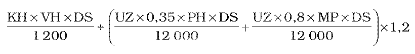
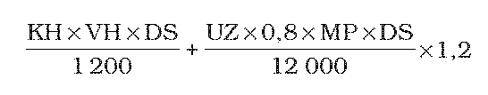

# Čl. I

Vyhláška Ministerstva pôdohospodárstva Slovenskej republiky č. 199/2008 Z. z., ktorou sa ustanovuje Program poľnohospodárskych činností vo vyhlásených zraniteľných oblastiach sa mení a dopĺňa takto:

- 1. V § 3 odsek 2 znie:

- „(2)

- V zraniteľných oblastiach je zakázané aplikovať hnojivá s obsahom dusíka podľa odseku 1 od 15. novembra do 15. februára, pričom skoré jarné prihnojenie ozimných plodín dusíkom v dávke do 60 kg.ha-1 je povolené od 1. februára, ak nie sú obmedzujúce pôdne a klimatické podmienky, a to zamokrené alebo dočasne zamokrené pôdy súvislou vrstvou vody, poľnohospodárske pôdy zamrznuté do hĺbky 8 cm a viac alebo pôdy pokryté vrstvou snehu nad 5 cm bez ohľadu na kalendárne obmedzenia.“.

- 2. V § 4 ods. 2 v prvej vete sa slová „č. 2“ nahrádzajú slovami „č. 9“ a na konci sa pripája táto veta: „Potreba skladovacích nádrží na maštaľný hnoj, močovku a hnojovicu na jeden mesiac pre jedno zviera je uvedená v prílohe č. 2.“.

- 3. V § 5 ods. 2 v druhej vete sa slová „je vhodné“ nahrádzajú slovami „sa musia“.

- 4. V § 6 ods. 1 sa na konci pripája táto veta: „Pri výbere zariadenia použitého na aplikáciu hnojív sa zohľadňuje najmä tlak stroja na pôdu, terén, zrnitostné zloženie pôdy a vlhkostný stav pôdy; použité zariadenie musí zabezpečiť rovnomernosť aplikácie zvolenej dávky hnojiva.“.

- 5. V § 6 ods. 2 sa na konci pripája táto veta: „Produkcia dusíka jedným zvieraťom za rok je uvedená v prílohe č. 7.“.

- 6. V § 6 sa vypúšťa odsek 3.

- Doterajšie odseky 4 až 9 sa označujú ako odseky 3 až 8.

- 7. V § 6 ods. 6 sa slová „podľa odseku 6“ nahrádzajú slovami „podľa odseku 5“.

- 8. V § 6 odsek 7 znie:

- „(7)

- Hnojivá s obsahom dusíka je zakázané aplikovať

- a)

- v zónach 10 m od

- 1.

- brehovej čiary vodného toku,

- 2.

- zátopovej čiary vodnej nádrže,

- 3.

- hranice ochranného pásma I. stupňa vodného zdroja,

- b)

- na pôdy, ak sú zamokrené, zamrznuté do hĺbky 8 cm a viac alebo pokryté vrstvou snehu nad 5 cm.“.

- 9. § 6 sa dopĺňa odsekom 9, ktorý znie:

- „(9)

- Používať závlahovú vodu5) možno len v takom rozsahu a množstve, aby nedošlo k znečisteniu povrchových a podzemných vôd. Spôsob určenia závlahovej dávky je uvedený v prílohe č. 8.“.

- Poznámka pod čiarou k odkazu 5 znie:

- „5)

- § 9 ods. 1 zákona č. 364/2004 Z. z. o vodách a o zmene a doplnení zákona Slovenskej národnej rady č. 372/1990 Zb. o priestupkoch v znení neskorších predpisov (vodný zákon).“.

- 10. Príloha č. 2 vrátane nadpisu znie:

- „Príloha č. 2 k vyhláške č. 199/2008 Z. z.

- POTREBA SKLADOVACÍCH NÁDRŽÍ NA MAŠTAĽNÝ HNOJ, MOČOVKU A HNOJOVICU NA JEDEN MESIAC PRE JEDNO ZVIERA

- Kategória | Priemerná živá hmotnosť | Produkcia/deň | | Potreba skladovacích nádrží na 1 mesiac pre jedno zviera v m3 | | | | |

- | | výkaly | moč | odkanalizovaná maštaľ | | boxové ustajnenie | kotercové ustajnenie | nepodstielané ustajnenie | splaškové vody z dojárne

- | kg | kg | kg | maštaľný hnoj | močovka | maštaľný hnoj | maštaľný hnoj | hnojovica |

- Hovädzí dobytok | | | | | | | | |

- Krava mliekového typu | 650 | 34 | 21 | 1,24 | 0,48 | 1,45 | 1,75 | 1,51 | 0,15

- Teľa do 6 mesiacov | 105 | 5 | 3 | 0,21 | 0,06 | 0,24 | 0,27 | 0,22 |

- Jalovica do 1 roka | 250 | 13 | 8 | 0,5 | 0,15 | 0,57 | 0,68 | 0,57 |

- Jalovica od 1 roka do 2 rokov | 440 | 22 | 14 | 0,83 | 0,26 | 0,98 | 1,15 | 0,98 |

- Jalovica nad 2 roky | 550 | 28 | 17 | 1,03 | 0,32 | 1,20 | 1,43 | 1,23 |

- Býk vo výkrme | 360 | 19 | 11 | 0,72 | 0,21 | 0,85 | 1,00 | 0,82 |

- Ošípané | | | | | | | | |

- Prasnica pripúšťaná a prasná | 180 | 2,4 | 6,4 | 0,18 | 0,16 | | 0,31 | 0,46 |

- Prasnica vysokoprasná a dojčiaca | 180 | 4,5 | 9,9 | 0,34 | 0,22 | | | 0,53 |

- Odstavča | 14 | 0,4 | 0,9 | 0,03 | 0,03 | | 0,05 | 0,09 |

- Ošípaná v predvýkrme | 30 | 0,7 | 1,8 | 0,06 | 0,03 | | 0,09 | 0,12 |

- Ošípaná vo výkrme | 75 | 1,6 | 2,1 | 0,09 | 0,05 | | 0,13 | 0,15 |

- Ošípaná vo výkrme | 120 | 2 | 2,5 | 0,11 | 0,07 | | 0,16 | 0,18 |

- Prasnička a kanec v odchove | 100 | 1,9 | 2,4 | 0,11 | 0,06 | | 0,16 | 0,17 |

- Kanec | 200 | 3 | 6,5 | 0,22 | 0,16 | | 0,31 | 0,39 |

- Ovce | | | | | | | | |

- Bahnica s jahňaťom 60 dní | 55 | 4,30 | | | | | 0,127 | |

- Jahnička a baran do 1 roka | 22 | 1,21 | | | | | 0,036 | 0,031 |

- Jahnička a baran nad 1 rok | 40 | 2,20 | | | | | 0,065 | 0,057 |

- Baran | 70 | 4,00 | | | | | 0,119 | |

- Kozy | | | | | | | | |

- Koza s kozičkou 40 dní | 50 | 4,30 | | | | | 0,140 | |

- Kozička a cap do 1 roka | 26 | 1,43 | | | | | 0,047 | |

- Cap | 65 | 4,00 | | | | | 0,123 | |

- Kone | | 24,0 | 16,0 | 0,90 | 0,36 | | | |

- Hydina | | | | | | | Podstielané maštaľný hnoj | Klietky hnojovica | Klietky sušený trus

- Sliepka – nosnica | | 0,180 | | | | | 0,004 | 0,005 | 0,0025

- brojler | | 0,054 | | | | | 0,0015 | |

- Morka – plemenná | | 0,301 | | | | | 0,0078 | 0,008 | 0,0041

- brojler | | 0,09 | | | | | 0,0025 | |

- Kačica – plemenná | | 0,247 | | | | | 0,0031 | |

- brojler | | 0,074 | | | | | 0,001 | |

- Hus – plemenná | | 0,329 | | | | | 0,0045 | |

- brojler | | 0,099 | | | | | 0,0015 | |

- Králiky | | | | | | | Klietky maštaľný hnoj | |

- Králik chovný | | 0,25 | | | | | 0,0075 | |

- brojler | | 0,16 | | | | | 0,0046 | |

- “.

- 11. Za prílohu č. 6 sa pripájajú prílohy č. 7 až 9, ktoré vrátane nadpisov znejú:

- „Príloha č. 7 k vyhláške č. 199/2008 Z. z.

- PRODUKCIA DUSÍKA JEDNÝM ZVIERAŤOM ZA ROK

- Kategória | Priemerná živá hmotnosť kg | Produkcia dusíka | | | Produkcia disponibilného dusíka za rok (kg) | | | |

- | | výkaly kg | moč kg | spolu kg | odkanalizovaná maštaľ | | boxové maštaľný hnoj | kotercové maštaľný hnoj | nepodstielané hnojovica

- | | | | | maštaľný hnoj | močovka | | |

- Hovädzí dobytok | | | | | | | | |

- Krava mliekového typu | 650 | 56,00 | 42,27 | 98,27 | 55,63 | 26,63 | 76,45 | 81,94 | 88,44

- Teľa do 6 mesiacov | 105 | 8,24 | 6,04 | 14,27 | 9,59 | 3,80 | 10,71 | 12,76 | 12,85

- Jalovica do 1 roka | 250 | 21,41 | 16,10 | 37,52 | 22,43 | 10,15 | 29,51 | 32,25 | 33,76

- Jalovica od 1 roka do 2 rokov | 440 | 36,23 | 28,18 | 64,42 | 37,63 | 17,75 | 50,37 | 53,80 | 57,97

- Jalovica nad 2 roky | 550 | 46,12 | 34,22 | 80,34 | 46,40 | 21,56 | 63,00 | 67,12 | 72,30

- Býk vo výkrme | 360 | 31,29 | 22,14 | 53,44 | 32,57 | 13,95 | 40,08 | 46,94 | 48,09

- Ošípané | | | | | | | | |

- Prasnica pripúšťaná a prasná | 180 | 4,39 | 14,05 | 18,45 | 8,59 | 8,36 | | 15,47 | 15,68

- Prasnica vysokoprasná a dojčiaca | 180 | 5,12 | 21,74 | 26,86 | 12,64 | 15,22 | | 23,29 | 22,83

- Odstavča | 14 | 0,73 | 1,98 | 2,71 | 1,44 | 1,38 | | 2,41 | 2,30

- Ošípaná v predvýkrme | 30 | 1,28 | 3,95 | 5,23 | 2,62 | 2,77 | | 4,56 | 4,45

- Ošípaná vo výkrme | 75 | 2,93 | 4,61 | 7,54 | 4,17 | 3,23 | | 6,43 | 6,41

- Prasnička a kanec v odchove | 100 | 3,48 | 5,27 | 8,75 | 4,82 | 3,69 | | 7,40 | 7,44

- Kanec | 200 | 5,49 | 14,27 | 19,76 | 9,40 | 9,99 | | 16,40 | 16,80

- Ovce | | | | | | | | |

- Bahnica s jahňaťom 60 dní | 55 | | | 9,76 | | | | 7,73 |

- Jahnička a baran do 1 roka | 22 | | | 2,75 | | | | 2,21 | 2,47

- Jahnička a baran nad 1 rok | 40 | | | 4,99 | | | 3,95 | 4,49 |

- Baran | 70 | | | 9,08 | | | 7,22 | |

- Kozy | | | | | | | | |

- Koza s kozičkou 60 dní | 50 | | | 9,76 | | | 7,73 | |

- Kozička a cap do 1 roka | 26 | | | 2,75 | | | 2,21 | |

- Cap | 65 | | | 4,99 | | | 4,16 | |

- Kone | | 30,74 | 24,16 | 54,90 | 31,92 | 15,22 | | |

- Hydina | | | | | | | Podstielané | Klietky hnojovica | Klietky sušenie trusu

- | | | | | | | maštaľný hnoj | |

- Sliepka – nosnica | | | | 0,79 | | | 0,57 | 0,67 | 0,55

- brojler | | | | 0,24 | | | 0,17 | |

- Morka – plemenná | | | | 1,10 | | | 0,79 | 0,93 | 0,77

- brojler | | | | 0,30 | | | 0,30 | |

- Kačica – plemenná | | | | 1,10 | | | 0,79 | |

- brojler | | | | 0,33 | | | 0,24 | |

- Hus – plemenná | | | | 1,45 | | | 1,07 | |

- brojler | | | | 0,43 | | | 0,33 | |

- Králiky | | | | | | | Klietky | |

- | | | | | | | maštaľný hnoj | |

- Králik – chovný | | | | 0,55 | | | 0,40 | |

- brojler | | | | 0,35 | | | 0,25 | |

- Príloha č. 8 k vyhláške č. 199/2008 Z. z.

- SPÔSOB URČENIA ZÁVLAHOVEJ DÁVKY

- Cieľom zavlažovania je udržať vlhkosť pôdy medzi hydrolimitmi – bodom vädnutia a poľnou vodnou kapacitou. Vlhkosť vädnutia a poľná vodná kapacita závisia od druhu pôdy. Ľahké pôdy (piesočnaté) majú nízku vlhkosť vädnutia a poľnú vodnú kapacitu, stredne ťažké a ťažké pôdy (hlinité, ílovité) nadobúdajú väčšie hodnoty vlhkosti vädnutia a poľnej vodnej kapacity.

- Druh pôdy | Objemová hmotnosť [g/cm3 ] | Vlhkosť vädnutia [obj. %] | Poľná vodná kapacita [obj. %]

- Piesočnatá | 1,5 – 1,7 | 2 – 6 | 15

- Hlinitá | 1,2 – 1,4 | 6 – 18 | 30 – 40

- Ílovitá | 1,4 – 1,6 | 18 – 25 | 30 – 35

- Ak sa určí vlhkosť pôdy v koreňovej oblasti, možno pomocou uvedenej tabuľky zistiť, či je potrebné zavlažiť pôdny profil tak, aby sa dosiahla vlhkosť pôdy približne rovná poľnej vodnej kapacite. Obsah vody v pôde sa vypočíta z hodnôt vlhkosti pôdy stanovenej vo viacerých vrstvách pôdneho profilu. Hrúbka koreňovej vrstvy pôdy, ktorú je potrebné zavlažovať, sa počas rastu rastlín mení od 0,2 m do 1,5 m a závisí aj od druhu rastliny. Spravidla stačí zavlažovať vrchnú 30 cm vrstvu pôdy na začiatku vegetačného obdobia, neskôr vrstvu pôdy do hĺbky 60 cm.

- V hlinitej pôde sa stanovila vlhkosť pôdy v 10 cm vrstvách:

- Hĺbka [cm] | Vlhkosť pôdy [% hm.]

- 10 | 12,6

- 20 | 14,3

- 30 | 18,1

- 40 | 19,8

- 50 | 24,3

- Pri závlahe postrekom je potrebné prevlhčiť pôdu do hĺbky 50 cm.

- Výpočet závlahovej dávky:

- Vlhkosť pôdy v hmotnostných % treba vynásobiť objemovou hmotnosťou pre hlinitú pôdu, napr. 1,3 g/cm3.

- Hĺbka [cm] | Vlhkosť pôdy [% obj.] | Obsah vody [mm]

- 10 | 12,6 x 1,3 = 16,38 | 16,38

- 20 | 14,3 x 1,3 = 18,59 | 18,59

- 30 | 18,1 x 1,3 = 23,53 | 23,53

- 40 | 19,8 x 1,3 = 25,74 | 25,74

- 50 | 24,3 x 1,3 = 31,59 | 31,59

- Obsah vody vo vrstve pôdy 0 až 50 cm: 16,38 + 18,59 + 23,53 + 25,74 + 31,59 = 115,83 mm.

- Poľná vodná kapacita pre hlinitú pôdu: 35 obj. %, t. j. 35 mm vody v 10 cm vrstve pôdy.

- Poľná vodná kapacita pre vrstvu pôdy 0 až 50 cm: 35 x 5 = 175 mm.

- Závlahová dávka:

- 175 – 115,83 = 59,17 mm 60 mm, t. j. 600 m3/ha.

- Príloha č. 9 k vyhláške č. 199/2008 Z. z.

- VÝPOČET KAPACITY SKLADOVACEJ NÁDRŽE NA HNOJOVKU

- Vzorec pre nezastrešené hnojisko:

- 

- Vzorec pre zastrešené hnojisko s nezastrešenou manipulačnou plochou:

- 

- kde:

- KH – kapacita hnojiska v m3,

- VH – výtok hnojovky z hnoja pri výške uskladneného hnoja v m

- 2 m – 6 % pri dostatočnom podstielaní

- 9 % pri nedostatočnom podstielaní

- 3 m – 9 % pri dostatočnom podstielaní

- 12 % pri nedostatočnom podstielaní

- 4 m – 12 % pri dostatočnom podstielaní

- 15 % pri nedostatočnom podstielaní

- 5 m – 15 % pri dostatočnom podstielaní

- 18 % pri nedostatočnom podstielaní

- 6 m – 18 % pri dostatočnom podstielaní

- 21 % pri nedostatočnom podstielaní,

- DS – doba skladovania hnojovky v mesiacoch,

- UZ – ročný úhrn zrážok v mm

- PH – plocha hnojiska m2

- MP – manipulačná plocha pri hnojisku v m2

- 1,2 – 20 % rezerva na návalové vody.“.
