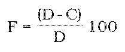
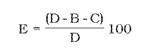
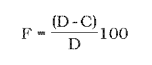
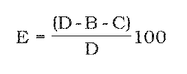

# Čl. I

Vyhláška Ministerstva životného prostredia Slovenskej republiky č. 315/2010 Z. z. o nakladaní s elektrozariadeniami a s elektroodpadom sa mení a dopĺňa takto:

- 1. V § 4 ods. 2 písmeno a) znie:

- „a)

- vhodné miesta s nepriepustnou podlahou, ktoré majú k dispozícii zariadenia na zachytávanie unikajúcich kvapalín a podľa potreby zariadenia na zachytávanie znečisťujúcich látok1) a odmasťovacie prostriedky,“.

- 2. V § 4 ods. 4 písmeno b) znie:

- „b)

- vhodné miesta s nepriepustnou podlahou, ktoré majú k dispozícii zariadenia na zachytávanie unikajúcich kvapalín a podľa potreby zariadenia na zachytávanie znečisťujúcich látok1) a odmasťovacie prostriedky,“.

- 3. V § 4 sa odsek 4 dopĺňa písmenom e), ktoré znie:

- „e)

- čistiarne odpadových vôd v súlade s osobitným predpisom,2a) ak nakladajú s odpadovými vodami.“.

- Poznámka pod čiarou k odkazu 2a) znie:

- „2a)

- § 36 a 37 zákona č. 364/2004 Z. z.“.

- 4. V § 4 ods. 5 písm. d) sa za slovo „telefónov“ vkladá slovo „všeobecne“.

- 5. V § 9 odsek 2 znie:

- „(2)

- Spracovateľ elektroodpadu a výrobca elektrozariadení uchovávajú hlásenie spracovateľa elektroodpadu v písomnej forme päť rokov.“.

- 6. V § 10 ods. 1 sa bodkočiarka za slovami „§ 11 ods. 1“ nahrádza bodkou a text za bodkočiarkou sa vypúšťa.

- 7. Za § 14 sa vkladá § 14a, ktorý vrátane nadpisu znie:

- 㤠14a

- Prechodné ustanovenie

- (1)

- Hlásenie spracovateľa elektroodpadu za rok 2010 sa podáva na tlačive podľa prílohy č. 6a.

- (2)

- Hlásenie výrobcu elektrozariadení za rok 2010 sa podáva na tlačive podľa prílohy č. 6b.“.

- 8. Za prílohu č. 6 sa vkladajú prílohy č. 6a a 6b, ktoré znejú:

- „Príloha č. 6a k vyhláške č. 315/2010 Z. z.

- VZOR

- HLÁSENIE SPRACOVATEĽA ELEKTROODPADU

- [Vzor 01](assets/e594f7055b1c7731afb31c123ecabcd901e28ec921e03c40c90a362e2100c519.pdf)

- Tlačivo HLÁSENIE SPRACOVATEĽA ELEKTROODPADU

- Spôsob vypĺňania tlačiva HLÁSENIE SPRACOVATEĽA ELEKTROODPADU

- V tomto tlačive sa uvádzajú sumárne údaje za predchádzajúci štvrťrok podľa jednotlivých kategórií elektrozariadení (plynové výbojky sa uvádzajú samostatne) a opis spôsobu spracovania elektroodpadu.

- ORGANIZÁCIA

- IČO – uvedie sa identifikačné číslo organizácie (spracovateľa elektroodpadu); ak má organizácia IČO menšie ako osemmiestne, zľava sa doplnia nuly na celkový počet 8 miest.

- Obchodné meno – uvedie sa obchodné meno organizácie (spracovateľa elektroodpadu) tak, ako je zapísané v obchodnom registri alebo v živnostenskom liste.

- Ulica, obec, PSČ – uvádza sa presná a úplna adresa organizácie, jej telefón, fax, e-mail, adresa URL.

- PREVÁDZKAREŇ/ZÁVOD

- Nasledujúca časť týkajúca sa samostatnej prevádzkarne/závodu sa vypĺňa v prípade, že nie je totožná s organizáciou.

- Názov – uvádza sa, ak je zavedený vnútri organizácie.

- Ulica, obec, PSČ – uvádza sa presná a úplná adresa samostatnej prevádzkarne, jej telefón, fax, e-mail, adresa URL.

- Elektrozariadenia

- Druh – uvedie sa číslo druhu elektrozariadenia v rámci kategórie podľa prílohy č. 1.

- Značka – uvedie sa značka jednotlivých druhov elektrozariadení samostatne.

- D (kg) – uvedie sa hmotnosť elektroodpadu prijatého do zariadenia na spracovanie elektroodpadu v kilogramoch.

- C (kg) – uvedie sa hmotnosť zneškodneného elektroodpadu v kilogramoch.

- B (kg) – uvedie sa hmotnosť energeticky zhodnoteného elektroodpadu v kilogramoch.

- F (%) – uvedie sa limit zhodnotenia elektroodpadu vypočítaného podľa nasledujúceho vzorca v percentách:

- 

- E (%) – uvedie sa limit opätovného použitia a recyklácie elektroodpadu vypočítaného podľa nasledujúceho vzorca

- v percentách:

- 

- Poznámka – uvedú sa informácie podľa potreby spracovateľa elektroodpadu.

- Opis spôsobu spracovania elektrodpadu – spracovateľ elektroodpadu uvedie bližšie informácie o spôsobe spracovania elektroodpadu podľa jednotlivých kategórií elektrozariadení pre výrobcu elektrozariadenia.

- Zodpovedná osoba – uvedie sa poverený pracovník, ktorý je v organizácii /prevádzkarni zodpovedný za vypĺňanie hlásenia spracovateľa elektroodpadu na príslušnom mieste organizácie/prevádzkarne.

- Príloha č. 6b k vyhláške č. 315/2010 Z. z.

- HLÁSENIE VÝROBCU ELEKTROZARIADENÍ ZA ROK 2010

- [Vzor 02](assets/e8fb01adf8892b91dfdb4a1dc1fd90911e9d6357c96289e2ab8180e30ce76b08.pdf)

- Tlačivo HLÁSENIE VÝROBCU ELEKTROZARIADENÍ

- Spôsob vypĺňania tlačiva HLÁSENIE VÝROBCU ELEKTROZARIADENÍ

- V tomto tlačive výrobcovia elektrozariadení uvádzajú sumárne údaje za predchádzajúci kalendárny rok podľa jednotlivých kategórií elektrozariadení (plynové výbojky sa uvádzajú samostatne).

- Číslo registrácie – uvedie sa číslo registrácie, pod akým Ministerstvo životného prostredia Slovenskej republiky zapíše výrobcu elektrozariadení do Registra výrobcov elektrozariadení a vydá mu potvrdenie o zápise do Registra výrobcov elektrozariadení.

- Obchodné meno – uvedie sa obchodné meno organizácie (výrobcu elektrozariadení) tak, ako je zapísané v obchodnom registri alebo v živnostenskom liste.

- Sídlo – uvedie sa presná a úplna adresa organizácie (výrobcu elektrozariadení), jej telefón, fax, e-mail, adresa URL.

- IČO – uvedie sa identifikačné číslo organizácie (výrobcu elektrozariadení); ak má organizácia IČO menšie ako osemmiestne, zľava sa doplnia nuly na celkový počet 8 miest.

- Kolektívna organizácia – uvedie sa údaj o zapojení sa do kolektívnej organizácie spätného odberu elektrozariadení, oddeleného zberu alebo nakladania s elektroodpadom s identifikáciou kolektívneho systému, ak neplní ustanovené povinnosti individuálne.

- Tabuľka A

- Elektrozariadenia

- Druh – uvedie sa číslo druhu elektrozariadenia v rámci kategórie podľa prílohy č. 1.

- Značka – uvedie sa značka jednotlivých druhov elektrozariadení samostatne.

- Uvedené na trh (kg) – uvedie sa hmotnosť elektrozariadení, ktoré výrobca uviedol na trh podľa § 54a ods. 18 zákona za predchádzajúci kalendárny rok v kilogramoch.

- Elektroodpad zozbieraný z domácností (kg) – uvedie sa hmotnosť zozbieraného elektroodpadu z domácností podľa § 54a ods. 4 zákona za predchádzajúci kalendárny rok v kilogramoch.

- Elektroodpad zozbieraný nie z domácností (kg) – uvedie sa hmotnosť zozbieraného elektroodpadu nie z domácností podľa § 54a ods. 5 zákona za predchádzajúci kalendárny rok v kilogramoch.

- Elektroodpad zozbieraný spolu (kg) – táto kolónka tlačiva sa vytvorí sčítaním údajov o množstvách zozbieraného elektroodpadu z domácností a o množstvách zozbieraného elektroodpadu nie z domácností za predchádzajúci kalendárny rok v kilogramoch. Množstvo elektroodpadu zozbieraného spolu sa rovná súčtu množstiev elektroodpadu spracovaného spolu a skladovaného elektroodpadu pred samotným spracovaním.

- Elektroodpad spracovaný na území SR (kg) – uvedie sa hmotnosť spracovaného elektroodpadu na území Slovenskej republiky za predchádzajúci kalendárny rok v kilogramoch.

- Elektroodpad vyvezený a spracovaný v EÚ (kg) – uvedie sa hmotnosť vyvezeného a spracovaného elektroodpadu na území iného členského štátu Európskej únie ako Slovenskej republiky podľa štvrtej časti zákona za predchádzajúci kalendárny rok v kilogramoch.

- Elektroodpad vyvezený a spracovaný mimo EÚ (kg) – uvedie sa hmotnosť vyvezeného a spracovaného elektroodpadu na územie nečlenského štátu Európskej únie podľa štvrtej časti zákona za predchádzajúci kalendárny rok v kilogramoch.

- Elektroodpad spracovaný spolu (kg) – táto kolónka tlačiva sa vytvorí sčítaním údajov o množstvách spracovaného elektroodpadu na území Slovenskej republiky, vyvezeného a spracovaného v Európskej únii a vyvezeného a spracovaného mimo Európskej únie v kilogramoch v kalendárnom roku, za ktorý sa podáva hlásenie.

- Tabuľka B

- Elektrozariadenia

- Druh – uvedie sa číslo druhu elektrozariadenia v rámci kategórie podľa prílohy č. 1.

- Značka – uvedie sa značka jednotlivých druhov elektrozariadení samostatne.

- Zhodnotenie (kg) – uvedie sa celkové množstvo zhodnoteného elektroodpadu za predchádzajúci kalendárny rok v kilogramoch.

- Zhodnotenie F (%) – uvedie sa limit zhodnotenia elektroodpadu za predchádzajúci kalendárny rok podľa nasledujúceho vzorca:

- 

- D – hmotnosť elektroodpadu prijatého do spracovateľského zariadenia v kilogramoch,

- C – hmotnosť zneškodneného elektroodpadu v kilogramoch.

- Opätovné použitie a recyklácia (kg) – uvedie sa celkové množstvo opätovne použitého a recyklovaného elektroodpadu za predchádzajúci kalendárny rok v kilogramoch.

- Opätovné použitie a recyklácia E (%) – uvedie sa limit opätovného použitia a recyklácie elektroodpadu za predchádzajúci kalendárny rok podľa nasledujúceho vzorca v percentách:

- 

- D – hmotnosť elektroodpadu prijatého do spracovateľského zariadenia v kilogramoch,

- B – hmotnosť energeticky zhodnoteného elektroodpadu v kilogramoch,

- C – hmotnosť zneškodneného elektroodpadu v kilogramoch.

- Opätovné použitie ako celok (kg) – uvedie sa celkové množstvo elektrozariadení, ktoré boli opätovne použité ako celok v kilogramoch v kalendárnom roku, za ktorý sa podáva hlásenie.

- Zodpovedná osoba – uvedie sa poverený pracovník, ktorý je zodpovedný za vypĺňanie tlačiva Hlásenie výrobcu elektrozariadení na príslušnom mieste.“.
